# Lab 05 — Putting the ECS Service Behind an Application Load Balancer

> **Course:** DSO303 · **Environment:** Floci (local AWS emulator) · **Guide:** [Lab 05 – ALB](https://norbutlepcha25.github.io/dso303/Lab/Lab-05-ALB.html)

This lab gives Lab 04's enrolment service (`usms-enrolment-svc`) a stable entry point: an internet-facing **Application Load Balancer (ALB)** in the two public subnets, forwarding to a target group that the ECS service keeps populated by itself. Once the new path is proven, the old direct path from the web tier to the tasks is removed, so the load balancer becomes the **only** way to reach an enrolment task.

---

## Table of Contents

1. [Objectives](#1-objectives)
2. [Prerequisites](#2-prerequisites)
3. [What This Lab Creates](#3-what-this-lab-creates)
4. [Architecture](#4-architecture)
5. [Directory Structure](#5-directory-structure)
6. [Step-by-Step Implementation](#6-step-by-step-implementation)
   - [Phase A — Prepare](#phase-a--prepare) (Steps 1–3)
   - [Phase B — Build the load balancer](#phase-b--build-the-load-balancer) (Steps 4–8)
   - [Phase C — Connect the service](#phase-c--connect-the-service) (Steps 9–12)
   - [Phase D — Cut over and operate](#phase-d--cut-over-and-operate) (Steps 13–15)
   - [Phase E — Persist, audit and commit](#phase-e--persist-audit-and-commit) (Steps 16–19)
7. [Verification Script](#7-verification-script)
8. [Cleanup Script (End of Course Only)](#8-cleanup-script-end-of-course-only)
9. [Key Takeaways](#9-key-takeaways)

---

## 1. Objectives

- Create an internet-facing ALB across **two Availability Zones**, with its own security group.
- Create an `ip`-type target group with a deliberate health check and deregistration delay.
- Add an HTTP:80 listener with a default `forward` action, plus one path-based listener rule.
- Attach the existing ECS service so that **ECS registers and deregisters its own targets**.
- Perform a safe cutover: build the new path, prove it, then remove the old one.
- Observe a rolling deployment drain targets, prove the stack survives a restart, and save all identifiers to `configs/lab-05.env` for Lab 06.

---

## 2. Prerequisites

| Requirement | How to confirm |
|---|---|
| Lab 04 complete | `./scripts/utilities/verify-lab-04.sh` → `FAIL=0` (before starting) |
| Two public subnets in **different** AZs | `USMS_PUBLIC_SUBNET_B` is set (Lab 02 Step 11) |
| `usms-web-01` running with `usms-app-sg` | Lab 03 complete |
| Floci running with persistent storage | `./scripts/utilities/floci-storage-check.sh` |
| Tools: `jq`, `python3`, `docker`, `curl`, AWS CLI v2 | See command below |

```bash
cd ~/aws-floci-course
for t in jq python3 docker curl; do printf '%-10s ' "$t"; command -v "$t" || echo MISSING; done
aws --version
./scripts/utilities/floci-storage-check.sh
```

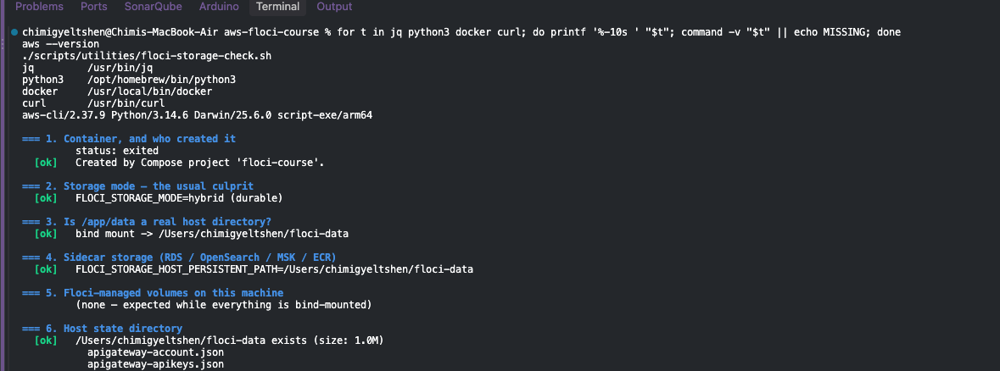

---

## 3. What This Lab Creates

| Resource | Purpose |
|---|---|
| `usms-alb-sg` | Security group for the ALB — tcp/80 from `0.0.0.0/0` |
| `usms-enrolment-alb` | Internet-facing Application Load Balancer in public subnets a and b |
| `usms-enrolment-tg` | Target group — `ip` type, HTTP:80, health check `GET /` |
| Listener (HTTP:80) | Default action forwards to `usms-enrolment-tg` |
| `usms-enrolment-health-rule` | Priority 10 rule — `/alb-health` returns a fixed `200` |
| Ingress rule on `usms-enrolment-sg` | tcp/80 from `usms-alb-sg` |
| *Removed:* direct rule from `usms-app-sg` | The cutover (Step 13) |
| Service settings | `loadBalancers` entry and a 60 s health-check grace period |

**Design values at a glance**

| Setting | Value | Why |
|---|---|---|
| Scheme / type | `internet-facing` / `application` | Public entry point; layer-7 routing |
| Target type | `ip` | Required for `awsvpc` (Fargate) tasks |
| Health check | `GET /` every 30 s, timeout 5 s, 2 healthy / 2 unhealthy, matcher `200` | A failed task is removed within ~60 s |
| Deregistration delay | 30 s | In-flight requests finish before a task stops |
| Grace period | 60 s | Slow-starting tasks aren't killed as "unhealthy" |
| Task inbound | tcp/80 **from `usms-alb-sg` only** | The ALB is the sole client of the tasks |

---

## 4. Architecture

```
                         Internet
                            │  http://<ALB DNS name>/
                            ▼
                        usms-igw
                            │
┌──────────────────────────────── usms-vpc 10.0.0.0/16 ───────────────────────────────┐
│                                                                                     │
│  usms-public-subnet-a (us-east-1a)        usms-public-subnet-b (us-east-1b)         │
│   [ALB node]  usms-alb-sg                  [ALB node]  usms-alb-sg                  │
│                                                                                     │
│   usms-enrolment-alb ── listener HTTP:80                                            │
│                          ├─ rule p10: /alb-health  → fixed-response 200             │
│                          └─ default:               → forward → usms-enrolment-tg    │
│                                                                                     │
│            tcp/80, source = usms-alb-sg ONLY                                        │
│                            ▼                                                        │
│  usms-private-subnet-a (us-east-1a)       usms-private-subnet-b (us-east-1b)        │
│   [task 1] 10.0.3.x  usms-enrolment-sg     [task 2] 10.0.4.x  usms-enrolment-sg     │
│                                                                                     │
│  ECS: usms-ecs-cluster / usms-enrolment-svc (desired 2)                             │
│       loadBalancers[0] → usms-enrolment-tg, enrolment-api:80, grace 60 s            │
│       ► the SERVICE registers and deregisters the targets ◄                         │
└─────────────────────────────────────────────────────────────────────────────────────┘
```

> **Important:** never populate the target group by hand with `register-targets`. The service owns its contents and will undo manual changes.

---

## 5. Directory Structure

```
aws-floci-course/
├── labs/lab-05-ecs-alb/README.md
├── policies/                                   # documents that GRANT access
│   ├── usms-alb-sg-ingress.json
│   └── usms-enrolment-sg-ingress-alb.json
├── templates/                                  # API request bodies
│   ├── lab-05-listener-default-actions.json
│   ├── lab-05-rule-conditions.json
│   ├── lab-05-rule-actions.json
│   └── lab-05-service-load-balancers.json
├── configs/lab-05.env
├── scripts/
│   ├── utilities/verify-lab-05.sh
│   └── cleanup/lab-05-cleanup.sh
└── outputs/lab-05-*.txt                        # git-ignored command output
```

---

## 6. Step-by-Step Implementation

> Run every command from the repository root (`~/aws-floci-course`). Shell variables are lost when the terminal closes — Step 18 saves them permanently.

### Phase A — Prepare

#### Step 1 — Resume the environment and load the env files

```bash
cd ~/aws-floci-course
./scripts/setup/floci-up.sh

source configs/course.env
source configs/lab-01.env
source configs/lab-02.env
source configs/lab-03.env
source configs/lab-04.env

./scripts/utilities/whoami.sh

printf '%-26s %s\n' \
  "vpc"                 "$USMS_VPC_ID" \
  "public subnet a"     "$USMS_PUBLIC_SUBNET_A" \
  "public subnet b"     "$USMS_PUBLIC_SUBNET_B" \
  "private subnet a"    "$USMS_PRIVATE_SUBNET_A" \
  "private subnet b"    "$USMS_PRIVATE_SUBNET_B" \
  "app security group"  "$USMS_APP_SG" \
  "enrolment sg"        "$USMS_ENROLMENT_SG" \
  "web instance"        "$USMS_WEB_INSTANCE" \
  "cluster"             "$USMS_ECS_CLUSTER" \
  "service"             "$USMS_ENROLMENT_SERVICE" \
  "container"           "$USMS_ENROLMENT_CONTAINER" \
  "region"              "$AWS_REGION_COURSE"
```

**Expected:** twelve non-empty values.

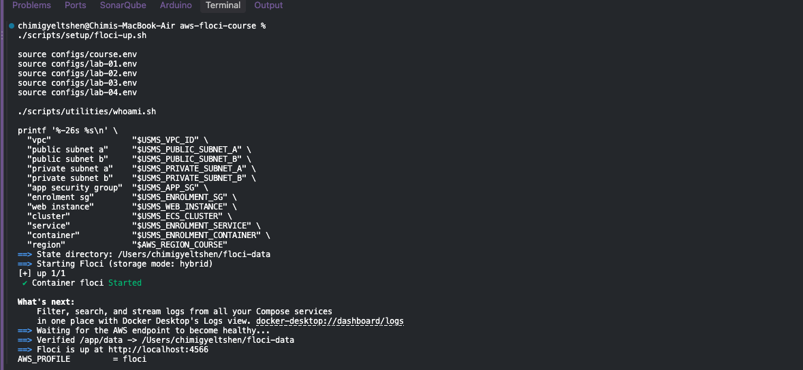

#### Step 2 — Confirm Labs 02, 03 and 04 are intact

The Lab 04 result is saved as a "before" snapshot for comparison after the cutover in Step 13.

```bash
./scripts/utilities/verify-lab-02.sh | tail -3
./scripts/utilities/verify-lab-03.sh | tail -3
./scripts/utilities/verify-lab-04.sh | tee outputs/lab-05-pre-verify-04.txt | tail -3
```

**Expected:** `FAIL=0` three times.

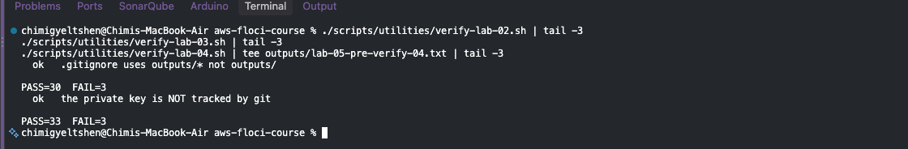

#### Step 3 — Probe Floci's Elastic Load Balancing support

ELBv2 is the least reliably emulated service in the course, so check what this build supports before building anything.

```bash
probe() {
  printf '%-48s ' "$1"
  if eval "$2" >/dev/null 2>&1; then echo "SUPPORTED"; else echo "not available"; fi
}

echo "== Elastic Load Balancing v2 =="
probe "elbv2 describe-load-balancers"        "aws elbv2 describe-load-balancers"
probe "elbv2 create-load-balancer (skeleton)" "aws elbv2 create-load-balancer --generate-cli-skeleton"
probe "elbv2 describe-target-groups"          "aws elbv2 describe-target-groups"
probe "elbv2 create-target-group (skeleton)"  "aws elbv2 create-target-group --generate-cli-skeleton"
probe "elbv2 describe-listeners (bad arn)"    "aws elbv2 describe-listeners --load-balancer-arn probe"
probe "elbv2 describe-account-limits"         "aws elbv2 describe-account-limits"

echo "== ECS integration =="
probe "ecs update-service (skeleton)"         "aws ecs update-service --generate-cli-skeleton"
probe "ecs describe-services"                 "aws ecs describe-services --cluster $USMS_ECS_CLUSTER --services $USMS_ENROLMENT_SERVICE"

echo "== Already used in Labs 1 to 4 =="
probe "ec2 describe-security-groups"          "aws ec2 describe-security-groups --max-items 1"
probe "ec2 describe-subnets"                  "aws ec2 describe-subnets --subnet-ids $USMS_PUBLIC_SUBNET_A"
```

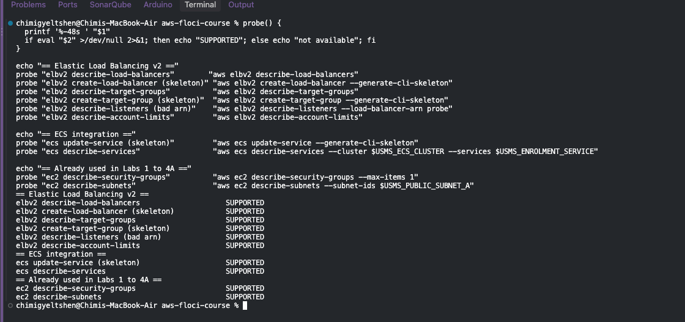

| Path | Condition | What it means |
|---|---|---|
| **A — Full** | Everything answers and Step 5 returns an ARN | Every step works as written |
| **B — Control plane only** | Objects are created, but targets never turn `healthy` / `curl` fails | All steps still work; proofs rely on control-plane data |
| **C — No ELBv2** | `describe-load-balancers` fails | Stop and consult the instructor |

---

### Phase B — Build the load balancer

#### Step 4 — Create the load balancer's security group

**Part 1 — Create the group**

```bash
ALB_SG=$(aws ec2 create-security-group \
  --group-name usms-alb-sg \
  --description "USMS enrolment load balancer: HTTP from the internet; forwards to usms-enrolment-sg" \
  --vpc-id "$USMS_VPC_ID" \
  --tag-specifications 'ResourceType=security-group,Tags=[{Key=Name,Value=usms-alb-sg},{Key=Project,Value=USMS},{Key=Tier,Value=edge},{Key=Lab,Value=05}]' \
  --query 'GroupId' \
  --output text)

echo "ALB_SG = $ALB_SG"
```

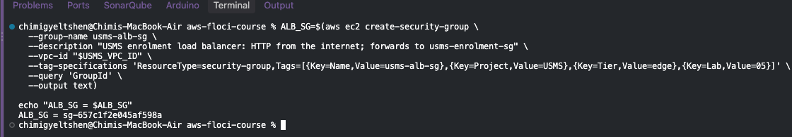

**Part 2 — Allow HTTP from the internet**

The heredoc is quoted (`<< 'EOF'`) because this document contains no variables.

```bash
cat > policies/usms-alb-sg-ingress.json << 'EOF'
[
  {
    "IpProtocol": "tcp",
    "FromPort": 80,
    "ToPort": 80,
    "IpRanges": [
      {
        "CidrIp": "0.0.0.0/0",
        "Description": "HTTP from the internet - this is an internet-facing load balancer and this rule is the reason it works"
      }
    ]
  }
]
EOF

python3 -m json.tool policies/usms-alb-sg-ingress.json > /dev/null && echo "valid JSON"

aws ec2 authorize-security-group-ingress \
  --group-id "$ALB_SG" \
  --ip-permissions file://policies/usms-alb-sg-ingress.json \
  --query 'SecurityGroupRules[].SecurityGroupRuleId' \
  --output text
```

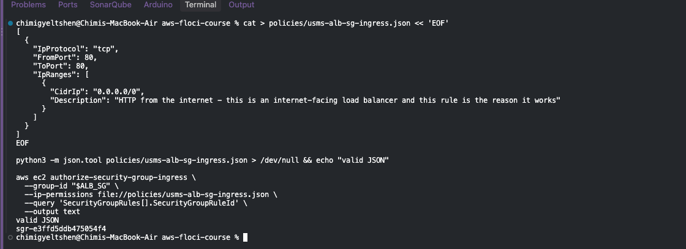

> This is the only `0.0.0.0/0` ingress rule in the course, and it is deliberate: the ALB only forwards to the target group, and the tasks only admit the ALB.

**Verify**

```bash
aws ec2 describe-security-groups --group-ids "$ALB_SG" \
  --query 'SecurityGroups[0].{Name:GroupName,VPC:VpcId,Inbound:IpPermissions[].{Port:FromPort,CIDR:IpRanges[0].CidrIp,FromGroup:UserIdGroupPairs[0].GroupId},OutboundRules:length(IpPermissionsEgress)}' \
  --output json
```

**Expected:** one inbound rule on port 80 from `0.0.0.0/0`; one outbound rule (default allow-all).

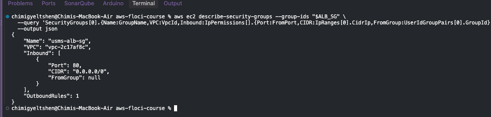

#### Step 5 — Create the Application Load Balancer

**Part 1 — Create it**

```bash
ALB_ARN=$(aws elbv2 create-load-balancer \
  --name usms-enrolment-alb \
  --type application \
  --scheme internet-facing \
  --ip-address-type ipv4 \
  --subnets "$USMS_PUBLIC_SUBNET_A" "$USMS_PUBLIC_SUBNET_B" \
  --security-groups "$ALB_SG" \
  --tags Key=Name,Value=usms-enrolment-alb Key=Project,Value=USMS Key=Tier,Value=edge Key=Lab,Value=05 \
  --query 'LoadBalancers[0].LoadBalancerArn' \
  --output text)

echo "ALB_ARN = $ALB_ARN"

ALB_DNS=$(aws elbv2 describe-load-balancers --load-balancer-arns "$ALB_ARN" \
  --query 'LoadBalancers[0].DNSName' --output text)

echo "ALB_DNS = $ALB_DNS"
```

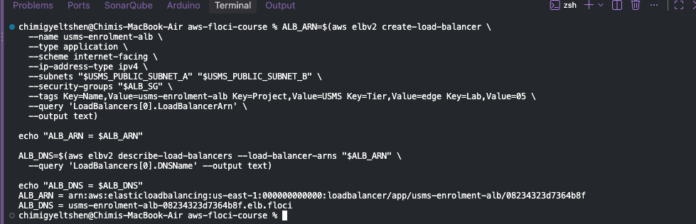

> Note: ELBv2 tags use capitalised `Key=`/`Value=`, and `--subnets` is space-separated.

**Part 2 — Wait until it is active**

```bash
aws elbv2 wait load-balancer-available --load-balancer-arns "$ALB_ARN" \
  && echo "load balancer available" \
  || echo "waiter did not complete - poll manually below (expected on some builds)"

for i in $(seq 1 10); do
  STATE=$(aws elbv2 describe-load-balancers --load-balancer-arns "$ALB_ARN" \
    --query 'LoadBalancers[0].State.Code' --output text)
  printf 'poll %2d  state=%s\n' "$i" "$STATE"
  [ "$STATE" = "active" ] && break
  sleep 10
done
```

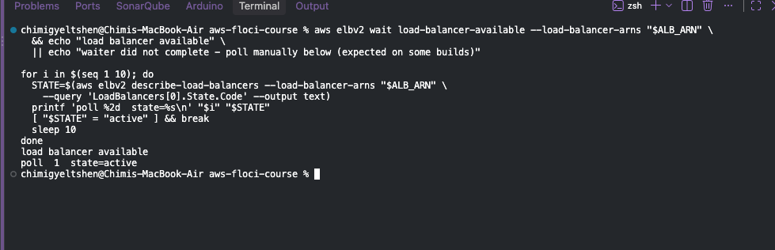

**Verify**

```bash
aws elbv2 describe-load-balancers --load-balancer-arns "$ALB_ARN" \
  --query 'LoadBalancers[0].{Name:LoadBalancerName,State:State.Code,Type:Type,Scheme:Scheme,VPC:VpcId,DNS:DNSName,IPType:IpAddressType,AZs:AvailabilityZones[].{Zone:ZoneName,Subnet:SubnetId},SGs:SecurityGroups}' \
  --output json
```

**Check:** two AZ entries in two **different** zones · `internet-facing` · `application` · `SGs` contains `$ALB_SG` · state `active`.

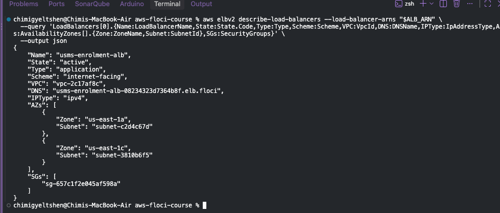

**Part 3 — Set load balancer attributes**

```bash
aws elbv2 modify-load-balancer-attributes \
  --load-balancer-arn "$ALB_ARN" \
  --attributes \
      Key=idle_timeout.timeout_seconds,Value=60 \
      Key=routing.http.drop_invalid_header_fields.enabled,Value=true \
  --query 'Attributes[?Key==`idle_timeout.timeout_seconds` || Key==`routing.http.drop_invalid_header_fields.enabled`]' \
  --output table \
  || echo "attribute modification not supported on this build - record it and continue"
```

| Attribute | Value | Effect |
|---|---|---|
| `idle_timeout.timeout_seconds` | 60 | Idle connections close after 60 s |
| `routing.http.drop_invalid_header_fields.enabled` | true | Headers with invalid names are dropped |

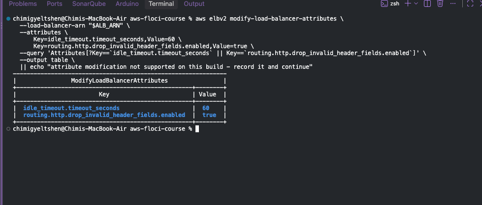

#### Step 6 — Create the target group

```bash
TG_ARN=$(aws elbv2 create-target-group \
  --name usms-enrolment-tg \
  --protocol HTTP \
  --port 80 \
  --vpc-id "$USMS_VPC_ID" \
  --target-type ip \
  --health-check-protocol HTTP \
  --health-check-path / \
  --health-check-port traffic-port \
  --health-check-interval-seconds 30 \
  --health-check-timeout-seconds 5 \
  --healthy-threshold-count 2 \
  --unhealthy-threshold-count 2 \
  --matcher HttpCode=200 \
  --tags Key=Name,Value=usms-enrolment-tg Key=Project,Value=USMS Key=Tier,Value=app Key=Lab,Value=05 \
  --query 'TargetGroups[0].TargetGroupArn' \
  --output text)

echo "TG_ARN = $TG_ARN"
```

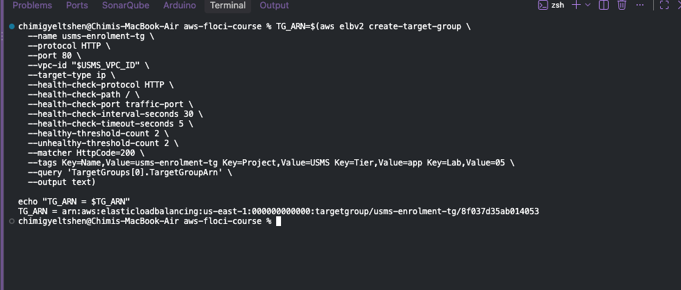

> `--target-type ip` is mandatory for Fargate tasks and **cannot be changed later**.

**Verify**

```bash
aws elbv2 describe-target-groups --target-group-arns "$TG_ARN" \
  --query 'TargetGroups[0].{Name:TargetGroupName,Type:TargetType,Proto:Protocol,Port:Port,VPC:VpcId,HCProto:HealthCheckProtocol,HCPath:HealthCheckPath,HCPort:HealthCheckPort,Interval:HealthCheckIntervalSeconds,Timeout:HealthCheckTimeoutSeconds,Healthy:HealthyThresholdCount,Unhealthy:UnhealthyThresholdCount,Matcher:Matcher.HttpCode,LBs:length(LoadBalancerArns)}' \
  --output json
```

**Expected:** `Type` is `ip`; `LBs` is `0` until the listener is created in Step 8.

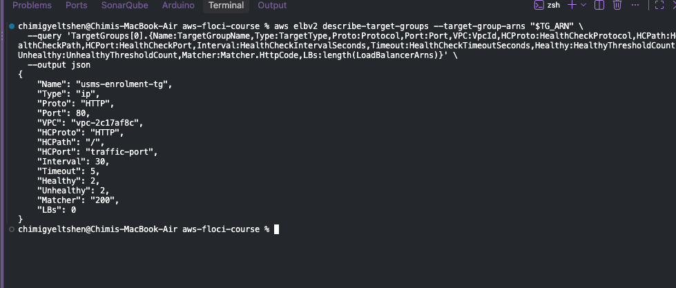

#### Step 7 — Set the target group attributes

The deregistration delay controls how long a stopping task keeps serving in-flight requests. The default (300 s) is far too long for a fast API.

```bash
aws elbv2 modify-target-group-attributes \
  --target-group-arn "$TG_ARN" \
  --attributes \
      Key=deregistration_delay.timeout_seconds,Value=30 \
      Key=load_balancing.algorithm.type,Value=least_outstanding_requests \
  --query 'Attributes[?Key==`deregistration_delay.timeout_seconds` || Key==`load_balancing.algorithm.type`].[Key,Value]' \
  --output text

aws elbv2 describe-target-group-attributes --target-group-arn "$TG_ARN" \
  --query 'Attributes[].[Key,Value]' --output table
```

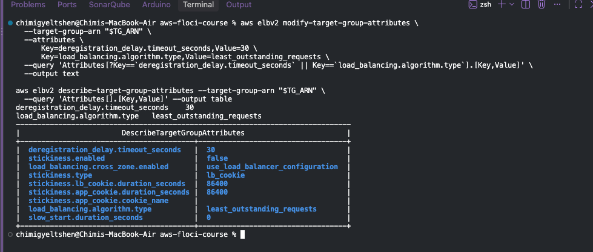

#### Step 8 — Create the listener

**Part 1 — Write the default action document**

The heredoc is **unquoted** (`<< EOF`) so `$TG_ARN` expands when the file is written. `grep -c '\$'` must print `0`.

```bash
cat > templates/lab-05-listener-default-actions.json << EOF
[
  {
    "Type": "forward",
    "TargetGroupArn": "$TG_ARN"
  }
]
EOF

python3 -m json.tool templates/lab-05-listener-default-actions.json > /dev/null && echo "valid JSON"
grep -c '\$' templates/lab-05-listener-default-actions.json
```

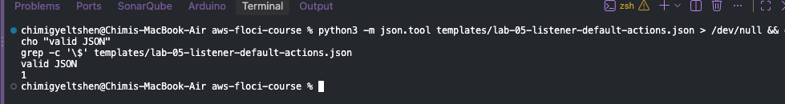

**Part 2 — Create the listener**

```bash
LISTENER_ARN=$(aws elbv2 create-listener \
  --load-balancer-arn "$ALB_ARN" \
  --protocol HTTP \
  --port 80 \
  --default-actions file://templates/lab-05-listener-default-actions.json \
  --tags Key=Name,Value=usms-enrolment-listener Key=Project,Value=USMS Key=Lab,Value=05 \
  --query 'Listeners[0].ListenerArn' \
  --output text)

echo "LISTENER_ARN = $LISTENER_ARN"
```

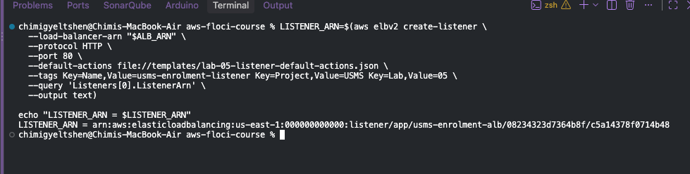

**Verify**

```bash
aws elbv2 describe-listeners --load-balancer-arn "$ALB_ARN" \
  --query 'Listeners[].{Port:Port,Proto:Protocol,DefaultActionType:DefaultActions[0].Type,Forwards:DefaultActions[0].TargetGroupArn,SSL:SslPolicy}' \
  --output json

aws elbv2 describe-target-groups --target-group-arns "$TG_ARN" \
  --query 'TargetGroups[0].{Name:TargetGroupName,AttachedToLoadBalancers:length(LoadBalancerArns)}' \
  --output json
```

**Expected:** HTTP:80 forwarding to `$TG_ARN`; `AttachedToLoadBalancers` is now `1`.

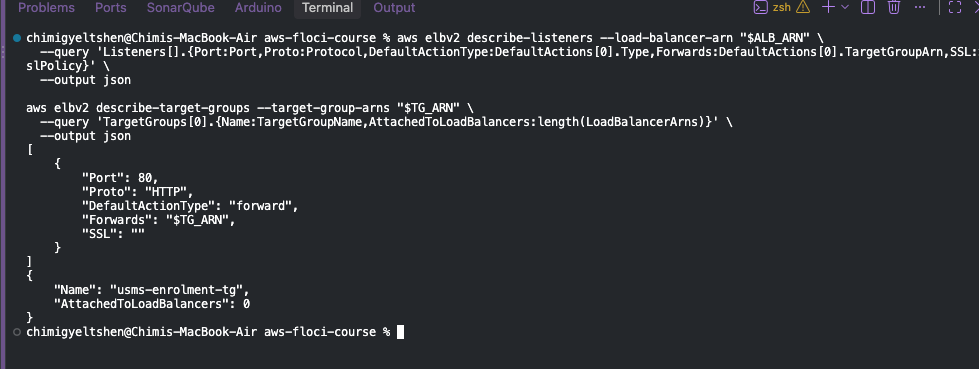

---

### Phase C — Connect the service

#### Step 9 — Let the load balancer reach the tasks

Add a rule on `usms-enrolment-sg` that admits tcp/80 from `usms-alb-sg`. The heredoc is unquoted so `$ALB_SG` expands.

```bash
cat > policies/usms-enrolment-sg-ingress-alb.json << EOF
[
  {
    "IpProtocol": "tcp",
    "FromPort": 80,
    "ToPort": 80,
    "UserIdGroupPairs": [
      {
        "GroupId": "$ALB_SG",
        "Description": "HTTP from usms-alb-sg - the load balancer is the only client of the enrolment tasks"
      }
    ]
  }
]
EOF

python3 -m json.tool policies/usms-enrolment-sg-ingress-alb.json > /dev/null && echo "valid JSON"
grep -c '\$' policies/usms-enrolment-sg-ingress-alb.json

aws ec2 authorize-security-group-ingress \
  --group-id "$USMS_ENROLMENT_SG" \
  --ip-permissions file://policies/usms-enrolment-sg-ingress-alb.json \
  --query 'SecurityGroupRules[].SecurityGroupRuleId' \
  --output text
```

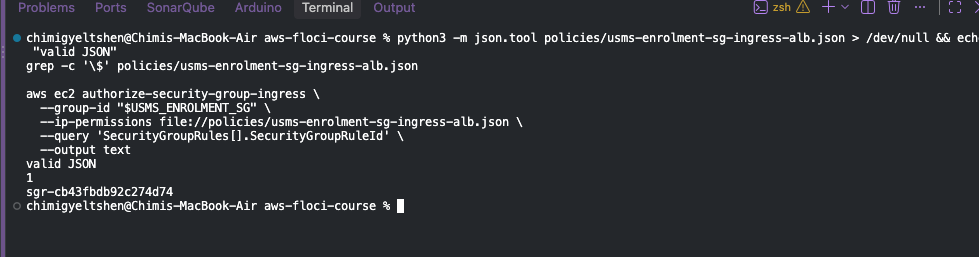

**Verify**

```bash
aws ec2 describe-security-groups --group-ids "$USMS_ENROLMENT_SG" \
  --query 'SecurityGroups[0].IpPermissions[].{Port:FromPort,Sources:UserIdGroupPairs[].GroupId,CIDRs:IpRanges[].CidrIp}' \
  --output json
```

**Expected:** two source groups on port 80 (`usms-app-sg` and `usms-alb-sg`) and no CIDRs. Both paths coexist until the cutover.

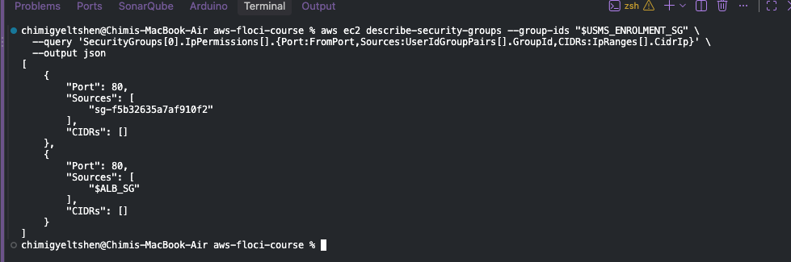

#### Step 10 — Attach the service to the target group

**Part 1 — Write the `loadBalancers` document**

`containerName` and `containerPort` must match the task definition exactly (`enrolment-api`, `80`).

```bash
cat > templates/lab-05-service-load-balancers.json << EOF
[
  {
    "targetGroupArn": "$TG_ARN",
    "containerName": "$USMS_ENROLMENT_CONTAINER",
    "containerPort": 80
  }
]
EOF

python3 -m json.tool templates/lab-05-service-load-balancers.json > /dev/null && echo "valid JSON"
grep -c '\$' templates/lab-05-service-load-balancers.json
cat templates/lab-05-service-load-balancers.json
```

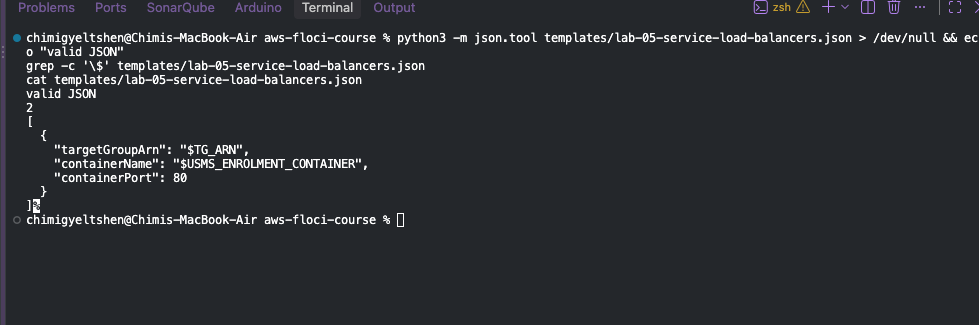

**Part 2 — Update the service**

```bash
aws ecs update-service \
  --cluster "$USMS_ECS_CLUSTER" \
  --service "$USMS_ENROLMENT_SERVICE" \
  --load-balancers file://templates/lab-05-service-load-balancers.json \
  --health-check-grace-period-seconds 60 \
  --query 'service.{Name:serviceName,LB:loadBalancers,Grace:healthCheckGracePeriodSeconds,Deployments:length(deployments),TaskDef:taskDefinition}' \
  --output json
```

**Expected:** one `LB` entry, `Grace` = `60`, task definition unchanged (`usms-enrolment:2`).

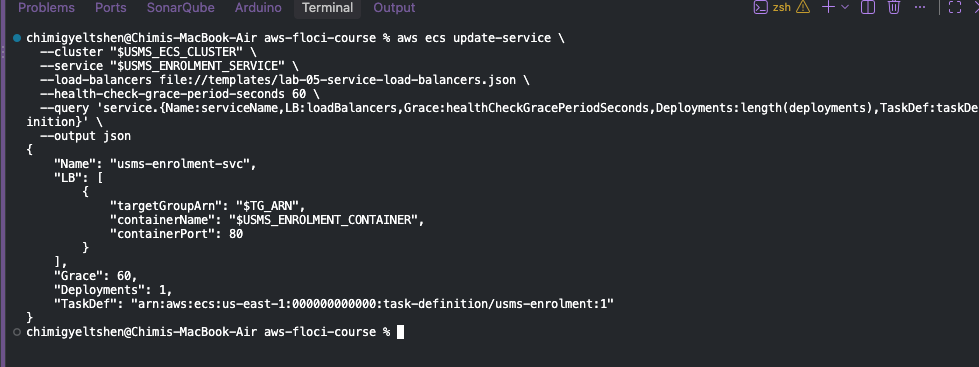

#### Step 11 — Watch the targets register

**Part 1 — Poll target health**

```bash
for i in $(seq 1 12); do
  echo "--- poll $i ---"
  aws elbv2 describe-target-health --target-group-arn "$TG_ARN" \
    --query 'TargetHealthDescriptions[].{Target:Target.Id,Port:Target.Port,AZ:Target.AvailabilityZone,State:TargetHealth.State,Reason:TargetHealth.Reason,Desc:TargetHealth.Description}' \
    --output table
  N=$(aws elbv2 describe-target-health --target-group-arn "$TG_ARN" \
        --query 'length(TargetHealthDescriptions)' --output text)
  [ "$N" -ge 2 ] && break
  sleep 10
done
```

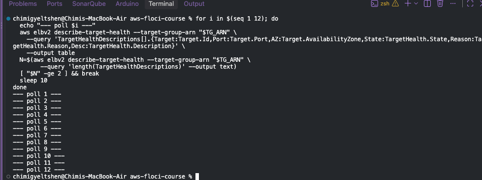

| State | Meaning |
|---|---|
| `initial` | Registered; health checks not yet conclusive |
| `healthy` | Passing checks; receiving traffic |
| `unhealthy` | Failing checks (usually security group, path or matcher) |
| `draining` | Deregistering; finishing in-flight requests |
| `unused` | Nothing forwards to this target group |

**Part 2 — The service's view**

```bash
aws ecs describe-services --cluster "$USMS_ECS_CLUSTER" --services "$USMS_ENROLMENT_SERVICE" \
  --query 'services[0].{Desired:desiredCount,Running:runningCount,Pending:pendingCount,Deployments:length(deployments),Rollout:deployments[0].rolloutState,LB:loadBalancers[0].targetGroupArn}' \
  --output json

aws ecs describe-services --cluster "$USMS_ECS_CLUSTER" --services "$USMS_ENROLMENT_SERVICE" \
  --query 'services[0].events[0:6].[createdAt,message]' --output text
```

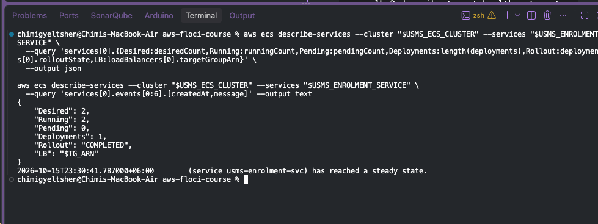

**Part 3 — Compare ECS health with target health**

```bash
for t in $(aws ecs list-tasks --cluster "$USMS_ECS_CLUSTER" --service-name "$USMS_ENROLMENT_SERVICE" \
             --query 'taskArns[]' --output text); do
  aws ecs describe-tasks --cluster "$USMS_ECS_CLUSTER" --tasks "$t" \
    --query 'tasks[0].{Task:taskArn,ECSHealth:healthStatus,Last:lastStatus,IP:attachments[].details[?name==`privateIPv4Address`].value|[]|[0]}' \
    --output text
done

aws elbv2 describe-target-health --target-group-arn "$TG_ARN" \
  --query 'TargetHealthDescriptions[].[Target.Id,TargetHealth.State]' --output text
```

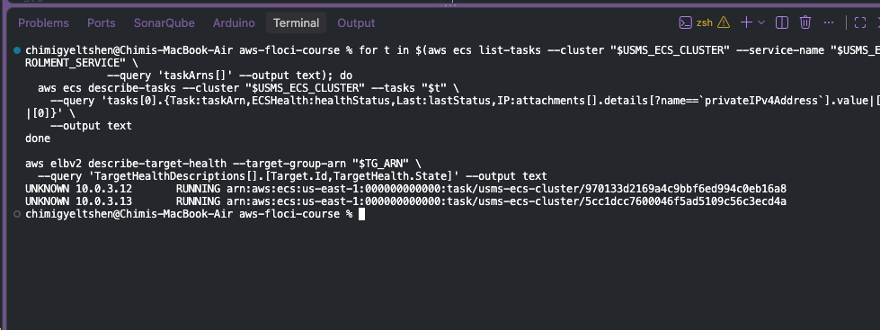

| ECS health | Target health | Diagnosis |
|---|---|---|
| `HEALTHY` | `healthy` | Working |
| `HEALTHY` | `unhealthy` | Network path broken (security group, subnet, health check path) |
| `UNHEALTHY` | `unhealthy` | Application broken — read container logs |
| `UNKNOWN` | `healthy` | No container health check defined — not a fault |
| any | `unused` | Nothing forwards to the target group |

#### Step 12 — Prove the path

**Part 1 — Data-path test (may not work on Floci)**

```bash
echo "ALB DNS name: $ALB_DNS"

getent hosts "$ALB_DNS" 2>/dev/null || python3 -c "
import socket,sys
try:
    print(socket.gethostbyname_ex(sys.argv[1]))
except Exception as e:
    print('does not resolve:', e)
" "$ALB_DNS"

curl -s -o /dev/null -w 'http_code=%{http_code}  time_total=%{time_total}s\n' \
     --max-time 10 "http://$ALB_DNS/" \
  || echo "curl could not connect - expected on many builds; see part 2"
```

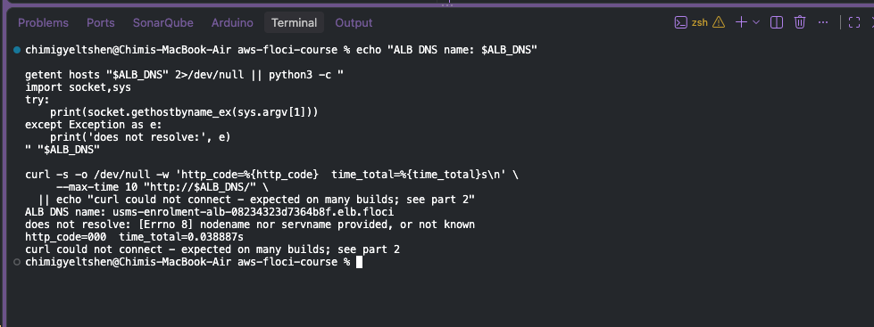

> **Floci limitation:** most builds publish no DNS name or data path for ELBv2. A failed `curl` here is an acceptable result — record it honestly and use Part 2.

**Part 2 — Control-plane proof (always works)**

```bash
{
  echo "== 1. The listener a client would connect to =="
  aws elbv2 describe-listeners --load-balancer-arn "$ALB_ARN" \
    --query 'Listeners[].[Protocol,Port,DefaultActions[0].Type,DefaultActions[0].TargetGroupArn]' \
    --output text

  echo
  echo "== 2. The target group that listener forwards to =="
  aws elbv2 describe-target-groups --target-group-arns "$TG_ARN" \
    --query 'TargetGroups[0].[TargetGroupName,TargetType,Protocol,Port,HealthCheckPath,VpcId]' \
    --output text

  echo
  echo "== 3. The targets in it, and which subnet each address belongs to =="
  for ip in $(aws elbv2 describe-target-health --target-group-arn "$TG_ARN" \
                --query 'TargetHealthDescriptions[].Target.Id' --output text); do
    printf '%-16s ' "$ip"
    case "$ip" in
      10.0.3.*) echo "usms-private-subnet-a  (us-east-1a)" ;;
      10.0.4.*) echo "usms-private-subnet-b  (us-east-1b)" ;;
      *)        echo "NOT in a Lab 02 private subnet - investigate" ;;
    esac
  done

  echo
  echo "== 4. The service that put them there =="
  aws ecs describe-services --cluster "$USMS_ECS_CLUSTER" --services "$USMS_ENROLMENT_SERVICE" \
    --query 'services[0].[serviceName,loadBalancers[0].targetGroupArn,loadBalancers[0].containerName,loadBalancers[0].containerPort,healthCheckGracePeriodSeconds]' \
    --output text

  echo
  echo "== 5. The firewall that lets step 1 reach step 3 =="
  aws ec2 describe-security-groups --group-ids "$USMS_ENROLMENT_SG" \
    --query 'SecurityGroups[0].IpPermissions[].UserIdGroupPairs[].GroupId' --output text
  echo "   (usms-alb-sg is $ALB_SG)"
} | tee outputs/lab-05-path-proof.txt
```

The five blocks form one chain: **listener → target group → targets in private subnets → registered by the service → reachable through `usms-alb-sg`**.


---

### Phase D — Cut over and operate

#### Step 13 — The cutover: remove the direct path

> ⚠️ **Before deleting:** this removes only the tcp/80 rule on `usms-enrolment-sg` sourced from `usms-app-sg` (created in Lab 04). It is fully reversible with Lab 04's `policies/usms-enrolment-sg-ingress.json`.

**Part 1 — Find and confirm the exact rule**

```bash
aws ec2 describe-security-group-rules \
  --filters "Name=group-id,Values=$USMS_ENROLMENT_SG" \
  --query 'SecurityGroupRules[].{Id:SecurityGroupRuleId,Egress:IsEgress,Port:FromPort,CIDR:CidrIpv4,FromGroup:ReferencedGroupInfo.GroupId,Desc:Description}' \
  --output table

OLD_RULE_ID=$(aws ec2 describe-security-group-rules \
  --filters "Name=group-id,Values=$USMS_ENROLMENT_SG" \
  --query "SecurityGroupRules[?IsEgress==\`false\` && ReferencedGroupInfo.GroupId=='$USMS_APP_SG'].SecurityGroupRuleId | [0]" \
  --output text)

echo "rule to remove: $OLD_RULE_ID"
```

**Expected:** a real `sgr-…` ID — **not** `None`.

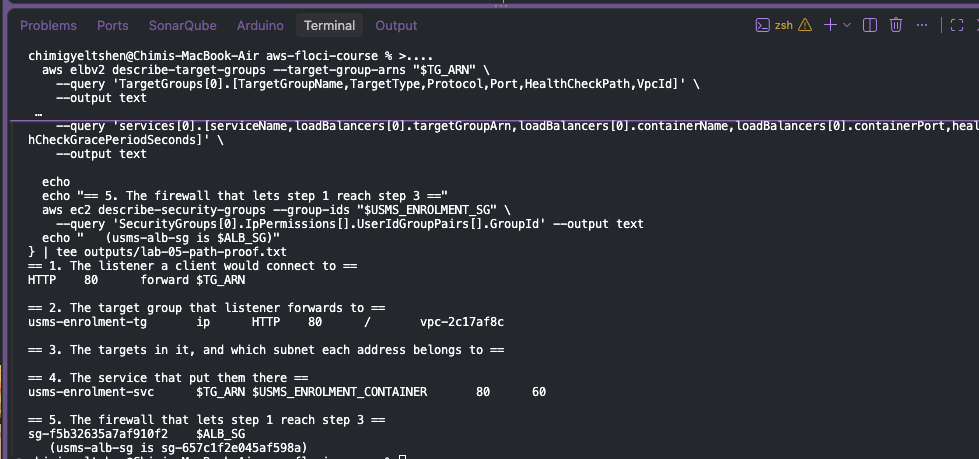

**Part 2 — Remove it**

```bash
aws ec2 revoke-security-group-ingress \
  --group-id "$USMS_ENROLMENT_SG" \
  --security-group-rule-ids "$OLD_RULE_ID" \
  --query 'Return' --output text
```

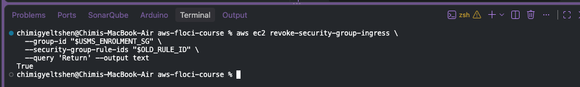

**Verify**

```bash
aws ec2 describe-security-groups --group-ids "$USMS_ENROLMENT_SG" \
  --query 'SecurityGroups[0].IpPermissions[].{Port:FromPort,Sources:UserIdGroupPairs[].GroupId,CIDRs:IpRanges[].CidrIp}' \
  --output json

echo "usms-alb-sg = $ALB_SG"
echo "usms-app-sg = $USMS_APP_SG   (must NOT appear above)"
```

**Expected:** exactly one source on port 80 — `usms-alb-sg`.

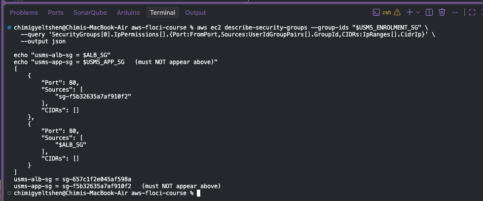

**Part 3 — Effect on Lab 04's verification script**

```bash
./scripts/utilities/verify-lab-04.sh | tee outputs/lab-05-post-verify-04.txt | tail -5

echo "== what changed =="
diff outputs/lab-05-pre-verify-04.txt outputs/lab-05-post-verify-04.txt
```

**Expected:** exactly **one** check changes from `ok` to `FAIL` (`usms-enrolment-sg is sourced from usms-app-sg`). This is correct — the architecture changed on purpose. From now on, `verify-lab-05.sh` is the script of record.

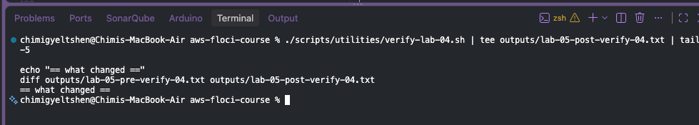

#### Step 14 — Deploy behind the load balancer and watch a target drain

**Part 1 — Record the state before**

```bash
{
  date -u +%Y-%m-%dT%H:%M:%SZ
  aws ecs describe-services --cluster "$USMS_ECS_CLUSTER" --services "$USMS_ENROLMENT_SERVICE" \
    --query 'services[0].[taskDefinition,desiredCount,runningCount]' --output text
  aws elbv2 describe-target-health --target-group-arn "$TG_ARN" \
    --query 'sort(TargetHealthDescriptions[].Target.Id)' --output text
} > outputs/lab-05-pre-deploy.txt

cat outputs/lab-05-pre-deploy.txt
```

**Part 2 — Force a deployment with no changes**

```bash
aws ecs update-service \
  --cluster "$USMS_ECS_CLUSTER" \
  --service "$USMS_ENROLMENT_SERVICE" \
  --force-new-deployment \
  --query 'service.{TaskDef:taskDefinition,Deployments:length(deployments)}' \
  --output json
```

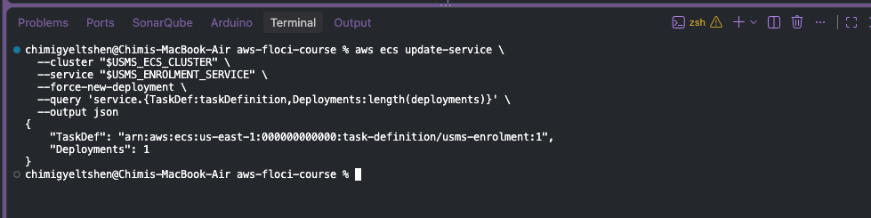

**Part 3 — Watch deployments and targets together**

```bash
for i in $(seq 1 15); do
  echo "--- poll $i ---"
  aws ecs describe-services --cluster "$USMS_ECS_CLUSTER" --services "$USMS_ENROLMENT_SERVICE" \
    --query 'services[0].deployments[].{Status:status,Desired:desiredCount,Running:runningCount,Pending:pendingCount,Rollout:rolloutState}' \
    --output text
  aws elbv2 describe-target-health --target-group-arn "$TG_ARN" \
    --query 'TargetHealthDescriptions[].[Target.Id,TargetHealth.State]' --output text
  N=$(aws ecs describe-services --cluster "$USMS_ECS_CLUSTER" --services "$USMS_ENROLMENT_SERVICE" \
        --query 'length(deployments)' --output text)
  [ "$N" = "1" ] && break
  sleep 8
done
```

Look for the sequence `initial` → `healthy` → `draining`.

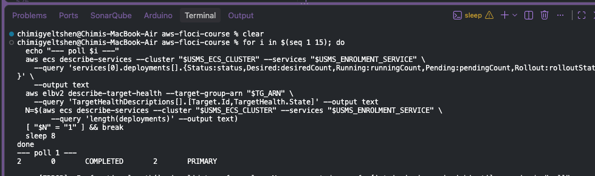

**Part 4 — Compare before and after**

```bash
{
  date -u +%Y-%m-%dT%H:%M:%SZ
  aws ecs describe-services --cluster "$USMS_ECS_CLUSTER" --services "$USMS_ENROLMENT_SERVICE" \
    --query 'services[0].[taskDefinition,desiredCount,runningCount]' --output text
  aws elbv2 describe-target-health --target-group-arn "$TG_ARN" \
    --query 'sort(TargetHealthDescriptions[].Target.Id)' --output text
} > outputs/lab-05-post-deploy.txt

paste outputs/lab-05-pre-deploy.txt outputs/lab-05-post-deploy.txt
```

**Expected:** same task definition and counts, **different** target addresses.

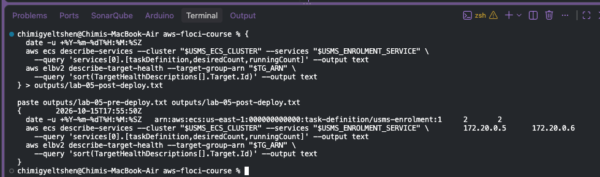

#### Step 15 — Add a listener rule

Rules are evaluated lowest priority first; the first match wins, and the default action runs only if nothing matches.

**Part 1 — Condition and action documents**

```bash
cat > templates/lab-05-rule-conditions.json << 'EOF'
[
  {
    "Field": "path-pattern",
    "PathPatternConfig": {
      "Values": ["/alb-health", "/alb-health/*"]
    }
  }
]
EOF

cat > templates/lab-05-rule-actions.json << 'EOF'
[
  {
    "Type": "fixed-response",
    "FixedResponseConfig": {
      "StatusCode": "200",
      "ContentType": "text/plain",
      "MessageBody": "usms-enrolment-alb ok\n"
    }
  }
]
EOF

python3 -m json.tool templates/lab-05-rule-conditions.json > /dev/null && echo "conditions valid"
python3 -m json.tool templates/lab-05-rule-actions.json    > /dev/null && echo "actions valid"
```

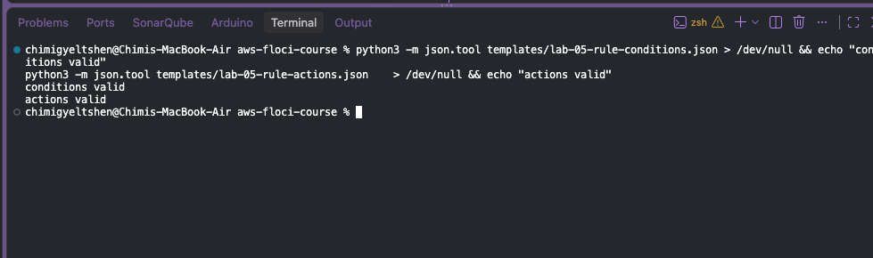

**Part 2 — Create the rule**

```bash
RULE_ARN=$(aws elbv2 create-rule \
  --listener-arn "$LISTENER_ARN" \
  --priority 10 \
  --conditions file://templates/lab-05-rule-conditions.json \
  --actions file://templates/lab-05-rule-actions.json \
  --tags Key=Name,Value=usms-enrolment-health-rule Key=Project,Value=USMS Key=Lab,Value=05 \
  --query 'Rules[0].RuleArn' \
  --output text)

echo "RULE_ARN = $RULE_ARN"
```

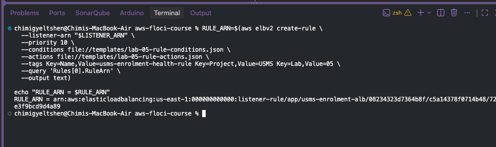

**Verify**

```bash
aws elbv2 describe-rules --listener-arn "$LISTENER_ARN" \
  --query 'Rules[].{Priority:Priority,Default:IsDefault,Condition:Conditions[0].Field,Values:Conditions[0].Values,Action:Actions[0].Type,Status:Actions[0].FixedResponseConfig.StatusCode,TargetGroup:Actions[0].TargetGroupArn}' \
  --output json
```

**Expected:** two entries — the priority-10 `fixed-response` rule and the `default` forward action.

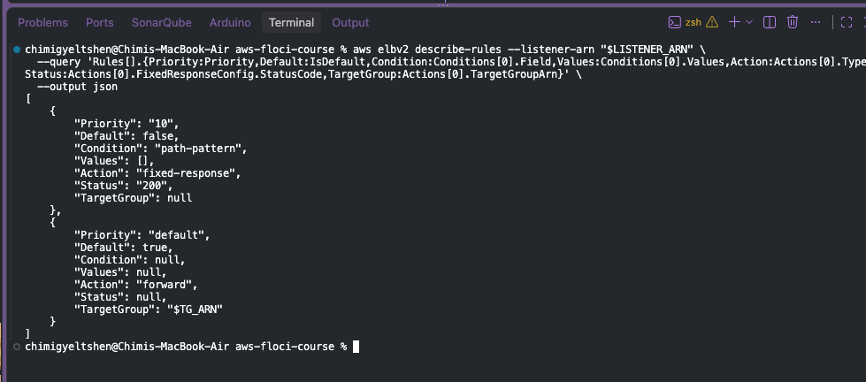

**Part 3 — Test it (if a data path exists)**

```bash
curl -s -o /dev/null -w '/            -> %{http_code}\n' --max-time 10 "http://$ALB_DNS/" || true
curl -s -w '/alb-health  -> %{http_code}  body: %{size_download} bytes\n' --max-time 10 \
     "http://$ALB_DNS/alb-health" || true
```

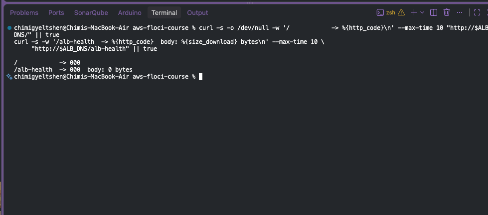

---

### Phase E — Persist, audit and commit

#### Step 16 — Prove everything survives a restart

**Part 1 — Record the state**

```bash
{
  aws elbv2 describe-load-balancers --names usms-enrolment-alb \
    --query 'LoadBalancers[0].[LoadBalancerName,Scheme,Type,State.Code,length(AvailabilityZones),length(SecurityGroups)]' --output text
  aws elbv2 describe-target-groups --names usms-enrolment-tg \
    --query 'TargetGroups[0].[TargetGroupName,TargetType,Protocol,Port,HealthCheckPath,Matcher.HttpCode,HealthCheckIntervalSeconds,UnhealthyThresholdCount]' --output text
  aws elbv2 describe-listeners --load-balancer-arn "$ALB_ARN" \
    --query 'sort_by(Listeners,&Port)[].[Port,Protocol,DefaultActions[0].Type]' --output text
  aws elbv2 describe-rules --listener-arn "$LISTENER_ARN" \
    --query 'sort_by(Rules,&Priority)[].[Priority,Actions[0].Type]' --output text
  aws ecs describe-services --cluster "$USMS_ECS_CLUSTER" --services "$USMS_ENROLMENT_SERVICE" \
    --query 'services[0].[serviceName,status,desiredCount,loadBalancers[0].containerName,loadBalancers[0].containerPort,healthCheckGracePeriodSeconds]' --output text
  aws ec2 describe-security-groups --group-ids "$ALB_SG" \
    --query 'SecurityGroups[0].[GroupName,IpPermissions[0].FromPort,IpPermissions[0].IpRanges[0].CidrIp]' --output text
  aws ec2 describe-security-groups --group-ids "$USMS_ENROLMENT_SG" \
    --query 'SecurityGroups[0].[GroupName,length(IpPermissions[0].UserIdGroupPairs)]' --output text
} > outputs/lab-05-pre-restart.txt

cat outputs/lab-05-pre-restart.txt
```

**Part 2 — Restart Floci**

`floci-down.sh` stops the container but keeps state. Never use `docker compose down -v`.

```bash
./scripts/setup/floci-down.sh
sleep 3
./scripts/setup/floci-up.sh
sleep 5
source configs/course.env
source configs/lab-02.env
source configs/lab-04.env
```

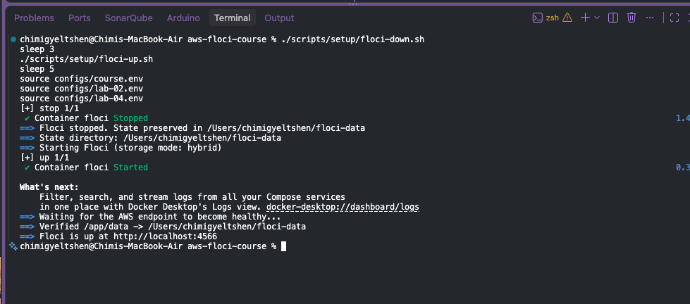

**Part 3 — Re-derive every ARN from the API and compare**

```bash
ALB_ARN=$(aws elbv2 describe-load-balancers --names usms-enrolment-alb \
  --query 'LoadBalancers[0].LoadBalancerArn' --output text)
ALB_DNS=$(aws elbv2 describe-load-balancers --names usms-enrolment-alb \
  --query 'LoadBalancers[0].DNSName' --output text)
TG_ARN=$(aws elbv2 describe-target-groups --names usms-enrolment-tg \
  --query 'TargetGroups[0].TargetGroupArn' --output text)
LISTENER_ARN=$(aws elbv2 describe-listeners --load-balancer-arn "$ALB_ARN" \
  --query 'Listeners[?Port==`80`].ListenerArn | [0]' --output text)
ALB_SG=$(aws ec2 describe-security-groups \
  --filters "Name=tag:Name,Values=usms-alb-sg" \
  --query 'SecurityGroups[0].GroupId' --output text)

echo "re-derived:"
printf '  %s\n' "$ALB_ARN" "$TG_ARN" "$LISTENER_ARN" "$ALB_SG"

{
  aws elbv2 describe-load-balancers --names usms-enrolment-alb \
    --query 'LoadBalancers[0].[LoadBalancerName,Scheme,Type,State.Code,length(AvailabilityZones),length(SecurityGroups)]' --output text
  aws elbv2 describe-target-groups --names usms-enrolment-tg \
    --query 'TargetGroups[0].[TargetGroupName,TargetType,Protocol,Port,HealthCheckPath,Matcher.HttpCode,HealthCheckIntervalSeconds,UnhealthyThresholdCount]' --output text
  aws elbv2 describe-listeners --load-balancer-arn "$ALB_ARN" \
    --query 'sort_by(Listeners,&Port)[].[Port,Protocol,DefaultActions[0].Type]' --output text
  aws elbv2 describe-rules --listener-arn "$LISTENER_ARN" \
    --query 'sort_by(Rules,&Priority)[].[Priority,Actions[0].Type]' --output text
  aws ecs describe-services --cluster "$USMS_ECS_CLUSTER" --services "$USMS_ENROLMENT_SERVICE" \
    --query 'services[0].[serviceName,status,desiredCount,loadBalancers[0].containerName,loadBalancers[0].containerPort,healthCheckGracePeriodSeconds]' --output text
  aws ec2 describe-security-groups --group-ids "$ALB_SG" \
    --query 'SecurityGroups[0].[GroupName,IpPermissions[0].FromPort,IpPermissions[0].IpRanges[0].CidrIp]' --output text
  aws ec2 describe-security-groups --group-ids "$USMS_ENROLMENT_SG" \
    --query 'SecurityGroups[0].[GroupName,length(IpPermissions[0].UserIdGroupPairs)]' --output text
} > outputs/lab-05-post-restart.txt

diff outputs/lab-05-pre-restart.txt outputs/lab-05-post-restart.txt \
  && echo "PERSISTENCE PROVEN: the load balancer, its two Availability Zones, its security group, the target group with its full health check configuration, the listener, the rule, the service's loadBalancers entry and the grace period are all unchanged" \
  || echo "PERSISTENCE FAILED: read the diff above, then run ./scripts/utilities/floci-storage-check.sh"
```

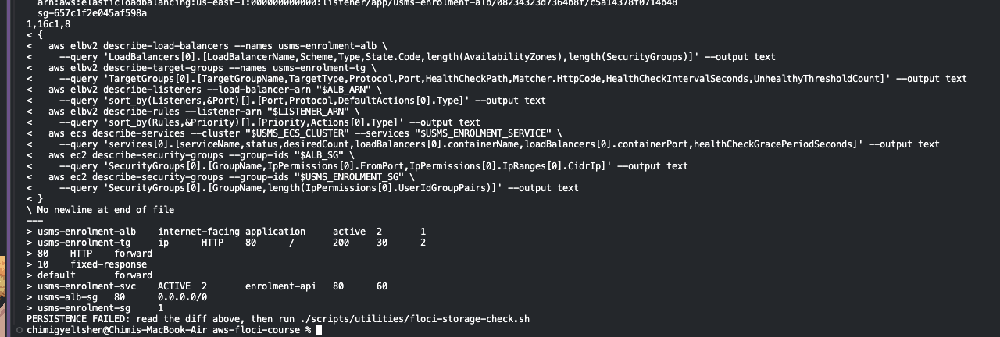

#### Step 17 — Close the loop and audit

```bash
source configs/lab-03.env

echo "== 1. Who can reach the load balancer? =="
aws ec2 describe-security-groups --group-ids "$ALB_SG" \
  --query 'SecurityGroups[0].IpPermissions[].{Port:FromPort,FromCIDR:IpRanges[].CidrIp,FromGroup:UserIdGroupPairs[].GroupId}' \
  --output json

echo
echo "== 2. Who can reach the tasks? =="
TASK_SOURCE=$(aws ec2 describe-security-groups --group-ids "$USMS_ENROLMENT_SG" \
  --query 'SecurityGroups[0].IpPermissions[0].UserIdGroupPairs[0].GroupId' --output text)
echo "source group: $TASK_SOURCE"

if [ "$TASK_SOURCE" = "$ALB_SG" ]; then
  echo "CUTOVER CONFIRMED: the ONLY thing that may open a connection to an enrolment task is usms-alb-sg"
else
  echo "MISMATCH: expected $ALB_SG (usms-alb-sg), found $TASK_SOURCE - re-read Steps 9 and 13"
fi

echo
echo "== 3. And who is the client of the load balancer, in the story? =="
aws ec2 describe-instances \
  --filters "Name=instance.group-id,Values=$USMS_APP_SG" "Name=instance-state-name,Values=running" \
  --query 'Reservations[].Instances[].{Name:Tags[?Key==`Name`]|[0].Value,Id:InstanceId,Subnet:SubnetId}' \
  --output table

CARRIER=$(aws ec2 describe-instances \
  --filters "Name=instance.group-id,Values=$USMS_APP_SG" "Name=instance-state-name,Values=running" \
  --query 'Reservations[0].Instances[0].InstanceId' --output text)

if [ "$CARRIER" = "$USMS_WEB_INSTANCE" ]; then
  echo "LOOP CLOSED: usms-web-01 ($CARRIER) still carries usms-app-sg, but now calls $ALB_DNS instead of a task address"
else
  echo "NOTE: usms-app-sg is carried by $CARRIER; lab-03.env records $USMS_WEB_INSTANCE"
fi

echo
echo "== 4. Audit: everything this lab tagged Lab=05 =="
aws ec2 describe-security-groups --filters "Name=tag:Lab,Values=05" \
  --query 'SecurityGroups[].[GroupName,GroupId]' --output text
aws elbv2 describe-tags --resource-arns "$ALB_ARN" "$TG_ARN" \
  --query 'TagDescriptions[].{Resource:ResourceArn,Tags:Tags[?Key==`Lab`].Value|[0]}' \
  --output table \
  || echo "elbv2 describe-tags not supported on this build - record it and continue"
```

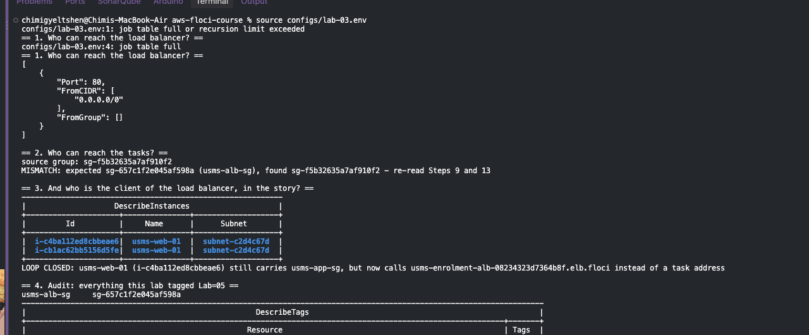

#### Step 18 — Write `configs/lab-05.env`

Every value is derived from the API, never typed by hand. The file contains IDs and ARNs only — no secrets.

```bash
cat > configs/lab-05.env << EOF
# Lab 05 - ECS service behind an Application Load Balancer
# Generated on $(date -u +%Y-%m-%dT%H:%M:%SZ)
# Contains names, IDs and ARNs only. NO SECRETS. Safe to commit.
#
# Sourced alongside lab-01/02/03/04. Lab 06 sources this
# file for the target group its ALBRequestCountPerTarget policy names.

export USMS_ALB_NAME=usms-enrolment-alb
export USMS_ALB_ARN=$(aws elbv2 describe-load-balancers --names usms-enrolment-alb \
  --query 'LoadBalancers[0].LoadBalancerArn' --output text)
export USMS_ALB_DNS=$(aws elbv2 describe-load-balancers --names usms-enrolment-alb \
  --query 'LoadBalancers[0].DNSName' --output text)
export USMS_ALB_SCHEME=$(aws elbv2 describe-load-balancers --names usms-enrolment-alb \
  --query 'LoadBalancers[0].Scheme' --output text)
export USMS_ALB_SG=$(aws ec2 describe-security-groups \
  --filters "Name=tag:Name,Values=usms-alb-sg" \
  --query 'SecurityGroups[0].GroupId' --output text)

export USMS_TG_NAME=usms-enrolment-tg
export USMS_TG_ARN=$(aws elbv2 describe-target-groups --names usms-enrolment-tg \
  --query 'TargetGroups[0].TargetGroupArn' --output text)
export USMS_TG_TARGET_TYPE=$(aws elbv2 describe-target-groups --names usms-enrolment-tg \
  --query 'TargetGroups[0].TargetType' --output text)
export USMS_TG_HEALTH_PATH=$(aws elbv2 describe-target-groups --names usms-enrolment-tg \
  --query 'TargetGroups[0].HealthCheckPath' --output text)

export USMS_ALB_LISTENER_ARN=$(aws elbv2 describe-listeners \
  --load-balancer-arn "$(aws elbv2 describe-load-balancers --names usms-enrolment-alb \
     --query 'LoadBalancers[0].LoadBalancerArn' --output text)" \
  --query 'Listeners[?Port==\`80\`].ListenerArn | [0]' --output text)

export USMS_ALB_LISTENER_PORT=80
export USMS_ALB_HEALTH_RULE_PATH=/alb-health

export USMS_SVC_LB_CONTAINER=$(aws ecs describe-services \
  --cluster usms-ecs-cluster --services usms-enrolment-svc \
  --query 'services[0].loadBalancers[0].containerName' --output text)
export USMS_SVC_LB_PORT=$(aws ecs describe-services \
  --cluster usms-ecs-cluster --services usms-enrolment-svc \
  --query 'services[0].loadBalancers[0].containerPort' --output text)
export USMS_SVC_GRACE_PERIOD=$(aws ecs describe-services \
  --cluster usms-ecs-cluster --services usms-enrolment-svc \
  --query 'services[0].healthCheckGracePeriodSeconds' --output text)
EOF

grep -n 'export .*=$\|None' configs/lab-05.env || echo "all values populated"
```

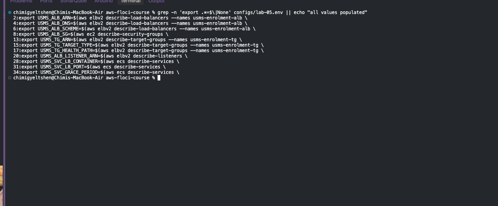

**Verify**

```bash
source configs/lab-05.env

printf '%-26s %s\n' \
  "alb name"        "$USMS_ALB_NAME" \
  "alb scheme"      "$USMS_ALB_SCHEME" \
  "alb dns"         "$USMS_ALB_DNS" \
  "alb sg"          "$USMS_ALB_SG" \
  "target group"    "$USMS_TG_NAME" \
  "target type"     "$USMS_TG_TARGET_TYPE" \
  "health path"     "$USMS_TG_HEALTH_PATH" \
  "listener"        "$USMS_ALB_LISTENER_ARN" \
  "lb container"    "$USMS_SVC_LB_CONTAINER" \
  "lb port"         "$USMS_SVC_LB_PORT" \
  "grace period"    "$USMS_SVC_GRACE_PERIOD"
```

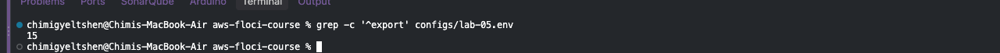

#### Step 19 — Commit

**Part 1 — Check what will be committed**

```bash
git status --short

git check-ignore -v outputs/lab-05-path-proof.txt
git ls-files outputs/
```

**Expected:** `outputs/` is ignored and nothing in it is tracked.

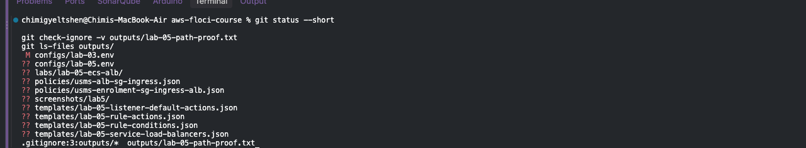

**Part 2 — Commit**

```bash
git add labs/lab-05-ecs-alb/ \
        configs/lab-05.env \
        policies/usms-alb-sg-ingress.json \
        policies/usms-enrolment-sg-ingress-alb.json \
        templates/lab-05-listener-default-actions.json \
        templates/lab-05-rule-conditions.json \
        templates/lab-05-rule-actions.json \
        templates/lab-05-service-load-balancers.json \
        scripts/utilities/verify-lab-05.sh \
        scripts/cleanup/lab-05-cleanup.sh

git status --short

git commit -m "Lab 05: USMS enrolment service behind an Application Load Balancer - ALB, target group, listener, rule, service attachment and the security cutover"

git log --oneline -6
```

> The verification and cleanup scripts are built in Sections 7 and 8 — create them before running this commit.

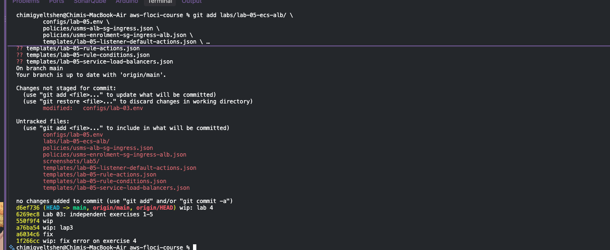

---

## 7. Verification Script

`scripts/utilities/verify-lab-05.sh` is read-only: it inspects every Lab 05 artefact and exits `0` only if all checks pass.

```bash
cat > scripts/utilities/verify-lab-05.sh << 'EOF'
#!/usr/bin/env bash
# Verify every Lab 05 artefact exists and is configured correctly.
# Read-only: this script inspects and changes nothing. Safe to run at any time.
# Exit 0 if every check passes, 1 otherwise.
set -uo pipefail

REPO_ROOT="$(cd "$(dirname "${BASH_SOURCE[0]}")/../.." && pwd)"
cd "$REPO_ROOT"
source "$REPO_ROOT/configs/course.env"
source "$REPO_ROOT/configs/lab-01.env"  2>/dev/null || true
source "$REPO_ROOT/configs/lab-02.env"  2>/dev/null || true
source "$REPO_ROOT/configs/lab-03.env"  2>/dev/null || true
source "$REPO_ROOT/configs/lab-04.env" 2>/dev/null || true
source "$REPO_ROOT/configs/lab-05.env" 2>/dev/null || true

# Defaults so that set -u cannot abort the script before it has told you anything.
: "${USMS_VPC_ID:=none}"
: "${USMS_PUBLIC_SUBNET_A:=none}"
: "${USMS_PUBLIC_SUBNET_B:=none}"
: "${USMS_PRIVATE_SUBNET_A:=none}"
: "${USMS_PRIVATE_SUBNET_B:=none}"
: "${USMS_APP_SG:=none}"
: "${USMS_ENROLMENT_SG:=none}"
: "${USMS_ECS_CLUSTER:=usms-ecs-cluster}"
: "${USMS_ENROLMENT_SERVICE:=usms-enrolment-svc}"
: "${USMS_ENROLMENT_CONTAINER:=enrolment-api}"
: "${USMS_ALB_NAME:=usms-enrolment-alb}"
: "${USMS_ALB_SG:=none}"
: "${USMS_TG_NAME:=usms-enrolment-tg}"
: "${USMS_TG_ARN:=none}"
: "${USMS_ALB_LISTENER_ARN:=}"

PASS=0; FAIL=0
check() {
  if eval "$2" >/dev/null 2>&1; then printf "  ok   %s\n" "$1"; PASS=$((PASS+1))
  else printf "  FAIL %s\n" "$1"; FAIL=$((FAIL+1)); fi
}

# One field from the load balancer, the target group, a target group attribute, or the service.
lbq()    { aws elbv2 describe-load-balancers --names "$USMS_ALB_NAME" \
             --query "LoadBalancers[0].$1" --output text; }
tgq()    { aws elbv2 describe-target-groups --names "$USMS_TG_NAME" \
             --query "TargetGroups[0].$1" --output text; }
tgattr() { aws elbv2 describe-target-group-attributes --target-group-arn "$(tgq TargetGroupArn)" \
             --query "Attributes[?Key=='$1'].Value | [0]" --output text; }
svcq()   { aws ecs describe-services --cluster "$USMS_ECS_CLUSTER" \
             --services "$USMS_ENROLMENT_SERVICE" --query "services[0].$1" --output text; }
sgsrc()  { aws ec2 describe-security-groups --group-ids "$1" \
             --query 'SecurityGroups[0].IpPermissions[].UserIdGroupPairs[].GroupId' --output text; }
az()     { aws ec2 describe-subnets --subnet-ids "$1" \
             --query 'Subnets[0].AvailabilityZone' --output text 2>/dev/null; }

# Listeners and rules have no names, so walk down from the load balancer.
LARN="${USMS_ALB_LISTENER_ARN}"
if [ -z "$LARN" ] || [ "$LARN" = "None" ]; then
  LARN=$(aws elbv2 describe-listeners --load-balancer-arn "$(lbq LoadBalancerArn)" \
           --query 'Listeners[?Port==`80`].ListenerArn | [0]' --output text 2>/dev/null || echo none)
fi

echo "== Environment =="
check "Floci container running" \
  "test \"\$(docker container inspect $FLOCI_CONTAINER_NAME --format '{{.State.Running}}')\" = true"
check "Storage mode is NOT memory" \
  "docker container inspect $FLOCI_CONTAINER_NAME --format '{{range .Config.Env}}{{println .}}{{end}}' | grep -qE '^FLOCI_STORAGE_MODE=(hybrid|persistent|wal)$'"
check "AWS CLI reaches Floci" "aws sts get-caller-identity"
check "Account is 000000000000" \
  "test \"\$(aws sts get-caller-identity --query Account --output text)\" = 000000000000"

echo "== Lab 02 to 04 dependencies =="
check "usms-vpc exists" "aws ec2 describe-vpcs --vpc-ids $USMS_VPC_ID"
check "usms-public-subnet-a exists" "aws ec2 describe-subnets --subnet-ids $USMS_PUBLIC_SUBNET_A"
check "usms-public-subnet-b exists" "aws ec2 describe-subnets --subnet-ids $USMS_PUBLIC_SUBNET_B"
check "the two public subnets are in TWO different AZs" \
  "test -n \"\$(az $USMS_PUBLIC_SUBNET_A)\" && test \"\$(az $USMS_PUBLIC_SUBNET_A)\" != \"\$(az $USMS_PUBLIC_SUBNET_B)\""
check "usms-app-sg still exists" "aws ec2 describe-security-groups --group-ids $USMS_APP_SG"
check "cluster $USMS_ECS_CLUSTER is ACTIVE" \
  "test \"\$(aws ecs describe-clusters --clusters $USMS_ECS_CLUSTER --query 'clusters[0].status' --output text)\" = ACTIVE"
check "service $USMS_ENROLMENT_SERVICE is ACTIVE" "test \"\$(svcq status)\" = ACTIVE"

echo "== Lab 05 security groups =="
check "usms-alb-sg exists" "aws ec2 describe-security-groups --group-ids $USMS_ALB_SG"
check "usms-alb-sg admits tcp/80 from 0.0.0.0/0" \
  "aws ec2 describe-security-groups --group-ids $USMS_ALB_SG --query 'SecurityGroups[0].IpPermissions[?FromPort==\`80\`].IpRanges[].CidrIp' --output text | grep -q '0.0.0.0/0'"
check "usms-enrolment-sg admits tcp/80 from usms-alb-sg" \
  "sgsrc $USMS_ENROLMENT_SG | grep -qw $USMS_ALB_SG"
check "cutover done: usms-enrolment-sg no longer admits usms-app-sg" \
  "! sgsrc $USMS_ENROLMENT_SG | grep -qw $USMS_APP_SG"

echo "== Lab 05 load balancer =="
check "load balancer $USMS_ALB_NAME exists" "aws elbv2 describe-load-balancers --names $USMS_ALB_NAME"
check "load balancer state is active"        "test \"\$(lbq 'State.Code')\" = active"
check "scheme is internet-facing"            "test \"\$(lbq Scheme)\" = internet-facing"
check "type is application"                  "test \"\$(lbq Type)\" = application"
check "spans TWO availability zones"         "test \"\$(lbq 'length(AvailabilityZones)')\" = 2"
check "carries usms-alb-sg" \
  "aws elbv2 describe-load-balancers --names $USMS_ALB_NAME --query 'LoadBalancers[0].SecurityGroups' --output text | grep -qw $USMS_ALB_SG"

echo "== Lab 05 target group =="
check "target group $USMS_TG_NAME exists" "aws elbv2 describe-target-groups --names $USMS_TG_NAME"
check "target type is ip (mandatory for awsvpc)" "test \"\$(tgq TargetType)\" = ip"
check "protocol HTTP on port 80" \
  "test \"\$(tgq Protocol)\" = HTTP && test \"\$(tgq Port)\" = 80"
check "target group lives in usms-vpc" "test \"\$(tgq VpcId)\" = $USMS_VPC_ID"
check "health check is GET / with matcher 200" \
  "test \"\$(tgq HealthCheckPath)\" = / && test \"\$(tgq 'Matcher.HttpCode')\" = 200"
check "deregistration delay is 30 seconds" \
  "test \"\$(tgattr deregistration_delay.timeout_seconds)\" = 30"

echo "== Lab 05 listener and rule =="
check "a listener exists on port 80" "test \"\$LARN\" != none && test -n \"\$LARN\""
check "listener default action forwards to $USMS_TG_NAME" \
  "aws elbv2 describe-listeners --listener-arns \"\$LARN\" --query 'Listeners[0].DefaultActions[0].TargetGroupArn' --output text | grep -q ':targetgroup/$USMS_TG_NAME/'"
check "at least one non-default rule exists" \
  "test \"\$(aws elbv2 describe-rules --listener-arn \"\$LARN\" --query 'length(Rules[?IsDefault==\`false\`])' --output text)\" -ge 1"
check "the non-default rule returns a fixed-response 200" \
  "aws elbv2 describe-rules --listener-arn \"\$LARN\" --query 'Rules[?IsDefault==\`false\`].Actions[0].FixedResponseConfig.StatusCode' --output text | grep -q 200"

echo "== Lab 05 service wiring =="
check "service has exactly ONE loadBalancers entry" "test \"\$(svcq 'length(loadBalancers)')\" = 1"
check "it names $USMS_TG_NAME" \
  "svcq 'loadBalancers[0].targetGroupArn' | grep -q ':targetgroup/$USMS_TG_NAME/'"
check "containerName is $USMS_ENROLMENT_CONTAINER" \
  "test \"\$(svcq 'loadBalancers[0].containerName')\" = $USMS_ENROLMENT_CONTAINER"
check "containerPort is 80" "test \"\$(svcq 'loadBalancers[0].containerPort')\" = 80"
check "healthCheckGracePeriodSeconds is set (not None, not 0)" \
  "test \"\$(svcq healthCheckGracePeriodSeconds)\" != None && test \"\$(svcq healthCheckGracePeriodSeconds)\" -gt 0"
check "service still spans two private subnets" \
  "test \"\$(svcq 'length(networkConfiguration.awsvpcConfiguration.subnets)')\" = 2"
check "service still assigns NO public IP" \
  "test \"\$(svcq 'networkConfiguration.awsvpcConfiguration.assignPublicIp')\" = DISABLED"
check "exactly ONE deployment (nothing stuck mid-roll)" \
  "test \"\$(svcq 'length(deployments)')\" = 1"

echo "== Files and Git hygiene =="
check "configs/lab-05.env exists" "test -f configs/lab-05.env"
check "configs/lab-05.env has no empty values" \
  "! grep -qE 'export [A-Z_]+=\$|=None\$' configs/lab-05.env"
check "policies/usms-alb-sg-ingress.json is valid JSON" \
  "python3 -m json.tool policies/usms-alb-sg-ingress.json"
check "policies/usms-enrolment-sg-ingress-alb.json is valid JSON" \
  "python3 -m json.tool policies/usms-enrolment-sg-ingress-alb.json"
check "templates/lab-05-listener-default-actions.json is valid JSON" \
  "python3 -m json.tool templates/lab-05-listener-default-actions.json"
check "templates/lab-05-rule-conditions.json is valid JSON" \
  "python3 -m json.tool templates/lab-05-rule-conditions.json"
check "templates/lab-05-rule-actions.json is valid JSON" \
  "python3 -m json.tool templates/lab-05-rule-actions.json"
check "templates/lab-05-service-load-balancers.json is valid JSON" \
  "python3 -m json.tool templates/lab-05-service-load-balancers.json"
check "no Lab 05 document contains an unexpanded variable" \
  "! grep -q '[\$]' templates/lab-05-listener-default-actions.json templates/lab-05-service-load-balancers.json policies/usms-enrolment-sg-ingress-alb.json"
check "no secret is tracked by git" "! git ls-files | grep -q '^outputs/'"

echo; echo "PASS=$PASS  FAIL=$FAIL"

if [ "$FAIL" -ne 0 ]; then
  cat <<'REMEDY'

A failure under "== Environment ==" is the real problem, and most failures below it are
a consequence. Fix that block first:
  ./scripts/utilities/floci-storage-check.sh

A failure under "== Lab 02 to 04 dependencies ==" means an earlier lab's resource is
gone. Run verify-lab-02.sh, verify-lab-03.sh and verify-lab-04.sh before re-reading
anything here. Remember that verify-lab-04.sh is EXPECTED to report exactly one
failure after Step 13, on the usms-app-sg source check.
REMEDY
fi

[ "$FAIL" -eq 0 ]
EOF

chmod +x scripts/utilities/verify-lab-05.sh
bash -n scripts/utilities/verify-lab-05.sh && echo "syntax OK"
./scripts/utilities/verify-lab-05.sh
```

**Expected:** `FAIL=0`.

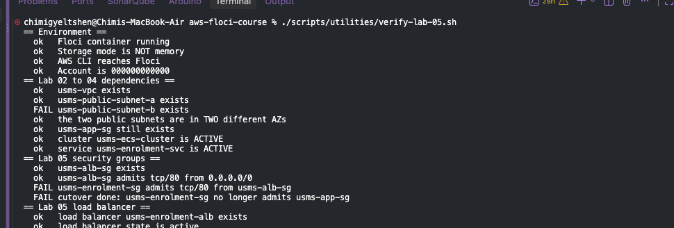

---

## 8. Cleanup Script (End of Course Only)

> ⚠️ **Do not run this now.** Labs 06, 09 and the CloudFormation lab depend on these resources. Teardown order: `lab-06-cleanup.sh` → **`lab-05-cleanup.sh`** → `lab-04-cleanup.sh`.

Deletion order inside the script: **service → rules → listener → load balancer → target group → security group**.

```bash
cat > scripts/cleanup/lab-05-cleanup.sh << 'EOF'
#!/usr/bin/env bash
# END OF COURSE ONLY. Removes Lab 05, dependencies first.
# Order: service -> rules -> listener -> load balancer -> target group -> security group.
# Run AFTER scripts/cleanup/lab-06-cleanup.sh and BEFORE scripts/cleanup/lab-04-cleanup.sh.
set -Eeuo pipefail

REPO_ROOT="$(cd "$(dirname "${BASH_SOURCE[0]}")/../.." && pwd)"
cd "$REPO_ROOT"
source "$REPO_ROOT/configs/course.env"
source "$REPO_ROOT/configs/lab-04.env"
source "$REPO_ROOT/configs/lab-05.env"

cat <<'WARN'
============================================================
  This deletes the USMS enrolment SERVICE, the Application
  Load Balancer usms-enrolment-alb, its listener and rule,
  the target group usms-enrolment-tg and the security group
  usms-alb-sg.

  Lab 06, Lab 09 and the CloudFormation lab depend on parts
  of it. None of this is reversible.

  Run AFTER  lab-06-cleanup.sh
  Run BEFORE lab-04-cleanup.sh
============================================================
WARN

# Refuse while Lab 06's scaling configuration still points at this service.
RID="service/${USMS_ECS_CLUSTER}/${USMS_ENROLMENT_SERVICE}"
TARGETS=$(aws application-autoscaling describe-scalable-targets \
            --service-namespace ecs --resource-ids "$RID" \
            --query 'length(ScalableTargets)' --output text 2>/dev/null || echo 0)
if [ "$TARGETS" != "0" ] && [ "$TARGETS" != "None" ]; then
  echo "REFUSING: a scalable target still exists for $RID"
  echo "Run scripts/cleanup/lab-06-cleanup.sh first."
  exit 1
fi

read -r -p 'Type exactly: DELETE USMS LOAD BALANCER  > ' answer
[ "$answer" = "DELETE USMS LOAD BALANCER" ] || { echo "aborted"; exit 1; }

say() { printf '\n-- %s\n' "$1"; }

say "service: scale to zero, wait, then delete (this frees the targets)"
aws ecs update-service --cluster "$USMS_ECS_CLUSTER" --service "$USMS_ENROLMENT_SERVICE" \
  --desired-count 0 >/dev/null || true
aws ecs wait services-stable --cluster "$USMS_ECS_CLUSTER" \
  --services "$USMS_ENROLMENT_SERVICE" || sleep 20
aws ecs delete-service --cluster "$USMS_ECS_CLUSTER" --service "$USMS_ENROLMENT_SERVICE" \
  --force >/dev/null || true

say "listener rules (deleting the listener would take them anyway; explicit is clearer)"
LARN=$(aws elbv2 describe-listeners --load-balancer-arn "$USMS_ALB_ARN" \
         --query 'Listeners[0].ListenerArn' --output text 2>/dev/null || echo None)
if [ "$LARN" != "None" ] && [ -n "$LARN" ]; then
  for r in $(aws elbv2 describe-rules --listener-arn "$LARN" \
               --query 'Rules[?IsDefault==`false`].RuleArn' --output text); do
    aws elbv2 delete-rule --rule-arn "$r" >/dev/null || true
  done
  say "listener"
  aws elbv2 delete-listener --listener-arn "$LARN" >/dev/null || true
fi

say "load balancer (must go before the target group it forwarded to)"
aws elbv2 delete-load-balancer --load-balancer-arn "$USMS_ALB_ARN" >/dev/null || true
aws elbv2 wait load-balancers-deleted --load-balancer-arns "$USMS_ALB_ARN" 2>/dev/null || sleep 20

say "target group"
aws elbv2 delete-target-group --target-group-arn "$USMS_TG_ARN" >/dev/null || true

say "security group (only after the load balancer's interfaces are gone)"
aws ec2 delete-security-group --group-id "$USMS_ALB_SG" || \
  echo "  still in use - wait for the load balancer's ENIs to be released, then retry"

echo
echo "Lab 05 teardown complete. scripts/cleanup/lab-04-cleanup.sh may now run."
EOF

chmod +x scripts/cleanup/lab-05-cleanup.sh
bash -n scripts/cleanup/lab-05-cleanup.sh && echo "syntax OK - do NOT run it"
```

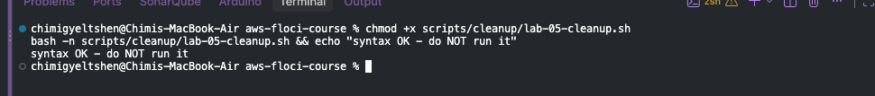

---

## 9. Key Takeaways

- **The service owns the targets.** ECS registers and deregisters tasks automatically — never use `register-targets` by hand.
- **`ip` target type is mandatory** for Fargate/`awsvpc` tasks and cannot be changed after creation.
- **Two health checks, two opinions.** ECS container health and ALB target health can disagree; comparing them pinpoints whether the app or the network is broken.
- **Security group chaining.** Internet → `usms-alb-sg` → `usms-enrolment-sg`. Each tier admits only the tier above it.
- **Migrate, don't break.** Build the new path, prove it, then remove the old one (Steps 9 → 12 → 13).
- **Timers protect deployments.** Deregistration delay (30 s) lets in-flight requests finish; the grace period (60 s) stops slow starts being treated as failures.
- **Be honest about proof.** On Floci, the control-plane chain is valid evidence when the data path is unavailable.