# Implementing Auto Scaling for an ECS-Based Application

## Prerequisites¶

```bash 
for t in jq python3 docker; do printf '%-10s ' "$t"; command -v "$t" || echo MISSING; done
aws --version
./scripts/utilities/floci-storage-check.sh
```
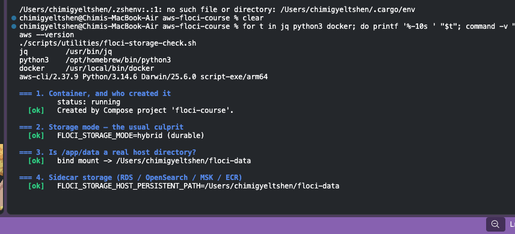

## Step-by-Step Implementation

Step 1 - Resume the environment and load six env files¶

```bash 
cd ~/aws-floci-course
./scripts/setup/floci-up.sh

source configs/course.env
source configs/lab-01.env
source configs/lab-02.env
source configs/lab-03.env
source configs/lab-04.env
source configs/lab-05.env

./scripts/utilities/whoami.sh

printf '%-28s %s\n' \
  "cluster"              "$USMS_ECS_CLUSTER" \
  "service"              "$USMS_ENROLMENT_SERVICE" \
  "baseline desired"     "$USMS_ECS_DESIRED_BASELINE" \
  "container"            "$USMS_ENROLMENT_CONTAINER" \
  "task cpu / memory"    "$USMS_ECS_TASK_CPU / $USMS_ECS_TASK_MEMORY" \
  "private subnet a"     "$USMS_PRIVATE_SUBNET_A" \
  "private subnet b"     "$USMS_PRIVATE_SUBNET_B" \
  "load balancer"        "$USMS_ALB_NAME" \
  "load balancer arn"    "$USMS_ALB_ARN" \
  "target group"         "$USMS_TG_NAME" \
  "target group arn"     "$USMS_TG_ARN" \
  "grace period"         "$USMS_SVC_GRACE_PERIOD" \
  "region"               "$AWS_REGION_COURSE" \
  "account"              "$ACCOUNT_ID"
```
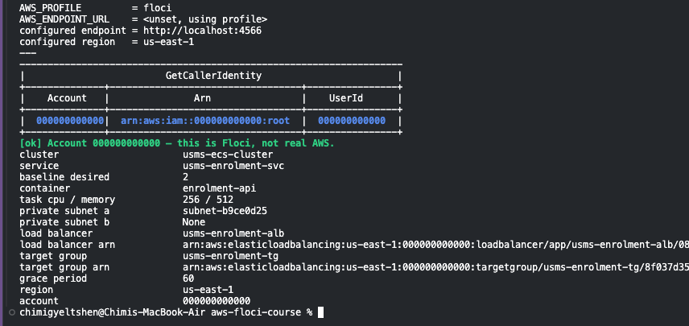


Step 2 - Confirm Labs 02, 03, 04 and 05 are still intact

```bash 
./scripts/utilities/verify-lab-02.sh  | tail -3
./scripts/utilities/verify-lab-03.sh  | tail -3
./scripts/utilities/verify-lab-04.sh | tail -3
./scripts/utilities/verify-lab-05.sh | tee outputs/lab-06-pre-verify-05.txt | tail -3

echo "== the one failure that is allowed, and only this one =="
./scripts/utilities/verify-lab-04.sh | grep FAIL || echo "no failures in 04"
```
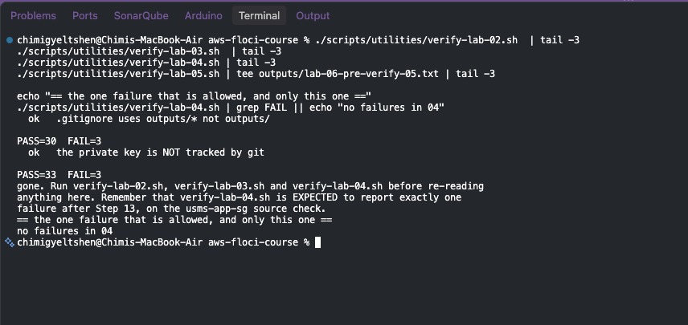

verify 
```bash 
aws ecs describe-services --cluster "$USMS_ECS_CLUSTER" --services "$USMS_ENROLMENT_SERVICE" \
  --query 'services[0].{Desired:desiredCount,Running:runningCount,Pending:pendingCount,Deployments:length(deployments),LBs:length(loadBalancers)}' \
  --output json
```
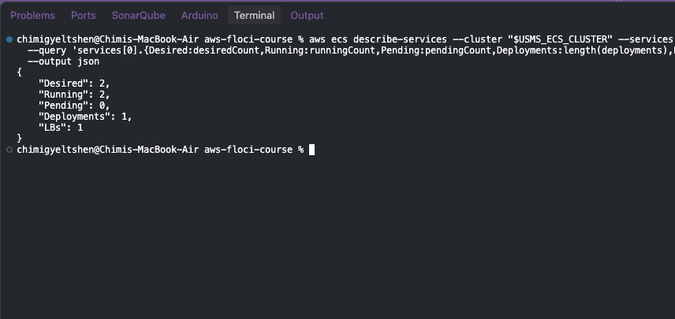

Step 3 - Probe what this Floci build supports

```bash 
probe() {
  printf '%-52s ' "$1"
  if eval "$2" >/dev/null 2>&1; then echo "SUPPORTED"; else echo "not available"; fi
}

echo "== Application Auto Scaling =="
probe "describe-scalable-targets"                 "aws application-autoscaling describe-scalable-targets --service-namespace ecs"
probe "register-scalable-target (skeleton)"       "aws application-autoscaling register-scalable-target --generate-cli-skeleton"
probe "describe-scaling-policies"                 "aws application-autoscaling describe-scaling-policies --service-namespace ecs"
probe "put-scaling-policy (skeleton)"             "aws application-autoscaling put-scaling-policy --generate-cli-skeleton"
probe "describe-scheduled-actions"                "aws application-autoscaling describe-scheduled-actions --service-namespace ecs"
probe "describe-scaling-activities"               "aws application-autoscaling describe-scaling-activities --service-namespace ecs"

echo "== CloudWatch, which is where every decision comes from =="
probe "cloudwatch describe-alarms"                "aws cloudwatch describe-alarms --max-items 1"
probe "cloudwatch put-metric-alarm (skeleton)"    "aws cloudwatch put-metric-alarm --generate-cli-skeleton"
probe "cloudwatch put-metric-data (skeleton)"     "aws cloudwatch put-metric-data --generate-cli-skeleton"
probe "cloudwatch set-alarm-state (skeleton)"     "aws cloudwatch set-alarm-state --generate-cli-skeleton"
probe "cloudwatch list-metrics"                   "aws cloudwatch list-metrics --max-items 1"

echo "== IAM and ECS, already used in Labs 1 to 4B =="
probe "iam create-service-linked-role (skeleton)" "aws iam create-service-linked-role --generate-cli-skeleton"
probe "ecs describe-services"                     "aws ecs describe-services --cluster $USMS_ECS_CLUSTER --services $USMS_ENROLMENT_SERVICE"
probe "elbv2 describe-target-groups"              "aws elbv2 describe-target-groups --names $USMS_TG_NAME"
```
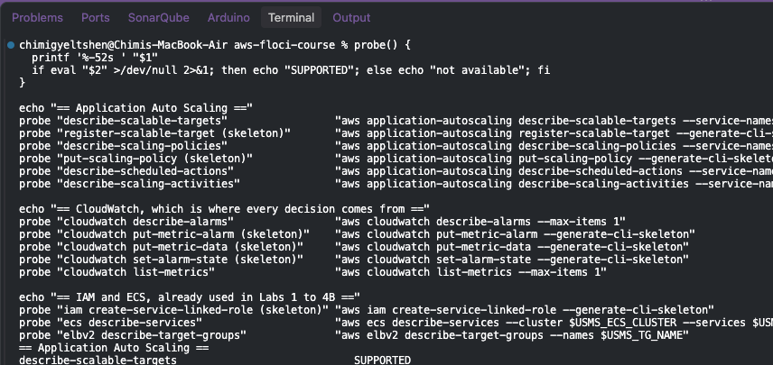

Step 4 - Create the service-linked role that writes desiredCount

Command - part 1, create it


```bash 
ASA_SLR="AWSServiceRoleForEcsApplicationAutoscaling"

if aws iam create-service-linked-role \
  --aws-service-name ecs.application-autoscaling.amazonaws.com \
  --description "Allows Application Auto Scaling to change the desired count of USMS ECS services" \
  --query 'Role.[RoleName,Arn]' \
  --output text; then
  :
elif aws iam get-role --role-name "$ASA_SLR" >/dev/null 2>&1; then
  echo "service-linked role already exists: $ASA_SLR"
else
  echo "could not create or find $ASA_SLR; check the IAM error above" >&2
  exit 1
fi
```
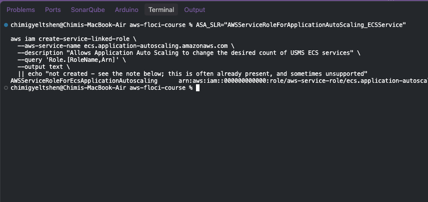

Command - part 2, read it back

```bash
aws iam get-role --role-name "$ASA_SLR" \
  --query 'Role.{Name:RoleName,Arn:Arn,Path:Path,Trust:AssumeRolePolicyDocument.Statement[0].Principal.Service}' \
  --output json \
  || echo "role not present on this build - record it as a limitation and continue"

aws iam list-attached-role-policies --role-name "$ASA_SLR" \
  --query 'AttachedPolicies[].PolicyName' --output text 2>/dev/null || true
```
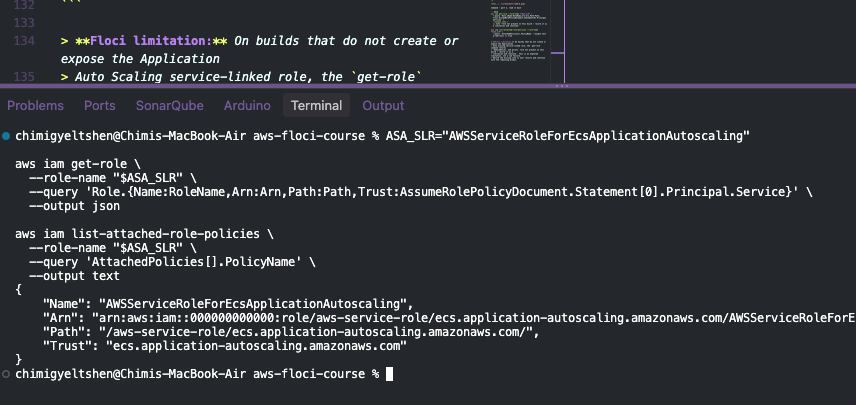

```bash 
aws iam get-role --role-name "$ASA_SLR" \
  --query 'Role.{Name:RoleName,Arn:Arn,Path:Path,Trust:AssumeRolePolicyDocument.Statement[0].Principal.Service}' \
  --output json \
  || echo "role not present on this build - record it as a limitation and continue"

aws iam list-attached-role-policies --role-name "$ASA_SLR" \
  --query 'AttachedPolicies[].PolicyName' --output text 2>/dev/null || true
```
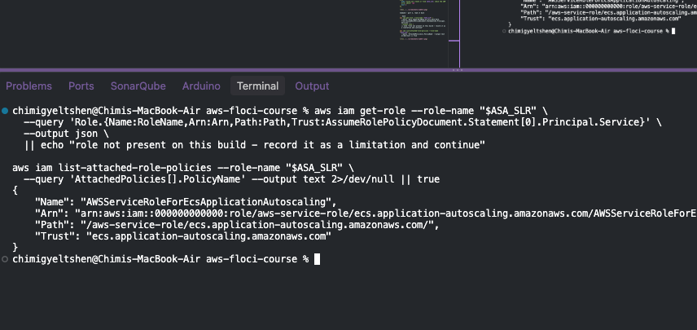

Step 5 - Register the scalable target¶
Command - part 1, build the resource ID from the API, not by hand

```bash 
SVC_ARN=$(aws ecs describe-services \
  --cluster "$USMS_ECS_CLUSTER" --services "$USMS_ENROLMENT_SERVICE" \
  --query 'services[0].serviceArn' --output text)

echo "service arn : $SVC_ARN"

# The resource ID is exactly the ARN's final colon-separated field.
RID="${SVC_ARN##*:}"
echo "resource id : $RID"

# Validate it before using it. Three slash-separated segments, the first literally "service".
SEGMENTS=$(printf '%s' "$RID" | awk -F/ '{print NF}')
FIRST=$(printf '%s' "$RID" | cut -d/ -f1)

if [ "$SEGMENTS" = "3" ] && [ "$FIRST" = "service" ]; then
  echo "OK: 3 segments, first segment 'service'"
else
  echo "UNEXPECTED SHAPE ($SEGMENTS segments, first '$FIRST') - falling back to constructing it"
  RID="service/${USMS_ECS_CLUSTER}/${USMS_ENROLMENT_SERVICE}"
  echo "resource id : $RID"
fi

SDIM="ecs:service:DesiredCount"
```
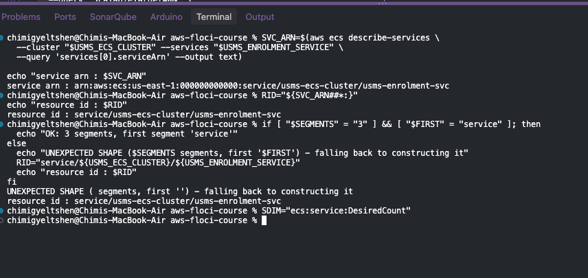

Command - part 2, register it
```bash 
aws application-autoscaling register-scalable-target \
  --service-namespace ecs \
  --resource-id "$RID" \
  --scalable-dimension "$SDIM" \
  --min-capacity "$USMS_ECS_DESIRED_BASELINE" \
  --max-capacity 10 \
  --tags Project=USMS,Name=usms-enrolment-scalable-target,Tier=app,Lab=06 \
  --query 'ScalableTargetARN' \
  --output text \
  || aws application-autoscaling register-scalable-target \
       --service-namespace ecs \
       --resource-id "$RID" \
       --scalable-dimension "$SDIM" \
       --min-capacity "$USMS_ECS_DESIRED_BASELINE" \
       --max-capacity 10
```
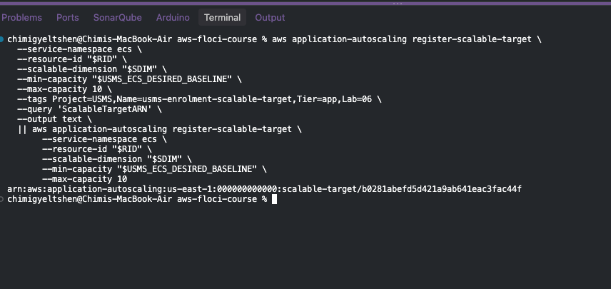

Verify

```bash 
aws application-autoscaling describe-scalable-targets \
  --service-namespace ecs \
  --resource-ids "$RID" \
  --query 'ScalableTargets[0].{Namespace:ServiceNamespace,Resource:ResourceId,Dimension:ScalableDimension,Min:MinCapacity,Max:MaxCapacity,Role:RoleARN,Created:CreationTime,Suspended:SuspendedState}' \
  --output json
```
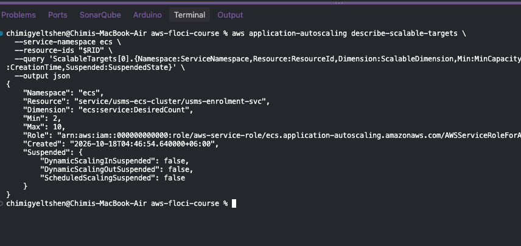

Command - part 3, find out what registering it did to the service

```bash 
aws ecs describe-services --cluster "$USMS_ECS_CLUSTER" --services "$USMS_ENROLMENT_SERVICE" \
  --query 'services[0].{Desired:desiredCount,Running:runningCount,Pending:pendingCount,Deployments:length(deployments)}' \
  --output json
```
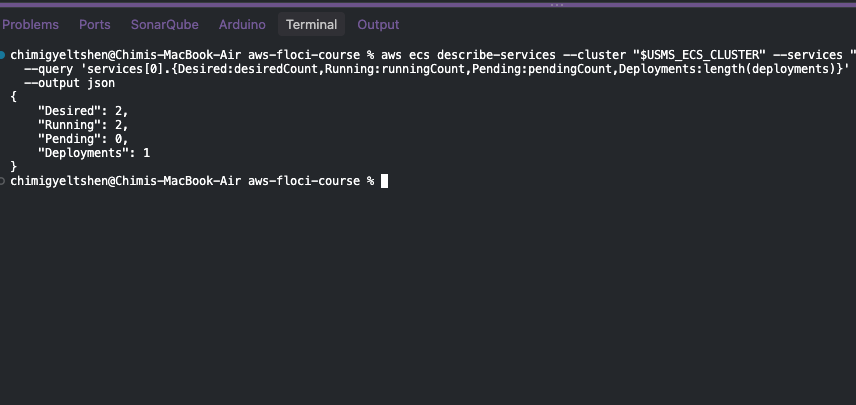

Step 6 - Change the bounds, and learn what a re-registration is¶

Command - part 1, raise the ceiling, then read it back

```bash 
aws application-autoscaling register-scalable-target \
  --service-namespace ecs \
  --resource-id "$RID" \
  --scalable-dimension "$SDIM" \
  --max-capacity 12 \
  >/dev/null

aws application-autoscaling describe-scalable-targets \
  --service-namespace ecs --resource-ids "$RID" \
  --query 'ScalableTargets[0].[MinCapacity,MaxCapacity]' --output text
```
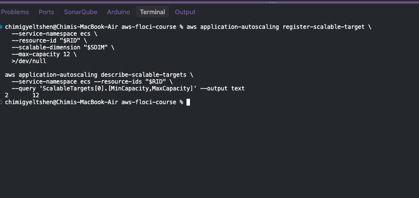

Command - part 2, put it back

```bash
aws application-autoscaling register-scalable-target \
  --service-namespace ecs \
  --resource-id "$RID" \
  --scalable-dimension "$SDIM" \
  --min-capacity 2 \
  --max-capacity 10 \
  >/dev/null

aws application-autoscaling describe-scalable-targets \
  --service-namespace ecs --resource-ids "$RID" \
  --query 'ScalableTargets[].{Resource:ResourceId,Min:MinCapacity,Max:MaxCapacity}' \
  --output table
```
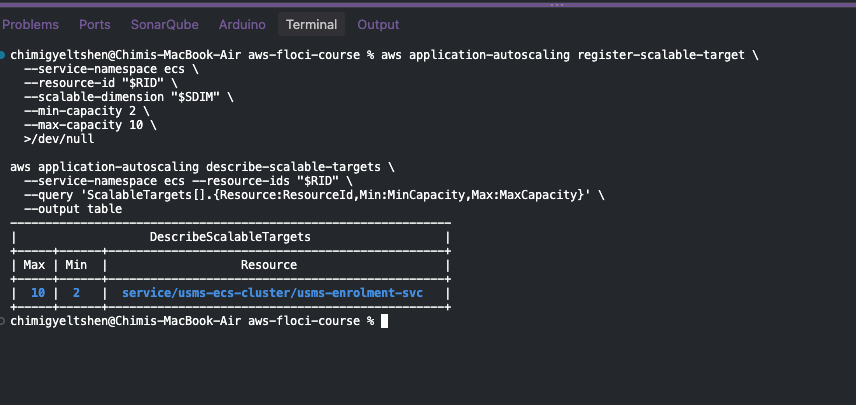

verify 
```bash 
aws application-autoscaling describe-scalable-targets --service-namespace ecs \
  --query 'length(ScalableTargets)' --output text
```
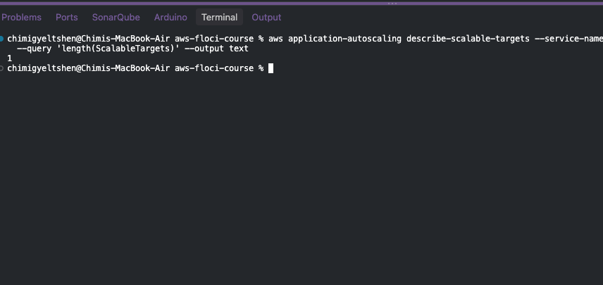

Step 7 - Create the CPU target tracking policy¶

Command - part 1, write the policy configuration

```bash 
cat > templates/lab-06-target-tracking-cpu.json << 'EOF'
{
  "TargetValue": 50.0,
  "PredefinedMetricSpecification": {
    "PredefinedMetricType": "ECSServiceAverageCPUUtilization"
  },
  "ScaleOutCooldown": 60,
  "ScaleInCooldown": 300,
  "DisableScaleIn": false
}
EOF

python3 -m json.tool templates/lab-06-target-tracking-cpu.json > /dev/null && echo "valid JSON"
grep -c '\$' templates/lab-06-target-tracking-cpu.json
```
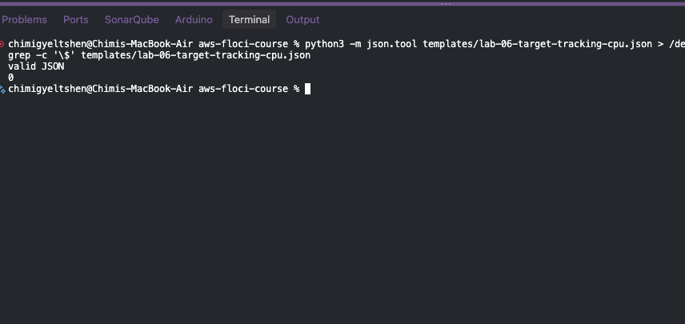

Command - part 2, create the policy
```bash 
CPU_POLICY="usms-enrolment-cpu-target-tracking"

CPU_POLICY_ARN=$(aws application-autoscaling put-scaling-policy \
  --service-namespace ecs \
  --resource-id "$RID" \
  --scalable-dimension "$SDIM" \
  --policy-name "$CPU_POLICY" \
  --policy-type TargetTrackingScaling \
  --target-tracking-scaling-policy-configuration file://templates/lab-06-target-tracking-cpu.json \
  --query 'PolicyARN' \
  --output text)

echo "CPU_POLICY_ARN = $CPU_POLICY_ARN"
```
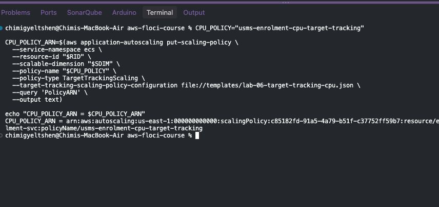

verify 
```bash
aws application-autoscaling describe-scaling-policies \
  --service-namespace ecs \
  --resource-id "$RID" \
  --policy-names "$CPU_POLICY" \
  --query 'ScalingPolicies[0].{Name:PolicyName,Type:PolicyType,Metric:TargetTrackingScalingPolicyConfiguration.PredefinedMetricSpecification.PredefinedMetricType,Target:TargetTrackingScalingPolicyConfiguration.TargetValue,Out:TargetTrackingScalingPolicyConfiguration.ScaleOutCooldown,In:TargetTrackingScalingPolicyConfiguration.ScaleInCooldown,NoScaleIn:TargetTrackingScalingPolicyConfiguration.DisableScaleIn,Alarms:Alarms[].AlarmName}' \
  --output json
```
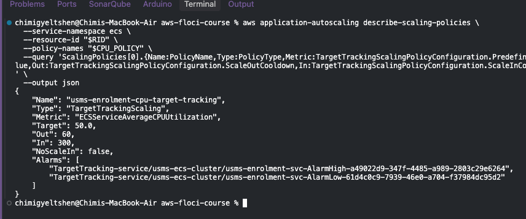

Step 8 - Read the two alarms that target tracking created for you¶

Command - part 1, find them

```bash
aws cloudwatch describe-alarms \
  --alarm-name-prefix "TargetTracking-${RID}" \
  --query 'MetricAlarms[].{Name:AlarmName,Metric:MetricName,Namespace:Namespace,Stat:Statistic,Period:Period,Evals:EvaluationPeriods,Op:ComparisonOperator,Threshold:Threshold,Actions:length(AlarmActions),State:StateValue}' \
  --output json
```
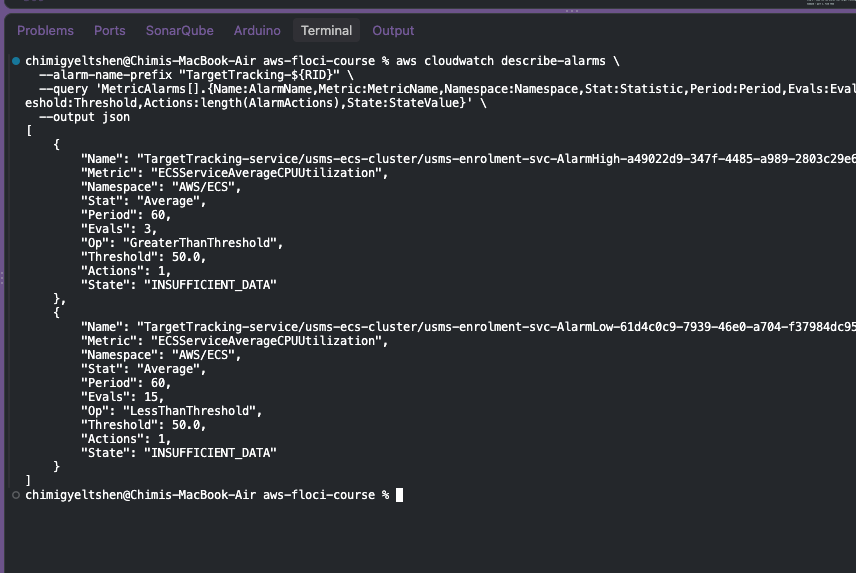

Command - part 2, prove the naming is derivable

```bash 
echo "resource id            : $RID"
echo "managed alarm prefix   : TargetTracking-$RID"
aws cloudwatch describe-alarms --alarm-name-prefix "TargetTracking-${RID}" \
  --query 'length(MetricAlarms)' --output text
```
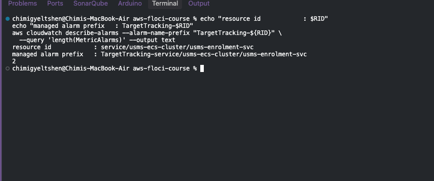

Step 9 - Create the request-count policy, the row Lab 05 unlocked

Command - part 1, get the label, from Lab 05 if it recorded one and from the API if not

```bash 
if [ -n "${USMS_ALB_RESOURCE_LABEL:-}" ]; then
  RESOURCE_LABEL="$USMS_ALB_RESOURCE_LABEL"
  echo "using the label Lab 05 Exercise 5 recorded"
else
  echo "no recorded label - deriving it from the API"
  ALB_ARN_NOW=$(aws elbv2 describe-load-balancers --names "$USMS_ALB_NAME" \
    --query 'LoadBalancers[0].LoadBalancerArn' --output text)
  TG_ARN_NOW=$(aws elbv2 describe-target-groups --names "$USMS_TG_NAME" \
    --query 'TargetGroups[0].TargetGroupArn' --output text)

  # The ALB suffix is everything AFTER ":loadbalancer/", and already starts with "app/".
  ALB_SUFFIX="${ALB_ARN_NOW#*:loadbalancer/}"
  # The target group suffix is everything after the LAST colon, and already starts with "targetgroup/".
  TG_SUFFIX="${TG_ARN_NOW##*:}"

  RESOURCE_LABEL="${ALB_SUFFIX}/${TG_SUFFIX}"
fi

echo "RESOURCE_LABEL = $RESOURCE_LABEL"

# Validate before use: six slash-separated segments, first "app", fourth "targetgroup".
printf '%s' "$RESOURCE_LABEL" | awk -F/ '{
  printf "segments=%d first=%s fourth=%s\n", NF, $1, $4
  if (NF==6 && $1=="app" && $4=="targetgroup") print "OK"; else print "UNEXPECTED SHAPE"
}'
```
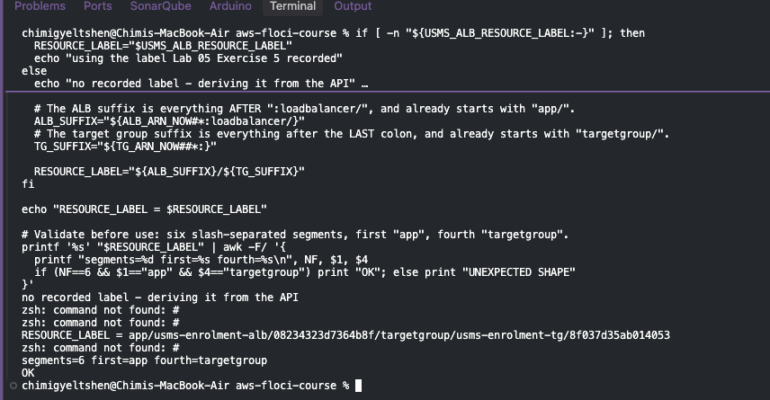

Command - part 2, the policy configuration

```bash
cat > templates/lab-06-target-tracking-requests.json << EOF
{
  "TargetValue": 1000.0,
  "PredefinedMetricSpecification": {
    "PredefinedMetricType": "ALBRequestCountPerTarget",
    "ResourceLabel": "$RESOURCE_LABEL"
  },
  "ScaleOutCooldown": 60,
  "ScaleInCooldown": 300,
  "DisableScaleIn": false
}
EOF

python3 -m json.tool templates/lab-06-target-tracking-requests.json > /dev/null && echo "valid JSON"
grep -c '\$' templates/lab-06-target-tracking-requests.json
grep ResourceLabel templates/lab-06-target-tracking-requests.json
```
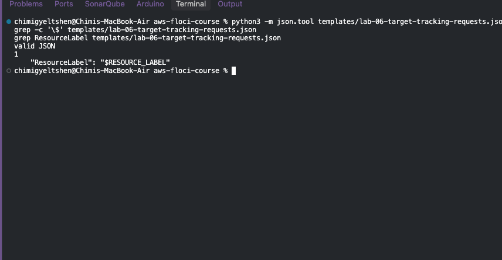

Command - part 3, create it
```bash
REQ_POLICY="usms-enrolment-requests-target-tracking"

REQ_POLICY_ARN=$(aws application-autoscaling put-scaling-policy \
  --service-namespace ecs \
  --resource-id "$RID" \
  --scalable-dimension "$SDIM" \
  --policy-name "$REQ_POLICY" \
  --policy-type TargetTrackingScaling \
  --target-tracking-scaling-policy-configuration file://templates/lab-06-target-tracking-requests.json \
  --query 'PolicyARN' \
  --output text) \
  && echo "REQ_POLICY_ARN = $REQ_POLICY_ARN" \
  || echo "ALBRequestCountPerTarget not supported on this build - record it and continue; Step 10 does not depend on it"
```
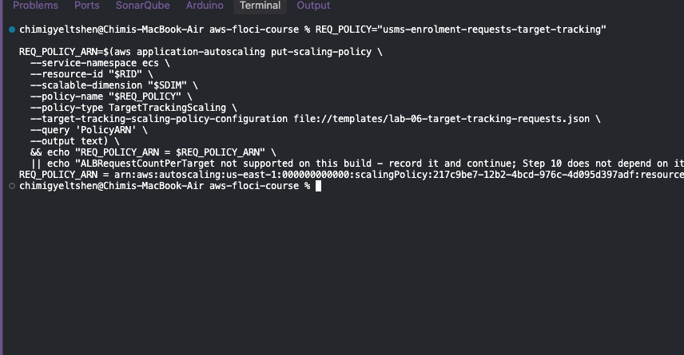

verify 
```bash
aws application-autoscaling describe-scaling-policies \
  --service-namespace ecs --resource-id "$RID" \
  --query 'ScalingPolicies[].{Name:PolicyName,Type:PolicyType,Metric:TargetTrackingScalingPolicyConfiguration.PredefinedMetricSpecification.PredefinedMetricType,Target:TargetTrackingScalingPolicyConfiguration.TargetValue,Alarms:length(Alarms)}' \
  --output table
```
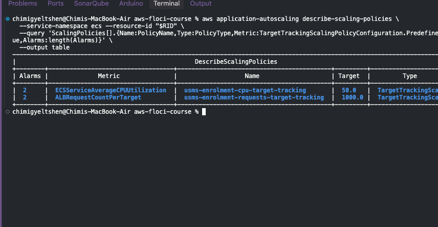

Step 10 - Create a step scaling policy, and the alarm that drives it¶
Command - part 1, publish the metric, so that it exists


```bash 
METRIC_NS="USMS/Enrolment"
METRIC_NAME="EnrolmentQueueDepth"
METRIC_DIM="Service=enrolment"

for v in 3 5 4; do
  aws cloudwatch put-metric-data \
    --namespace "$METRIC_NS" \
    --metric-name "$METRIC_NAME" \
    --value "$v" \
    --unit Count \
    --dimensions "$METRIC_DIM"
done

aws cloudwatch list-metrics --namespace "$METRIC_NS" \
  --query 'Metrics[].{Name:MetricName,Dimensions:Dimensions[].[Name,Value]}' \
  --output json
```
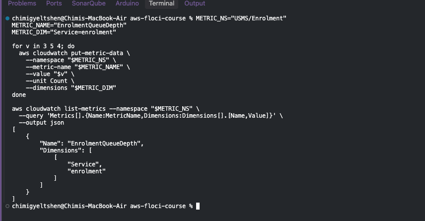

Command - part 2, the step configuration


```bash
cat > templates/lab-06-step-scaling-out.json << 'EOF'
{
  "AdjustmentType": "ChangeInCapacity",
  "MetricAggregationType": "Average",
  "Cooldown": 60,
  "StepAdjustments": [
    {
      "MetricIntervalLowerBound": 0,
      "MetricIntervalUpperBound": 100,
      "ScalingAdjustment": 1
    },
    {
      "MetricIntervalLowerBound": 100,
      "ScalingAdjustment": 3
    }
  ]
}
EOF

python3 -m json.tool templates/lab-06-step-scaling-out.json > /dev/null && echo "valid JSON"
grep -c '\$' templates/lab-06-step-scaling-out.json
```
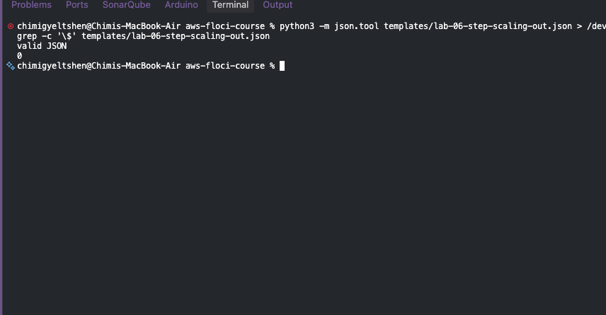

Command - part 3, create the policy, then the alarm that drives it

```bash 
STEP_POLICY="usms-enrolment-queue-step-out"

STEP_POLICY_ARN=$(aws application-autoscaling put-scaling-policy \
  --service-namespace ecs \
  --resource-id "$RID" \
  --scalable-dimension "$SDIM" \
  --policy-name "$STEP_POLICY" \
  --policy-type StepScaling \
  --step-scaling-policy-configuration file://templates/lab-06-step-scaling-out.json \
  --query 'PolicyARN' \
  --output text)

echo "STEP_POLICY_ARN = $STEP_POLICY_ARN"

QUEUE_ALARM="usms-enrolment-queue-high"

aws cloudwatch put-metric-alarm \
  --alarm-name "$QUEUE_ALARM" \
  --alarm-description "USMS enrolment work queue is backing up; invokes the step scaling policy" \
  --namespace "$METRIC_NS" \
  --metric-name "$METRIC_NAME" \
  --dimensions Name=Service,Value=enrolment \
  --statistic Average \
  --period 60 \
  --evaluation-periods 1 \
  --threshold 100 \
  --comparison-operator GreaterThanOrEqualToThreshold \
  --treat-missing-data notBreaching \
  --alarm-actions "$STEP_POLICY_ARN" \
  --tags Key=Name,Value=usms-enrolment-queue-high Key=Project,Value=USMS Key=Lab,Value=06

aws cloudwatch describe-alarms --alarm-names "$QUEUE_ALARM" \
  --query 'MetricAlarms[0].{Name:AlarmName,Namespace:Namespace,Metric:MetricName,Stat:Statistic,Period:Period,Evals:EvaluationPeriods,Op:ComparisonOperator,Threshold:Threshold,Missing:TreatMissingData,Actions:AlarmActions,State:StateValue}' \
  --output json
```
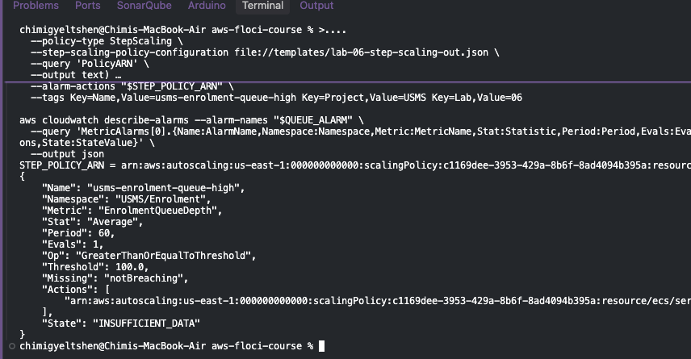

verify 
```bash
aws application-autoscaling describe-scaling-policies \
  --service-namespace ecs --resource-id "$RID" --policy-names "$STEP_POLICY" \
  --query 'ScalingPolicies[0].{Name:PolicyName,Type:PolicyType,Adjust:StepScalingPolicyConfiguration.AdjustmentType,Agg:StepScalingPolicyConfiguration.MetricAggregationType,Cooldown:StepScalingPolicyConfiguration.Cooldown,Steps:StepScalingPolicyConfiguration.StepAdjustments,Alarms:Alarms[].AlarmName}' \
  --output json
```
Step 11 - Create two scheduled actions¶

Command - part 1, the morning scale-out


```bash 
SCHED_OUT="usms-enrolment-morning-scale-out"

aws application-autoscaling put-scheduled-action \
  --service-namespace ecs \
  --resource-id "$RID" \
  --scalable-dimension "$SDIM" \
  --scheduled-action-name "$SCHED_OUT" \
  --schedule "cron(45 7 ? * MON-FRI *)" \
  --timezone "Asia/Thimphu" \
  --scalable-target-action MinCapacity=4,MaxCapacity=10 \
  && echo "created $SCHED_OUT" \
  || echo "--timezone may be unsupported on this build; retrying in UTC below"
```
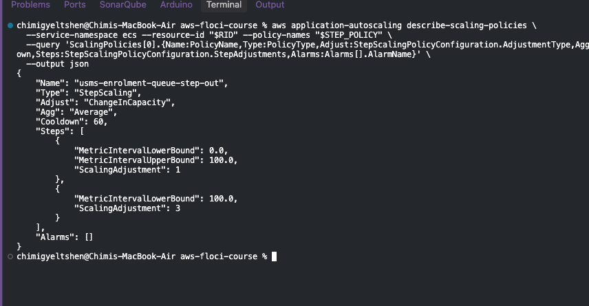

Command - part 2, the evening scale-in

```bash
SCHED_IN="usms-enrolment-evening-scale-in"

aws application-autoscaling put-scheduled-action \
  --service-namespace ecs \
  --resource-id "$RID" \
  --scalable-dimension "$SDIM" \
  --scheduled-action-name "$SCHED_IN" \
  --schedule "cron(0 20 ? * MON-FRI *)" \
  --timezone "Asia/Thimphu" \
  --scalable-target-action MinCapacity=2,MaxCapacity=10 \
  || aws application-autoscaling put-scheduled-action \
       --service-namespace ecs \
       --resource-id "$RID" \
       --scalable-dimension "$SDIM" \
       --scheduled-action-name "$SCHED_IN" \
       --schedule "cron(0 14 ? * MON-FRI *)" \
       --scalable-target-action MinCapacity=2,MaxCapacity=10
```
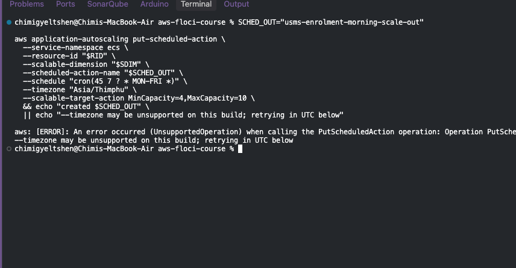

verufy 
```bash

aws application-autoscaling describe-scheduled-actions \
  --service-namespace ecs \
  --resource-id "$RID" \
  --query 'ScheduledActions[].{Name:ScheduledActionName,Schedule:Schedule,TZ:Timezone,Min:ScalableTargetAction.MinCapacity,Max:ScalableTargetAction.MaxCapacity,Created:CreationTime}' \
  --output table
```
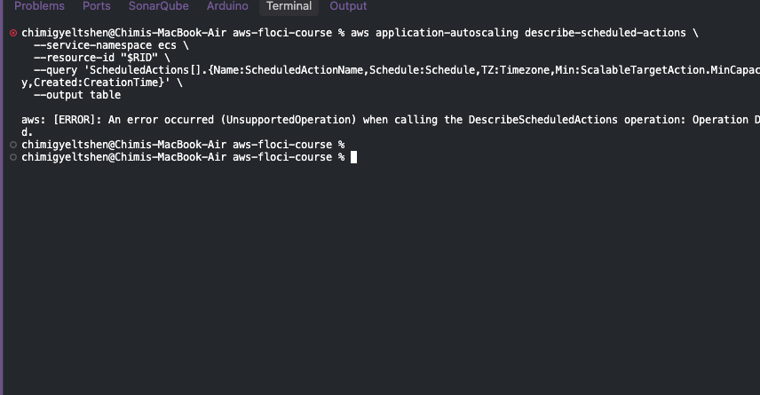


Step 12 - Fire the alarm, and prove that something other than you moved the number

Command - part 1, record the truth before

```bash
python3 -c "import datetime;print(datetime.datetime.now(datetime.timezone.utc).strftime('%Y-%m-%dT%H:%M:%SZ'))" \
  > outputs/lab-06-pre-scale.txt

aws ecs describe-services --cluster "$USMS_ECS_CLUSTER" --services "$USMS_ENROLMENT_SERVICE" \
  --query 'services[0].[desiredCount,runningCount,pendingCount]' --output text \
  >> outputs/lab-06-pre-scale.txt

aws application-autoscaling describe-scaling-activities \
  --service-namespace ecs --resource-id "$RID" \
  --query 'length(ScalingActivities)' --output text \
  >> outputs/lab-06-pre-scale.txt

cat outputs/lab-06-pre-scale.txt
```
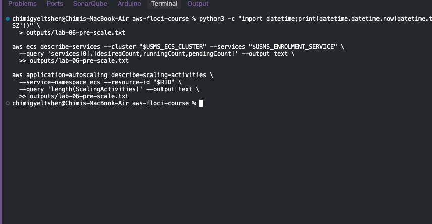

Command - part 2, push the metric past the threshold the honest way

```bash 
for i in 1 2 3; do
  aws cloudwatch put-metric-data \
    --namespace "$METRIC_NS" \
    --metric-name "$METRIC_NAME" \
    --value 260 \
    --unit Count \
    --dimensions "$METRIC_DIM"
  sleep 5
done

START=$(python3 -c "import datetime;print((datetime.datetime.now(datetime.timezone.utc)-datetime.timedelta(minutes=10)).strftime('%Y-%m-%dT%H:%M:%SZ'))")
END=$(python3 -c "import datetime;print(datetime.datetime.now(datetime.timezone.utc).strftime('%Y-%m-%dT%H:%M:%SZ'))")

aws cloudwatch get-metric-statistics \
  --namespace "$METRIC_NS" \
  --metric-name "$METRIC_NAME" \
  --dimensions Name=Service,Value=enrolment \
  --start-time "$START" --end-time "$END" \
  --period 60 \
  --statistics Average Maximum \
  --query 'sort_by(Datapoints,&Timestamp)[].[Timestamp,Average,Maximum]' \
  --output table
```
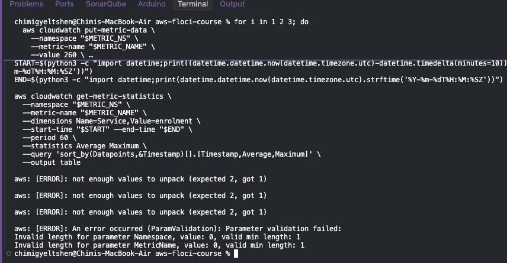

```bash 
for i in $(seq 1 8); do
  read -r state reason <<< "$(aws cloudwatch describe-alarms --alarm-names "$QUEUE_ALARM" \
    --query 'MetricAlarms[0].[StateValue,StateReason]' --output text)"
  printf 'poll %d  state=%-18s %s\n' "$i" "$state" "$reason"
  [ "$state" = "ALARM" ] && break
  sleep 15
done
```
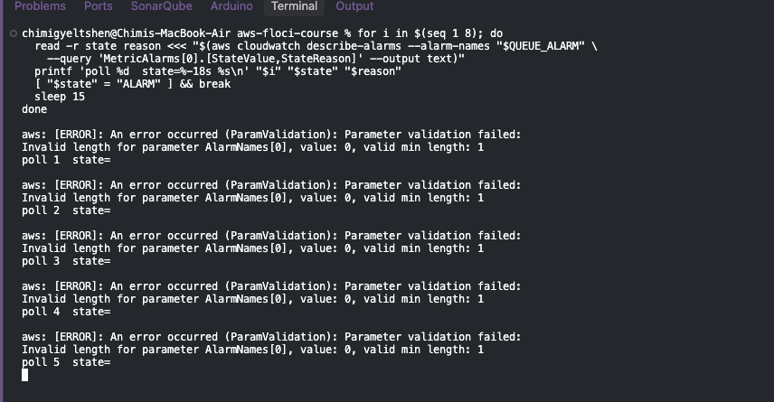

Command - part 3, if the alarm will not fire by itself, fire it deliberately

```bash
aws cloudwatch set-alarm-state \
  --alarm-name "$QUEUE_ALARM" \
  --state-value ALARM \
  --state-reason "Lab 06 Step 12: forcing the alarm state to prove the alarm-to-policy link" \
  && echo "alarm state forced to ALARM" \
  || echo "set-alarm-state not supported on this build - go to part 5"
```
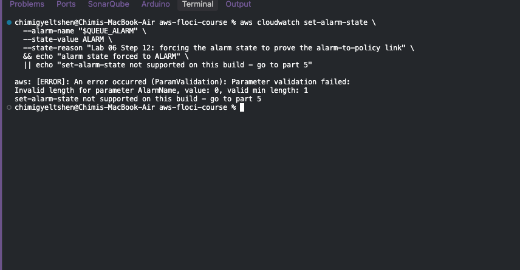


Command - part 4, read back the number and the record

```bash
for i in $(seq 1 10); do
  read -r d r p <<< "$(aws ecs describe-services --cluster "$USMS_ECS_CLUSTER" \
    --services "$USMS_ENROLMENT_SERVICE" \
    --query 'services[0].[desiredCount,runningCount,pendingCount]' --output text)"
  printf 'poll %2d  desired=%s running=%s pending=%s\n' "$i" "$d" "$r" "$p"
  [ "$d" != "2" ] && break
  sleep 10
done

echo
echo "== who moved it? =="
aws application-autoscaling describe-scaling-activities \
  --service-namespace ecs \
  --resource-id "$RID" \
  --max-items 5 \
  --query 'ScalingActivities[].{Start:StartTime,Status:StatusCode,Cause:Cause,Detail:StatusMessage,Description:Description}' \
  --output json
```
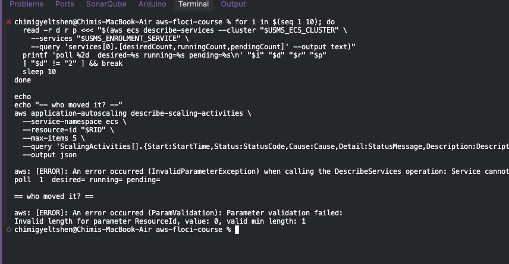

Command - part 5, the fallback proof, which always works

```bash
{
  echo "== 1. The alarm, and what it watches =="
  aws cloudwatch describe-alarms --alarm-names "$QUEUE_ALARM" \
    --query 'MetricAlarms[0].[AlarmName,Namespace,MetricName,ComparisonOperator,Threshold,StateValue]' \
    --output text

  echo
  echo "== 2. What the alarm invokes =="
  aws cloudwatch describe-alarms --alarm-names "$QUEUE_ALARM" \
    --query 'MetricAlarms[0].AlarmActions[]' --output text

  echo
  echo "== 3. That ARN belongs to this policy, on this target =="
  aws application-autoscaling describe-scaling-policies \
    --service-namespace ecs --resource-id "$RID" --policy-names "$STEP_POLICY" \
    --query 'ScalingPolicies[0].[PolicyName,PolicyARN,ResourceId,ScalableDimension]' --output text

  echo
  echo "== 4. The step the breach of 160 would select =="
  python3 - << 'PY'
import json
cfg = json.load(open('templates/lab-06-step-scaling-out.json'))
breach = 260 - 100
for s in cfg['StepAdjustments']:
    lo = s.get('MetricIntervalLowerBound')
    hi = s.get('MetricIntervalUpperBound')
    lo_ok = lo is None or breach >= lo
    hi_ok = hi is None or breach < hi
    if lo_ok and hi_ok:
        print(f"breach {breach} selects ScalingAdjustment {s['ScalingAdjustment']:+d}")
PY

  echo
  echo "== 5. The bounds that would clamp the result =="
  aws application-autoscaling describe-scalable-targets \
    --service-namespace ecs --resource-ids "$RID" \
    --query 'ScalableTargets[0].[MinCapacity,MaxCapacity]' --output text

  echo
  echo "== 6. The current desired count =="
  aws ecs describe-services --cluster "$USMS_ECS_CLUSTER" --services "$USMS_ENROLMENT_SERVICE" \
    --query 'services[0].desiredCount' --output text
} | tee outputs/lab-06-scaling-proof.txt
```
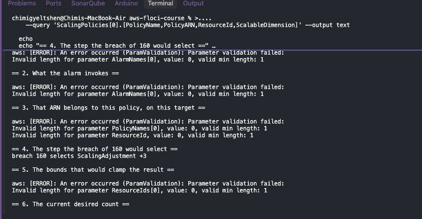

Command - part 6, return to the baseline

```bash 
aws cloudwatch set-alarm-state --alarm-name "$QUEUE_ALARM" --state-value OK \
  --state-reason "Lab 06 Step 12 complete" 2>/dev/null || true

for v in 4 3 2; do
  aws cloudwatch put-metric-data --namespace "$METRIC_NS" --metric-name "$METRIC_NAME" \
    --value "$v" --unit Count --dimensions "$METRIC_DIM"
done

aws ecs update-service \
  --cluster "$USMS_ECS_CLUSTER" --service "$USMS_ENROLMENT_SERVICE" \
  --desired-count 2 \
  --query 'service.desiredCount' --output text

python3 -c "import datetime;print(datetime.datetime.now(datetime.timezone.utc).strftime('%Y-%m-%dT%H:%M:%SZ'))" \
  > outputs/lab-06-post-scale.txt
aws ecs describe-services --cluster "$USMS_ECS_CLUSTER" --services "$USMS_ENROLMENT_SERVICE" \
  --query 'services[0].[desiredCount,runningCount,pendingCount]' --output text \
  >> outputs/lab-06-post-scale.txt

paste outputs/lab-06-pre-scale.txt outputs/lab-06-post-scale.txt
```
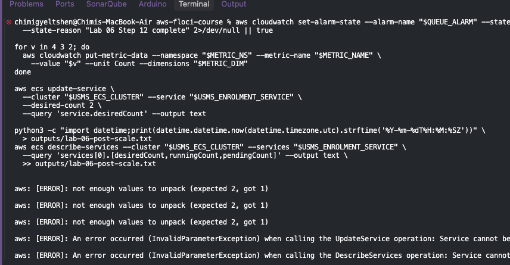

Step 13 - Suspend and resume scaling¶
```bash 
{
  "DynamicScalingInSuspended": true,
  "DynamicScalingOutSuspended": false,
  "ScheduledScalingSuspended": false
}
```
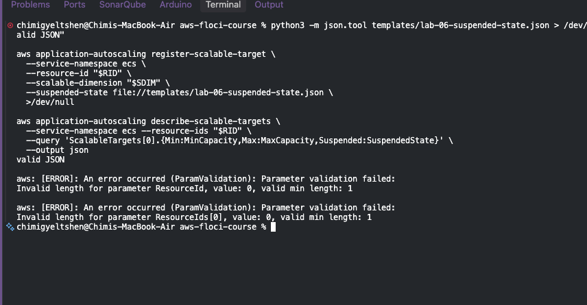


