# Lab 07 - Deploying a Microservices Application on Amazon EKS

| | |
|---|---|
| **Course** | DSO303 - Cloud-Native Application Development on AWS |
| **Environment** | Floci (local AWS emulator) + k3s/k3d Kubernetes |
| **New tool** | `kubectl` |
| **Builds on** | Lab 01 (IAM), Lab 02 (VPC), Lab 04 (ECS) |
| **Feeds into** | Lab 08 (EKS scaling and exposure) |
| **Lab guide** | [Lab 07 - EKS](https://norbutlepcha25.github.io/dso303/Lab/Lab-07-EKS.html) |
| **Exercises** | [exercises.md](exercises.md) |

---

## Table of Contents

1. [Objectives](#1-objectives)
2. [Prerequisites](#2-prerequisites)
3. [What We Are Building](#3-what-we-are-building)
4. [Resources Created](#4-resources-created)
5. [Implementation](#5-implementation)
   - [Part A - Environment and support path (Steps 1-3)](#part-a---environment-and-support-path)
   - [Part B - IAM roles and networking (Steps 4-7)](#part-b---iam-roles-and-networking)
   - [Part C - Cluster, node group and kubectl (Steps 8-11)](#part-c---cluster-node-group-and-kubectl)
   - [Part D - Deploying the microservices (Steps 12-16)](#part-d---deploying-the-microservices)
   - [Part E - Configuration, rollouts and failures (Steps 17-19)](#part-e---configuration-rollouts-and-failures)
   - [Part F - ECS comparison, IRSA and persistence (Steps 20-22)](#part-f---ecs-comparison-irsa-and-persistence)
   - [Part G - Save and commit (Steps 23-24)](#part-g---save-and-commit)
6. [Verification](#6-verification)
7. [Independent Exercises](#7-independent-exercises)
8. [Key Takeaways](#8-key-takeaways)

---

## 1. Objectives

- Create an EKS cluster and a managed node group in Lab 02's VPC, each with its own IAM role.
- Point `kubectl` at the cluster and deploy three microservices (`usms-gateway`, `usms-enrolment`, `usms-results`) from declarative manifests.
- Prove the services discover each other by DNS name, then perform a rolling update, a rollback and three deliberate failure diagnoses.
- Use a ConfigMap and a Secret, and demonstrate what a Secret does **not** protect.
- Prove the cluster survives a restart and save its identifiers to `configs/lab-07.env` for Lab 08.

---

## 2. Prerequisites

- Labs 01-04 complete, with `verify-lab-02.sh` reporting `FAIL=0`.
- All four Lab 02 subnets (public-a/b, private-a/b) recorded in `configs/lab-02.env`. EKS refuses a cluster in a single Availability Zone.
- About 2 GB free RAM and 3 GB disk for the Kubernetes node containers.

| Tool | Used for | Check |
|------|----------|-------|
| Docker | Floci and the Kubernetes node containers | `docker version` |
| AWS CLI v2 | Every AWS-side step | `aws --version` |
| `kubectl` | Step 11 onwards | `kubectl version --client` |
| `k3d` | Support Path B only | `k3d version` |
| `python3` | Validating JSON | `python3 --version` |

`kubectl` is the one new tool:

```bash
brew install kubectl
kubectl version --client --output=yaml
```

---

## 3. What We Are Building

```text
A student clicks "Register for this module" in the USMS portal.

   the request arrives at        usms-gateway     (1 pod,  nginx reverse proxy)
   which forwards /enrolment/ to usms-enrolment   (2 pods, returns JSON with its own pod name)
   and forwards   /results/   to usms-results     (2 pods, returns JSON with its own pod name)

Nothing in usms-gateway's configuration contains an IP address.
It contains two DNS names, and the cluster keeps them pointing at healthy pods.
```

```text
                    INSIDE THE CLUSTER - namespace "usms"

   Service usms-gateway (ClusterIP :80)
      └── Deployment usms-gateway (1 replica, nginx)
            ├── /enrolment/ -> usms-enrolment.usms.svc.cluster.local
            └── /results/   -> usms-results.usms.svc.cluster.local

   Service usms-enrolment (ClusterIP)        Service usms-results (ClusterIP)
      └── Deployment, 2 replicas                └── Deployment, 2 replicas
          requests cpu=50m, mem=32Mi                requests cpu=50m, mem=32Mi
          readiness + liveness probes               readiness probe only
          maxUnavailable 0 / maxSurge 1             default strategy 25% / 25%

   ConfigMaps: usms-app-config, usms-enrolment-conf, usms-results-conf, usms-gateway-conf
   Secret:     usms-enrolment-secret  (base64, NOT encrypted)

                    AWS SIDE - in Lab 02's VPC (10.0.0.0/16)

   usms-eks-cluster      all 4 subnets, sg usms-eks-cluster-sg (tcp/443 from VPC only)
   usms-eks-nodes        private-a + private-b only
   usms-eks-cluster-role trusts eks.amazonaws.com -> USMSEKSClusterPolicy
   usms-eks-node-role    trusts ec2.amazonaws.com -> USMSEKSNodePolicy
                                                  -> USMSStudentDataReadWrite (Lab 01, unchanged)
```

Two endpoints, two protocols: the **AWS CLI** talks to Floci on `:4566`; **`kubectl`** talks to the Kubernetes API server on `:6443`. Nothing in the cluster half mentions AWS; that half is portable to any conformant Kubernetes.

---

## 4. Resources Created

| Layer | Resource | Purpose |
|-------|----------|---------|
| IAM | `usms-eks-cluster-role` | Assumed by the EKS control plane |
| IAM | `usms-eks-node-role` | Assumed by the worker nodes (EC2) |
| IAM | `USMSEKSClusterPolicy` | Local stand-in for `AmazonEKSClusterPolicy` |
| IAM | `USMSEKSNodePolicy` | Local stand-in for the worker-node, CNI and ECR read-only policies |
| EC2 | `usms-eks-cluster-sg` | Control-plane endpoint firewall, tcp/443 from the VPC CIDR |
| EKS | `usms-eks-cluster` | Kubernetes 1.30, 4 subnets, tag `_lb_ports_=8081,8082` |
| EKS | `usms-eks-nodes` | Managed node group, private subnets, min 2 / max 4 / desired 2 |
| K8s | namespace `usms` | Holds every object below |
| K8s | `usms-gateway`, `usms-enrolment`, `usms-results` | Deployment + ClusterIP Service + ConfigMap each |
| K8s | `usms-app-config` | Shared ConfigMap (environment, campus, version, region) |
| K8s | `usms-enrolment-secret` | Secret consumed by `usms-enrolment` |
| K8s | `usms-enrolment-sa` | ServiceAccount, ready for IRSA on real AWS |
| Repo | `configs/lab-07.env` | 21 identifiers for Lab 08 |

```text
manifests/lab-07/
├── 00-namespace.yaml          ├── 40-gateway.yaml
├── 10-configmap-app.yaml      ├── 50-secret.yaml
├── 20-enrolment.yaml          └── 60-serviceaccount.yaml
└── 30-results.yaml
```

The numeric prefixes matter: `kubectl apply -f manifests/lab-07/` applies files in lexical order, so the namespace always exists before anything is created in it.

---

## 5. Implementation

### Part A - Environment and support path

#### Step 1 - Start the environment and confirm the ground

Nothing here is worth starting if Lab 02's subnets are missing or Floci is in memory mode.

```bash
cd ~/aws-floci-course
./scripts/setup/floci-up.sh

source configs/course.env
source configs/lab-01.env
source configs/lab-02.env
source configs/lab-03.env
source configs/lab-04.env

./scripts/utilities/whoami.sh
./scripts/utilities/floci-storage-check.sh
```
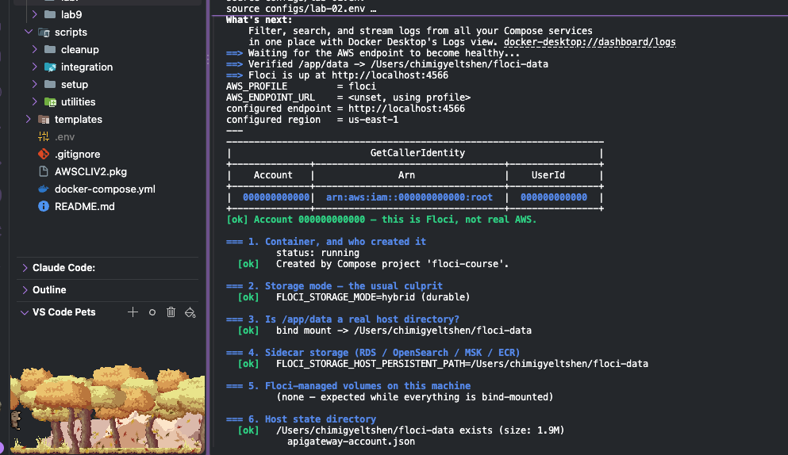

**Verify** - earlier labs still pass and all four subnets are present:

```bash
./scripts/utilities/verify-lab-02.sh | tail -2
./scripts/utilities/verify-lab-04.sh | tail -2

echo "public-a=$USMS_PUBLIC_SUBNET_A"
echo "public-b=$USMS_PUBLIC_SUBNET_B"
echo "private-a=$USMS_PRIVATE_SUBNET_A"
echo "private-b=$USMS_PRIVATE_SUBNET_B"
```
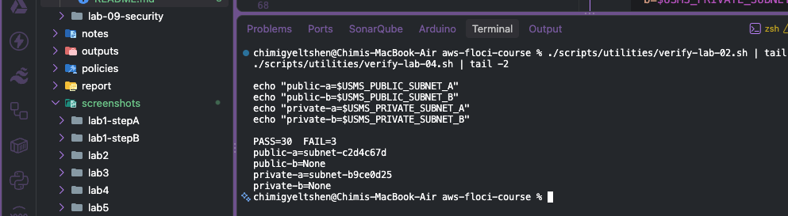

#### Step 2 - Probe what this build supports, and record it

Floci runs a real k3s cluster and emulates only the AWS-facing `eks` API. The probe decides the path: **A** (`aws eks` works), **B** (use `k3d` directly) or **C** (manifests only).

```bash
chmod +x scripts/utilities/eks-support-probe.sh
./scripts/utilities/eks-support-probe.sh | tee outputs/lab-07-support-probe.txt
```
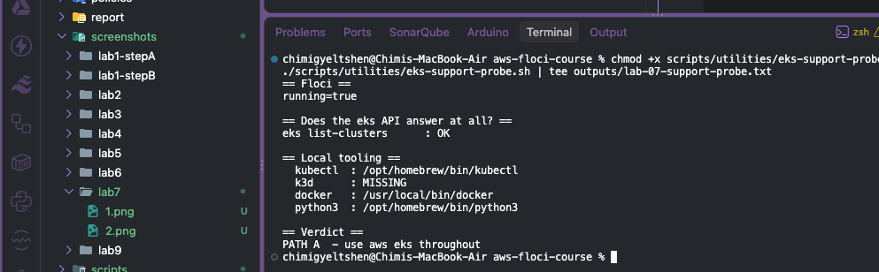

**Verify** - record the verdict in the notes:

```bash
mkdir -p notes
{
  echo "## Lab 07 support path"
  echo "Probed on $(date -u +%Y-%m-%dT%H:%M:%SZ)"
  grep -A1 '== Verdict ==' outputs/lab-07-support-probe.txt | tail -1
} >> notes/lab-07-notes.md

tail -3 notes/lab-07-notes.md
```
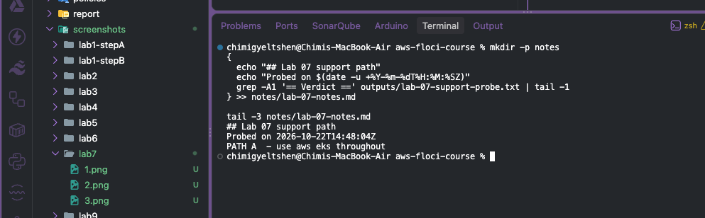

#### Step 3 - The control plane / data plane split

```text
        CONTROL PLANE                    |            DATA PLANE
        AWS runs it. You cannot log in.  |            You run it. You can log in.
   ----------------------------------------------------------------------------
        kube-apiserver                   |   EC2 instances in YOUR account
        etcd (the cluster's database)    |   the kubelet on each of them
        kube-scheduler                   |   the container runtime
        kube-controller-manager          |   your pods
        cloud-controller-manager         |   the CNI plugin that gives pods VPC addresses
   ----------------------------------------------------------------------------
        billed per cluster per hour      |   billed per instance, as ordinary EC2
        patched by AWS                   |   patched by YOU
        one IAM role: cluster role       |   one IAM role: node role
```

Three consequences show up later in the lab:

1. An `ACTIVE` cluster with no node group runs nothing.
2. Two IAM roles, trusting different principals, never interchangeable.
3. Upgrading is two operations: `update-cluster-version`, then `update-nodegroup-version`.

> **Your turn - "EKS is just ECS with different names."**
> **False because** EKS hands you a whole data plane to run: EC2 nodes, kubelets, the CNI, OS patching and a node IAM role. ECS on Fargate has almost nothing in that right-hand column.
> **Nearly true because** both are a managed control plane that keeps N copies of a container spec running behind a stable name: task definition ↔ pod template, ECS service ↔ Deployment.

---

### Part B - IAM roles and networking

#### Step 4 - Write the two trust policies

A role has a **trust policy** (who may assume it) and **permissions policies** (what it may do). Both files were written with a *quoted* heredoc (`<< 'EOF'`) so the shell expands nothing.

<details>
<summary>policies/trust-eks-cluster.json and policies/trust-eks-node.json</summary>

```json
{
  "Version": "2012-10-17",
  "Statement": [
    {
      "Sid": "EKSControlPlaneAssumesThisRole",
      "Effect": "Allow",
      "Principal": { "Service": "eks.amazonaws.com" },
      "Action": "sts:AssumeRole"
    }
  ]
}
```

```json
{
  "Version": "2012-10-17",
  "Statement": [
    {
      "Sid": "EC2InstancesAssumeThisRole",
      "Effect": "Allow",
      "Principal": { "Service": "ec2.amazonaws.com" },
      "Action": "sts:AssumeRole"
    }
  ]
}
```
</details>

```bash
python3 -m json.tool policies/trust-eks-cluster.json > /dev/null && echo "cluster trust: valid JSON"
python3 -m json.tool policies/trust-eks-node.json    > /dev/null && echo "node trust   : valid JSON"
```
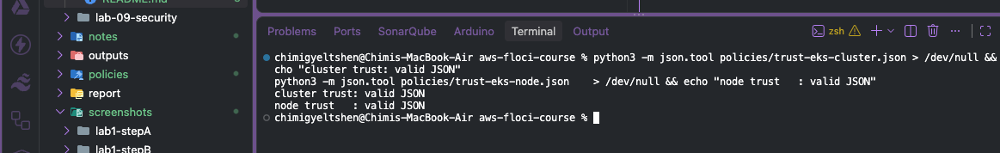

**Verify** - each file names the right service principal:

```bash
python3 -c "
import json
for f in ('policies/trust-eks-cluster.json','policies/trust-eks-node.json'):
    d = json.load(open(f))
    s = d['Statement'][0]
    print(f, '->', s['Principal']['Service'], s['Action'])
"
```
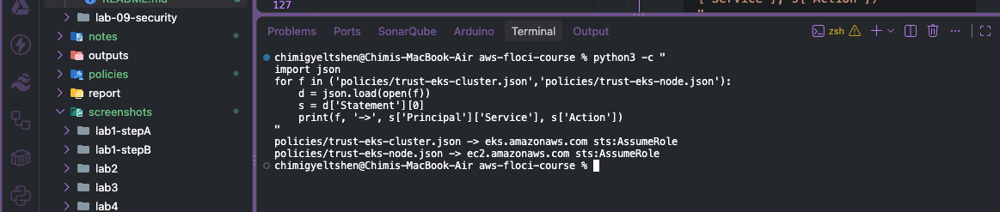

#### Step 5 - Write the two permissions policies

Floci may not carry the AWS managed policies, so local equivalents were written:

| Real AWS managed policy | Attached to | Local stand-in |
|-------------------------|-------------|----------------|
| `AmazonEKSClusterPolicy` | cluster role | `USMSEKSClusterPolicy` - ENI, security-group and load-balancer management |
| `AmazonEKSWorkerNodePolicy` | node role | `USMSEKSNodePolicy` - describe cluster / node group |
| `AmazonEKS_CNI_Policy` | node role | `USMSEKSNodePolicy` - attach ENIs, assign pod IPs |
| `AmazonEC2ContainerRegistryReadOnly` | node role | `USMSEKSNodePolicy` - pull from ECR |

Both policies end with an explicit region `Deny`, and the log-group statement is scoped to `/usms/eks/*` because that ARN is knowable in advance.

```bash
for f in policies/usms-eks-cluster-policy.json policies/usms-eks-node-policy.json; do
  python3 -m json.tool "$f" > /dev/null && echo "$f : valid JSON"
done
```
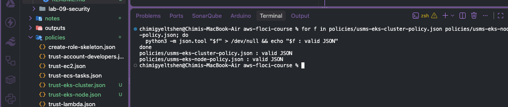

**Verify** - three statements in the cluster policy, five in the node policy, each ending with `Deny`:

```bash
python3 -c "
import json
for f in ('policies/usms-eks-cluster-policy.json','policies/usms-eks-node-policy.json'):
    d = json.load(open(f))
    print(f)
    for s in d['Statement']:
        n = len(s['Action']) if isinstance(s['Action'], list) else 1
        print('   %-9s %-2d action(s)  %s' % (s['Effect'], n, s['Sid']))
"
```
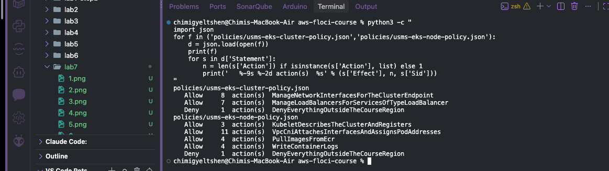

> **Floci limitation:** policies are stored, not enforced. Judge them by reading them, not by whether a command succeeded.

#### Step 6 - Create the cluster role and the cluster security group

**Part 1 - the role**

```bash
EKS_CLUSTER_ROLE=usms-eks-cluster-role

aws iam create-role \
  --role-name "$EKS_CLUSTER_ROLE" \
  --assume-role-policy-document file://policies/trust-eks-cluster.json \
  --description "Assumed by the EKS control plane to manage network resources for usms-eks-cluster" \
  --tags Key=Project,Value=USMS Key=Tier,Value=app Key=Lab,Value=07 \
  --query 'Role.Arn' --output text
```
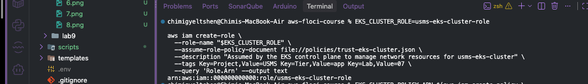

**Part 2 - the permissions policy, with a re-runnable fallback**

```bash
EKS_CLUSTER_POLICY_ARN=$(aws iam create-policy \
  --policy-name USMSEKSClusterPolicy \
  --policy-document file://policies/usms-eks-cluster-policy.json \
  --description "Local stand-in for AmazonEKSClusterPolicy" \
  --query 'Policy.Arn' --output text 2>/dev/null \
  || aws iam list-policies --scope Local \
       --query "Policies[?PolicyName=='USMSEKSClusterPolicy'].Arn | [0]" --output text)

echo "EKS_CLUSTER_POLICY_ARN = $EKS_CLUSTER_POLICY_ARN"

aws iam attach-role-policy \
  --role-name "$EKS_CLUSTER_ROLE" \
  --policy-arn "$EKS_CLUSTER_POLICY_ARN"
```
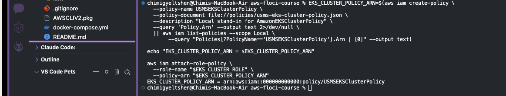

**Part 3 - the cluster security group, in Lab 02's VPC**

```bash
EKS_CLUSTER_SG=$(aws ec2 create-security-group \
  --group-name usms-eks-cluster-sg \
  --description "Control-plane endpoint for usms-eks-cluster" \
  --vpc-id "$USMS_VPC_ID" \
  --tag-specifications 'ResourceType=security-group,Tags=[{Key=Name,Value=usms-eks-cluster-sg},{Key=Project,Value=USMS},{Key=Tier,Value=app},{Key=Lab,Value=07}]' \
  --query 'GroupId' --output text 2>/dev/null \
  || aws ec2 describe-security-groups \
       --filters "Name=group-name,Values=usms-eks-cluster-sg" "Name=vpc-id,Values=$USMS_VPC_ID" \
       --query 'SecurityGroups[0].GroupId' --output text)

echo "EKS_CLUSTER_SG = $EKS_CLUSTER_SG"

aws ec2 authorize-security-group-ingress \
  --group-id "$EKS_CLUSTER_SG" \
  --protocol tcp --port 443 --cidr "$USMS_VPC_CIDR" \
  --query 'Return' --output text 2>/dev/null || echo "ingress rule already present"
```
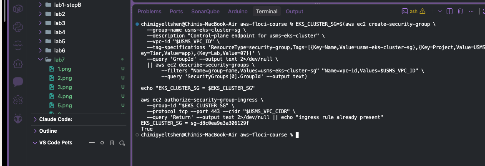

**Verify** - policy attached, trust is `eks.amazonaws.com`, SG is in `usms-vpc` with port 443:

```bash
aws iam list-attached-role-policies --role-name usms-eks-cluster-role \
  --query 'AttachedPolicies[].PolicyName' --output text

aws iam get-role --role-name usms-eks-cluster-role \
  --query 'Role.AssumeRolePolicyDocument.Statement[0].Principal.Service' --output text

aws ec2 describe-security-groups --group-ids "$EKS_CLUSTER_SG" \
  --query 'SecurityGroups[0].{Id:GroupId,Vpc:VpcId,Ports:IpPermissions[].FromPort}' --output json
```
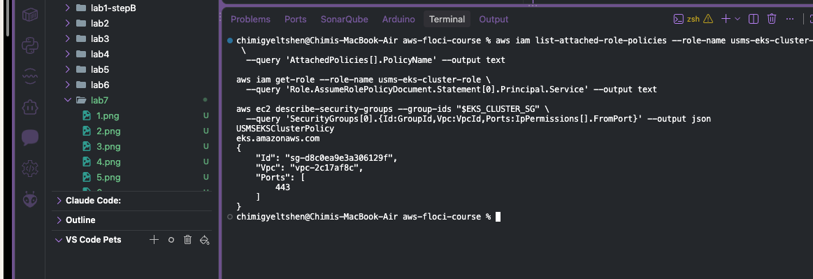

#### Step 7 - Create the node role, and attach Lab 01's policy to it

**Part 1 - the role and its own policy**

```bash
EKS_NODE_ROLE=usms-eks-node-role

aws iam create-role \
  --role-name "$EKS_NODE_ROLE" \
  --assume-role-policy-document file://policies/trust-eks-node.json \
  --description "Assumed by EC2 instances in usms-eks-nodes so they can join the cluster" \
  --tags Key=Project,Value=USMS Key=Tier,Value=app Key=Lab,Value=07 \
  --query 'Role.Arn' --output text

EKS_NODE_POLICY_ARN=$(aws iam create-policy \
  --policy-name USMSEKSNodePolicy \
  --policy-document file://policies/usms-eks-node-policy.json \
  --description "Local stand-in for AmazonEKSWorkerNodePolicy + AmazonEKS_CNI_Policy + ECR read-only" \
  --query 'Policy.Arn' --output text 2>/dev/null \
  || aws iam list-policies --scope Local \
       --query "Policies[?PolicyName=='USMSEKSNodePolicy'].Arn | [0]" --output text)

aws iam attach-role-policy --role-name "$EKS_NODE_ROLE" --policy-arn "$EKS_NODE_POLICY_ARN"
```
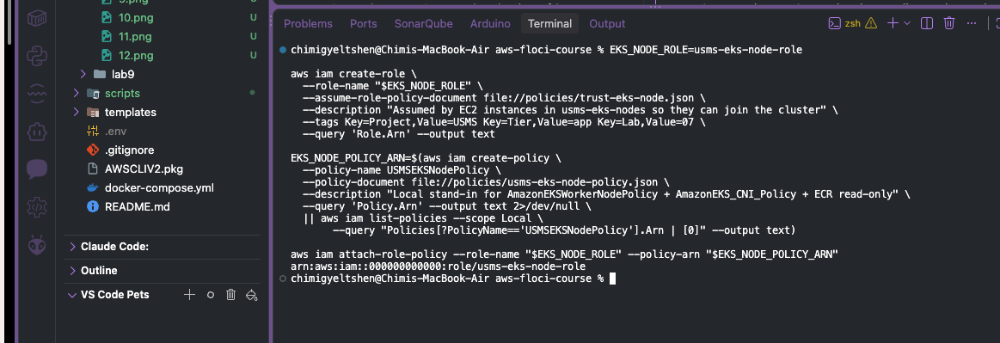

**Part 2 - attach Lab 01's `USMSStudentDataReadWrite`, unchanged**

```bash
S3_RW_ARN=$(aws iam list-policies --scope Local \
  --query "Policies[?PolicyName=='USMSStudentDataReadWrite'].Arn | [0]" --output text)

echo "USMSStudentDataReadWrite = $S3_RW_ARN"

aws iam attach-role-policy --role-name "$EKS_NODE_ROLE" --policy-arn "$S3_RW_ARN"

aws iam list-entities-for-policy --policy-arn "$S3_RW_ARN" \
  --query 'PolicyRoles[].RoleName' --output text
```
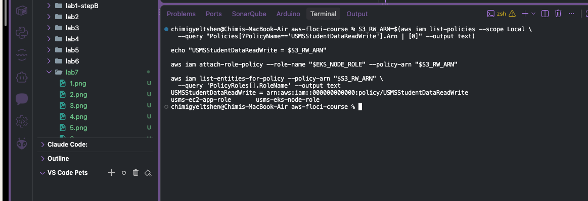

One policy, three holders, never edited: Lab 03's instance role, Lab 04's task role and now the EKS node role.

**Verify** - two policies attached, trust is `ec2.amazonaws.com`:

```bash
aws iam list-attached-role-policies --role-name usms-eks-node-role \
  --query 'AttachedPolicies[].PolicyName' --output text

aws iam get-role --role-name usms-eks-node-role \
  --query 'Role.AssumeRolePolicyDocument.Statement[0].Principal.Service' --output text
```
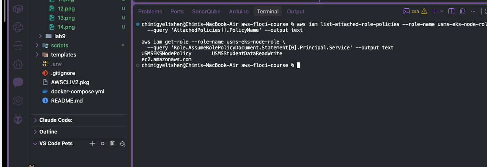

> **Why the node role is the coarse option:** every pod on a node inherits the node role's credentials. Real EKS narrows this with IRSA (Step 21).

---

### Part C - Cluster, node group and kubectl

#### Step 8 - Create the cluster

The request body lives in `templates/lab-07-create-cluster.json`, written with an *unquoted* heredoc so the real subnet IDs, role ARN and security group ID are expanded into the file. It also carries the `_lb_ports_=8081,8082` tag, which Floci needs **at creation time** to publish LoadBalancer ports in Lab 08.

**Part 1 - inspect the request body**

```bash
python3 -m json.tool templates/lab-07-create-cluster.json
```
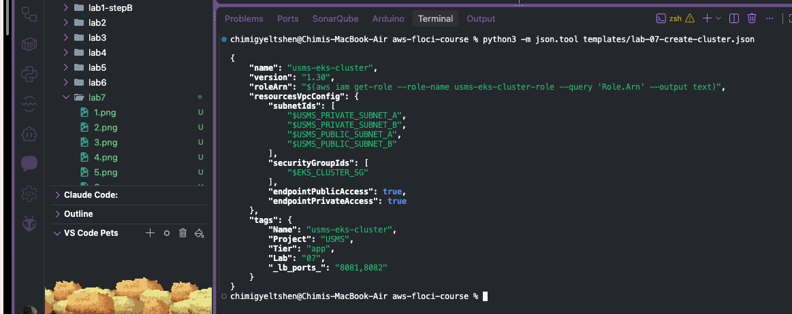

**Part 2 - assume `usms-developer-role` (Lab 01) for the build**

```bash
CREDS=$(aws sts assume-role \
  --role-arn "arn:aws:iam::${ACCOUNT_ID}:role/usms-developer-role" \
  --role-session-name lab07-eks-build \
  --query 'Credentials.[AccessKeyId,SecretAccessKey,SessionToken]' --output text)

export AWS_ACCESS_KEY_ID=$(echo "$CREDS" | cut -f1)
export AWS_SECRET_ACCESS_KEY=$(echo "$CREDS" | cut -f2)
export AWS_SESSION_TOKEN=$(echo "$CREDS" | cut -f3)

aws sts get-caller-identity
```
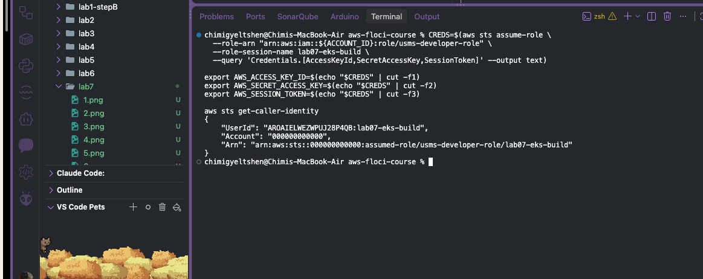

**Part 3 (Path A) - create the cluster**

```bash
aws eks create-cluster \
  --cli-input-json file://templates/lab-07-create-cluster.json \
  --query 'cluster.{Name:name,Status:status,Version:version,Arn:arn}' \
  --output table
```
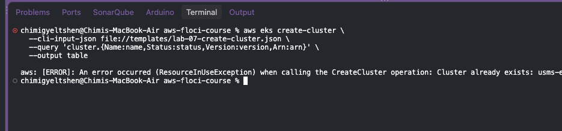

> **Note:** re-running `create-cluster` returned `Cluster already exists: usms-eks-cluster`, because the cluster had been created on an earlier attempt. This is harmless; Step 9 confirms the existing cluster is `ACTIVE` with the correct configuration.

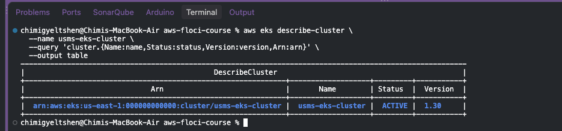

**Part 3 (Path B) - the k3d equivalent**

```bash
k3d cluster create usms-eks-cluster \
  --servers 1 --agents 2 \
  --api-port 6443 \
  --port "8081:80@loadbalancer" \
  --port "8082:443@loadbalancer" \
  --wait

k3d cluster list
```
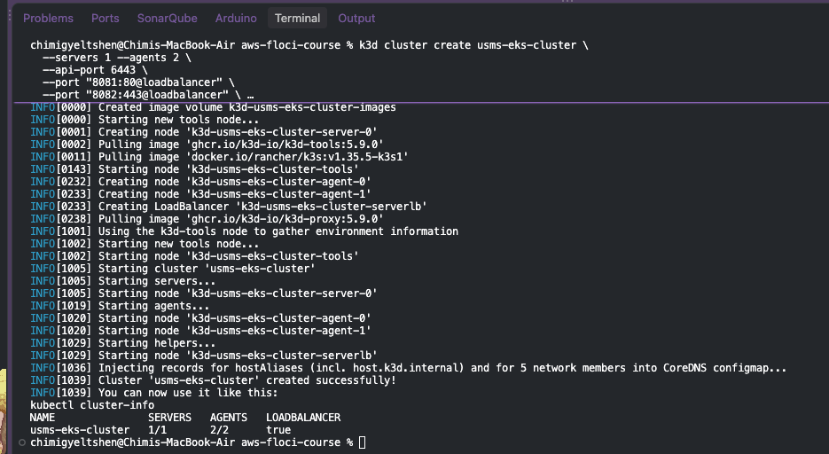

**Part 4 - restore the normal identity** (not optional: env-var credentials outrank the profile)

```bash
unset AWS_ACCESS_KEY_ID AWS_SECRET_ACCESS_KEY AWS_SESSION_TOKEN
./scripts/utilities/whoami.sh
```
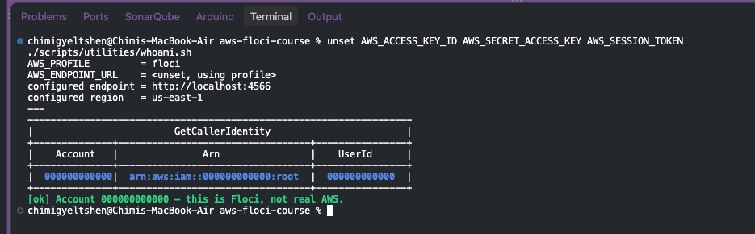

#### Step 9 - Wait for the cluster, and read what it reports

Creation is asynchronous. If the CLI waiter is unavailable, a 10-minute polling loop does the same job.

```bash
aws eks wait cluster-active --name usms-eks-cluster 2>/dev/null \
  || {
    echo "waiter unavailable - polling describe-cluster instead"
    for i in $(seq 1 60); do
      STATUS=$(aws eks describe-cluster --name usms-eks-cluster \
                 --query 'cluster.status' --output text 2>/dev/null || echo UNKNOWN)
      printf "  attempt %2d  status=%s\n" "$i" "$STATUS"
      [ "$STATUS" = ACTIVE ] && break
      sleep 10
    done
  }

aws eks describe-cluster --name usms-eks-cluster --query 'cluster.status' --output text
```
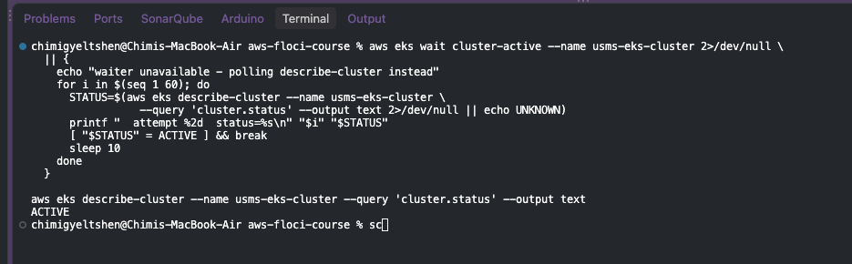

**Verify** - `ACTIVE`, four subnets, the right VPC, an endpoint URL and the `_lb_ports_` tag:

```bash
aws eks describe-cluster --name usms-eks-cluster \
  --query 'cluster.{Name:name,Status:status,Version:version,Endpoint:endpoint,
                    RoleArn:roleArn,Subnets:resourcesVpcConfig.subnetIds,
                    Sgs:resourcesVpcConfig.securityGroupIds,Vpc:resourcesVpcConfig.vpcId,
                    Tags:tags}' \
  --output json | tee outputs/lab-07-cluster.json
```
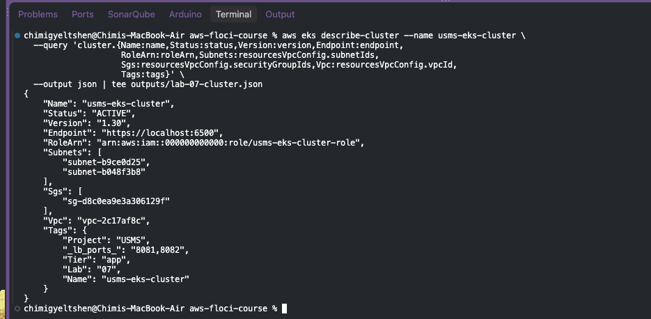

> **Your turn - version and OIDC issuer side by side:**
> ```bash
> aws eks describe-cluster --name usms-eks-cluster \
>   --query 'cluster.[version,identity.oidc.issuer]' --output text
> ```
> The OIDC issuer is the URL where the cluster publishes the public keys that sign its ServiceAccount tokens; registering it in IAM lets STS trust those tokens, which is what makes IRSA possible (Step 21).

#### Step 10 - Create the managed node group

`templates/lab-07-create-nodegroup.json` places the nodes in the **two private subnets only**, with `min 2 / max 4 / desired 2`, Kubernetes labels `workload=usms, tier=app`, and `usms-eks-node-role`.

**Part 1 - validate the request body**

```bash
python3 -m json.tool templates/lab-07-create-nodegroup.json > /dev/null && echo "valid JSON"
```
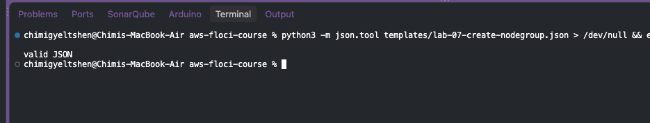

**Part 2 (Path A) - create it and wait**

```bash
aws eks create-nodegroup \
  --cli-input-json file://templates/lab-07-create-nodegroup.json \
  --query 'nodegroup.{Name:nodegroupName,Status:status,Desired:scalingConfig.desiredSize}' \
  --output table

aws eks wait nodegroup-active \
  --cluster-name usms-eks-cluster --nodegroup-name usms-eks-nodes 2>/dev/null \
  || {
    for i in $(seq 1 60); do
      S=$(aws eks describe-nodegroup --cluster-name usms-eks-cluster \
            --nodegroup-name usms-eks-nodes --query 'nodegroup.status' --output text 2>/dev/null || echo UNKNOWN)
      printf "  attempt %2d  status=%s\n" "$i" "$S"
      [ "$S" = ACTIVE ] && break
      sleep 10
    done
  }
```
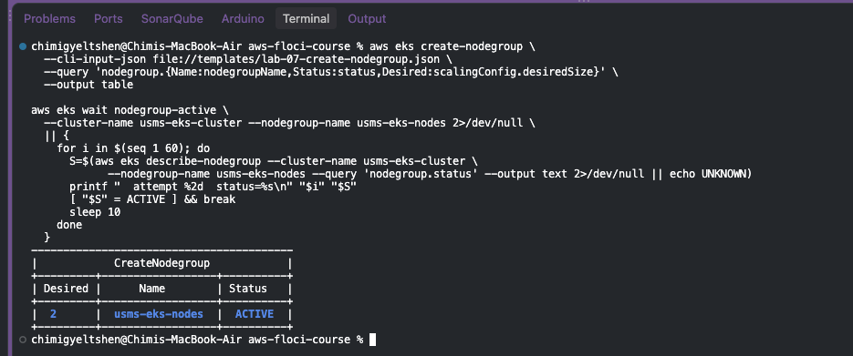

**Verify**

```bash
aws eks describe-nodegroup --cluster-name usms-eks-cluster --nodegroup-name usms-eks-nodes \
  --query 'nodegroup.{Name:nodegroupName,Status:status,Scaling:scalingConfig,
                      Subnets:subnets,Role:nodeRole,Labels:labels,Ami:amiType}' \
  --output json | tee outputs/lab-07-nodegroup.json
```
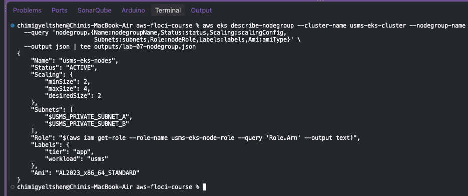

#### Step 11 - Point kubectl at the cluster

From here to Step 21 the tool changes from the AWS CLI to `kubectl`.

**Part 1 (Path A)**

```bash
aws eks update-kubeconfig --name usms-eks-cluster --alias usms-eks

kubectl config current-context
kubectl config get-contexts
```
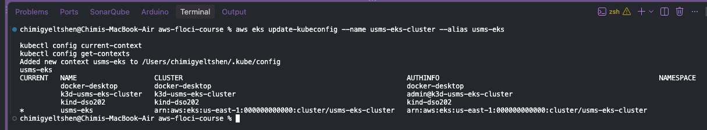

**Part 1 (Path B)**

```bash
k3d kubeconfig merge usms-eks-cluster --kubeconfig-merge-default
kubectl config use-context k3d-usms-eks-cluster
kubectl config current-context
```
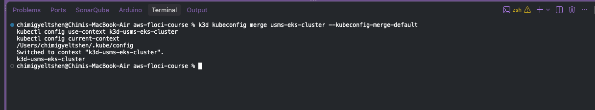

**Part 2 - prove the API server is reachable and nodes registered**

```bash
kubectl cluster-info
kubectl get nodes -o wide
```
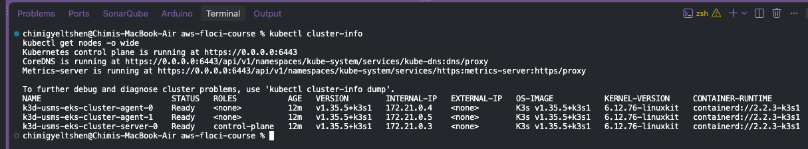

**Verify** - at least one node, permission to create Deployments, namespaced resource types:

```bash
kubectl get nodes --no-headers | wc -l
kubectl auth can-i create deployments --all-namespaces
kubectl api-resources --namespaced=true -o name | head -12
```
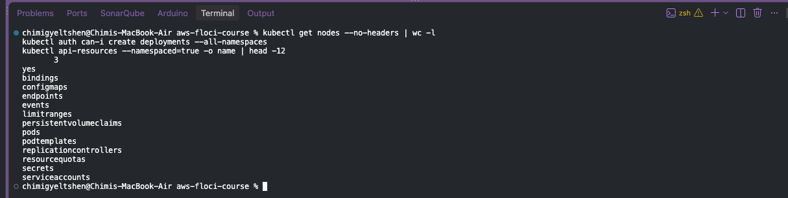

---

### Part D - Deploying the microservices

#### Step 12 - Create the namespace and make it the default

A namespace is a name scope and a policy attachment point, **not** an isolation boundary.

```bash
kubectl apply -f manifests/lab-07/00-namespace.yaml
```
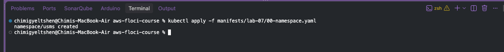

```bash
kubectl config set-context --current --namespace=usms
kubectl config view --minify --output 'jsonpath={..namespace}'; echo
```
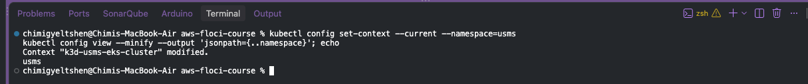

**Verify**

```bash
kubectl get namespace usms --show-labels
kubectl get all -n usms
```
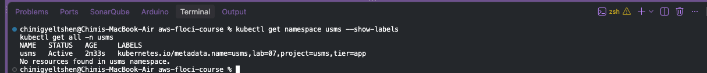

#### Step 13 - Deploy the first microservice: `usms-enrolment`

| Design choice | Why |
|---------------|-----|
| `resources.requests` cpu `50m`, mem `32Mi` | Lab 08's HPA computes utilisation as a percentage of the request; no request means `<unknown>` and no scaling |
| Readiness probe on `/healthz` | Controls membership of the Service (no traffic until ready) |
| Liveness probe on `/healthz` | Controls restarts (container is killed if it wedges) |
| `maxUnavailable: 0`, `maxSurge: 1` | Never drop below the current count during a roll |
| nginx `default.conf.template` | `envsubst` at start injects `POD_NAME`, `NODE_NAME` and the ConfigMap values into the JSON response |

**Part 1 - the shared ConfigMap**

```bash
kubectl apply -f manifests/lab-07/10-configmap-app.yaml
kubectl get configmap usms-app-config -o jsonpath='{.data}'; echo
```
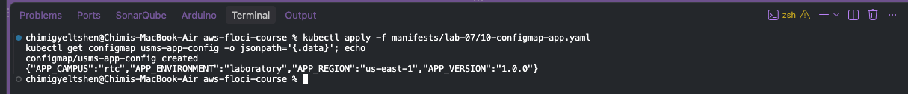

**Part 2 - the enrolment ConfigMap, Deployment and Service**

```bash
kubectl apply -f manifests/lab-07/20-enrolment.yaml
```
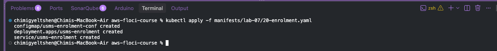

**Verify** - rolled out, 2/2 ready, ClusterIP with no external address, two endpoints:

```bash
kubectl rollout status deployment/usms-enrolment --timeout=120s
kubectl get deploy,rs,pods,svc -l app=usms-enrolment -o wide
kubectl get endpoints usms-enrolment
```
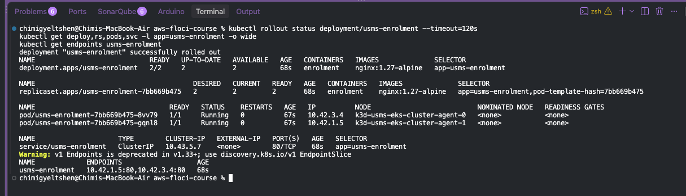

**Part 3 - prove it serves**

```bash
kubectl run usms-curl --rm -it --restart=Never \
  --image=busybox:1.36 -- \
  wget -qO- http://usms-enrolment.usms.svc.cluster.local/
```
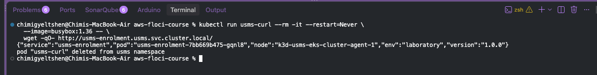

#### Step 14 - Deploy the second microservice: `usms-results`

Deliberately different from enrolment: no liveness probe, the **default** rolling strategy (25% / 25%), and `APP_CAMPUS` in its response.

```bash
kubectl apply -f manifests/lab-07/30-results.yaml
kubectl rollout status deployment/usms-results --timeout=120s
```
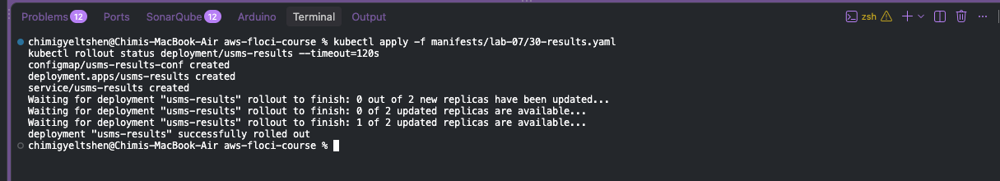

**Verify** - compare the two strategies side by side:

```bash
kubectl get deploy -n usms -o custom-columns=\
'NAME:.metadata.name,READY:.status.readyReplicas,DESIRED:.spec.replicas,STRATEGY:.spec.strategy.type,MAXUNAVAIL:.spec.strategy.rollingUpdate.maxUnavailable'

kubectl get endpoints -n usms
```
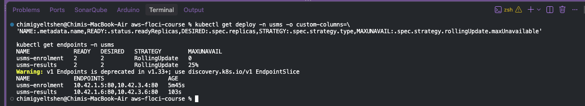

#### Step 15 - Deploy the gateway, and meet cluster DNS

The gateway's nginx config holds two **hostnames** and no addresses. Each Service gets the DNS name `<service>.<namespace>.svc.cluster.local`, which resolves to a ClusterIP that never moves. The trailing slash in `proxy_pass http://.../;` strips the `/enrolment/` prefix before forwarding.

```bash
kubectl apply -f manifests/lab-07/40-gateway.yaml
kubectl rollout status deployment/usms-gateway --timeout=120s
```
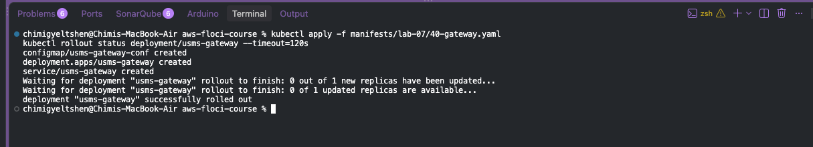

**Verify** - five pods running, no `emerg` lines in the gateway log:

```bash
kubectl get pods -n usms -o wide
kubectl logs deploy/usms-gateway --tail=5
```
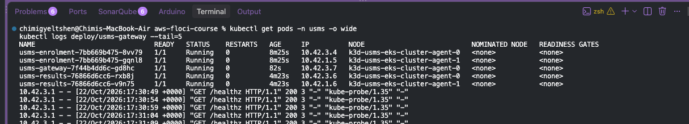

#### Step 16 - Prove service discovery from inside the cluster

**Part 1 - resolve the Service names from inside a pod**

```bash
kubectl run usms-debug --rm -it --restart=Never --image=busybox:1.36 -- sh -c '
  echo "--- resolving service names ---"
  nslookup usms-enrolment.usms.svc.cluster.local
  nslookup usms-results.usms.svc.cluster.local
'
```
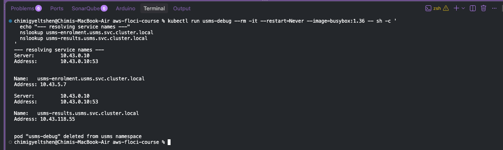

The names resolve to **ClusterIPs** (served by CoreDNS), not pod IPs.

**Part 2 - go through the gateway**

```bash
kubectl run usms-debug --rm -it --restart=Never --image=busybox:1.36 -- sh -c '
  G=http://usms-gateway.usms.svc.cluster.local
  echo "--- gateway root ---";      wget -qO- $G/
  echo "--- via /enrolment/ ---";   wget -qO- $G/enrolment/
  echo "--- via /results/ ---";     wget -qO- $G/results/
'
```
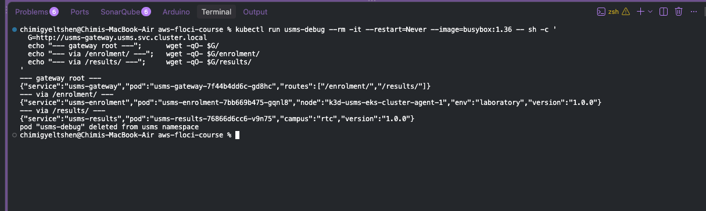

**Part 3 - show that traffic is spread across pods**

```bash
kubectl run usms-debug --rm -it --restart=Never --image=busybox:1.36 -- sh -c '
  for i in $(seq 1 12); do
    wget -qO- http://usms-gateway.usms.svc.cluster.local/enrolment/
  done
' | grep -o '"pod":"[^"]*"' | sort | uniq -c
```
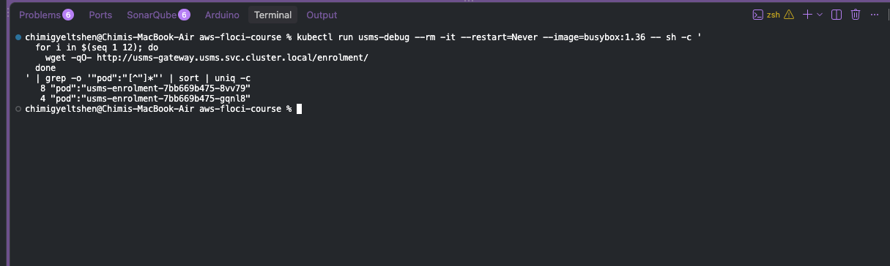

Two distinct pod names answer. nginx holds one ClusterIP; kube-proxy spreads the load beneath it.

> **Your turn - delete a pod under load:** `kubectl delete pod <one enrolment pod>`, then re-run Part 3. Requests keep succeeding and a new pod name appears. The replacement was created by the **ReplicaSet** controller (not the Deployment, and not me), which saw 1 of 2 desired pods and created another.

---

### Part E - Configuration, rollouts and failures

#### Step 17 - ConfigMaps and Secrets, and what a Secret really is

A Secret is stored as **base64**, an encoding, not encryption. It keeps the value out of the image and can be RBAC-restricted separately, but gives no confidentiality at rest unless etcd encryption (KMS envelope encryption on EKS) is configured.

**Part 1 - create the Secret from literals**

```bash
kubectl create secret generic usms-enrolment-secret \
  --namespace usms \
  --from-literal=ENROLMENT_API_TOKEN='floci-dummy-token-not-a-real-secret' \
  --from-literal=ENROLMENT_DB_PASSWORD='floci-dummy-password' \
  --dry-run=client -o yaml > manifests/lab-07/50-secret.yaml

kubectl apply -f manifests/lab-07/50-secret.yaml
```
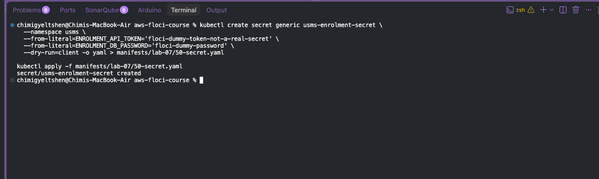

> The values are deliberate dummies. In a real repository a Secret manifest must never be committed: base64 in Git history is plaintext forever.

**Part 2 - demonstrate that base64 is not a lock**

```bash
kubectl get secret usms-enrolment-secret -o jsonpath='{.data.ENROLMENT_API_TOKEN}'; echo
kubectl get secret usms-enrolment-secret -o jsonpath='{.data.ENROLMENT_API_TOKEN}' | base64 -d; echo
```
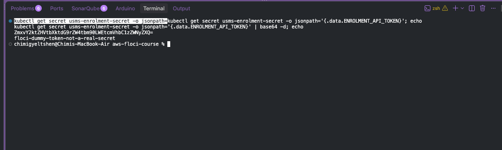

No key and no permission beyond `get secret` were needed to read the plaintext.

**Part 3 - consume it in the enrolment Deployment**

```bash
kubectl set env deployment/usms-enrolment \
  --from=secret/usms-enrolment-secret \
  --namespace usms

kubectl rollout status deployment/usms-enrolment --timeout=120s

kubectl get deploy usms-enrolment -o jsonpath='{.spec.template.spec.containers[0].envFrom}'; echo
```
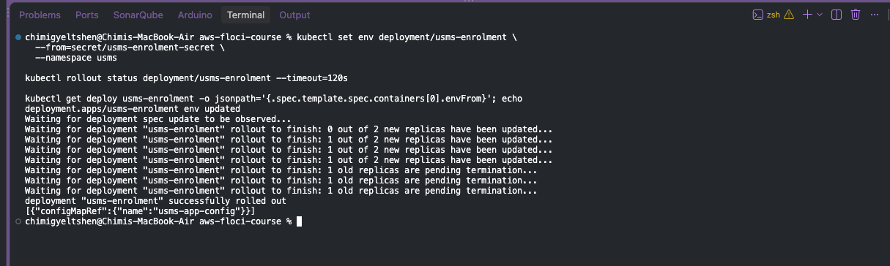

**Verify** - both sources listed; four `APP_*` and two `ENROLMENT_*` variables inside the container:

```bash
kubectl describe deployment usms-enrolment | sed -n '/Environment Variables from/,/Mounts/p'
kubectl exec deploy/usms-enrolment -- printenv | grep -E '^(APP_|ENROLMENT_)' | sort
```
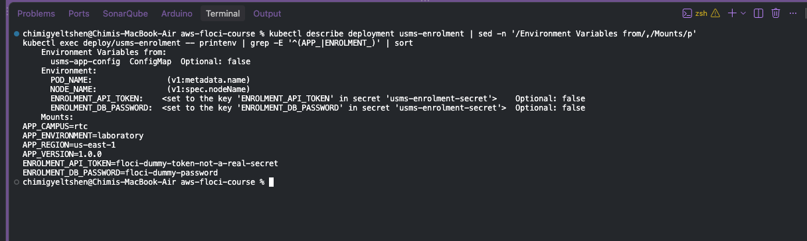

Inside the container the token is plain text: a Secret protects the value on the way to the pod, not inside it.

#### Step 18 - Roll out a change, then roll it back

```text
before:  ReplicaSet-A (rev 1)  replicas=2   <- serving
apply :  ReplicaSet-B (rev 2)  replicas=0 -> 1 -> 2
         ReplicaSet-A (rev 1)  replicas=2 -> 1 -> 0
after :  ReplicaSet-B (rev 2)  replicas=2   <- serving
         ReplicaSet-A (rev 1)  replicas=0   <- kept, and this is the rollback
```

**Part 1 - change `APP_VERSION` from 1.0.0 to 1.1.0**

```bash
sed -i.bak 's/APP_VERSION: "1.0.0"/APP_VERSION: "1.1.0"/' manifests/lab-07/10-configmap-app.yaml
grep APP_VERSION manifests/lab-07/10-configmap-app.yaml

kubectl apply -f manifests/lab-07/10-configmap-app.yaml
```
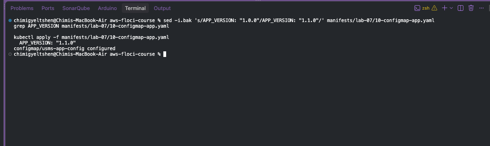

**Part 2 - observe that nothing happened**

```bash
kubectl run usms-debug --rm -it --restart=Never --image=busybox:1.36 -- \
  wget -qO- http://usms-enrolment.usms.svc.cluster.local/
```
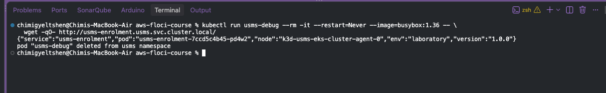

Still `1.0.0`: the ConfigMap changed, the running pods did not.

**Part 3 - trigger the rollout deliberately**

```bash
kubectl annotate deployment/usms-enrolment \
  usms.rtc.bt/config-revision="$(date -u +%Y%m%d%H%M%S)" \
  --overwrite

kubectl rollout status deployment/usms-enrolment --timeout=120s

# The annotation lands on the Deployment's metadata, not the pod template,
# so it may not roll. The supported instrument writes into the pod template:
kubectl rollout restart deployment/usms-enrolment
kubectl rollout status deployment/usms-enrolment --timeout=120s
```


**Part 4 - confirm the new configuration reached the pods**

```bash
kubectl run usms-debug --rm -it --restart=Never --image=busybox:1.36 -- \
  wget -qO- http://usms-enrolment.usms.svc.cluster.local/
```


Now `1.1.0`, and the pod name's middle segment (the ReplicaSet hash) has changed.

**Part 5 - read the history and roll back**

```bash
kubectl rollout history deployment/usms-enrolment

kubectl get rs -n usms -l app=usms-enrolment \
  -o custom-columns='NAME:.metadata.name,DESIRED:.spec.replicas,REVISION:.metadata.annotations.deployment\.kubernetes\.io/revision'

kubectl rollout undo deployment/usms-enrolment
kubectl rollout status deployment/usms-enrolment --timeout=120s
```


> **What `rollout undo` did not revert:** the response can still say `1.1.0`. Undo reverts the **pod template**, not the ConfigMap, which is still at `1.1.0`. Configuration has to be versioned with the workload (for example, a versioned ConfigMap name referenced from the pod template) for rollback to mean anything.

Restore the ConfigMap so the lab ends in a known state:

```bash
sed -i.bak 's/APP_VERSION: "1.1.0"/APP_VERSION: "1.0.0"/' manifests/lab-07/10-configmap-app.yaml
kubectl apply -f manifests/lab-07/10-configmap-app.yaml
kubectl rollout restart deployment/usms-enrolment
kubectl rollout status deployment/usms-enrolment --timeout=120s
rm -f manifests/lab-07/*.bak
```

> **Your turn - image-tag roll on `usms-results`:**
> ```bash
> kubectl set image deployment/usms-results results=nginx:1.27
> kubectl rollout status deployment/usms-results
> kubectl rollout undo deployment/usms-results
> kubectl rollout history deployment/usms-results
> ```
> With only **two** replicas, the default `25%` resolves to `maxSurge 1` (rounded up) and `maxUnavailable 0` (rounded down), so the roll peaks at 3 pods, exactly like enrolment's explicit `0 / 1`. The strategies only diverge at four or more replicas, where the default allows a pod to go unavailable.

#### Step 19 - Break a pod deliberately, and diagnose it

```text
kubectl get pods            is it running? what phase, how many restarts?
kubectl describe pod <n>    WHY is it in that phase? read the Events at the bottom
kubectl logs <n>            what did the application itself say?
```

**Failure 1 - an image that does not exist → `ImagePullBackOff`**

```bash
kubectl set image deployment/usms-results results=nginx:this-tag-does-not-exist
sleep 20
kubectl get pods -n usms -l app=usms-results
kubectl describe pod -l app=usms-results | tail -15
```


The new pod is stuck in `ImagePullBackOff` while **the old pods keep serving**: the rolling strategy never removed a healthy pod for a broken one. Fixed with:

```bash
kubectl rollout undo deployment/usms-results
kubectl rollout status deployment/usms-results --timeout=120s
```

**Failure 2 - a pod that cannot be scheduled → `Pending` / `FailedScheduling`**

```bash
kubectl apply -f - << 'EOF'
apiVersion: v1
kind: Pod
metadata:
  name: usms-toobig
  namespace: usms
  labels:
    app: usms-toobig
spec:
  containers:
    - name: toobig
      image: nginx:1.27-alpine
      resources:
        requests:
          cpu: "64"
          memory: "256Gi"
EOF

sleep 10
kubectl get pod usms-toobig
kubectl describe pod usms-toobig | tail -8
```


The scheduler reports `Insufficient cpu` and `Insufficient memory` on every node. Cleaned up with `kubectl delete pod usms-toobig`.

**Failure 3 - a container that exits immediately → `CrashLoopBackOff`**

```bash
kubectl apply -f - << 'EOF'
apiVersion: v1
kind: Pod
metadata:
  name: usms-crasher
  namespace: usms
  labels:
    app: usms-crasher
spec:
  containers:
    - name: crasher
      image: busybox:1.36
      command: ["sh", "-c", "echo 'usms-crasher starting'; echo 'fatal: no database configured' >&2; exit 1"]
EOF

sleep 25
kubectl get pod usms-crasher
kubectl logs usms-crasher
kubectl describe pod usms-crasher | grep -A4 'Last State'
```


Here `logs` is the right second command, because the container did start:

```bash
kubectl logs usms-crasher --previous
kubectl delete pod usms-crasher
kubectl get events -n usms --sort-by=.lastTimestamp | tail -20
```


| Symptom | Phase / reason | Container started? | Where the answer is |
|---------|----------------|--------------------|---------------------|
| Wrong image tag | `ImagePullBackOff` | No | `describe` → Events (`Failed to pull image`) |
| Requests too large | `Pending` / `FailedScheduling` | No | `describe` → Events (`Insufficient cpu/memory`) |
| Process exits 1 | `CrashLoopBackOff` | Yes | `logs` / `logs --previous` |

---

### Part F - ECS comparison, IRSA and persistence

#### Step 20 - Compare ECS and Kubernetes with both running

```bash
echo "=== ECS (Lab 04 / 05 / 06) ==="
aws ecs describe-services --cluster usms-ecs-cluster --services usms-enrolment-svc \
  --query 'services[0].{Desired:desiredCount,Running:runningCount,TaskDef:taskDefinition,
                        LB:length(loadBalancers),Deployments:length(deployments)}' --output table

echo "=== EKS (this lab) ==="
kubectl get deploy,svc -n usms -o wide
```


The comparison template was appended to `notes/lab-07-notes.md`:


| Question | ECS answer | Kubernetes answer |
|----------|------------|-------------------|
| What holds the container spec? | Task definition (immutable numbered revisions, e.g. `usms-enrolment:2`) | Pod template inside the Deployment |
| What keeps N copies alive? | ECS service scheduler (`desiredCount`) | Deployment → ReplicaSet controller (`replicas`) |
| What gives it a stable name? | ALB DNS name / target group (Lab 05) | Service: ClusterIP + DNS name `usms-enrolment.usms.svc.cluster.local` |
| How does another service find it? | Through the ALB listener rules (or Cloud Map / Service Connect) | CoreDNS resolves the Service name; kube-proxy routes to ready endpoints |
| What does a rolling update create? | A new ECS deployment running tasks from the new task-definition revision | A new ReplicaSet with a new pod-template hash |
| Where does rollback state live? | Previous task-definition revisions; roll back by redeploying one | Old ReplicaSets scaled to 0, kept up to `revisionHistoryLimit` (5); `rollout undo` |
| Which IAM role does the app code use? | The task role (`usms-ecs-task-role`), per task | The node role (`usms-eks-node-role`), shared by every pod on the node, unless IRSA / Pod Identity is used |
| What would I have to change to move to another cloud? | Effectively everything: ECS, task definitions and service config are AWS-only | Manifests are largely portable; IAM roles, VPC, node groups, LoadBalancer/Ingress annotations, IRSA and image registry must change |

**Choice for USMS:** ECS on Fargate. A small team with a strongly seasonal load gets per-task IAM roles, no nodes to patch and simpler scaling; Kubernetes' portability and ecosystem do not yet justify running and securing a data plane.

#### Step 21 - IRSA: the right way to give a pod AWS permissions

```text
1. The cluster publishes an OIDC discovery document at a public HTTPS URL.
2. That URL is registered in IAM as an OpenID Connect identity provider.
3. A role trusts tokens from THAT provider whose sub claim is
   system:serviceaccount:usms:usms-enrolment-sa.
4. The ServiceAccount is annotated with the role's ARN.
5. A webhook injects a projected token and two env vars into pods using it.
6. The AWS SDK calls sts:AssumeRoleWithWebIdentity and gets 15-minute credentials.
```

**Part 1 - does the cluster publish an issuer?**

```bash
OIDC_ISSUER=$(aws eks describe-cluster --name usms-eks-cluster \
  --query 'cluster.identity.oidc.issuer' --output text 2>/dev/null || echo None)

echo "OIDC issuer: $OIDC_ISSUER"
```

**Part 2 - register the provider, only if Part 1 printed a URL**

```bash
if [ "$OIDC_ISSUER" != "None" ] && [ -n "$OIDC_ISSUER" ]; then
  aws iam create-open-id-connect-provider \
    --url "$OIDC_ISSUER" \
    --client-id-list sts.amazonaws.com \
    --thumbprint-list 9e99a48a9960b14926bb7f3b02e22da2b0ab7280 \
    --query 'OpenIDConnectProviderArn' --output text
else
  echo "No OIDC issuer on this build - IRSA is Conceptual / Real AWS here. Record it."
fi
```

**Part 3 - the ServiceAccount, worth creating either way**

```bash
kubectl create serviceaccount usms-enrolment-sa -n usms \
  --dry-run=client -o yaml > manifests/lab-07/60-serviceaccount.yaml

kubectl apply -f manifests/lab-07/60-serviceaccount.yaml
kubectl get sa -n usms
```


**Verify**

```bash
kubectl get sa usms-enrolment-sa -n usms -o yaml | grep -A3 'metadata:'
aws iam list-open-id-connect-providers --query 'OpenIDConnectProviderList[].Arn' --output text 2>/dev/null \
  || echo "list-open-id-connect-providers unsupported on this build"
```


> **Floci limitation:** the cluster's OIDC document is not reachable from STS, so IRSA can only be completed on real AWS. The ServiceAccount is in place for when it is.

#### Step 22 - Prove that everything survives a restart

Create, perturb, read back, and **re-derive every identifier from the API** rather than trusting shell variables.

**Part 1 - record the state before the restart**

```bash
{
  echo "=== BEFORE RESTART $(date -u +%Y-%m-%dT%H:%M:%SZ) ==="
  aws eks describe-cluster --name usms-eks-cluster --query 'cluster.[name,status,version]' --output text 2>/dev/null
  aws eks describe-nodegroup --cluster-name usms-eks-cluster --nodegroup-name usms-eks-nodes \
    --query 'nodegroup.[nodegroupName,status,scalingConfig.desiredSize]' --output text 2>/dev/null
  kubectl get deploy -n usms -o custom-columns='NAME:.metadata.name,READY:.status.readyReplicas' --no-headers
  kubectl get svc -n usms --no-headers | awk '{print $1, $3}'
} | tee outputs/lab-07-before-restart.txt
```

**Part 2 - perturb** (`floci-down.sh` is `docker compose stop`, which keeps volumes)

```bash
./scripts/setup/floci-down.sh
sleep 5
./scripts/setup/floci-up.sh
sleep 20
```


**Part 3 - read back, re-deriving everything, and diff**

```bash
{
  echo "=== AFTER RESTART $(date -u +%Y-%m-%dT%H:%M:%SZ) ==="

  CL=$(aws eks list-clusters --query 'clusters[?@==`usms-eks-cluster`] | [0]' --output text 2>/dev/null)
  echo "cluster re-derived from list-clusters: ${CL:-MISSING}"

  aws eks describe-cluster --name usms-eks-cluster --query 'cluster.[name,status,version]' --output text 2>/dev/null

  NG=$(aws eks list-nodegroups --cluster-name usms-eks-cluster --query 'nodegroups | [0]' --output text 2>/dev/null)
  echo "nodegroup re-derived from list-nodegroups: ${NG:-MISSING}"

  echo "--- kubernetes ---"
  kubectl get ns usms --no-headers 2>/dev/null | awk '{print "namespace", $1, $2}'
  kubectl get deploy -n usms -o custom-columns='NAME:.metadata.name,READY:.status.readyReplicas' --no-headers 2>/dev/null
  kubectl get cm -n usms --no-headers 2>/dev/null | awk '{print "configmap", $1}'
} | tee outputs/lab-07-after-restart.txt

echo
diff <(grep -v '^===' outputs/lab-07-before-restart.txt) \
     <(grep -v '^===\|re-derived\|^--- ' outputs/lab-07-after-restart.txt) \
  && echo "PERSISTENCE PROVEN - identical before and after" \
  || echo "differences above - read them before deciding whether they matter"
```


---

### Part G - Save and commit

#### Step 23 - Write `configs/lab-07.env`

An *unquoted* heredoc runs every `$(...)` now, so the file holds values, not commands. AWS values are looked up from the API, so a missing resource shows up as `None`.

```bash
cat > configs/lab-07.env << EOF
# Lab 07 - EKS cluster, node group and microservices
# Generated on $(date -u +%Y-%m-%dT%H:%M:%SZ)
# Contains IDs, ARNs and names only. NO SECRETS. Safe to commit.

export USMS_EKS_CLUSTER=usms-eks-cluster
export USMS_EKS_NODEGROUP=usms-eks-nodes
export USMS_EKS_NAMESPACE=usms

export USMS_EKS_CLUSTER_ARN=$(aws eks describe-cluster --name usms-eks-cluster \
  --query 'cluster.arn' --output text 2>/dev/null)
export USMS_EKS_CLUSTER_STATUS=$(aws eks describe-cluster --name usms-eks-cluster \
  --query 'cluster.status' --output text 2>/dev/null)
export USMS_EKS_VERSION=$(aws eks describe-cluster --name usms-eks-cluster \
  --query 'cluster.version' --output text 2>/dev/null)
export USMS_EKS_ENDPOINT=$(aws eks describe-cluster --name usms-eks-cluster \
  --query 'cluster.endpoint' --output text 2>/dev/null)
export USMS_EKS_LB_PORTS=$(aws eks describe-cluster --name usms-eks-cluster \
  --query 'cluster.tags._lb_ports_' --output text 2>/dev/null)

export USMS_EKS_CLUSTER_ROLE_ARN=$(aws iam get-role --role-name usms-eks-cluster-role \
  --query 'Role.Arn' --output text 2>/dev/null)
export USMS_EKS_NODE_ROLE_ARN=$(aws iam get-role --role-name usms-eks-node-role \
  --query 'Role.Arn' --output text 2>/dev/null)
export USMS_POLICY_EKS_CLUSTER=$(aws iam list-policies --scope Local \
  --query "Policies[?PolicyName=='USMSEKSClusterPolicy'].Arn | [0]" --output text 2>/dev/null)
export USMS_POLICY_EKS_NODE=$(aws iam list-policies --scope Local \
  --query "Policies[?PolicyName=='USMSEKSNodePolicy'].Arn | [0]" --output text 2>/dev/null)

export USMS_EKS_CLUSTER_SG=$(aws ec2 describe-security-groups \
  --filters "Name=group-name,Values=usms-eks-cluster-sg" \
  --query 'SecurityGroups[0].GroupId' --output text 2>/dev/null)

export USMS_K8S_DEPLOY_GATEWAY=usms-gateway
export USMS_K8S_DEPLOY_ENROLMENT=usms-enrolment
export USMS_K8S_DEPLOY_RESULTS=usms-results
export USMS_K8S_SVC_GATEWAY=usms-gateway
export USMS_K8S_SVC_ENROLMENT=usms-enrolment
export USMS_K8S_SVC_RESULTS=usms-results
export USMS_K8S_CPU_REQUEST=50m
export USMS_K8S_MANIFEST_DIR=manifests/lab-07
EOF

grep -n 'export .*=$\|None' configs/lab-07.env || echo "all values populated"
```


**Verify** - `lb_ports` reads `8081,8082` and there are 21 exports:

```bash
source configs/lab-07.env
echo "cluster=$USMS_EKS_CLUSTER  ns=$USMS_EKS_NAMESPACE  lb_ports=$USMS_EKS_LB_PORTS"
grep -c '^export' configs/lab-07.env
```


#### Step 24 - Commit the work

**Part 1 - look before adding:** no path under `outputs/` (it may hold a kubeconfig with certificates), no root `.env`, and `configs/lab-07.env` present.

```bash
git status --short
```

**Part 2 - add and commit**

```bash
git add labs/lab-07-eks manifests/lab-07 policies/trust-eks-*.json \
        policies/usms-eks-*.json templates/lab-07-*.json \
        configs/lab-07.env scripts/utilities/verify-lab-07.sh \
        scripts/utilities/eks-support-probe.sh scripts/cleanup/lab-07-cleanup.sh \
        notes/lab-07-notes.md

git status --short

git commit -m "Lab 07: EKS cluster, node group and three USMS microservices

- usms-eks-cluster-role and usms-eks-node-role, with local stand-ins for the
  AWS managed policies, plus Lab 01's USMSStudentDataReadWrite on the node role
- usms-eks-cluster across all four Lab 02 subnets, usms-eks-nodes in the private pair
- namespace usms with gateway, enrolment and results Deployments and ClusterIP Services
- service discovery proven by DNS from inside the cluster
- rolling update and rollback exercised; three failure modes diagnosed
- persistence proven by re-deriving every identifier after a Floci restart"
```

**Verify** - the commit is on top and **0** files under `outputs/` are tracked:

```bash
git log --oneline -1
git show --stat --oneline HEAD | head -25
git ls-files | grep -c '^outputs/'
```


---

## 6. Verification

### 6.1 `scripts/utilities/verify-lab-07.sh`

Checks configuration as well as existence: Floci state and storage mode, earlier-lab dependencies, IAM roles and their trust principals, the security group's VPC, cluster status and the `_lb_ports_` tag, node-group status, ready replicas and endpoints for every Deployment, the CPU request Lab 08 needs, and Git hygiene (nothing under `outputs/` tracked).

```bash
chmod +x scripts/utilities/verify-lab-07.sh
./scripts/utilities/verify-lab-07.sh
```


### 6.2 `scripts/cleanup/lab-07-cleanup.sh` - built, **not run**

The script destroys the namespace, node group, cluster, both roles, both local policies and the security group. Lab 08 depends on all of them, so it is only syntax-checked now and kept for the end of the course.

```bash
chmod +x scripts/cleanup/lab-07-cleanup.sh
bash -n scripts/cleanup/lab-07-cleanup.sh && echo "cleanup script: valid bash syntax"
```


### 6.3 Checkpoint summary

| Area | Result |
|------|--------|
| IAM | Cluster role trusts `eks.amazonaws.com`; node role trusts `ec2.amazonaws.com`; Lab 01 policy on 3 roles |
| Network | `usms-eks-cluster-sg` in `usms-vpc`, tcp/443 from the VPC CIDR only |
| Cluster | `usms-eks-cluster` ACTIVE, 4 subnets, `_lb_ports_=8081,8082` |
| Nodes | `usms-eks-nodes` ACTIVE in private subnets, 2 / 4 / 2 |
| Workloads | gateway 1/1, enrolment 2/2, results 2/2 |
| Discovery | Service names resolve to ClusterIPs; load spread across 2 pods |
| Operations | Rolling update, rollback, and 3 failure modes diagnosed |
| Persistence | Cluster, node group and workloads re-derived after a Floci restart |
| Hand-off | `configs/lab-07.env` with 21 exports |

---

## 7. Independent Exercises

All five Section 12 exercises are documented in **[exercises.md](exercises.md)**:

1. **Basic** - a fourth microservice, `usms-timetable`
2. **Intermediate** - a `/timetable/` gateway route, proven on a new ReplicaSet
3. **Problem solving** - two independent faults in `usms-broken` (selector mismatch + failing readiness probe)
4. **Challenge** - surviving a node drain with topology spread and a PodDisruptionBudget
5. **Integration** - CPU baseline, Lab 01 policy readiness, and the Lab 08 hand-off

---

## 8. Key Takeaways

- **Two planes, two roles.** The control plane (AWS-run) and the data plane (yours) each need their own IAM role with a different trusted principal.
- **Names, not addresses.** Services give pods a stable DNS name and ClusterIP; the gateway never needs to know a pod IP.
- **ConfigMap changes do not restart pods.** Only a change to the pod template rolls a Deployment, and `rollout undo` reverts only the pod template.
- **A Secret is base64, not encryption.** Real protection needs etcd envelope encryption plus IRSA or a secrets manager.
- **`describe` before `logs`.** For image-pull and scheduling failures the container never started; the answer is in the Events.
- **Prove persistence from the API.** Re-deriving identifiers after a restart is evidence; a shell variable is not.