# lab-08-eks-scaling

## prerequisites

```bash 
kubectl version --client
aws --version
```
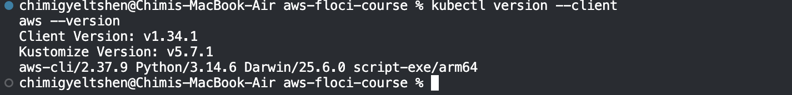

## Step by step implementation

```bash 
kubectl config set-context --current --namespace=usms
```
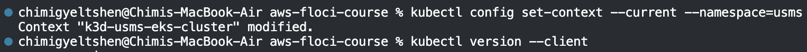

Step 1 - Start the environment, and check the two things Lab 07 had to leave behind

Part 1 - start and source

```bash 
cd ~/aws-floci-course
./scripts/setup/floci-up.sh

source configs/course.env
source configs/lab-01.env
source configs/lab-02.env
source configs/lab-04.env
source configs/lab-07.env

./scripts/utilities/whoami.sh
kubectl config current-context
kubectl config set-context --current --namespace=usms
```
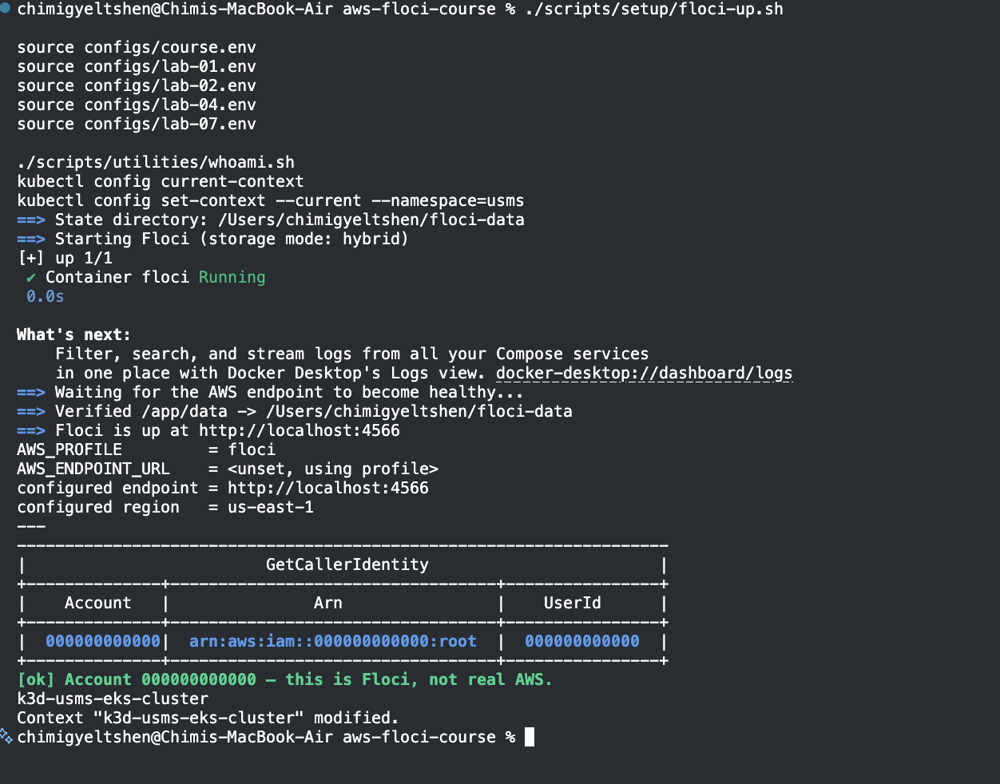

Part 2 - the two checks that matter

```bash
echo "--- 1. does usms-enrolment declare a CPU request? ---"
kubectl get deploy usms-enrolment \
  -o jsonpath='{.spec.template.spec.containers[0].resources.requests}'; echo

echo "--- 2. is the _lb_ports_ tag on the cluster? ---"
echo "from configs/lab-07.env : ${USMS_EKS_LB_PORTS:-EMPTY}"
aws eks describe-cluster --name "$USMS_EKS_CLUSTER" \
  --query 'cluster.tags._lb_ports_' --output text 2>/dev/null || echo "eks API unavailable (Path B)"
```
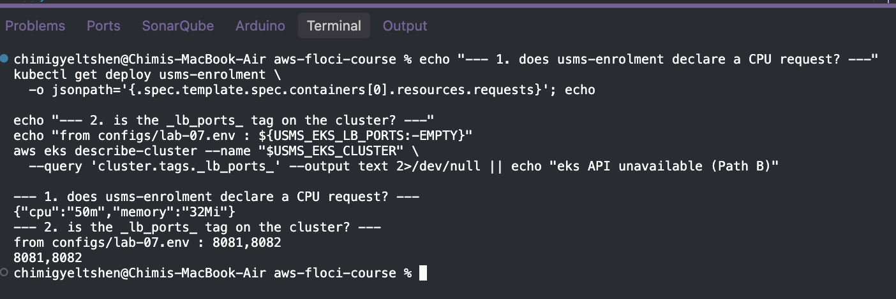

Verify

```bash
./scripts/utilities/verify-lab-07.sh | tail -3
kubectl get deploy,svc,cm,secret
```
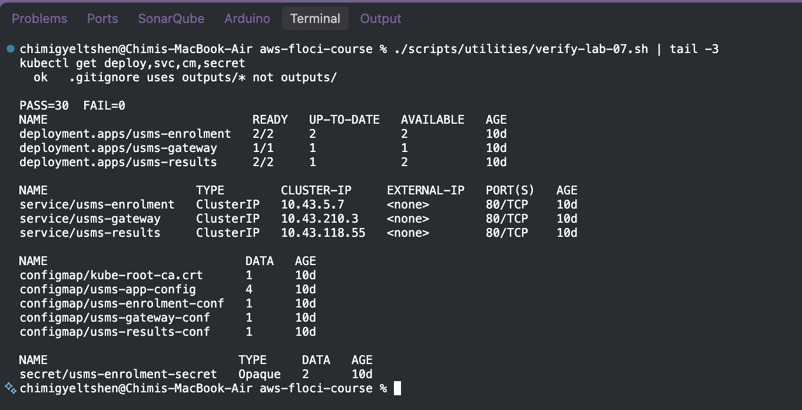

Step 2 - Read your own baseline before you change anything

```bash
mkdir -p notes outputs

echo "--- Lab 07 Exercise 5 artefacts ---"
ls -l outputs/lab-07-cpu-baseline.txt outputs/lab-07-lab06-readiness.txt 2>/dev/null \
  || echo "Exercise 5 not done - that is recoverable, but do it before Lab 10"

echo
echo "--- fresh baseline ---"
{
  echo "=== LAB 08 BASELINE $(date -u +%Y-%m-%dT%H:%M:%SZ) ==="
  kubectl get deploy -o custom-columns='NAME:.metadata.name,DESIRED:.spec.replicas,READY:.status.readyReplicas'
  echo "--- endpoints ---"
  kubectl get endpoints
  echo "--- service types ---"
  kubectl get svc -o custom-columns='NAME:.metadata.name,TYPE:.spec.type,CLUSTERIP:.spec.clusterIP,EXTERNAL:.status.loadBalancer.ingress[0].ip'
  echo "--- nodes ---"
  kubectl get nodes -o custom-columns='NAME:.metadata.name,STATUS:.status.conditions[-1].type,CPU:.status.capacity.cpu,MEM:.status.capacity.memory'
} | tee outputs/lab-08-baseline.txt
```
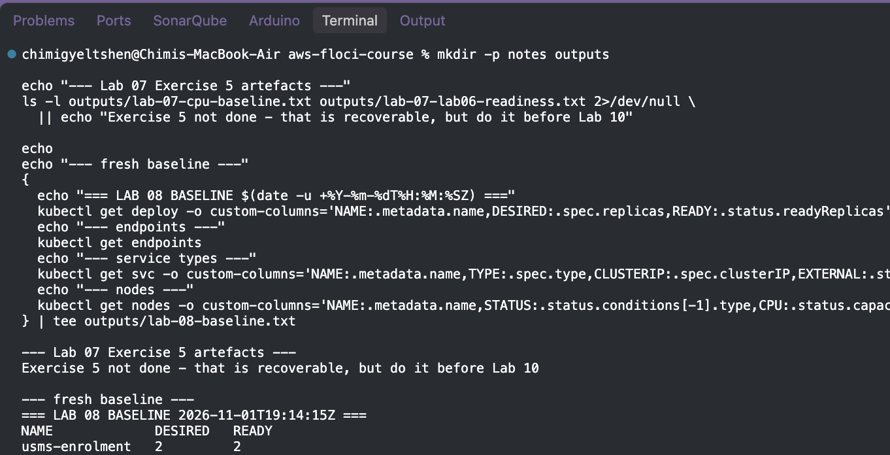

Step 4 - Scale by hand, and watch what moves

Part 1 - open a watcher in a second terminal

```bash 
kubectl get pods -w -l app=usms-enrolment
```
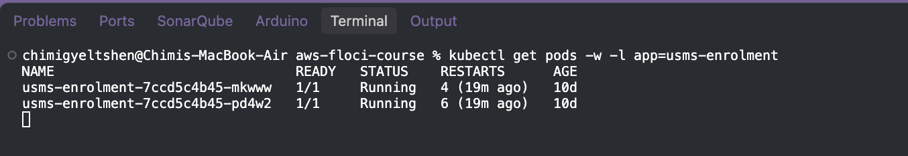

Part 2 - scale up

```bash
kubectl scale deployment/usms-enrolment --replicas=5
kubectl rollout status deployment/usms-enrolment --timeout=120s

kubectl get deploy usms-enrolment
kubectl get endpoints usms-enrolment
```
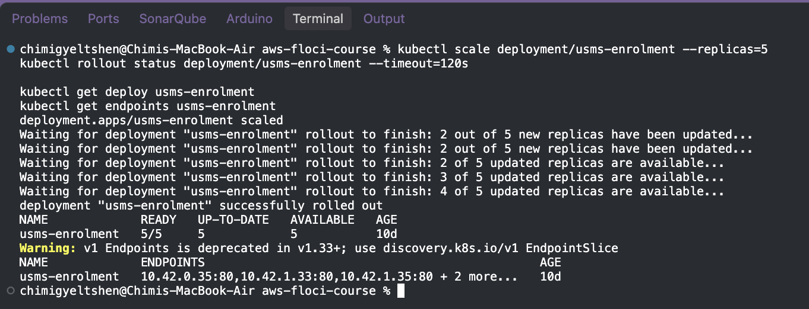

Part 3 - confirm the traffic really spreads across five

```bash
kubectl run usms-debug --rm -it --restart=Never --image=busybox:1.36 -- sh -c '
  for i in $(seq 1 40); do
    wget -qO- http://usms-gateway.usms.svc.cluster.local/enrolment/
  done
' | grep -o '"pod":"[^"]*"' | sort | uniq -c | sort -rn
```
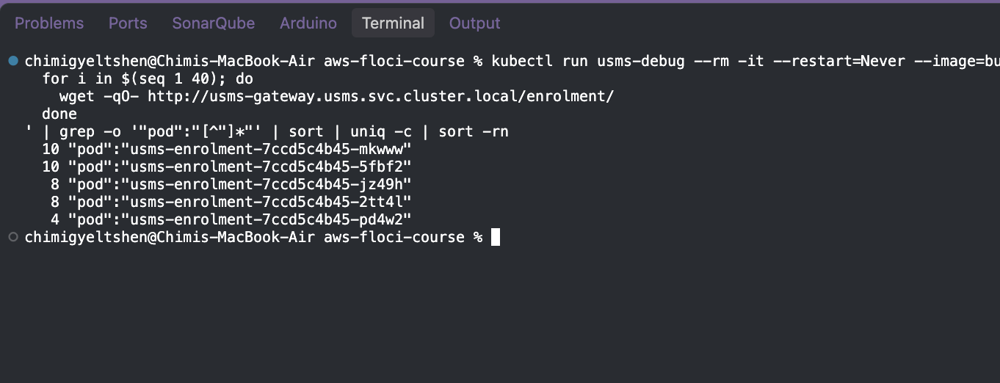

Part 4 - scale back down

```bash
kubectl scale deployment/usms-enrolment --replicas=2
kubectl rollout status deployment/usms-enrolment --timeout=120s
kubectl get endpoints usms-enrolment
```
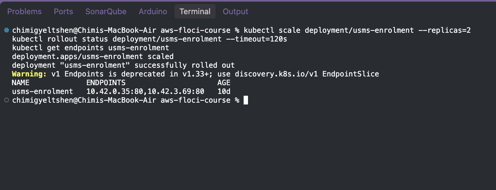

Step 5 - Scale declaratively, and meet configuration drift
Part 1 - create the drift deliberately

```bash
kubectl scale deployment/usms-enrolment --replicas=6
kubectl get deploy usms-enrolment -o jsonpath='{.spec.replicas}'; echo
grep -n 'replicas:' manifests/lab-07/20-enrolment.yaml
```
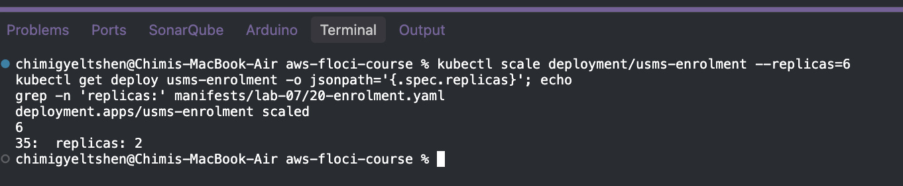

Part 2 - watch apply silently undo your scaling

```bash 
kubectl apply -f manifests/lab-07/20-enrolment.yaml
sleep 5
kubectl get deploy usms-enrolment -o jsonpath='{.spec.replicas}'; echo
```
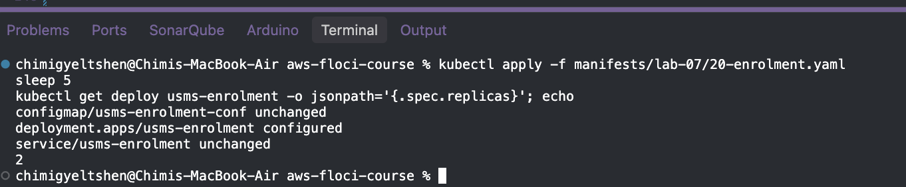


Part 3 - the habit that prevents it

```bash
sed -i.bak 's/^  replicas: 2$/  replicas: 3/' manifests/lab-07/20-enrolment.yaml

kubectl diff -f manifests/lab-07/20-enrolment.yaml || true

kubectl apply -f manifests/lab-07/20-enrolment.yaml
kubectl get deploy usms-enrolment -o jsonpath='{.spec.replicas}'; echo
```
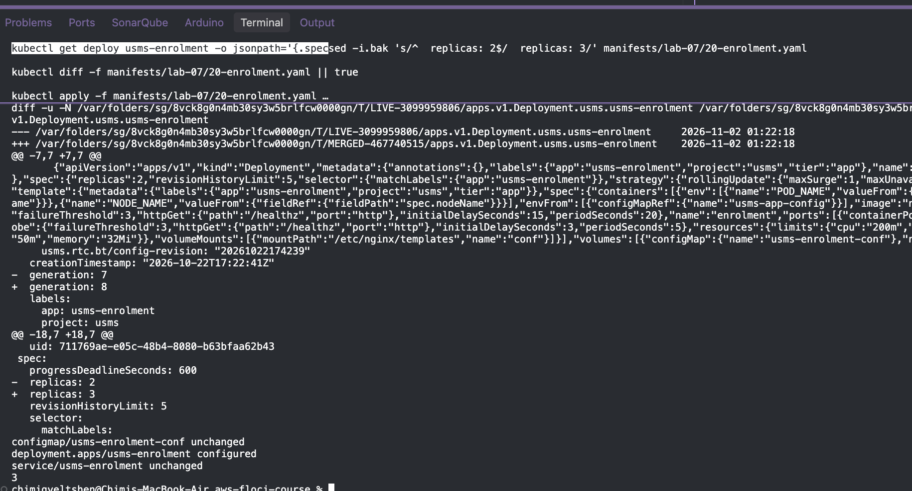

Part 4 - restore the baseline

```bash 
sed -i.bak 's/^  replicas: 3$/  replicas: 2/' manifests/lab-07/20-enrolment.yaml
kubectl apply -f manifests/lab-07/20-enrolment.yaml
kubectl rollout status deployment/usms-enrolment --timeout=120s
rm -f manifests/lab-07/*.bak
kubectl get deploy
```
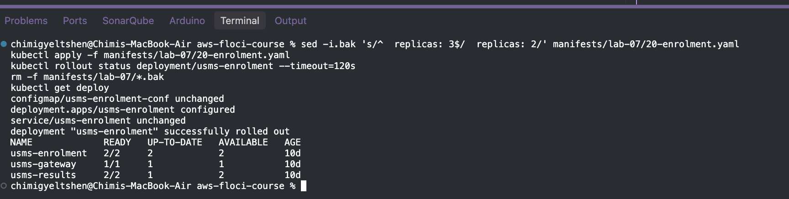

Step 6 - Requests, limits and QoS classes: the coupling nobody explains

Part 1 - read the classes off the cluster

```bash 
kubectl get pods -o custom-columns=\
'NAME:.metadata.name,QOS:.status.qosClass,CPUREQ:.spec.containers[0].resources.requests.cpu,CPULIM:.spec.containers[0].resources.limits.cpu'
```
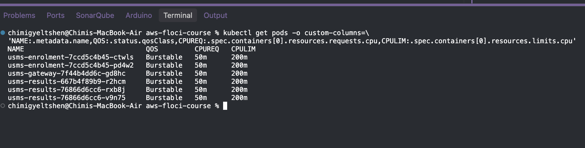

Part 2 - see the scheduler's arithmetic

```bash
NODE=$(kubectl get pods -l app=usms-enrolment -o jsonpath='{.items[0].spec.nodeName}')
echo "inspecting node: $NODE"
kubectl describe node "$NODE" | sed -n '/Allocated resources/,/Events/p'
```
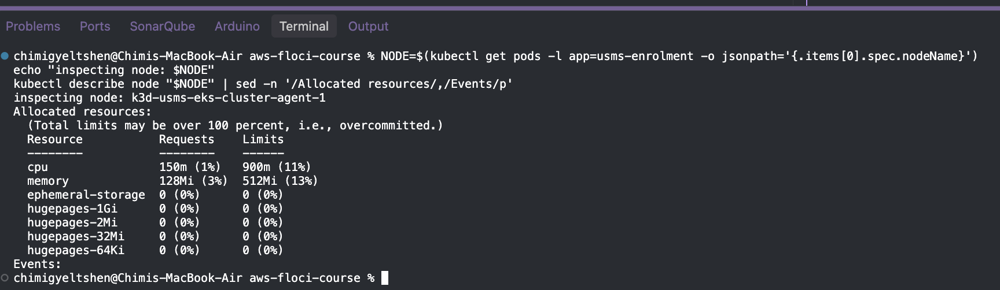

Part 3 - prove the denominator arithmetic before you rely on it

```bash
REQ=$(kubectl get deploy usms-enrolment \
  -o jsonpath='{.spec.template.spec.containers[0].resources.requests.cpu}')
echo "request        : $REQ"
echo "HPA target 50% : this means 50% of $REQ per pod, i.e. 25m average across all pods"
echo "NOT 50% of a node, and NOT 50% of the limit"
```
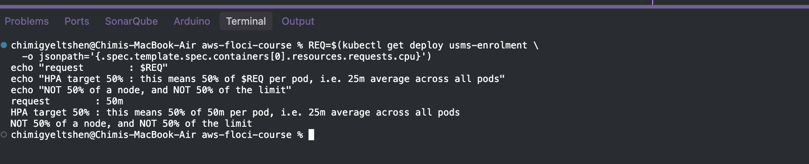

Step 7 - The metrics pipeline, and why it is an add-on¶

Part 1 - is the API registered?

```bash 
kubectl get apiservices | grep metrics || echo "no metrics APIService registered"
kubectl get deploy -n kube-system | grep -i metrics || echo "no metrics-server deployment"
kubectl get --raw /apis/metrics.k8s.io/v1beta1 >/dev/null 2>&1 \
  && echo "metrics API: AVAILABLE" \
  || echo "metrics API: NOT AVAILABLE"
```
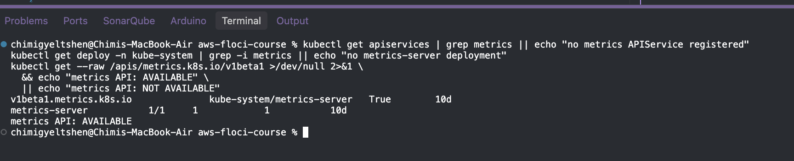

Part 2 - only if Part 1 said NOT AVAILABLE

```bash
kubectl apply -f https://github.com/kubernetes-sigs/metrics-server/releases/latest/download/components.yaml

kubectl -n kube-system rollout status deployment/metrics-server --timeout=120s
```
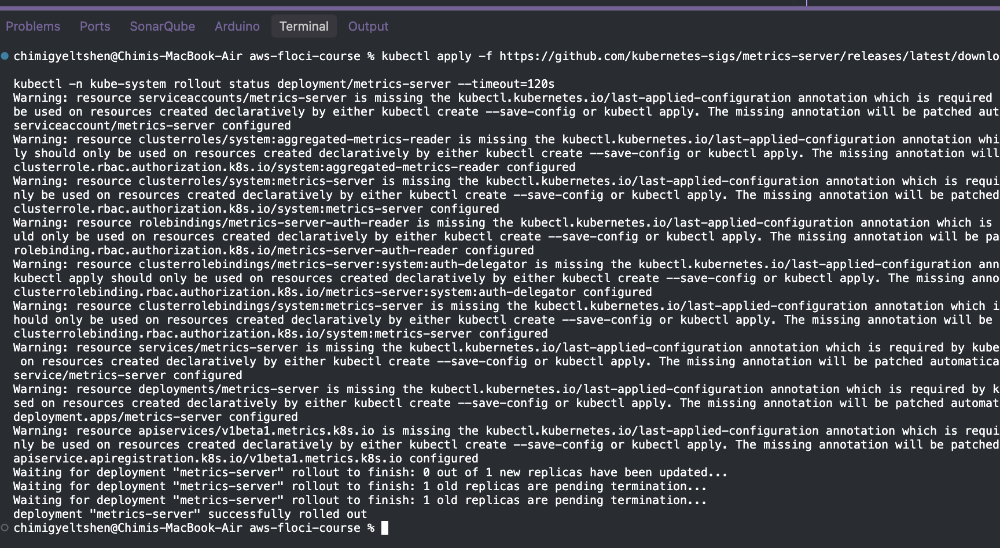

Part 3 - if the cluster has no network access

```bash 
echo "metrics API unavailable - Step 9 will use the manual fallback" >> notes/lab-08-notes.md
```
Verify
```bash
kubectl top nodes 2>/dev/null || echo "kubectl top nodes: unavailable"
kubectl top pods 
```
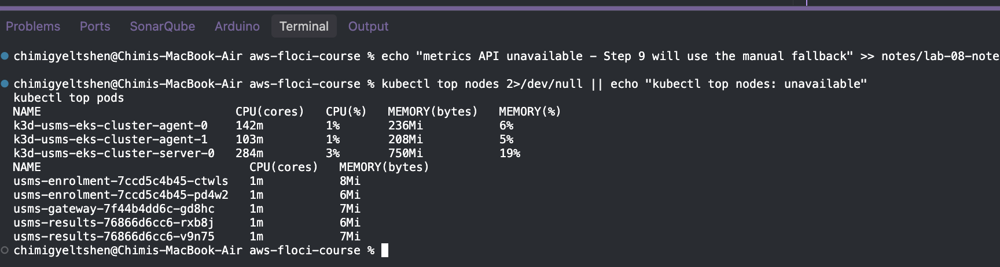

Step 8 - Create the HorizontalPodAutoscaler¶
```bash 
kubectl apply -f manifests/lab-08/10-hpa-enrolment.yaml
```
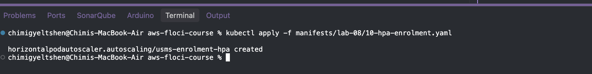

Verify

```bash 
kubectl get hpa
sleep 30
kubectl get hpa
kubectl describe hpa usms-enrolment-hpa | tail -20
```
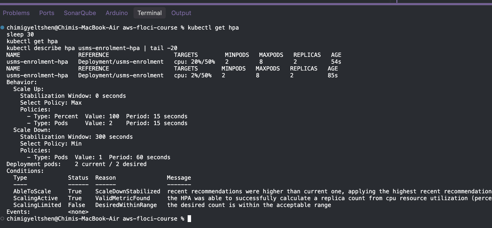

Step 9 - Generate load and watch it respond¶

Part 1 - a watcher script
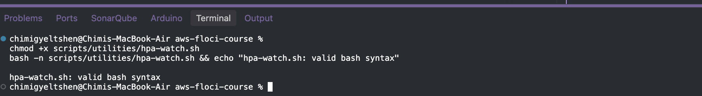

Part 2 - the load generator
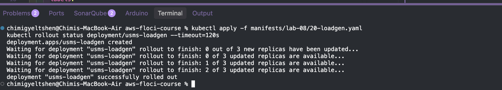


Part 3 - remove the load and watch the stabilisation window

```bash
kubectl scale deployment/usms-loadgen --replicas=0
```
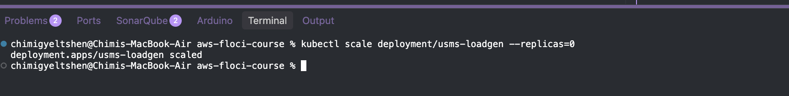

```bash 
kubectl describe hpa usms-enrolment-hpa | grep -A8 'Events:'
```
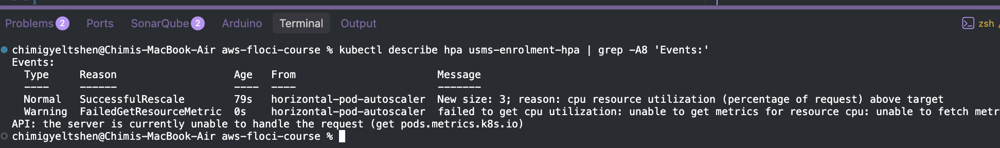

Step 10 - Scale the data plane from the AWS side

Part 1 - read the current configuration

```bash 
aws eks describe-nodegroup \
  --cluster-name "$USMS_EKS_CLUSTER" \
  --nodegroup-name "$USMS_EKS_NODEGROUP" \
  --query 'nodegroup.{Name:nodegroupName,Status:status,Scaling:scalingConfig,
                      Types:instanceTypes,Subnets:subnets,Labels:labels}' \
  --output json | tee outputs/lab-08-nodegroup-before.json
```
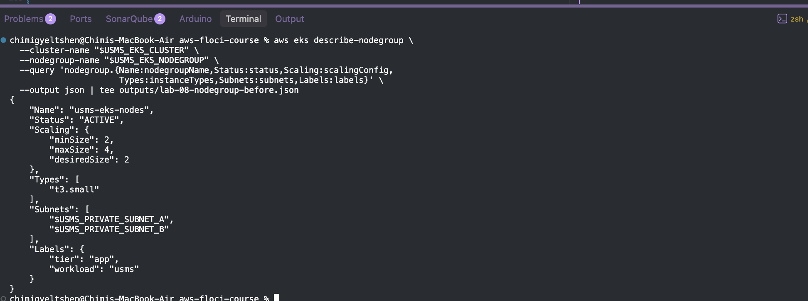

Part 2 - change it

```bash 
aws eks update-nodegroup-config \
  --cluster-name "$USMS_EKS_CLUSTER" \
  --nodegroup-name "$USMS_EKS_NODEGROUP" \
  --scaling-config minSize=2,maxSize=6,desiredSize=3 \
  --query 'update.{Id:id,Status:status,Type:type}' \
  --output table

```
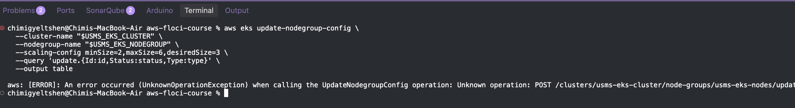

Part 3 - verify from both sides

```bash 
aws eks describe-nodegroup \
  --cluster-name "$USMS_EKS_CLUSTER" --nodegroup-name "$USMS_EKS_NODEGROUP" \
  --query 'nodegroup.scalingConfig' --output json | tee outputs/lab-08-nodegroup-after.json

echo "--- and what Kubernetes actually sees ---"
kubectl get nodes -o custom-columns='NAME:.metadata.name,STATUS:.status.conditions[-1].type,LABELS:.metadata.labels.workload'
```
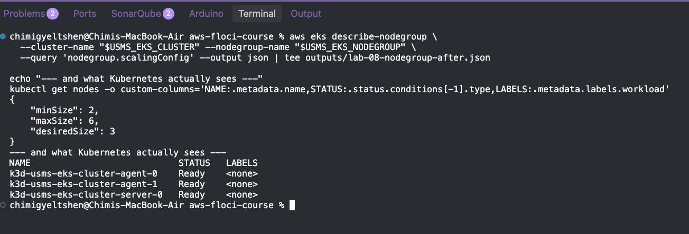

Part 4 - put it back, or don't

Leaving it at 3 is fine. To restore Lab 7's numbers:

```bash 
aws eks update-nodegroup-config \
  --cluster-name "$USMS_EKS_CLUSTER" --nodegroup-name "$USMS_EKS_NODEGROUP" \
  --scaling-config minSize=2,maxSize=4,desiredSize=2 \
  --query 'update.status' --output text
```
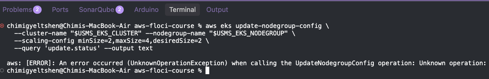

Step 11 - Cluster Autoscaler and Karpenter, and a nodeSelector you can actually use¶

Part 1 - do the labels exist?

```bash
kubectl get nodes --show-labels | tr ',' '\n' | grep -E 'workload|tier' \
  || echo "node group labels did not reach the nodes"
```
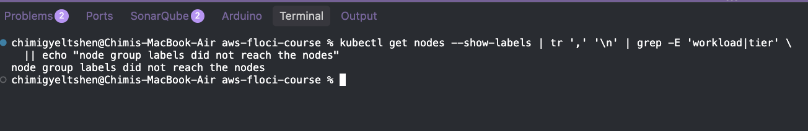

Part 2 - if they did not, apply them by hand (on real EKS the node group would have done this)

```bash
for N in $(kubectl get nodes -o jsonpath='{.items[*].metadata.name}'); do
  kubectl label node "$N" workload=usms tier=app --overwrite
done

kubectl get nodes -L workload,tier
```
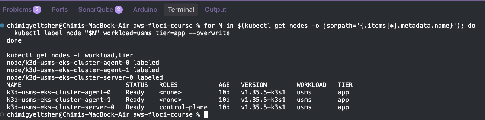

Part 3 - require the label

```bash
kubectl patch deployment usms-enrolment --type=merge \
  -p '{"spec":{"template":{"spec":{"nodeSelector":{"workload":"usms"}}}}}'

kubectl rollout status deployment/usms-enrolment --timeout=120s
kubectl get pods -l app=usms-enrolment -o wide
```
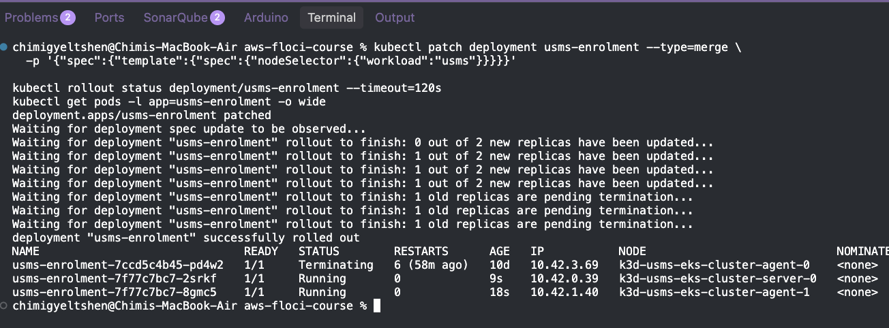

Part 4 - prove the selector is enforced

```bash 
kubectl patch deployment usms-enrolment --type=merge \
  -p '{"spec":{"template":{"spec":{"nodeSelector":{"workload":"nonexistent"}}}}}'

sleep 15
kubectl get pods -l app=usms-enrolment
kubectl describe pod -l app=usms-enrolment | grep -A3 'Events:' | tail -4
```
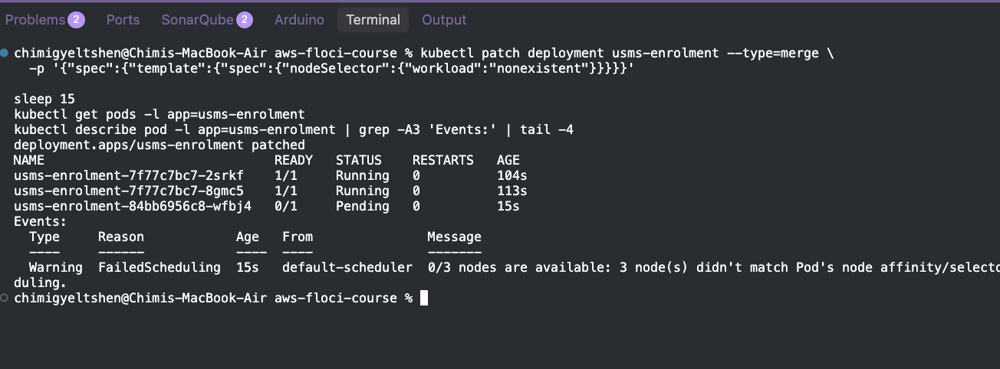


Step 12 - A PodDisruptionBudget, and what it does not protect against¶

Part 1 - write it
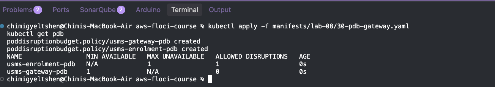

Part 2 - prove it is consulted, and then prove what ignores it

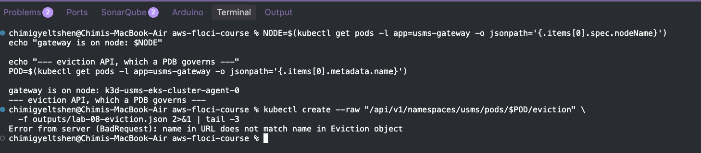

Part 3 - the practical consequence

```bash
kubectl drain "$NODE" --ignore-daemonsets --delete-emptydir-data --dry-run=client 2>&1 | tail -5
```
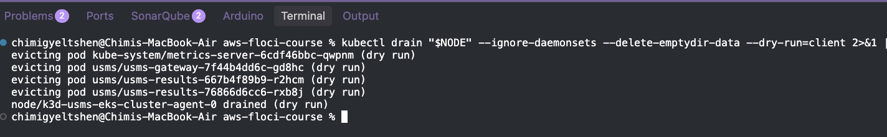


Step 13 - Rung one: ClusterIP and port-forward¶
Part 1 - confirm nothing is reachable from here

```bash 
kubectl get svc -o wide

CIP=$(kubectl get svc usms-gateway -o jsonpath='{.spec.clusterIP}')
echo "gateway ClusterIP: $CIP"

curl -s --max-time 5 "http://$CIP/" || echo "as expected: a ClusterIP is not routable from your machine"
```
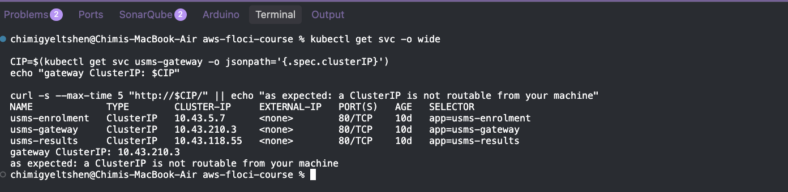


Part 2 - tunnel to it

```bash
kubectl port-forward svc/usms-gateway 18080:80

curl -s http://localhost:18080/ ; echo
curl -s http://localhost:18080/enrolment/ ; echo
curl -s http://localhost:18080/results/ ; echo
```
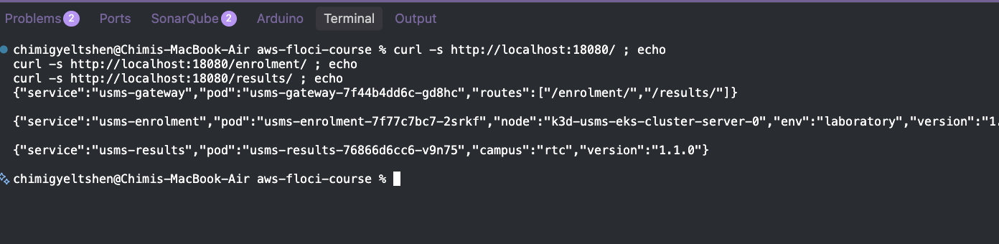

Step 14 - Rung two: NodePort
Part 1 - a new Service rather than a patch

```bash
kubectl apply -f manifests/lab-08/40-service-nodeport.yaml
kubectl get svc usms-results-np -o wide
```
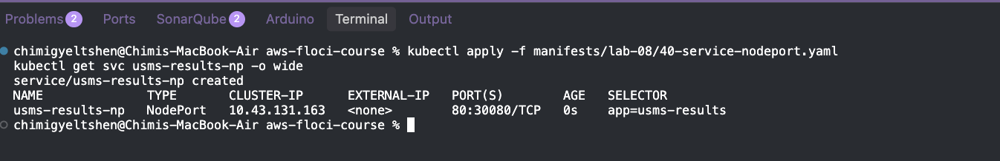


Part 2 - reach it from inside the cluster, on a node address

```bash 
NODEIP=$(kubectl get nodes -o jsonpath='{.items[0].status.addresses[?(@.type=="InternalIP")].address}')
echo "node internal IP: $NODEIP"

kubectl run usms-debug --rm -it --restart=Never --image=busybox:1.36 -- \
  wget -qO- "http://$NODEIP:30080/"
```
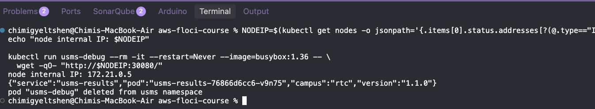

Part 3 - prove that every node answers

```bash
for IP in $(kubectl get nodes -o jsonpath='{range .items[*]}{.status.addresses[?(@.type=="InternalIP")].address}{"\n"}{end}'); do
  echo "--- via node $IP ---"
  kubectl run usms-debug-$RANDOM --rm -i --restart=Never --image=busybox:1.36 -- \
    wget -qO- --timeout=5 "http://$IP:30080/" 2>/dev/null || echo "  no answer"
done
```
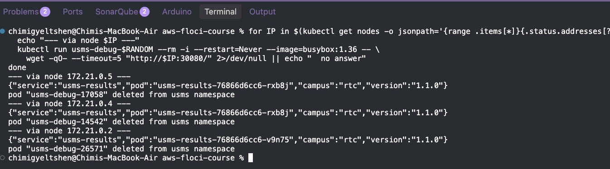

Part 4 - from your machine

```bash
curl -s --max-time 5 http://localhost:30080/ ; echo
```
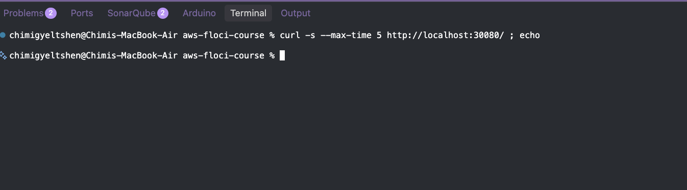

Step 15 - Rung three: LoadBalancer¶

Part 1 - promote the gateway

```bash
kubectl apply -f manifests/lab-08/50-service-loadbalancer.yaml
kubectl get svc usms-gateway -o wide
```
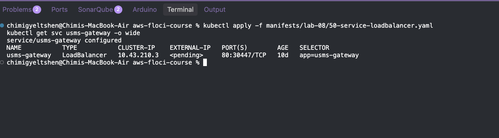

Part 2 - watch for an address
```bash 
kubectl get svc usms-gateway -w
```
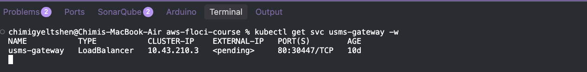

Part 3 - reach it

```bash
echo "--- via the published host port from Lab 07's _lb_ports_ tag ---"
curl -s --max-time 5 http://localhost:8081/ ; echo

echo "--- via the second published port ---"
curl -s --max-time 5 http://localhost:8082/ ; echo

echo "--- via the assigned EXTERNAL-IP, if there is one ---"
EXT=$(kubectl get svc usms-gateway -o jsonpath='{.status.loadBalancer.ingress[0].ip}')
echo "EXTERNAL-IP = ${EXT:-none}"
[ -n "$EXT" ] && kubectl run usms-debug --rm -i --restart=Never --image=busybox:1.36 -- \
  wget -qO- --timeout=5 "http://$EXT/" 2>/dev/null
```
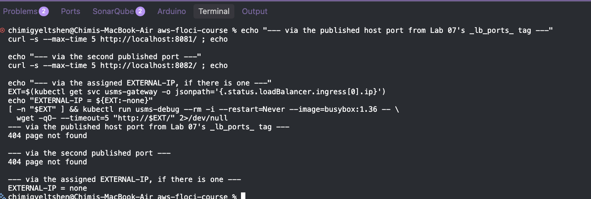

Verify

```bash
kubectl get svc usms-gateway \
  -o jsonpath='{"type="}{.spec.type}{"  clusterIP="}{.spec.clusterIP}{"  nodePort="}{.spec.ports[0].nodePort}{"  external="}{.status.loadBalancer.ingress[0].ip}{"\n"}'
```
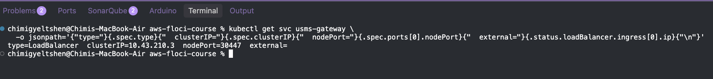

Step 16 - Rung four: Ingress, and the comparison this practical was built for
Part 1 - is there a controller?

```bash
kubectl get ingressclass 2>/dev/null || echo "no IngressClass registered"
kubectl get pods -A | grep -Ei 'traefik|ingress|nginx-controller' || echo "no ingress controller pod found"
```
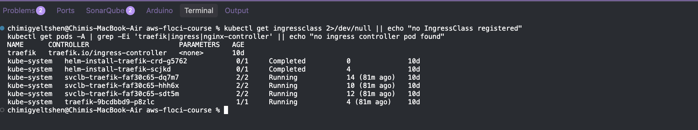

Part 2 - write the Ingress

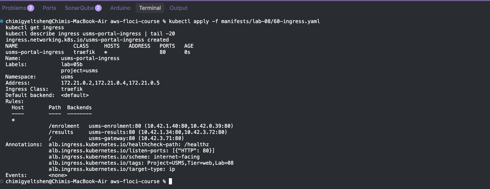

Part 3 - exercise the routes

```bash
for P in / /enrolment/ /results/ ; do
  echo "--- $P ---"
  curl -s --max-time 5 "http://localhost:8081$P" || echo "  (no answer on 8081)"
  echo
done
```
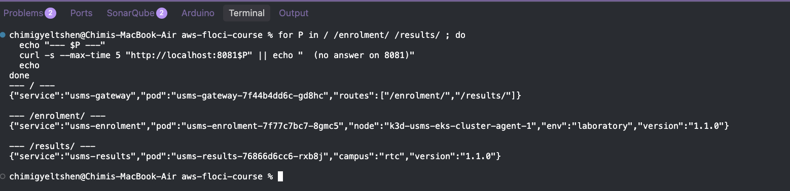


Step 17 - Write the Practical 2 / Practical 4 comparison, with both systems running

Command - look at both
```bash
echo "=============== ECS / ALB / Application Auto Scaling ==============="
aws ecs describe-services --cluster "$USMS_ECS_CLUSTER" --services usms-enrolment-svc \
  --query 'services[0].{Desired:desiredCount,Running:runningCount,TaskDef:taskDefinition,
                        LB:loadBalancers[0].targetGroupArn,Grace:healthCheckGracePeriodSeconds}' \
  --output json 2>/dev/null

aws application-autoscaling describe-scalable-targets --service-namespace ecs \
  --query 'ScalableTargets[0].{Id:ResourceId,Min:MinCapacity,Max:MaxCapacity}' --output json 2>/dev/null

aws application-autoscaling describe-scaling-policies --service-namespace ecs \
  --query 'ScalingPolicies[].{Name:PolicyName,Type:PolicyType}' --output table 2>/dev/null

echo
echo "=============== EKS / Ingress / HorizontalPodAutoscaler ==============="
kubectl get deploy,hpa,svc,ingress,pdb
```


Command - write the comparison


Step 18 - Prove that scaling and exposure configuration survive a restart¶
```bash
Part 1 - record the truth

```bash
{
  echo "=== BEFORE RESTART $(date -u +%Y-%m-%dT%H:%M:%SZ) ==="
  kubectl get hpa -o custom-columns='NAME:.metadata.name,MIN:.spec.minReplicas,MAX:.spec.maxReplicas,TARGET:.spec.metrics[0].resource.target.averageUtilization'
  kubectl get pdb -o custom-columns='NAME:.metadata.name,MINAVAIL:.spec.minAvailable,MAXUNAVAIL:.spec.maxUnavailable'
  kubectl get svc -o custom-columns='NAME:.metadata.name,TYPE:.spec.type,NODEPORT:.spec.ports[0].nodePort'
  kubectl get ingress -o custom-columns='NAME:.metadata.name,PATHS:.spec.rules[0].http.paths[*].path'
  aws eks describe-nodegroup --cluster-name "$USMS_EKS_CLUSTER" --nodegroup-name "$USMS_EKS_NODEGROUP" \
    --query 'nodegroup.scalingConfig' --output text 2>/dev/null || echo "nodegroup: Path B"
} | tee outputs/lab-08-before-restart.txt
```


Part 2 - perturb

```bash
./scripts/setup/floci-down.sh
sleep 5
./scripts/setup/floci-up.sh
sleep 30
kubectl cluster-info || { echo "re-establishing kubeconfig"; aws eks update-kubeconfig --name "$USMS_EKS_CLUSTER" --alias usms-eks; }
kubectl config set-context --current --namespace=usms
```


Part 3 - read back

```bash
{
  echo "=== AFTER RESTART $(date -u +%Y-%m-%dT%H:%M:%SZ) ==="
  kubectl get hpa -o custom-columns='NAME:.metadata.name,MIN:.spec.minReplicas,MAX:.spec.maxReplicas,TARGET:.spec.metrics[0].resource.target.averageUtilization'
  kubectl get pdb -o custom-columns='NAME:.metadata.name,MINAVAIL:.spec.minAvailable,MAXUNAVAIL:.spec.maxUnavailable'
  kubectl get svc -o custom-columns='NAME:.metadata.name,TYPE:.spec.type,NODEPORT:.spec.ports[0].nodePort'
  kubectl get ingress -o custom-columns='NAME:.metadata.name,PATHS:.spec.rules[0].http.paths[*].path'
  aws eks describe-nodegroup --cluster-name "$USMS_EKS_CLUSTER" --nodegroup-name "$USMS_EKS_NODEGROUP" \
    --query 'nodegroup.scalingConfig' --output text 2>/dev/null || echo "nodegroup: Path B"
} | tee outputs/lab-08-after-restart.txt

echo
diff <(grep -v '^===' outputs/lab-08-before-restart.txt) \
     <(grep -v '^===' outputs/lab-08-after-restart.txt) \
  && echo "PERSISTENCE PROVEN - scaling and exposure configuration identical" \
  || echo "differences above - read them before deciding whether they matter"
```


Step 19 - Write configs/lab-08.env¶


Verify

```bash 
source configs/lab-08.env
echo "hpa: $USMS_HPA_MIN..$USMS_HPA_MAX at ${USMS_HPA_CPU_TARGET}% cpu, scale-in window ${USMS_HPA_SCALEDOWN_WINDOW}s"
echo "nodeport: $USMS_SVC_NODEPORT   gateway: $USMS_SVC_GATEWAY_TYPE"
grep -c '^export' configs/lab-08.env
```


Step 20 - Commit your work
    
```bash 
git add configs/lab-08.env
git commit -m "lab-08-eks-scaling: HPA, PDB, NodePort, Ingress, and nodeSelector"
git log --oneline -n 1
```


