# Securing the USMS Application with IAM Roles and Security Groups

## Objectives

## Prerequisites

```bash 
for t in jq python3 docker; do printf '%-10s ' "$t"; command -v "$t" || echo MISSING; done
aws --version
./scripts/utilities/floci-storage-check.sh | tail -2
aws sts get-caller-identity --profile usms-dev --query 'Arn' --output text
ls -l outputs/usms-app-key.pem
```
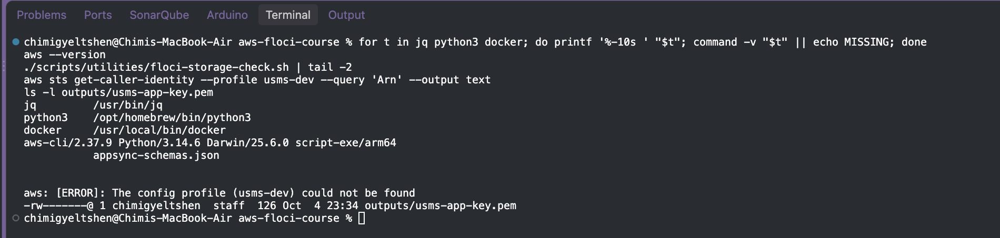

step by step implementation

Step 1 - Resume the environment and load seven env files
```bash 
cd ~/aws-floci-course
./scripts/setup/floci-up.sh

source configs/course.env
source configs/lab-01.env
source configs/lab-02.env
source configs/lab-03.env
source configs/lab-04.env
source configs/lab-05.env
source configs/lab-06.env

./scripts/utilities/whoami.sh

printf '%-28s %s\n' \
  "account"              "$USMS_ACCOUNT_ID" \
  "region"               "$AWS_REGION_COURSE" \
  "dev user"             "$USMS_DEV_USER" \
  "admin user"           "$USMS_ADMIN_USER" \
  "developer role"       "$USMS_ROLE_DEVELOPER" \
  "ec2 role"             "$USMS_ROLE_EC2" \
  "lambda role"          "$USMS_ROLE_LAMBDA" \
  "instance profile"     "$USMS_INSTANCE_PROFILE" \
  "bucket name (policy)" "$USMS_BUCKET_NAME" \
  "vpc"                  "$USMS_VPC_ID" \
  "app sg"               "$USMS_APP_SG" \
  "db sg"                "$USMS_DB_SG" \
  "enrolment sg"         "$USMS_ENROLMENT_SG" \
  "alb sg"               "$USMS_ALB_SG" \
  "s3 endpoint"          "$USMS_S3_ENDPOINT" \
  "web instance"         "$USMS_WEB_INSTANCE" \
  "db instance"          "$USMS_DB_INSTANCE"
```
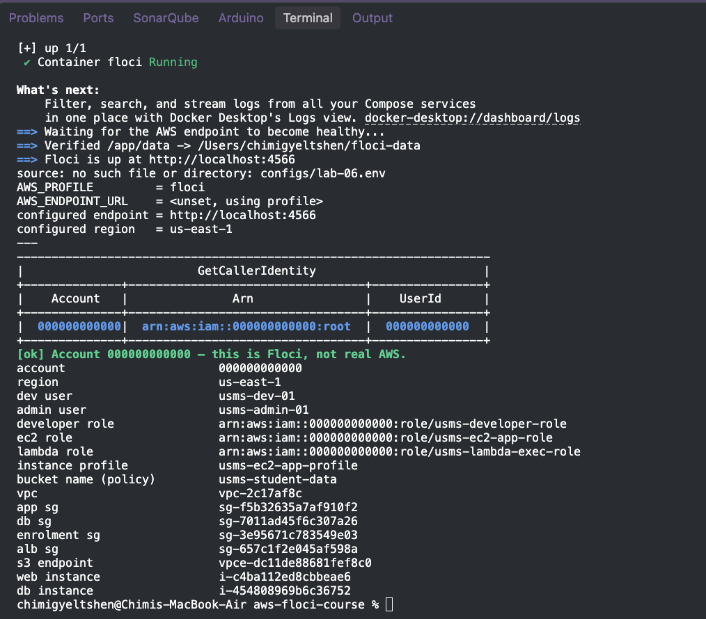

Step 2 - Record the security baseline before you change anything
```bash 
{
  echo "== baseline recorded $(python3 -c 'import datetime;print(datetime.datetime.now(datetime.timezone.utc).strftime("%Y-%m-%dT%H:%M:%SZ"))') =="
  for s in 02 03 04 05 06; do
    printf '%-10s ' "lab-$s"
    ./scripts/utilities/verify-lab-$s.sh 2>/dev/null | tail -1
  done
} | tee outputs/lab-09-pre-verify.txt
```
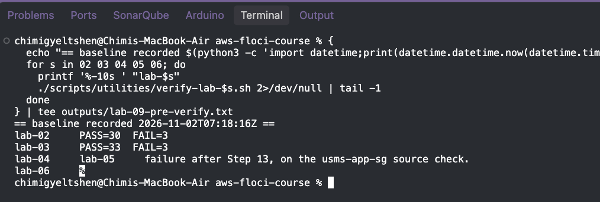

Verify

FAIL=0 from Labs 2, 3, 5 and 6; Lab 4 at FAIL=0 or the one documented failure. Confirm it:
```bash 

./scripts/utilities/verify-lab-04.sh 2>/dev/null | grep FAIL || echo "no failures in 04"
```
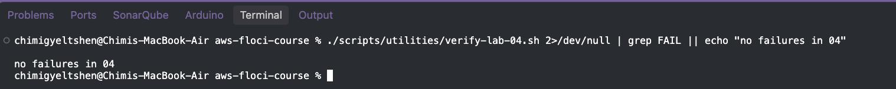


Step 3 - Probe what this Floci build supports for policy evaluation and rule management¶
```bash
probe() {
  printf '%-52s ' "$1"
  if eval "$2" >/dev/null 2>&1; then echo "SUPPORTED"; else echo "not available"; fi
}

echo "== IAM: reading what exists =="
probe "iam list-roles"                       "aws iam list-roles --max-items 1"
probe "iam list-policies --scope Local"      "aws iam list-policies --scope Local --max-items 1"
probe "iam get-role"                         "aws iam get-role --role-name $USMS_ROLE_EC2"
probe "iam list-attached-role-policies"      "aws iam list-attached-role-policies --role-name $USMS_ROLE_EC2"
probe "iam get-account-authorization-details" "aws iam get-account-authorization-details --max-items 1"

echo "== IAM: changing what exists =="
probe "iam update-assume-role-policy (skel)" "aws iam update-assume-role-policy --generate-cli-skeleton"
probe "iam create-role --permissions-boundary (skel)" "aws iam create-role --generate-cli-skeleton"
probe "iam put-role-permissions-boundary (skel)" "aws iam put-role-permissions-boundary --generate-cli-skeleton"

echo "== IAM: evaluating what exists =="
probe "iam simulate-principal-policy" \
  "aws iam simulate-principal-policy --policy-source-arn arn:aws:iam::$USMS_ACCOUNT_ID:role/$USMS_ROLE_EC2 --action-names s3:GetObject"
probe "accessanalyzer list-analyzers"        "aws accessanalyzer list-analyzers"
probe "sts assume-role --policy (session policy)" "aws sts assume-role --generate-cli-skeleton"

echo "== IAM: credentials =="
probe "iam list-access-keys"                 "aws iam list-access-keys --user-name $USMS_DEV_USER"
probe "iam get-access-key-last-used"         "aws iam get-access-key-last-used --generate-cli-skeleton"
probe "iam get-credential-report"            "aws iam get-credential-report"

echo "== EC2: security group rules =="
probe "ec2 describe-security-group-rules"    "aws ec2 describe-security-group-rules --max-items 1"
probe "ec2 authorize-security-group-egress (skel)" "aws ec2 authorize-security-group-egress --generate-cli-skeleton"
probe "ec2 revoke-security-group-egress (skel)"    "aws ec2 revoke-security-group-egress --generate-cli-skeleton"
probe "ec2 describe-prefix-lists"            "aws ec2 describe-prefix-lists"
probe "ec2 describe-network-interfaces"      "aws ec2 describe-network-interfaces --max-items 1"

echo "== EC2: instance metadata options =="
probe "ec2 modify-instance-metadata-options (skel)" "aws ec2 modify-instance-metadata-options --generate-cli-skeleton"
probe "ec2 describe-instances MetadataOptions" \
  "aws ec2 describe-instances --instance-ids $USMS_WEB_INSTANCE --query 'Reservations[0].Instances[0].MetadataOptions'"
```
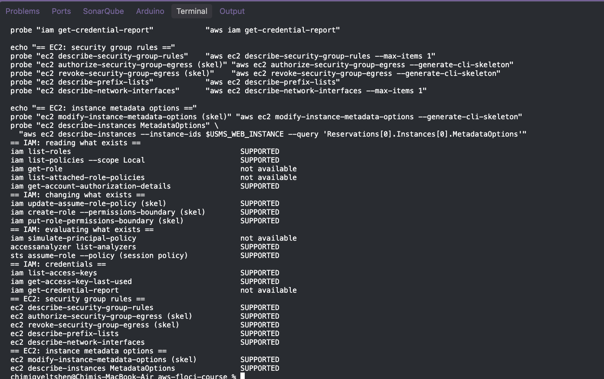

Step 4 - Inventory every identity in the account¶
Part 1 - the human-readable pass

```bash 
echo "== Roles in this account =="
aws iam list-roles \
  --query 'sort_by(Roles, &RoleName)[].{Role:RoleName,Created:CreateDate,MaxSession:MaxSessionDuration}' \
  --output table

echo
echo "== Users, and how many access keys each one has =="
for u in $(aws iam list-users --query 'Users[].UserName' --output text); do
  n=$(aws iam list-access-keys --user-name "$u" --query 'length(AccessKeyMetadata)' --output text)
  printf '  %-18s access keys: %s\n' "$u" "$n"
done

echo
echo "== Customer managed policies =="
aws iam list-policies --scope Local \
  --query 'sort_by(Policies, &PolicyName)[].{Policy:PolicyName,Default:DefaultVersionId,Attached:AttachmentCount}' \
  --output table
```
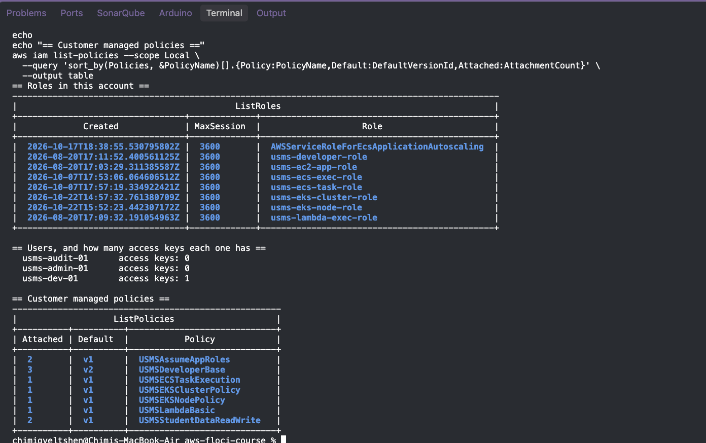

Part 2 - the machine-readable inventory

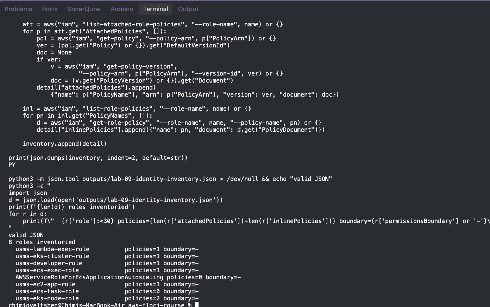

Step 5 - Build the IAM audit script¶
```bash 
chmod +x scripts/utilities/usms-iam-audit.sh
bash -n scripts/utilities/usms-iam-audit.sh && echo "syntax OK"
./scripts/utilities/usms-iam-audit.sh | tee outputs/lab-09-iam-findings.txt
```

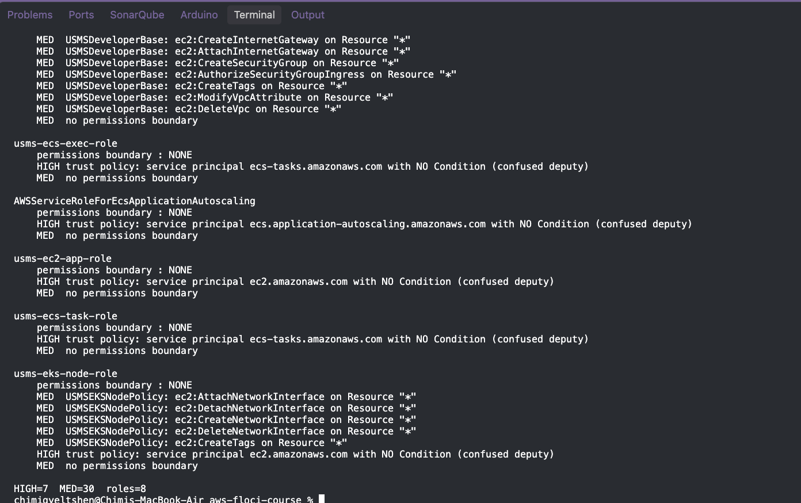

verify
```bash 
./scripts/utilities/usms-iam-audit.sh >/dev/null; echo "exit code: $?"
```
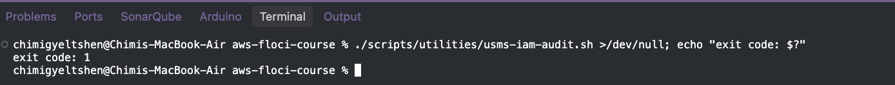

Step 6 - Read the transcripts policy, and find the verb that should not be there

Part 1 - read the policy that two roles share


```bash 
POLICY_ARN="arn:aws:iam::${USMS_ACCOUNT_ID}:policy/USMSStudentDataReadWrite"

DEFAULT_VERSION=$(aws iam get-policy --policy-arn "$POLICY_ARN" \
  --query 'Policy.DefaultVersionId' --output text)

echo "default version: $DEFAULT_VERSION"

aws iam get-policy-version --policy-arn "$POLICY_ARN" --version-id "$DEFAULT_VERSION" \
  --query 'PolicyVersion.Document' --output json | tee outputs/lab-09-transcripts-rw.json

echo
echo "== who carries it =="
aws iam list-entities-for-policy --policy-arn "$POLICY_ARN" \
  --query '{Roles:PolicyRoles[].RoleName,Users:PolicyUsers[].UserName,Groups:PolicyGroups[].GroupName}' \
  --output json
```
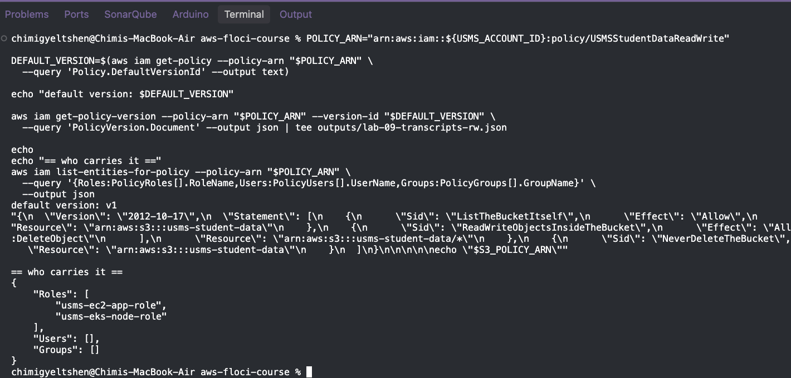


Part 2 - does the bucket exist yet?

```bash
aws s3api head-bucket --bucket "${USMS_BUCKET_NAME:-usms-student-data}" 2>&1 | head -3
echo "head-bucket exit code: ${PIPESTATUS[0]}"
```
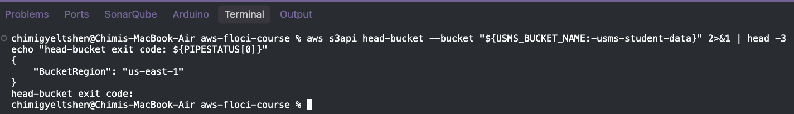

Step 7 - Create the read-only policy and the role that carries it¶
Part 1 - the read-only policy document

```bash
python3 -m json.tool policies/usms-student-data-ro-policy.json > /dev/null && echo "valid JSON"
grep -c '\$' policies/usms-student-data-ro-policy.json
```
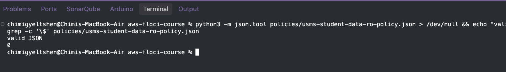

Part 2 - create the policy

```bash
RO_POLICY_ARN=$(aws iam create-policy \
  --policy-name USMSStudentDataReadOnly \
  --description "Read-only access to the USMS transcripts bucket. Explicitly denies every write." \
  --policy-document file://policies/usms-student-data-ro-policy.json \
  --tags Key=Project,Value=USMS Key=Lab,Value=05 Key=Tier,Value=data \
  --query 'Policy.Arn' --output text)

echo "RO_POLICY_ARN = $RO_POLICY_ARN"
```
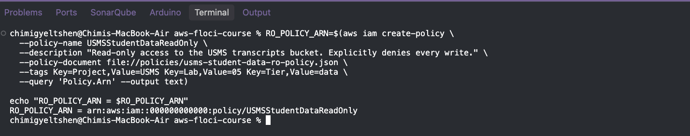

Part 4 - the new role

```bash 
READER_ROLE_ARN=$(aws iam create-role \
  --role-name usms-transcripts-reader-role \
  --description "Read-only transcripts access for a future USMS reporting task" \
  --assume-role-policy-document file://policies/trust-ecs-tasks-scoped.json \
  --max-session-duration 3600 \
  --tags Key=Project,Value=USMS Key=Lab,Value=05 Key=Tier,Value=data \
  --query 'Role.Arn' --output text)

echo "READER_ROLE_ARN = $READER_ROLE_ARN"

aws iam attach-role-policy \
  --role-name usms-transcripts-reader-role \
  --policy-arn "$RO_POLICY_ARN"
```
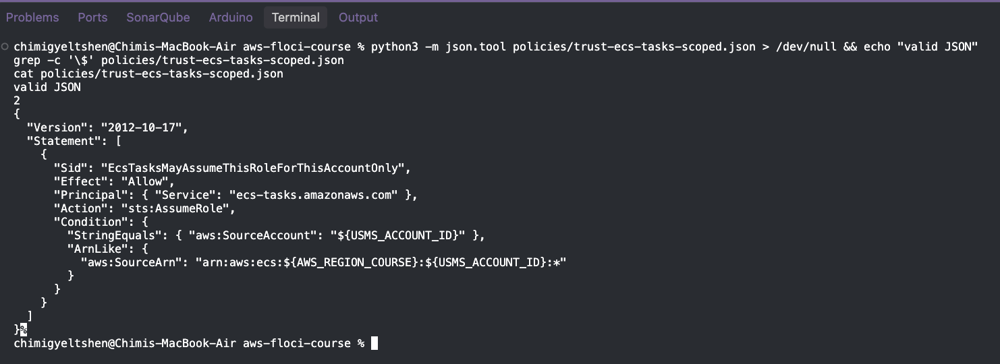

Part 5 - fix the trust policy on the role that already exists

```bash
aws iam get-role --role-name "$USMS_ECS_TASK_ROLE" \
  --query 'Role.AssumeRolePolicyDocument' --output json \
  > outputs/lab-09-ecs-task-role-trust-before.json

cat outputs/lab-09-ecs-task-role-trust-before.json

aws iam update-assume-role-policy \
  --role-name "$USMS_ECS_TASK_ROLE" \
  --policy-document file://policies/trust-ecs-tasks-scoped.json
```
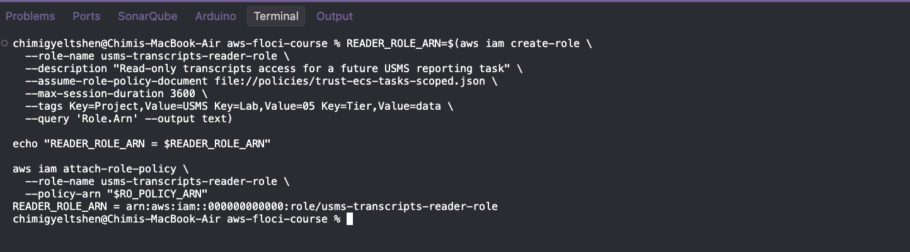

verify
```bash
echo "== the new role =="
aws iam get-role --role-name usms-transcripts-reader-role \
  --query 'Role.{Name:RoleName,MaxSession:MaxSessionDuration,Trust:AssumeRolePolicyDocument}' \
  --output json

echo
echo "== its permissions =="
aws iam list-attached-role-policies --role-name usms-transcripts-reader-role \
  --query 'AttachedPolicies[].PolicyName' --output text

echo
echo "== the rewritten trust policy on the existing task role =="
aws iam get-role --role-name "$USMS_ECS_TASK_ROLE" \
  --query 'Role.AssumeRolePolicyDocument' --output json \
  > outputs/lab-09-ecs-task-role-trust-after.json

python3 - << 'PY'
import json
before = json.load(open("outputs/lab-09-ecs-task-role-trust-before.json"))
after  = json.load(open("outputs/lab-09-ecs-task-role-trust-after.json"))

def principals(doc):
    out = []
    sts = doc.get("Statement")
    sts = sts if isinstance(sts, list) else [sts]
    for s in sts:
        out.append((json.dumps(s.get("Principal"), sort_keys=True), bool(s.get("Condition"))))
    return out

print("before:", principals(before))
print("after :", principals(after))

same_principal = [p for p, _ in principals(before)] == [p for p, _ in principals(after)]
gained_cond    = all(c for _, c in principals(after)) and not all(c for _, c in principals(before))

print()
print("SAME PRINCIPAL, NEW CONDITION" if (same_principal and gained_cond)
      else "CHECK THIS BY HAND - the principal changed, or no condition was added")
PY
```
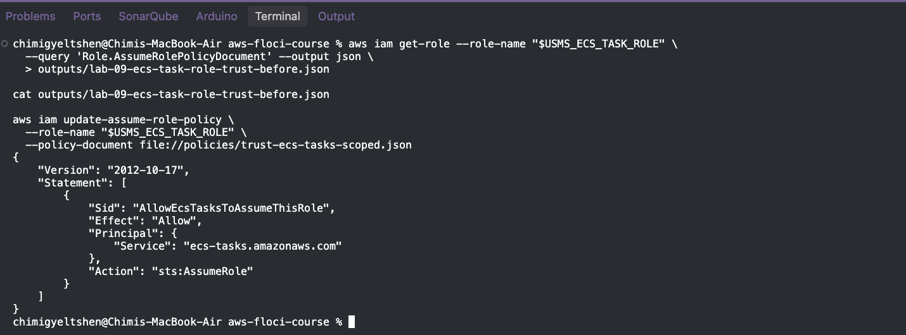

Step 8 - Scope iam:PassRole, and put a ceiling on a role for the first time¶
Part 1 - the boundary document

```bash
python3 -m json.tool policies/usms-permissions-boundary.json > /dev/null && echo "valid JSON"
```
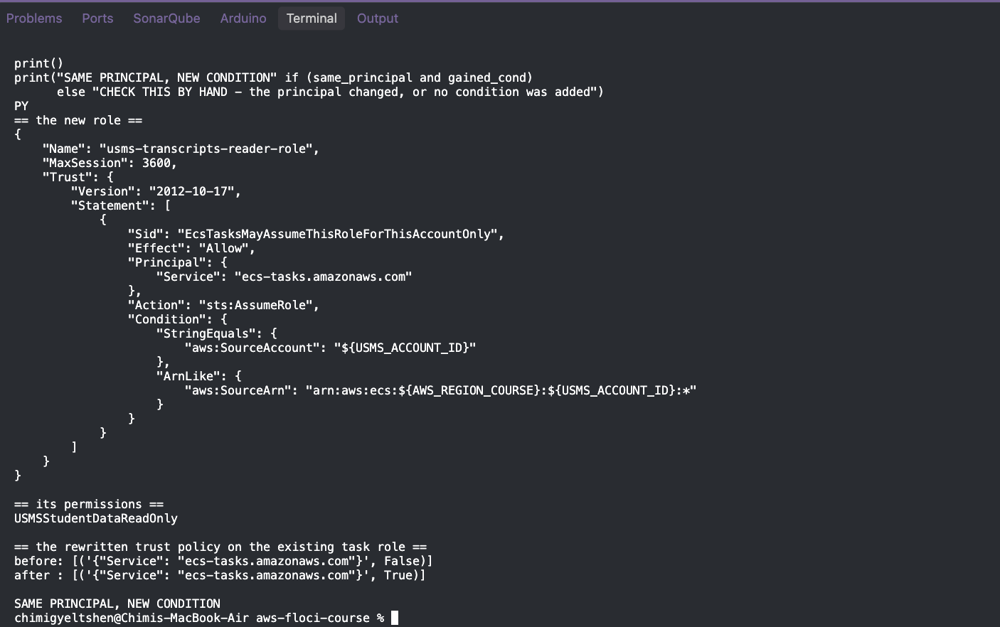
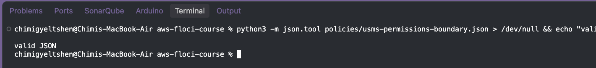


Part 2 - create it, and do not attach it to anything

```bash 
BOUNDARY_ARN=$(aws iam create-policy \
  --policy-name USMSPermissionsBoundary \
  --description "A CEILING, not a grant. Used only as a --permissions-boundary. Never attach this." \
  --policy-document file://policies/usms-permissions-boundary.json \
  --tags Key=Project,Value=USMS Key=Lab,Value=05 Key=Purpose,Value=boundary \
  --query 'Policy.Arn' --output text)

echo "BOUNDARY_ARN = $BOUNDARY_ARN"
```
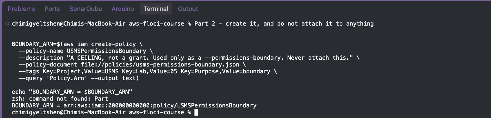

Part 3 - the deploy policy, with a scoped iam:PassRole

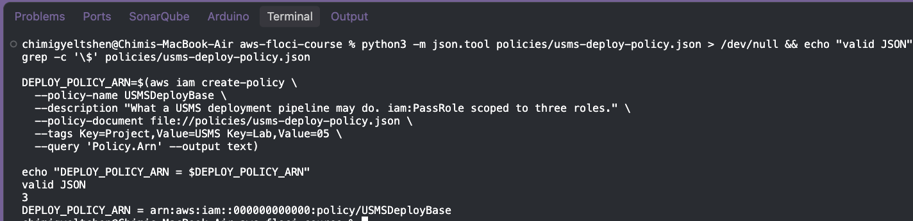

part 5 verify the deploy policy

```bash
echo "== the deploy role =="
aws iam get-role --role-name usms-deploy-role \
  --query 'Role.{Name:RoleName,Boundary:PermissionsBoundary.PermissionsBoundaryArn,MaxSession:MaxSessionDuration,Principal:AssumeRolePolicyDocument.Statement[0].Principal}' \
  --output json

echo
echo "== what it may pass, and to what =="
aws iam get-policy-version \
  --policy-arn "$DEPLOY_POLICY_ARN" \
  --version-id "$(aws iam get-policy --policy-arn "$DEPLOY_POLICY_ARN" --query 'Policy.DefaultVersionId' --output text)" \
  --query 'PolicyVersion.Document.Statement[?Action==`iam:PassRole`]' \
  --output json

echo
echo "== is the boundary attached to anything as an ordinary policy? (it must NOT be) =="
aws iam list-entities-for-policy --policy-arn "$BOUNDARY_ARN" \
  --query '{Roles:PolicyRoles[].RoleName,Users:PolicyUsers[].UserName,Groups:PolicyGroups[].GroupName}' \
  --output json
```
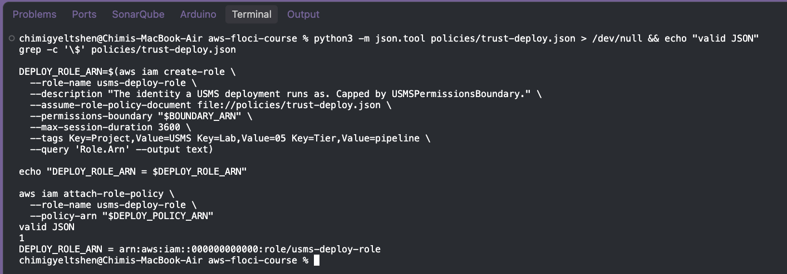
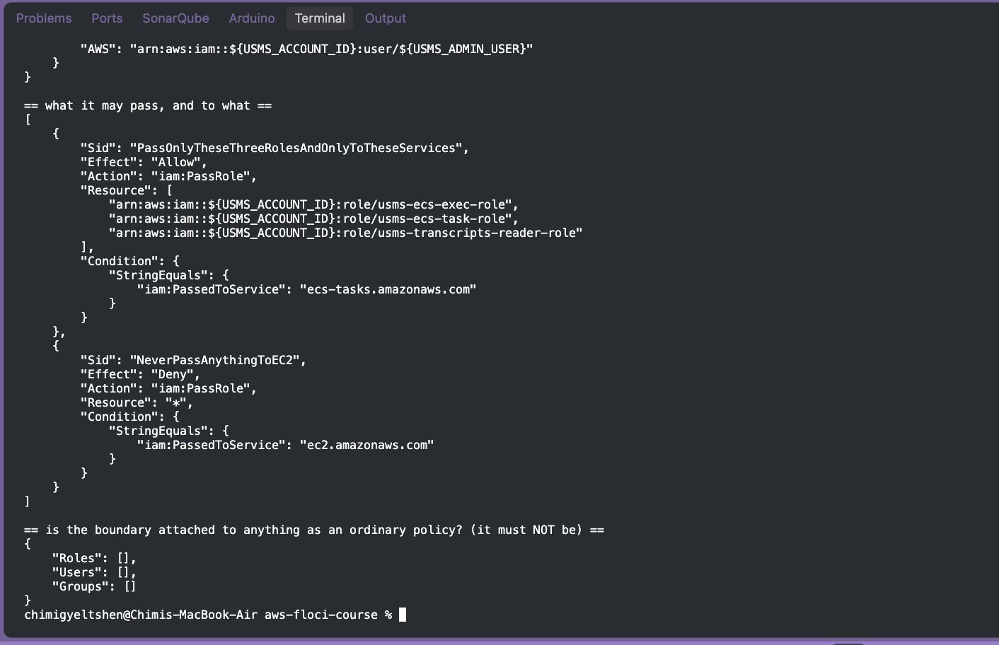

Step 9 - Scope down a session, and compute an intersection¶
Part 1 - write a session policy
```bash
python3 -m json.tool outputs/lab-09-session-policy.json > /dev/null && echo "valid JSON"
```
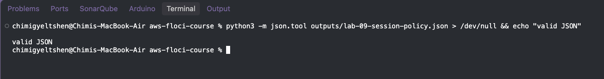

Part 2 - assume the role with it

```bash
ROLE_ARN="arn:aws:iam::${USMS_ACCOUNT_ID}:role/${USMS_ROLE_DEVELOPER}"

aws sts assume-role \
  --role-arn "$ROLE_ARN" \
  --role-session-name "lab05-scoped-review" \
  --policy file://outputs/lab-09-session-policy.json \
  --duration-seconds 900 \
  --profile usms-dev \
  > outputs/lab-09-scoped-session.json \
  || echo "assume-role with --policy not supported on this build - see the fallback below"

chmod 600 outputs/lab-09-scoped-session.json 2>/dev/null || true

if [ -s outputs/lab-09-scoped-session.json ]; then
  export AWS_ACCESS_KEY_ID=$(jq -r '.Credentials.AccessKeyId'     outputs/lab-09-scoped-session.json)
  export AWS_SECRET_ACCESS_KEY=$(jq -r '.Credentials.SecretAccessKey' outputs/lab-09-scoped-session.json)
  export AWS_SESSION_TOKEN=$(jq -r '.Credentials.SessionToken'    outputs/lab-09-scoped-session.json)

  aws sts get-caller-identity --no-cli-pager
  aws ec2 describe-vpcs --query 'length(Vpcs)' --output text
fi
```
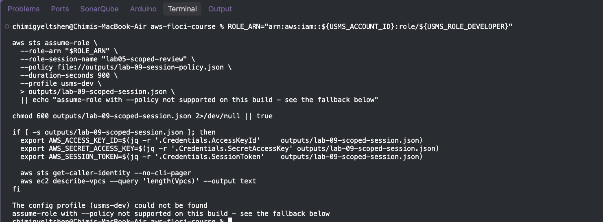

Part 3 - compute the intersection by hand

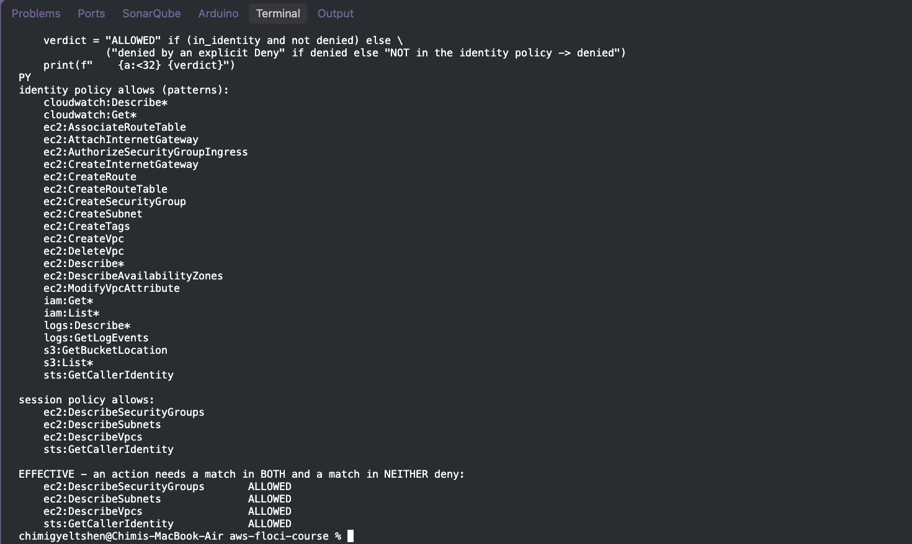

Part 4 - restore your normal identity

```bash 
unset AWS_ACCESS_KEY_ID AWS_SECRET_ACCESS_KEY AWS_SESSION_TOKEN
./scripts/utilities/whoami.sh
rm -f outputs/lab-09-scoped-session.json
```
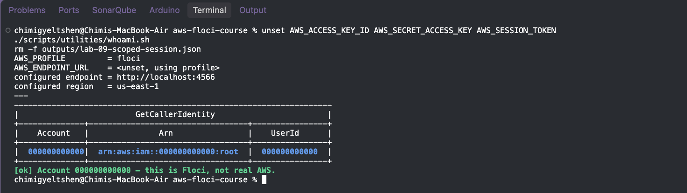

Step 10 - Rotate the access key, with no window in which nothing works¶
Part 1 - look at what you have

```bash 
aws iam list-access-keys --user-name "$USMS_DEV_USER" \
  --query 'AccessKeyMetadata[].{Key:AccessKeyId,Status:Status,Created:CreateDate}' \
  --output table

for k in $(aws iam list-access-keys --user-name "$USMS_DEV_USER" \
             --query 'AccessKeyMetadata[].AccessKeyId' --output text); do
  printf '%-24s ' "$k"
  aws iam get-access-key-last-used --access-key-id "$k" \
    --query 'AccessKeyLastUsed.{When:LastUsedDate,Service:ServiceName,Region:Region}' \
    --output text 2>/dev/null || echo "last-used not available on this build"
done
```
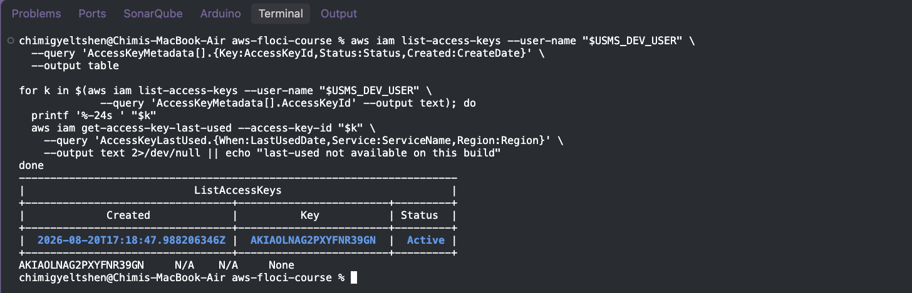

Part 2 - create the new key, straight into outputs/

```bash 
aws iam create-access-key --user-name "$USMS_DEV_USER" \
  > outputs/usms-dev-01-access-key-new.json

chmod 600 outputs/usms-dev-01-access-key-new.json

git check-ignore -v outputs/usms-dev-01-access-key-new.json

NEW_KEY_ID=$(jq -r '.AccessKey.AccessKeyId' outputs/usms-dev-01-access-key-new.json)
echo "new key id: $NEW_KEY_ID"

OLD_KEY_ID=$(aws iam list-access-keys --user-name "$USMS_DEV_USER" \
  --query "AccessKeyMetadata[?AccessKeyId!='$NEW_KEY_ID'].AccessKeyId | [0]" \
  --output text)
echo "old key id: $OLD_KEY_ID"
```
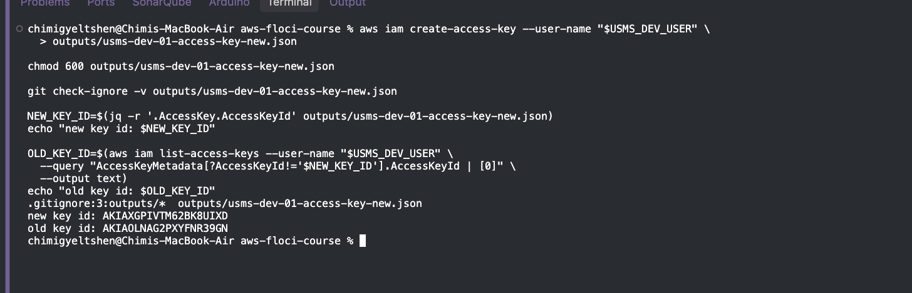


Part 3 - move the consumer over

```bash
aws configure set aws_access_key_id \
  "$(jq -r '.AccessKey.AccessKeyId' outputs/usms-dev-01-access-key-new.json)" --profile usms-dev
aws configure set aws_secret_access_key \
  "$(jq -r '.AccessKey.SecretAccessKey' outputs/usms-dev-01-access-key-new.json)" --profile usms-dev

aws sts get-caller-identity --profile usms-dev --query 'Arn' --output text
aws configure get aws_access_key_id --profile usms-dev
```
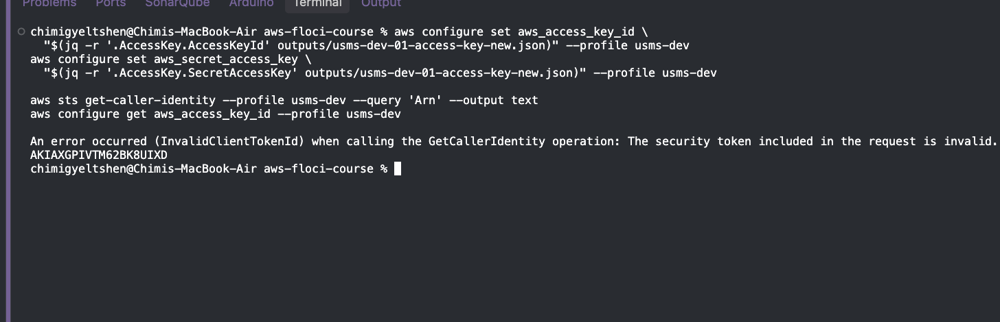

Part 4 - deactivate the old key and prove nothing broke

```bash 
aws iam update-access-key \
  --user-name "$USMS_DEV_USER" \
  --access-key-id "$OLD_KEY_ID" \
  --status Inactive

aws iam list-access-keys --user-name "$USMS_DEV_USER" \
  --query 'AccessKeyMetadata[].{Key:AccessKeyId,Status:Status}' --output table

aws sts get-caller-identity --profile usms-dev --query 'Arn' --output text
```
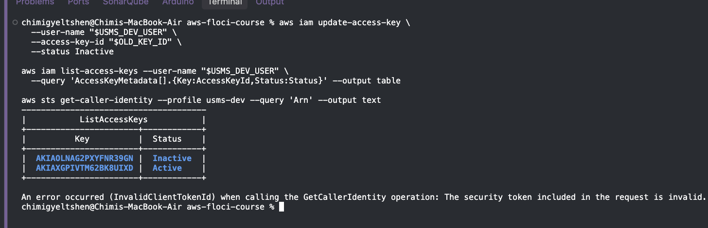

Part 5 - delete the old key

```bash
aws iam delete-access-key \
  --user-name "$USMS_DEV_USER" \
  --access-key-id "$OLD_KEY_ID"

aws iam list-access-keys --user-name "$USMS_DEV_USER" \
  --query 'AccessKeyMetadata[].{Key:AccessKeyId,Status:Status,Created:CreateDate}' --output table

aws sts get-caller-identity --profile usms-dev --query 'Arn' --output text

rm -f outputs/usms-dev-01-access-key.json
ls -l outputs/ | grep -i access-key || echo "no other access key files remain"
```
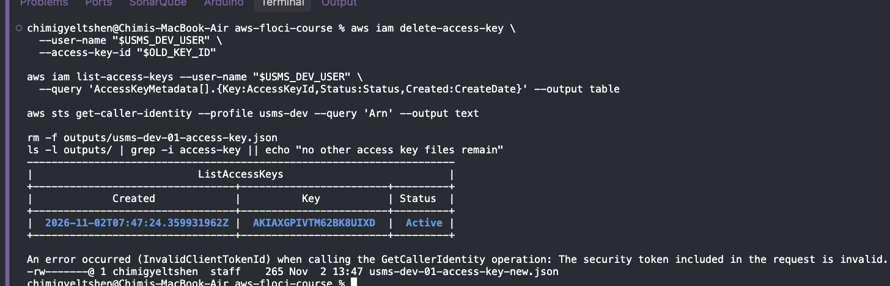

Step 11 - Require IMDSv2 on the web instance¶
Part 1 - look before you change

```bash
aws ec2 describe-instances --instance-ids "$USMS_WEB_INSTANCE" \
  --query 'Reservations[0].Instances[0].MetadataOptions' --output json \
  | tee outputs/lab-09-imds-before.json
```
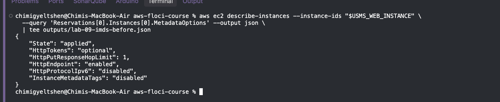

Part 2 - require tokens

```bash
aws ec2 modify-instance-metadata-options \
  --instance-id "$USMS_WEB_INSTANCE" \
  --http-tokens required \
  --http-endpoint enabled \
  --http-put-response-hop-limit 1 \
  --query '{Instance:InstanceId,State:InstanceMetadataOptions.State,Tokens:InstanceMetadataOptions.HttpTokens,Hops:InstanceMetadataOptions.HttpPutResponseHopLimit}' \
  --output json \
  || echo "modify-instance-metadata-options not supported on this build - record it and continue"
```
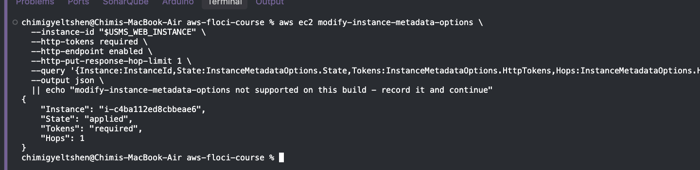

Part 3 - verify

```bash 
aws ec2 describe-instances --instance-ids "$USMS_WEB_INSTANCE" \
  --query 'Reservations[0].Instances[0].MetadataOptions' --output json \
  | tee outputs/lab-09-imds-after.json

python3 - << 'PY'
import json
before = json.load(open("outputs/lab-09-imds-before.json")) or {}
after  = json.load(open("outputs/lab-09-imds-after.json"))  or {}
print(f"HttpTokens : {before.get('HttpTokens','?')}  ->  {after.get('HttpTokens','?')}")
print(f"HopLimit   : {before.get('HttpPutResponseHopLimit','?')}  ->  {after.get('HttpPutResponseHopLimit','?')}")
ok = after.get("HttpTokens") == "required" and after.get("HttpPutResponseHopLimit") == 1
print()
print("IMDSv2 REQUIRED, HOP LIMIT 1" if ok else
      "NOT APPLIED - record this as a Floci limitation and say what real AWS would have done")
PY
```
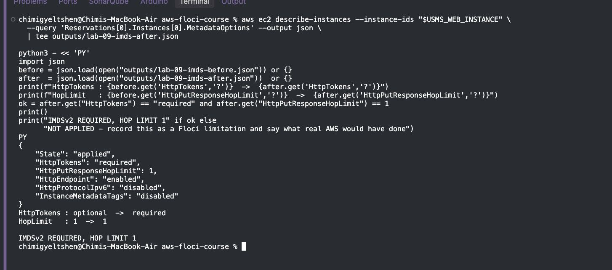

Step 12 - Build the security group audit script

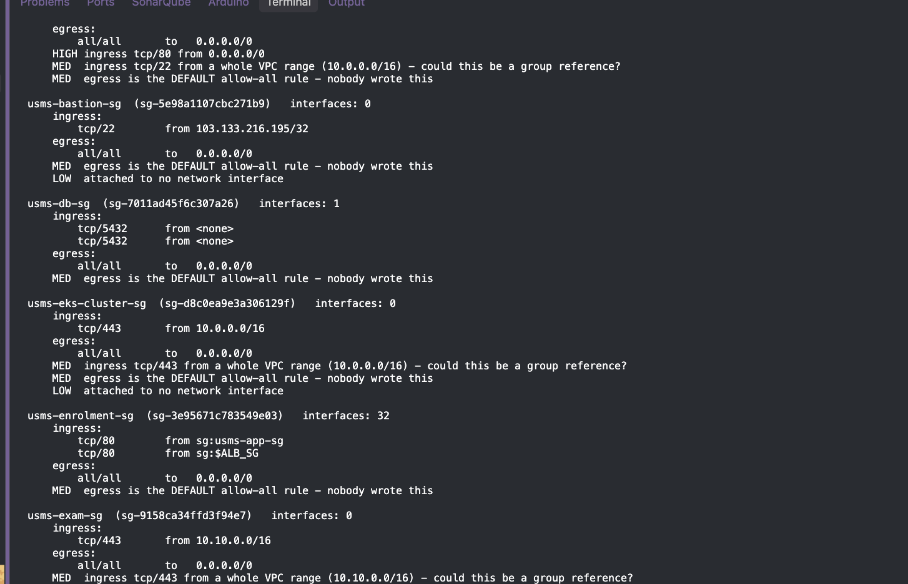

Step 13 - Write the egress rules for the enrolment tasks¶
Part 1 - find the S3 prefix list

```bash 
S3_PREFIX_LIST=$(aws ec2 describe-prefix-lists \
  --filters "Name=prefix-list-name,Values=com.amazonaws.${AWS_REGION_COURSE}.s3" \
  --query 'PrefixLists[0].PrefixListId' --output text 2>/dev/null)

echo "from describe-prefix-lists: $S3_PREFIX_LIST"

if [ -z "$S3_PREFIX_LIST" ] || [ "$S3_PREFIX_LIST" = "None" ]; then
  S3_PREFIX_LIST=$(aws ec2 describe-route-tables --route-table-ids "$USMS_PRIVATE_RT" \
    --query 'RouteTables[0].Routes[?DestinationPrefixListId!=`null`].DestinationPrefixListId | [0]' \
    --output text 2>/dev/null)
  echo "from the private route table:  $S3_PREFIX_LIST"
fi

echo "S3_PREFIX_LIST = ${S3_PREFIX_LIST:-<none>}"
```
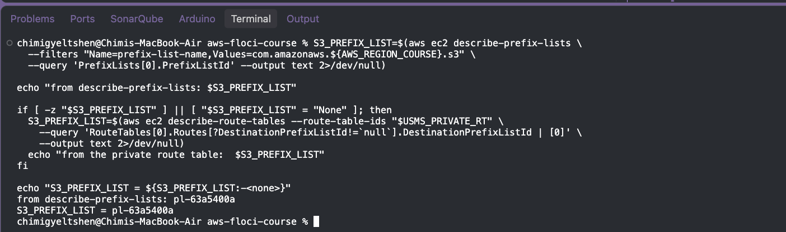

Part 2 - write the egress document

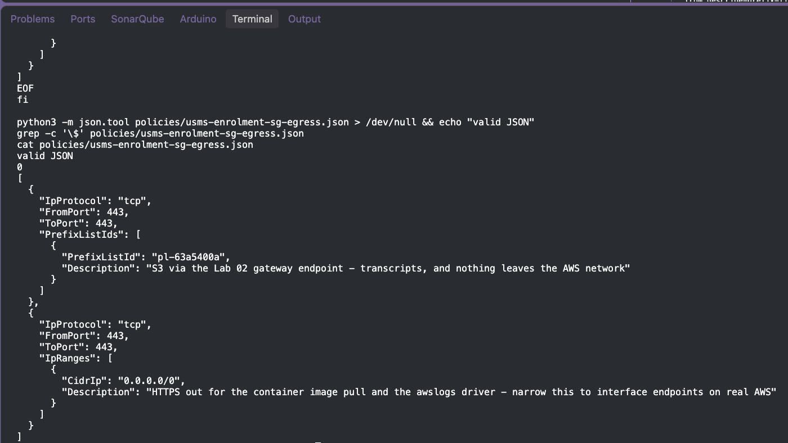

Part 3 - keep the undo, then make the change


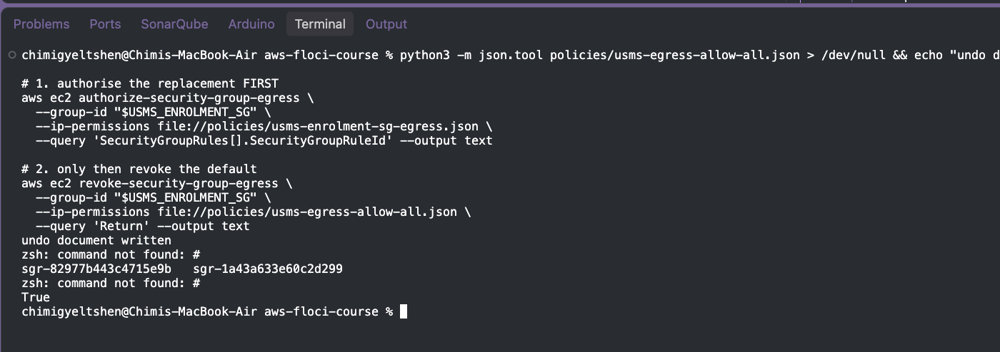

Verify

```bash
aws ec2 describe-security-group-rules \
  --filters "Name=group-id,Values=$USMS_ENROLMENT_SG" \
  --query 'SecurityGroupRules[?IsEgress==`true`].{Rule:SecurityGroupRuleId,Proto:IpProtocol,From:FromPort,To:ToPort,CIDR:CidrIpv4,PrefixList:PrefixListId,Desc:Description}' \
  --output table
```
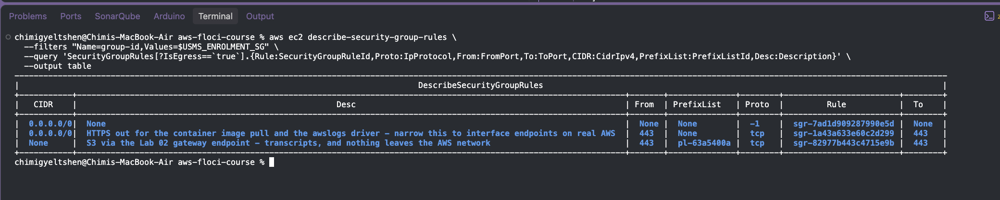


Step 14 - Write the load balancer's egress rule, whose destination is a security group¶
Part 1 - the document

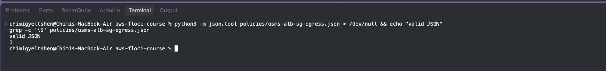

Part 2 - authorise then revoke

```bash
aws ec2 authorize-security-group-egress \
  --group-id "$USMS_ALB_SG" \
  --ip-permissions file://policies/usms-alb-sg-egress.json \
  --query 'SecurityGroupRules[].SecurityGroupRuleId' --output text

aws ec2 revoke-security-group-egress \
  --group-id "$USMS_ALB_SG" \
  --ip-permissions file://policies/usms-egress-allow-all.json \
  --query 'Return' --output text
```
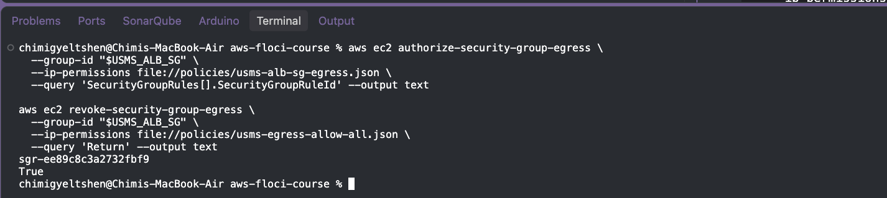

verify

```bash
aws ec2 describe-security-groups --group-ids "$USMS_ALB_SG" \
  --query 'SecurityGroups[0].{In:IpPermissions[].{Port:FromPort,CIDR:IpRanges[0].CidrIp},Out:IpPermissionsEgress[].{Port:FromPort,ToGroup:UserIdGroupPairs[0].GroupId,CIDR:IpRanges[0].CidrIp}}' \
  --output json

echo "usms-enrolment-sg = $USMS_ENROLMENT_SG"
```
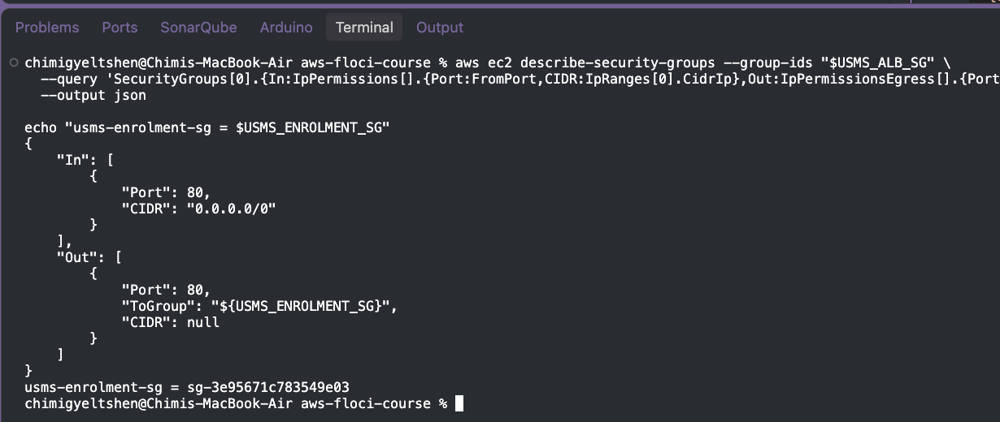

Step 15 - Write the data tier's egress rule¶
Part 1 - the document

```bash
python3 -m json.tool policies/usms-db-sg-egress.json > /dev/null && echo "valid JSON"
```
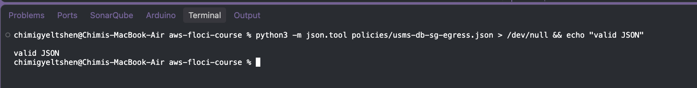

Part 2 - authorise then revoke

```bash 
aws ec2 authorize-security-group-egress \
  --group-id "$USMS_DB_SG" \
  --ip-permissions file://policies/usms-db-sg-egress.json \
  --query 'SecurityGroupRules[].SecurityGroupRuleId' --output text

aws ec2 revoke-security-group-egress \
  --group-id "$USMS_DB_SG" \
  --ip-permissions file://policies/usms-egress-allow-all.json \
  --query 'Return' --output text
```
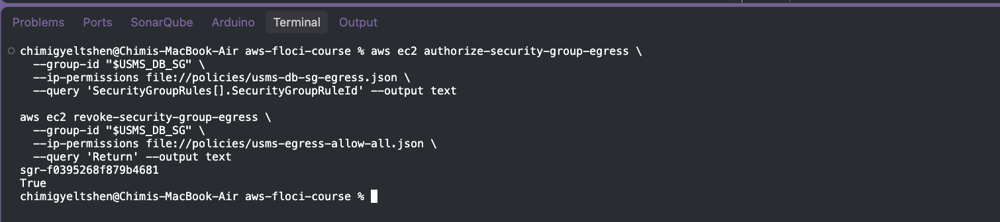

Verify

```bash 
for g in "$USMS_ENROLMENT_SG" "$USMS_ALB_SG" "$USMS_DB_SG"; do
  name=$(aws ec2 describe-security-groups --group-ids "$g" \
          --query 'SecurityGroups[0].GroupName' --output text)
  n=$(aws ec2 describe-security-groups --group-ids "$g" \
        --query 'length(IpPermissionsEgress[?IpProtocol==`-1`])' --output text)
  printf '%-22s allow-all egress rules remaining: %s\n' "$name" "$n"
done
```
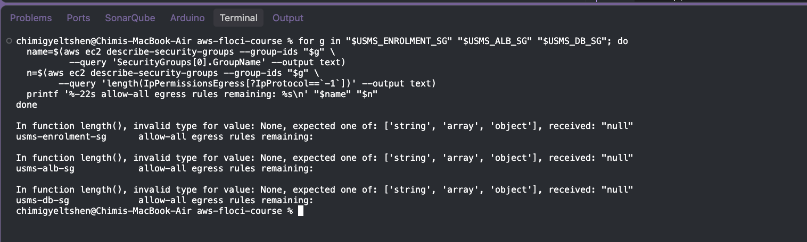

Step 16 - Narrow the SSH rule to a bastion group¶
Part 1 - find or create the group

```bash
BASTION_SG=$(aws ec2 describe-security-groups \
  --filters "Name=vpc-id,Values=$USMS_VPC_ID" "Name=group-name,Values=usms-bastion-sg" \
  --query 'SecurityGroups[0].GroupId | [0]' --output text 2>/dev/null)

if [ -z "$BASTION_SG" ] || [ "$BASTION_SG" = "None" ]; then
  echo "usms-bastion-sg does not exist - creating it (Lab 02 Exercise 2 was not done)"
  BASTION_SG=$(aws ec2 create-security-group \
    --group-name usms-bastion-sg \
    --description "USMS administrative jump host tier: SSH in from one address, SSH out to the VPC" \
    --vpc-id "$USMS_VPC_ID" \
    --tag-specifications 'ResourceType=security-group,Tags=[{Key=Name,Value=usms-bastion-sg},{Key=Project,Value=USMS},{Key=Tier,Value=admin},{Key=Lab,Value=05}]' \
    --query 'GroupId' --output text)

  aws ec2 authorize-security-group-ingress \
    --group-id "$BASTION_SG" \
    --protocol tcp --port 22 --cidr 203.0.113.10/32 \
    --query 'SecurityGroupRules[0].SecurityGroupRuleId' --output text
else
  echo "reusing usms-bastion-sg from Lab 02 Exercise 2"
fi

echo "BASTION_SG = $BASTION_SG"
```
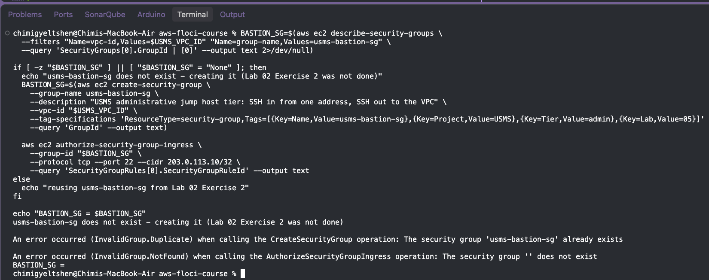

Part 2 - the new rule on usms-app-sg

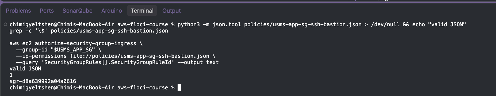

Part 3 - remove the old rule

```bash
OLD_SSH_RULE=$(aws ec2 describe-security-group-rules \
  --filters "Name=group-id,Values=$USMS_APP_SG" \
  --query "SecurityGroupRules[?IsEgress==\`false\` && FromPort==\`22\` && CidrIpv4=='10.0.0.0/16'].SecurityGroupRuleId | [0]" \
  --output text)

echo "rule to remove: $OLD_SSH_RULE"

if [ -n "$OLD_SSH_RULE" ] && [ "$OLD_SSH_RULE" != "None" ]; then
  aws ec2 revoke-security-group-ingress \
    --group-id "$USMS_APP_SG" \
    --security-group-rule-ids "$OLD_SSH_RULE" \
    --query 'Return' --output text
else
  echo "no 10.0.0.0/16 SSH rule found - Lab 02 Exercise 2 already removed it"
fi
```
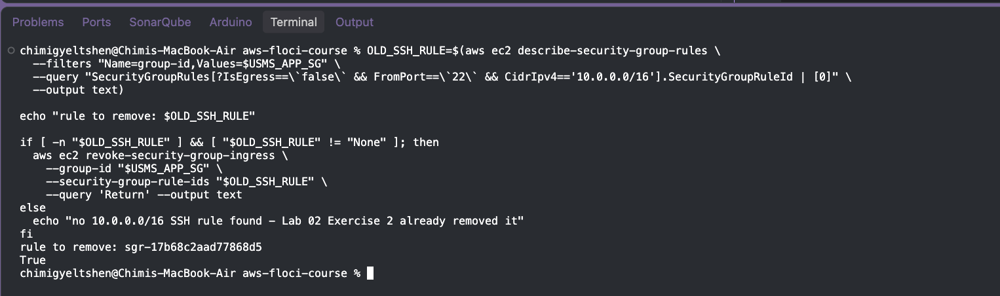

Verify

```bash
aws ec2 describe-security-group-rules \
  --filters "Name=group-id,Values=$USMS_APP_SG" \
  --query 'SecurityGroupRules[?IsEgress==`false`].{Rule:SecurityGroupRuleId,Port:FromPort,CIDR:CidrIpv4,FromGroup:ReferencedGroupInfo.GroupId,Desc:Description}' \
  --output table

echo "usms-bastion-sg = $BASTION_SG"
```
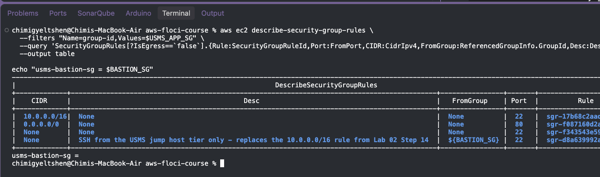

Step 17 - Compute the reachability matrix, and prove two negatives¶
Part 1 - build the matrix tool

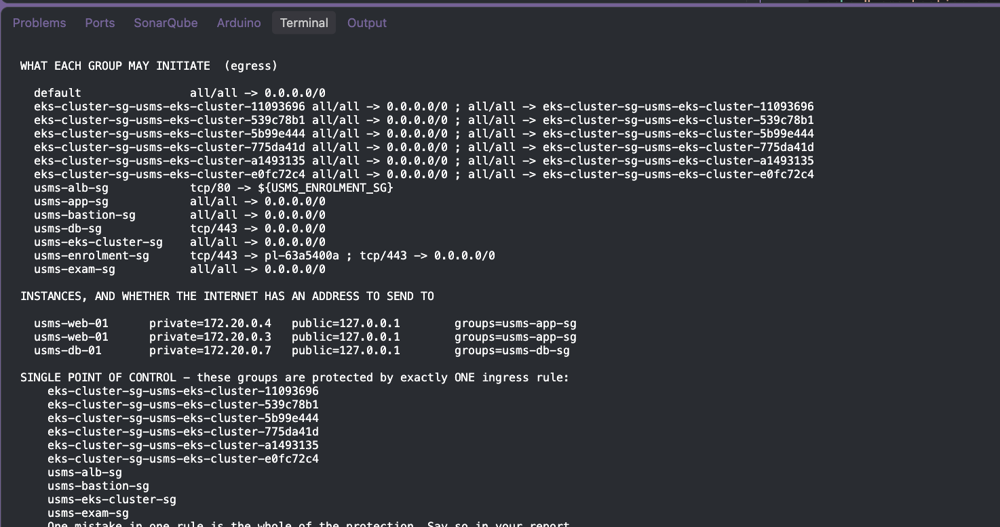

Part 2 - prove the negative on the data tier, four controls at a time

```bash
{
  echo "== Claim: usms-db-01 is not reachable from the internet =="
  echo "   Each control below would have to fail INDEPENDENTLY for the claim to be false."
  echo

  echo "-- control 1: no public address --"
  aws ec2 describe-instances --instance-ids "$USMS_DB_INSTANCE" \
    --query 'Reservations[0].Instances[0].PublicIpAddress' --output text

  echo "-- control 2: its subnet does not auto-assign one --"
  aws ec2 describe-subnets --subnet-ids "$USMS_PRIVATE_SUBNET_A" \
    --query 'Subnets[0].MapPublicIpOnLaunch' --output text

  echo "-- control 3: its route table has no internet gateway route --"
  aws ec2 describe-route-tables \
    --filters "Name=association.subnet-id,Values=$USMS_PRIVATE_SUBNET_A" \
    --query 'RouteTables[0].Routes[?DestinationCidrBlock==`0.0.0.0/0`].[GatewayId,NatGatewayId]' \
    --output text

  echo "-- control 4: its security group admits ONE group, no CIDR --"
  aws ec2 describe-security-groups --group-ids "$USMS_DB_SG" \
    --query 'SecurityGroups[0].IpPermissions[].{Port:FromPort,Group:UserIdGroupPairs[0].GroupId,CIDR:IpRanges[0].CidrIp}' \
    --output text

  echo "-- control 5: the subnet's network ACL is not the default one --"
  aws ec2 describe-network-acls \
    --filters "Name=association.subnet-id,Values=$USMS_PRIVATE_SUBNET_A" \
    --query 'NetworkAcls[0].{Acl:NetworkAclId,IsDefault:IsDefault}' --output text
} | tee outputs/lab-09-negative-proof.txt
```


Step 18 - Prove the whole posture survives a restart, and that nothing else broke¶
Part 1 - record the truth

```bash
{
  aws iam get-role --role-name "$USMS_ECS_TASK_ROLE" \
    --query 'length(Role.AssumeRolePolicyDocument.Statement[0].Condition)' --output text
  aws iam get-role --role-name usms-deploy-role \
    --query 'Role.PermissionsBoundary.PermissionsBoundaryArn' --output text
  aws iam get-role --role-name usms-transcripts-reader-role \
    --query 'Role.RoleName' --output text
  aws iam list-attached-role-policies --role-name usms-transcripts-reader-role \
    --query 'AttachedPolicies[0].PolicyName' --output text
  aws iam list-access-keys --user-name "$USMS_DEV_USER" \
    --query 'length(AccessKeyMetadata)' --output text
  for g in "$USMS_ALB_SG" "$USMS_ENROLMENT_SG" "$USMS_DB_SG"; do
    aws ec2 describe-security-groups --group-ids "$g" \
      --query 'length(IpPermissionsEgress[?IpProtocol==`-1`])' --output text
  done
  aws ec2 describe-security-groups --group-ids "$USMS_APP_SG" \
    --query 'length(IpPermissions[?FromPort==`22`].IpRanges[])' --output text
  aws ec2 describe-instances --instance-ids "$USMS_WEB_INSTANCE" \
    --query 'Reservations[0].Instances[0].MetadataOptions.HttpTokens' --output text
} > outputs/lab-09-pre-restart.txt

cat outputs/lab-09-pre-restart.txt
```


Part 2 - perturb

```bash
./scripts/setup/floci-down.sh
sleep 3
./scripts/setup/floci-up.sh
sleep 5

source configs/course.env
source configs/lab-01.env
source configs/lab-02.env
source configs/lab-03.env
source configs/lab-04.env
source configs/lab-05.env
```


Part 3 - re-derive every identifier and read it back

```bash
USMS_ALB_SG=$(aws ec2 describe-security-groups \
  --filters "Name=tag:Name,Values=usms-alb-sg" --query 'SecurityGroups[0].GroupId' --output text)
USMS_ENROLMENT_SG=$(aws ec2 describe-security-groups \
  --filters "Name=group-name,Values=usms-enrolment-sg" --query 'SecurityGroups[0].GroupId' --output text)
USMS_DB_SG=$(aws ec2 describe-security-groups \
  --filters "Name=tag:Name,Values=usms-db-sg" --query 'SecurityGroups[0].GroupId' --output text)
USMS_APP_SG=$(aws ec2 describe-security-groups \
  --filters "Name=tag:Name,Values=usms-app-sg" --query 'SecurityGroups[0].GroupId' --output text)
USMS_WEB_INSTANCE=$(aws ec2 describe-instances \
  --filters "Name=tag:Name,Values=usms-web-01" "Name=instance-state-name,Values=running,stopped" \
  --query 'Reservations[0].Instances[0].InstanceId' --output text)
USMS_ECS_TASK_ROLE="${USMS_ECS_TASK_ROLE:-usms-ecs-task-role}"

echo "re-derived:"
printf '  %s\n' "$USMS_ALB_SG" "$USMS_ENROLMENT_SG" "$USMS_DB_SG" "$USMS_APP_SG" "$USMS_WEB_INSTANCE"

{
  aws iam get-role --role-name "$USMS_ECS_TASK_ROLE" \
    --query 'length(Role.AssumeRolePolicyDocument.Statement[0].Condition)' --output text
  aws iam get-role --role-name usms-deploy-role \
    --query 'Role.PermissionsBoundary.PermissionsBoundaryArn' --output text
  aws iam get-role --role-name usms-transcripts-reader-role \
    --query 'Role.RoleName' --output text
  aws iam list-attached-role-policies --role-name usms-transcripts-reader-role \
    --query 'AttachedPolicies[0].PolicyName' --output text
  aws iam list-access-keys --user-name "$USMS_DEV_USER" \
    --query 'length(AccessKeyMetadata)' --output text
  for g in "$USMS_ALB_SG" "$USMS_ENROLMENT_SG" "$USMS_DB_SG"; do
    aws ec2 describe-security-groups --group-ids "$g" \
      --query 'length(IpPermissionsEgress[?IpProtocol==`-1`])' --output text
  done
  aws ec2 describe-security-groups --group-ids "$USMS_APP_SG" \
    --query 'length(IpPermissions[?FromPort==`22`].IpRanges[])' --output text
  aws ec2 describe-instances --instance-ids "$USMS_WEB_INSTANCE" \
    --query 'Reservations[0].Instances[0].MetadataOptions.HttpTokens' --output text
} > outputs/lab-09-post-restart.txt

diff outputs/lab-09-pre-restart.txt outputs/lab-09-post-restart.txt \
  && echo "PERSISTENCE PROVEN: the trust condition, the permissions boundary, the read-only role and its policy, the single access key, three written egress rules, the absence of a CIDR SSH source, and the IMDSv2 requirement are all unchanged" \
  || echo "PERSISTENCE FAILED: read the diff above, then run ./scripts/utilities/floci-storage-check.sh"
```


Part 4 - prove you broke nothing

```bash 
{
  echo "== after the security review $(python3 -c 'import datetime;print(datetime.datetime.now(datetime.timezone.utc).strftime("%Y-%m-%dT%H:%M:%SZ"))') =="
  for s in 02 03 04 05 06; do
    printf '%-10s ' "lab-$s"
    ./scripts/utilities/verify-lab-$s.sh 2>/dev/null | tail -1
  done
} | tee outputs/lab-09-post-verify.txt

echo
echo "== what changed =="
diff <(grep -v '^==' outputs/lab-09-pre-verify.txt) \
     <(grep -v '^==' outputs/lab-09-post-verify.txt) \
  && echo "NOTHING BROKE: all five verification scripts report exactly what they reported before this lab" \
  || echo "SOMETHING CHANGED - read the diff above and find out which check and why"
```


Step 19 - Write configs/lab-09.env¶


Verify

```bash 
source configs/lab-09.env

printf '%-36s %s\n' \
  "read-only policy"        "$USMS_POLICY_S3_RO_ARN" \
  "deploy policy"           "$USMS_POLICY_DEPLOY_ARN" \
  "permissions boundary"    "$USMS_POLICY_BOUNDARY_ARN" \
  "transcripts reader role" "$USMS_ROLE_TRANSCRIPTS_READER_ARN" \
  "deploy role"             "$USMS_ROLE_DEPLOY_ARN" \
  "bastion security group"  "$USMS_BASTION_SG" \
  "s3 prefix list"          "$USMS_S3_PREFIX_LIST" \
  "imds tokens"             "$USMS_IMDS_TOKENS" \
  "dev key created"         "$USMS_DEV_KEY_ROTATED" \
  "allow-all egress left"   "$USMS_EGRESS_ALLOW_ALL_REMAINING" \
  "review date"             "$USMS_SEC_REVIEW_DATE"

grep -c '^export' configs/lab-09.env

```


Step 20 - Commit¶

