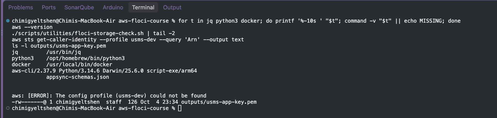

# Securing the USMS Application with IAM Roles and Security Groups

## Objectives

## Prerequisites

```bash 
for t in jq python3 docker; do printf '%-10s ' "$t"; command -v "$t" || echo MISSING; done
aws --version
./scripts/utilities/floci-storage-check.sh | tail -2
aws sts get-caller-identity --profile usms-dev --query 'Arn' --output text
ls -l outputs/usms-app-key.pem
```



