# Step by step implementation

Step 1 - Start the environment and prove a new terminal can find it¶
```bash 
./scripts/setup/floci-up.sh
./scripts/utilities/floci-storage-check.sh
```
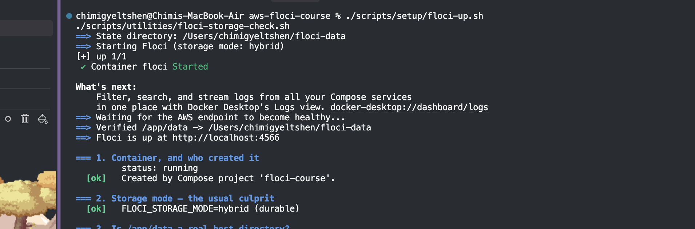

Step 2 - Source every lab environment file that exists, and confirm your identity¶
```bash 
./scripts/utilities/whoami.sh
```
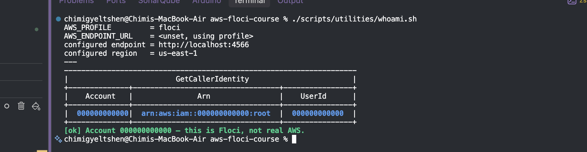

Verify

```bash 
printf 'bucket name  : %s\n' "${USMS_BUCKET_NAME:-<UNSET>}"
printf 'lambda role  : %s\n' "${USMS_ROLE_LAMBDA:-<UNSET>}"
printf 'account id   : %s\n' "${USMS_ACCOUNT_ID:-<UNSET>}"
```
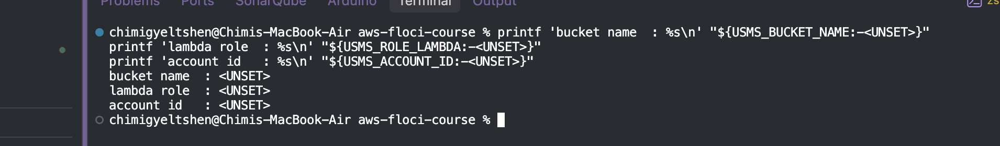


Step 3 - Create this lab's directories¶
One directory per function, because each deployment archive is built from its own directory.

```bash 
mkdir -p labs/lab-10-lambda-edge/edge-viewer-request \
         labs/lab-10-lambda-edge/edge-origin-response \
         labs/lab-10-lambda-edge/transcript-notifier

ls -d labs/lab-10-lambda-edge/*/
```
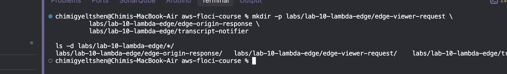

Verify

```bash 
test -d labs/lab-10-lambda-edge/edge-viewer-request && echo "source tree ready"
```
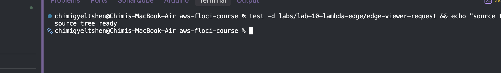


Step 4 - Find out what this Floci build actually supports¶

```bash 
probe() {   # $1 = label, $2 = command to try
  if eval "$2" >/dev/null 2>&1; then
    printf '  SUPPORTED    %s\n' "$1"
  else
    printf '  UNSUPPORTED  %s\n' "$1"
  fi
}

{
  printf 'Floci support probe for Lab 10 - %s\n\n' "$(date -u +%Y-%m-%dT%H:%M:%SZ)"
  probe "lambda  (list-functions)"      "aws lambda list-functions --max-items 1"
  probe "lambda  (list-layers)"         "aws lambda list-layers"
  probe "s3      (list-buckets)"        "aws s3api list-buckets"
  probe "logs    (describe-log-groups)" "aws logs describe-log-groups --limit 1"
  probe "cloudfront (list-distributions)" "aws cloudfront list-distributions"
  probe "iam     (get-role)"            "aws iam get-role --role-name ${USMS_ROLE_LAMBDA:-usms-lambda-exec-role}"
} | tee outputs/lab-10-support-probe.txt
```
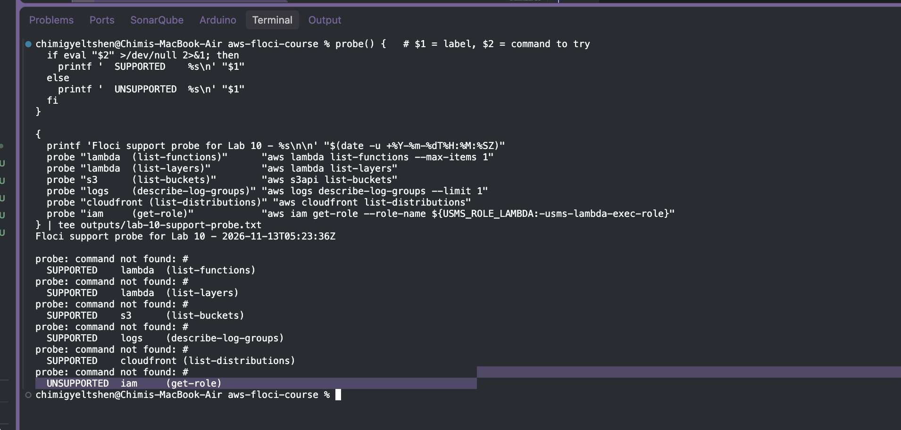


Step 5 - Create the origin bucket, and watch a policy stop being hypothetical


```bash 
BUCKET="${USMS_BUCKET_NAME:-usms-student-data}"

aws s3api head-bucket --bucket "$BUCKET" 2>/dev/null \
  && echo "bucket already exists - skipping create" \
  || aws s3api create-bucket --bucket "$BUCKET"

aws s3api put-bucket-tagging \
  --bucket "$BUCKET" \
  --tagging 'TagSet=[{Key=Project,Value=USMS},{Key=Tier,Value=data},{Key=Lab,Value=06}]'

echo "$BUCKET"
```
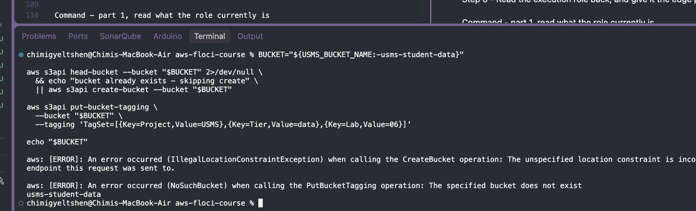


Verify

```bash
aws s3api head-bucket --bucket "$BUCKET" && echo "head-bucket: exit $?"

aws s3api get-bucket-tagging --bucket "$BUCKET" \
  --query 'TagSet[].[Key,Value]' --output table

POLICY_ARN=$(aws iam list-policies --scope Local \
  --query "Policies[?PolicyName=='USMSStudentDataReadWrite'].Arn | [0]" --output text)

aws iam get-policy-version \
  --policy-arn "$POLICY_ARN" \
  --version-id "$(aws iam get-policy --policy-arn "$POLICY_ARN" \
                    --query 'Policy.DefaultVersionId' --output text)" \
  --query 'PolicyVersion.Document.Statement[].Resource' --output json
```
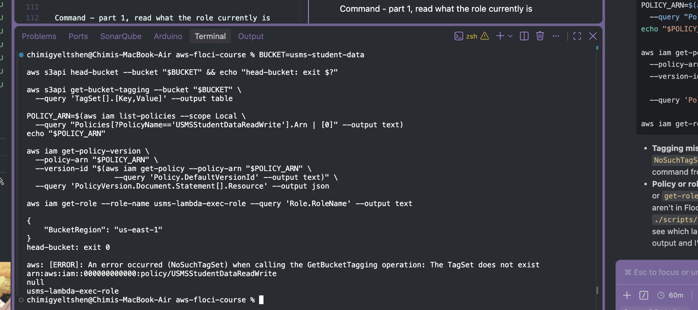


Step 6 - Read the execution role back, and give it the edge principal

Command - part 1, read what the role currently is

```bash
ROLE_NAME="${USMS_ROLE_LAMBDA:-usms-lambda-exec-role}"

aws iam get-role --role-name "$ROLE_NAME" \
  --query 'Role.{Name:RoleName,Created:CreateDate,MaxSession:MaxSessionDuration}' \
  --output table

aws iam get-role --role-name "$ROLE_NAME" \
  --query 'Role.AssumeRolePolicyDocument.Statement[].Principal.Service' --output json

aws iam list-attached-role-policies --role-name "$ROLE_NAME" \
  --query 'AttachedPolicies[].[PolicyName,PolicyArn]' --output table
```
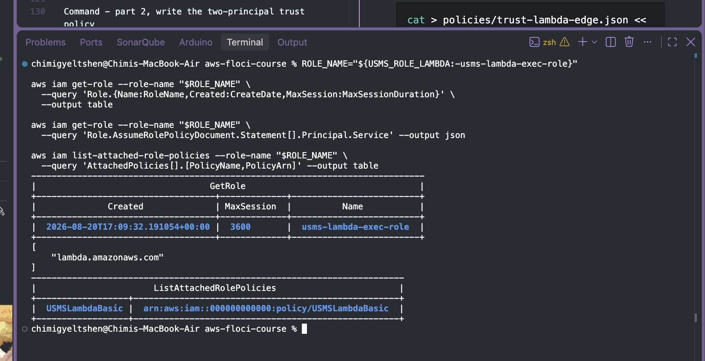


Command - part 2, write the two-principal trust policy

```bash 
cat > policies/trust-lambda-edge.json << 'EOF'
{
  "Version": "2012-10-17",
  "Statement": [
    {
      "Sid": "AllowLambdaAndCloudFrontEdgeToAssume",
      "Effect": "Allow",
      "Principal": {
        "Service": [
          "lambda.amazonaws.com",
          "edgelambda.amazonaws.com"
        ]
      },
      "Action": "sts:AssumeRole"
    }
  ]
}
EOF

python3 -m json.tool policies/trust-lambda-edge.json > /dev/null && echo "valid JSON"
```
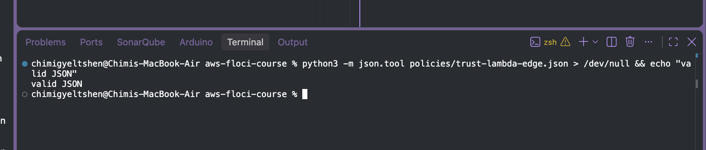

Command - part 3, replace the trust policy

```bash
aws iam update-assume-role-policy \
  --role-name "$ROLE_NAME" \
  --policy-document file://policies/trust-lambda-edge.json

EDGE_ROLE_ARN=$(aws iam get-role --role-name "$ROLE_NAME" \
  --query 'Role.Arn' --output text)

echo "$EDGE_ROLE_ARN"
```
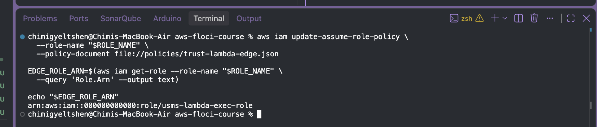
Verify

```bash
aws iam get-role --role-name "$ROLE_NAME" \
  --query 'length(Role.AssumeRolePolicyDocument.Statement[0].Principal.Service)' --output text

aws iam get-role --role-name "$ROLE_NAME" \
  --query "Role.AssumeRolePolicyDocument.Statement[0].Principal.Service[?contains(@, 'edgelambda')] | [0]" \
  --output text
```
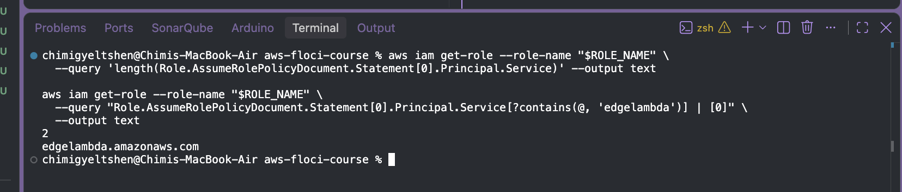

Step 7 - Write the viewer-request handler¶
```bash 
cat > labs/lab-10-lambda-edge/edge-viewer-request/index.mjs << 'EOF'
// usms-edge-viewer-request
//
// CloudFront trigger point: viewer-request.
// Runs on EVERY request, before the edge cache is consulted. Therefore:
//   - it must be fast (5 second hard timeout, 128 MB hard memory cap)
//   - it can reject a request without the origin ever being contacted
//   - anything it changes about the request becomes part of the cache key
//
// Returns the request object to continue, or a response object to stop.

const AUTH_HEADER = 'x-usms-student';
const PROTECTED_PREFIX = '/transcripts/';

export const handler = async (event) => {
  const request = event.Records[0].cf.request;
  const headers = request.headers;

  // 1. Normalise the URI. Without this, /transcripts/2026/STU-00417.json and
  //    /transcripts/2026/stu-00417.json are two different cache entries for one
  //    object, which halves the hit rate and doubles the origin traffic.
  request.uri = request.uri.toLowerCase();

  // 2. Anything outside /transcripts/ is not this function's business.
  if (!request.uri.startsWith(PROTECTED_PREFIX)) {
    return request;
  }

  // 3. The USMS portal attaches this header to an authenticated request.
  //    Note the [0]: a header value is an ARRAY of {key, value} objects.
  const studentHeader = headers[AUTH_HEADER];
  const studentId = studentHeader && studentHeader[0] && studentHeader[0].value;

  if (!studentId) {
    return {
      status: '403',
      statusDescription: 'Forbidden',
      headers: {
        'content-type': [{ key: 'Content-Type', value: 'application/json' }],
        'cache-control': [{ key: 'Cache-Control', value: 'no-store' }],
        'x-usms-edge': [{ key: 'X-USMS-Edge', value: 'viewer-request-deny' }]
      },
      body: JSON.stringify({
        message: 'transcript access requires an authenticated session'
      })
    };
  }

  // 4. Stamp the request so the origin-response function can see that we ran,
  //    and so the trace in Step 16 has something to show.
  request.headers['x-usms-edge'] = [
    { key: 'X-USMS-Edge', value: `viewer-request-allow;student=${studentId.toLowerCase()}` }
  ];

  return request;
};
EOF

node --check labs/lab-10-lambda-edge/edge-viewer-request/index.mjs 2>/dev/null \
  && echo "syntax OK (node)" \
  || echo "node not installed locally - syntax will be checked by the first invoke"
```
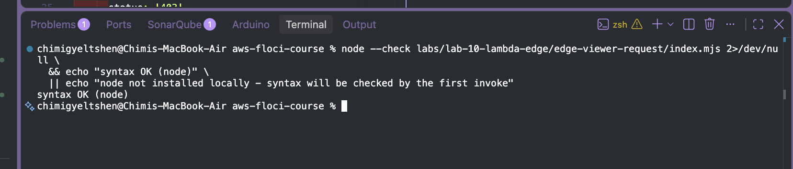


verify 
```bash 
wc -l labs/lab-10-lambda-edge/edge-viewer-request/index.mjs
grep -c 'studentId' labs/lab-10-lambda-edge/edge-viewer-request/index.mjs
grep -n 'toLowerCase()}' labs/lab-10-lambda-edge/edge-viewer-request/index.mjs
```
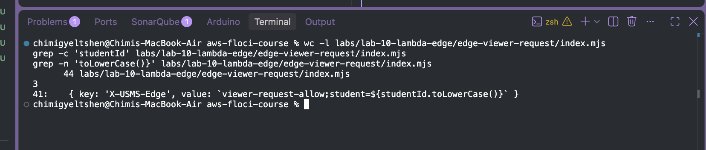

Step 8 - Package the function and create it¶

Command - part 1, build the archive

```bash 
( cd labs/lab-10-lambda-edge/edge-viewer-request \
  && python3 -m zipfile -c "$COURSE_ROOT/outputs/usms-edge-viewer-request.zip" index.mjs )

python3 -m zipfile -l outputs/usms-edge-viewer-request.zip
```
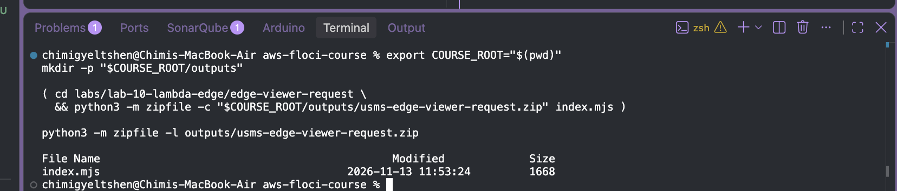

Command - part 1, build the archive

```bash 
( cd labs/lab-10-lambda-edge/edge-viewer-request \
  && python3 -m zipfile -c "$COURSE_ROOT/outputs/usms-edge-viewer-request.zip" index.mjs )

python3 -m zipfile -l outputs/usms-edge-viewer-request.zip
```


Command - part 2, create the function

```bash 
VIEWER_FN=usms-edge-viewer-request

VIEWER_FN_ARN=$(aws lambda create-function \
  --function-name "$VIEWER_FN" \
  --runtime nodejs20.x \
  --role "$EDGE_ROLE_ARN" \
  --handler index.handler \
  --zip-file fileb://outputs/usms-edge-viewer-request.zip \
  --timeout 5 \
  --memory-size 128 \
  --architectures x86_64 \
  --description "USMS Lambda@Edge viewer-request: auth gate and URI normalisation" \
  --tags Project=USMS,Tier=edge,Lab=06 \
  --query 'FunctionArn' --output text)

echo "$VIEWER_FN_ARN"
```
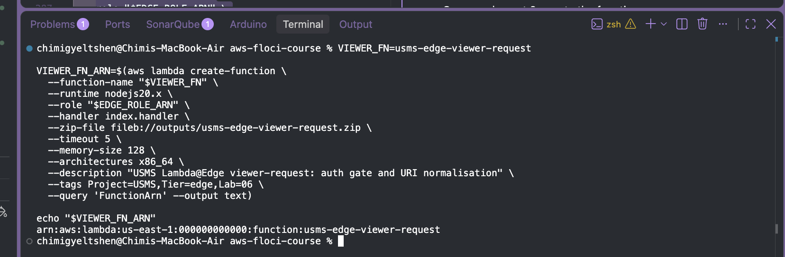

Verify

```bash 
aws lambda wait function-active-v2 --function-name "$VIEWER_FN" 2>/dev/null \
  || echo "waiter unsupported on this build - checking state directly"

aws lambda get-function-configuration --function-name "$VIEWER_FN" \
  --query '{Name:FunctionName,Runtime:Runtime,Handler:Handler,Mem:MemorySize,Timeout:Timeout,State:State,Version:Version,Role:Role}' \
  --output table
```
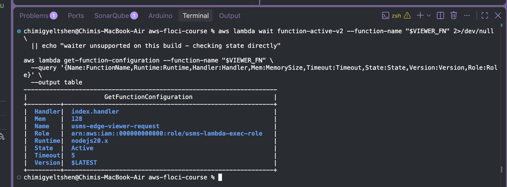

Step 9 - Invoke the function with a real CloudFront event¶
Build the event CloudFront would deliver, send it, and read the result.

Command - part 1, write the event

```bash
python3 -m json.tool templates/lab-10-viewer-request-event.json > /dev/null && echo "valid JSON"
```
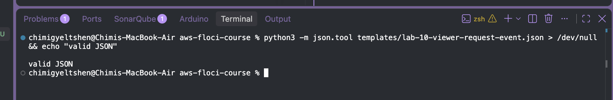

Command - part 2, invoke

```bash 
aws lambda invoke \
  --function-name "$VIEWER_FN" \
  --payload fileb://templates/lab-10-viewer-request-event.json \
  --query '{Status:StatusCode,Error:FunctionError,Executed:ExecutedVersion}' \
  --output table \
  outputs/lab-10-viewer-allow.json

python3 -m json.tool outputs/lab-10-viewer-allow.json
```
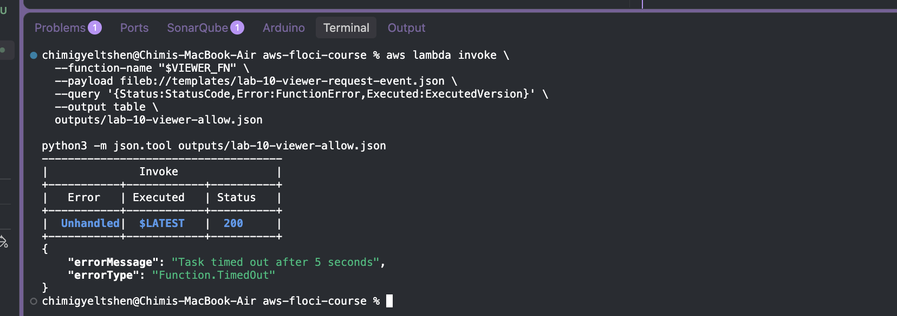

Verify

Check, in order: Error is None; uri is lower case; and a new x-usms-edge header ends with student=stu-00417. If it ends student= with nothing after it, the Step 7 heredoc was unquoted.

```bash
python3 -c "
import json
r = json.load(open('outputs/lab-10-viewer-allow.json'))
assert r['uri'] == '/transcripts/2026/stu-00417.json', 'uri not normalised'
assert r['headers']['x-usms-edge'][0]['value'].endswith('stu-00417'), 'student id not stamped'
print('viewer-request allow path: correct')
"
```
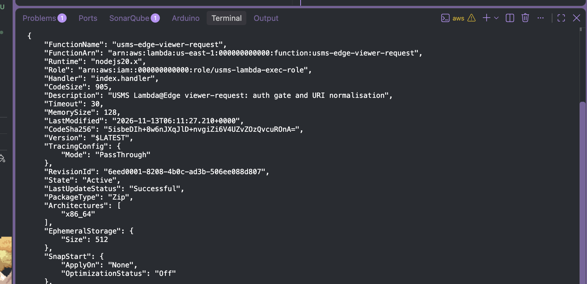

Step 10 - Read the function's logs
```bash 
aws lambda invoke \
  --function-name "$VIEWER_FN" \
  --payload fileb://templates/lab-10-viewer-request-event.json \
  --log-type Tail \
  --query 'LogResult' --output text \
  outputs/lab-10-viewer-allow.json \
  | openssl base64 -d -A
```
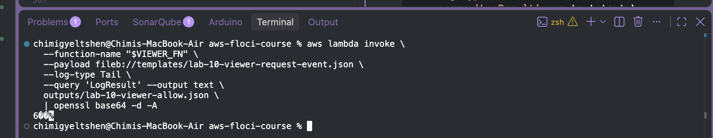

Verify - the durable route

```bash 
aws logs describe-log-groups \
  --log-group-name-prefix "/aws/lambda/$VIEWER_FN" \
  --query 'logGroups[].[logGroupName,storedBytes]' --output table
```
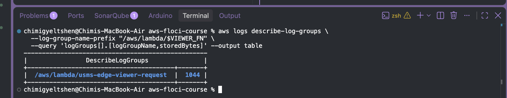

Step 11 - Publish a version, and find out why the edge insists on one

```bash 
VIEWER_VERSION=$(aws lambda publish-version \
  --function-name "$VIEWER_FN" \
  --description "Lab 10 - initial edge release" \
  --query 'Version' --output text)

VIEWER_VERSION_ARN="${VIEWER_FN_ARN}:${VIEWER_VERSION}"

printf 'version      : %s\n' "$VIEWER_VERSION"
printf 'qualified ARN: %s\n' "$VIEWER_VERSION_ARN"
```
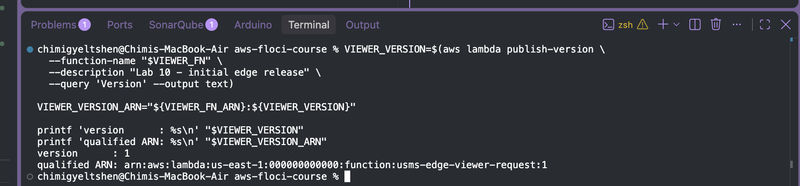


Verify

```bash 
aws lambda list-versions-by-function --function-name "$VIEWER_FN" \
  --query 'Versions[].[Version,Description,CodeSize,LastModified]' --output table

printf '%s' "$VIEWER_VERSION_ARN" | grep -qE ':[0-9]+$' \
  && echo "ARN is version-qualified - the edge would accept this" \
  || echo "ARN is NOT version-qualified - the edge would refuse this"
```
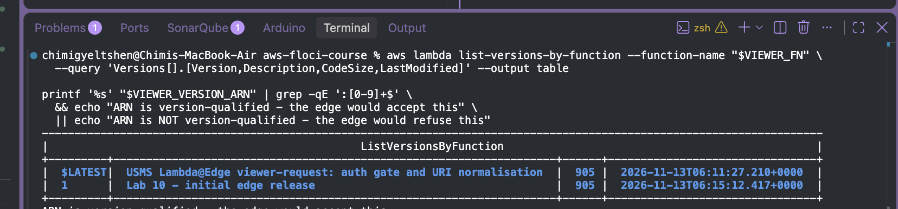

Step 12 - Write and deploy the origin-response function

Command - part 1, the handler
```bash 
node --check labs/lab-10-lambda-edge/edge-origin-response/index.mjs 2>/dev/null \
  && echo "syntax OK (node)" \
  || echo "node not installed locally - syntax will be checked by the first invoke"
```
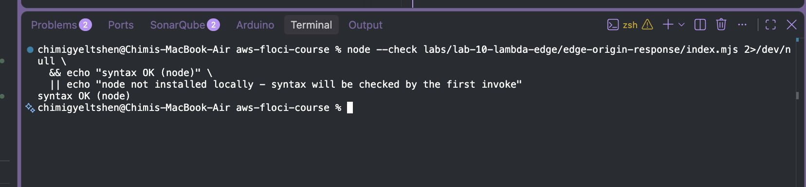


Command - part 2, package and create

```bash
ORIGIN_FN=usms-edge-origin-response

( cd labs/lab-10-lambda-edge/edge-origin-response \
  && python3 -m zipfile -c "$COURSE_ROOT/outputs/usms-edge-origin-response.zip" index.mjs )

ORIGIN_FN_ARN=$(aws lambda create-function \
  --function-name "$ORIGIN_FN" \
  --runtime nodejs20.x \
  --role "$EDGE_ROLE_ARN" \
  --handler index.handler \
  --zip-file fileb://outputs/usms-edge-origin-response.zip \
  --timeout 5 \
  --memory-size 128 \
  --architectures x86_64 \
  --description "USMS Lambda@Edge origin-response: security headers and cache policy" \
  --tags Project=USMS,Tier=edge,Lab=06 \
  --query 'FunctionArn' --output text)

echo "$ORIGIN_FN_ARN"
```
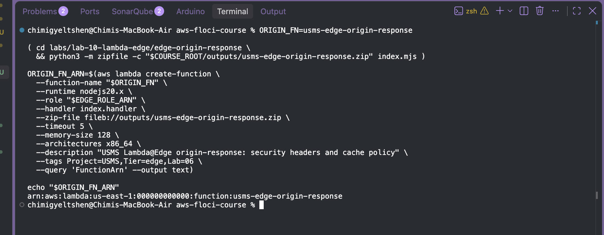

Verify

```bash
aws lambda get-function-configuration --function-name "$ORIGIN_FN" \
  --query '{Name:FunctionName,Runtime:Runtime,Handler:Handler,Mem:MemorySize,Timeout:Timeout,State:State}' \
  --output table
```
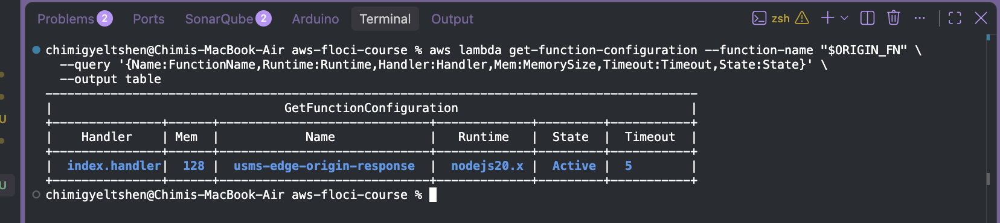

Step 13 - Invoke the origin-response function and publish its version¶
Invoke the second function with an event of its own shape, confirm the result, then freeze it as a version.

Command - part 1, the origin-response event

```bash 
cat > templates/lab-10-origin-response-event.json << 'EOF'
{
  "Records": [
    {
      "cf": {
        "config": {
          "distributionDomainName": "d3examplecdn01.cloudfront.net",
          "distributionId": "EDFDVBD6EXAMPLE",
          "eventType": "origin-response",
          "requestId": "lab06-origin-0001"
        },
        "request": {
          "clientIp": "203.0.113.178",
          "method": "GET",
          "uri": "/transcripts/2026/stu-00417.json",
          "querystring": "",
          "headers": {
            "host": [
              { "key": "Host", "value": "usms-student-data.s3.us-east-1.amazonaws.com" }
            ],
            "x-usms-edge": [
              { "key": "X-USMS-Edge", "value": "viewer-request-allow;student=stu-00417" }
            ]
          }
        },
        "response": {
          "status": "200",
          "statusDescription": "OK",
          "headers": {
            "content-type": [
              { "key": "Content-Type", "value": "application/json" }
            ],
            "etag": [
              { "key": "ETag", "value": "\"9f86d081884c7d659a2feaa0c55ad015\"" }
            ],
            "server": [
              { "key": "Server", "value": "AmazonS3" }
            ]
          }
        }
      }
    }
  ]
}
EOF

python3 -m json.tool templates/lab-10-origin-response-event.json > /dev/null && echo "valid JSON"
```
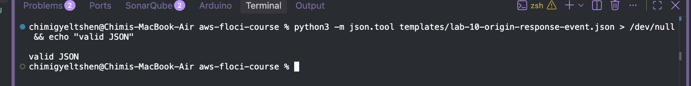


Command - part 2, invoke and publish

```bash 
aws lambda invoke \
  --function-name "$ORIGIN_FN" \
  --payload fileb://templates/lab-10-origin-response-event.json \
  --query '{Status:StatusCode,Error:FunctionError}' \
  --output table \
  outputs/lab-10-origin-response.json

python3 -m json.tool outputs/lab-10-origin-response.json

ORIGIN_VERSION=$(aws lambda publish-version \
  --function-name "$ORIGIN_FN" \
  --description "Lab 10 - initial edge release" \
  --query 'Version' --output text)

ORIGIN_VERSION_ARN="${ORIGIN_FN_ARN}:${ORIGIN_VERSION}"
printf 'qualified ARN: %s\n' "$ORIGIN_VERSION_ARN"
```
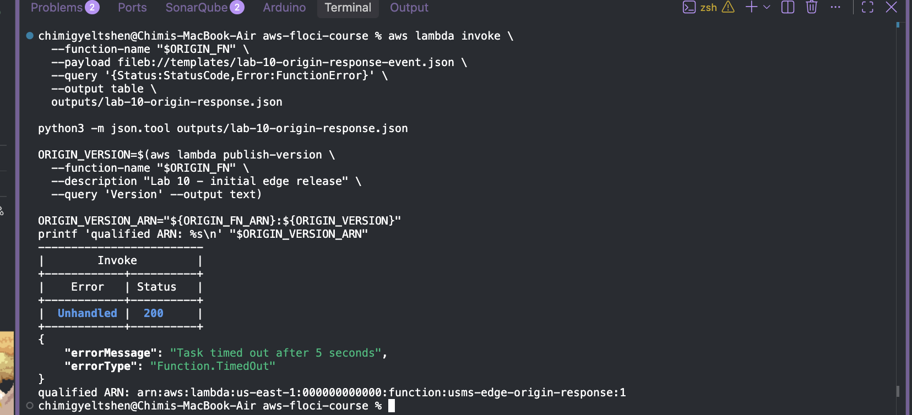

Verify

```bash
python3 -c "
import json
r = json.load(open('outputs/lab-10-origin-response.json'))
h = r['headers']
for required in ['strict-transport-security','x-content-type-options','x-frame-options','referrer-policy']:
    assert required in h, 'missing ' + required
assert h['cache-control'][0]['value'].startswith('public'), 'cache-control not set'
assert h['x-usms-edge-chain'][0]['value'].endswith(';origin-response'), 'chain header wrong'
print('origin-response: 4 security headers + cache-control + chain marker')
"
```
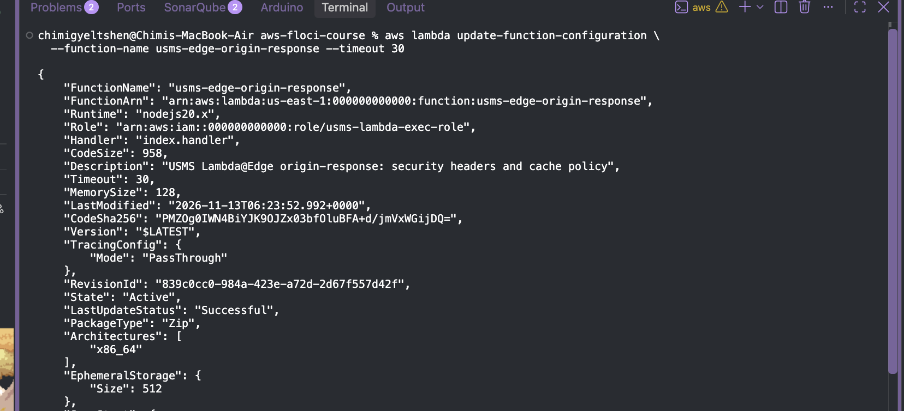

Step 14 - Check both functions against the Lambda@Edge restrictions

Command - part 1, make the mistake

```bash
aws lambda update-function-configuration \
  --function-name "$VIEWER_FN" \
  --environment 'Variables={USMS_STAGE=lab06,USMS_AUTH_HEADER=x-usms-student}' \
  --query '{Name:FunctionName,Env:Environment.Variables}' --output json
```
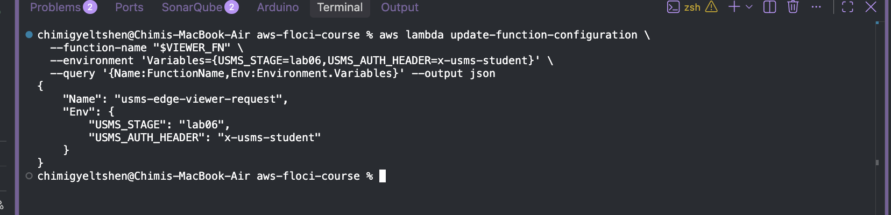


Command - part 2, undo it, and check both functions properly

```bash 
aws lambda update-function-configuration \
  --function-name "$VIEWER_FN" \
  --environment 'Variables={}' \
  --query 'Environment' --output json

edge_eligibility() {   # $1 = function name, $2 = max memory for its trigger point
  local fn="$1" cap="$2" cfg envcount mem timeout runtime vpc versions
  cfg=$(aws lambda get-function-configuration --function-name "$fn" --output json)
  envcount=$(printf '%s' "$cfg" | python3 -c 'import json,sys; print(len(json.load(sys.stdin).get("Environment",{}).get("Variables",{}) or {}))')
  mem=$(printf '%s' "$cfg" | python3 -c 'import json,sys; print(json.load(sys.stdin)["MemorySize"])')
  timeout=$(printf '%s' "$cfg" | python3 -c 'import json,sys; print(json.load(sys.stdin)["Timeout"])')
  runtime=$(printf '%s' "$cfg" | python3 -c 'import json,sys; print(json.load(sys.stdin)["Runtime"])')
  vpc=$(printf '%s' "$cfg" | python3 -c 'import json,sys; print(len(json.load(sys.stdin).get("VpcConfig",{}).get("SubnetIds",[]) or []))')
  versions=$(aws lambda list-versions-by-function --function-name "$fn" \
               --query "length(Versions[?Version!='\$LATEST'])" --output text)

  printf '\n%s\n' "$fn"
  [ "$envcount" -eq 0 ]            && printf '  ok   no environment variables\n'      || printf '  NO   %s environment variables set\n' "$envcount"
  [ "$mem" -le "$cap" ]            && printf '  ok   memory %s MB (cap %s)\n' "$mem" "$cap" || printf '  NO   memory %s MB exceeds cap %s\n' "$mem" "$cap"
  [ "$timeout" -le 5 ]             && printf '  ok   timeout %s s\n' "$timeout"        || printf '  NO   timeout %s s exceeds viewer cap 5\n' "$timeout"
  case "$runtime" in nodejs*|python*) printf '  ok   runtime %s\n' "$runtime" ;; *) printf '  NO   runtime %s not supported at the edge\n' "$runtime" ;; esac
  [ "$vpc" -eq 0 ]                 && printf '  ok   no VPC configuration\n'           || printf '  NO   attached to %s subnets\n' "$vpc"
  [ "$versions" -ge 1 ]            && printf '  ok   %s published version(s)\n' "$versions" || printf '  NO   no published version to associate\n'
}

{
  echo "Lambda@Edge eligibility - $(date -u +%Y-%m-%dT%H:%M:%SZ)"
  edge_eligibility usms-edge-viewer-request 128
  edge_eligibility usms-edge-origin-response 128
} | tee outputs/lab-10-function-inventory.json
```

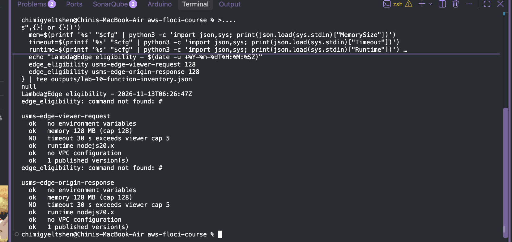

Verify

```bash
grep -c '  NO   ' outputs/lab-10-function-inventory.json || echo "0 failures - both functions are edge-eligible"
```
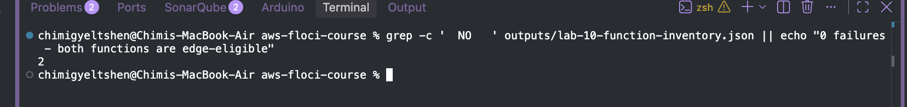

Step 15 - Associate both functions with a CloudFront distribution

Command - part 1, write the configuration

```bash
cat > templates/lab-10-distribution-config.json << EOF
{
  "CallerReference": "usms-transcript-cdn-$(date +%s)",
  "Comment": "usms-transcript-cdn - USMS transcript delivery with edge functions",
  "Enabled": true,
  "PriceClass": "PriceClass_All",
  "DefaultRootObject": "",
  "Origins": {
    "Quantity": 1,
    "Items": [
      {
        "Id": "usms-student-data-origin",
        "DomainName": "${USMS_BUCKET_NAME:-usms-student-data}.s3.us-east-1.amazonaws.com",
        "OriginPath": "",
        "CustomHeaders": { "Quantity": 0 },
        "S3OriginConfig": { "OriginAccessIdentity": "" }
      }
    ]
  },
  "DefaultCacheBehavior": {
    "TargetOriginId": "usms-student-data-origin",
    "ViewerProtocolPolicy": "redirect-to-https",
    "Compress": true,
    "MinTTL": 0,
    "DefaultTTL": 300,
    "MaxTTL": 3600,
    "SmoothStreaming": false,
    "FieldLevelEncryptionId": "",
    "TrustedSigners": { "Enabled": false, "Quantity": 0 },
    "AllowedMethods": {
      "Quantity": 2,
      "Items": ["GET", "HEAD"],
      "CachedMethods": { "Quantity": 2, "Items": ["GET", "HEAD"] }
    },
    "ForwardedValues": {
      "QueryString": false,
      "Cookies": { "Forward": "none" },
      "Headers": { "Quantity": 1, "Items": ["x-usms-student"] },
      "QueryStringCacheKeys": { "Quantity": 0 }
    },
    "LambdaFunctionAssociations": {
      "Quantity": 2,
      "Items": [
        {
          "EventType": "viewer-request",
          "LambdaFunctionARN": "${VIEWER_VERSION_ARN}",
          "IncludeBody": false
        },
        {
          "EventType": "origin-response",
          "LambdaFunctionARN": "${ORIGIN_VERSION_ARN}"
        }
      ]
    }
  }
}
EOF

python3 -m json.tool templates/lab-10-distribution-config.json > /dev/null && echo "valid JSON"
grep -n 'function:usms-edge' templates/lab-10-distribution-config.json
```
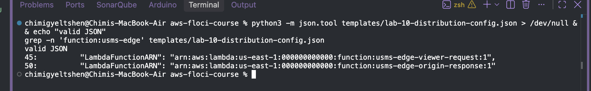

Command - part 2, PATH A: create the distribution

Take this path if Step 4 reported CloudFront as SUPPORTED.

```bash 
aws cloudfront create-distribution \
  --distribution-config file://templates/lab-10-distribution-config.json \
  > outputs/lab-10-distribution.json

DIST_ID=$(python3 -c "import json;print(json.load(open('outputs/lab-10-distribution.json'))['Distribution']['Id'])")
DIST_DOMAIN=$(python3 -c "import json;print(json.load(open('outputs/lab-10-distribution.json'))['Distribution']['DomainName'])")

printf 'distribution : %s\n' "$DIST_ID"
printf 'domain       : %s\n' "$DIST_DOMAIN"
```
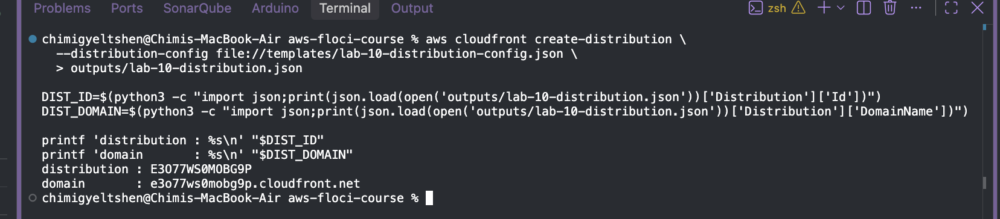


Verify - Path A

```bash
aws cloudfront get-distribution --id "$DIST_ID" \
  --query 'Distribution.DistributionConfig.DefaultCacheBehavior.LambdaFunctionAssociations.Items[].[EventType,LambdaFunctionARN]' \
  --output table

aws cloudfront get-distribution --id "$DIST_ID" \
  --query 'Distribution.{Id:Id,Status:Status,Domain:DomainName,Enabled:DistributionConfig.Enabled}' \
  --output table
```
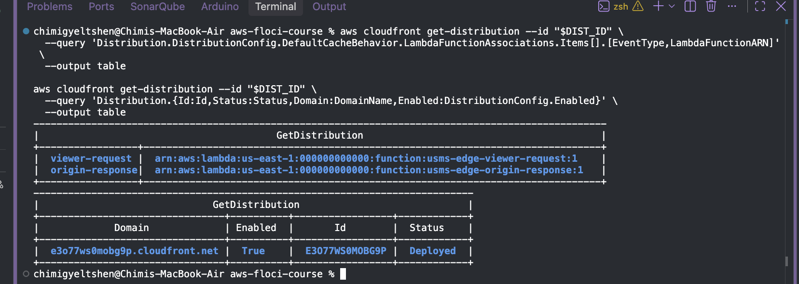

Command - part 2, PATH B: validate the configuration instead

```bash 
python3 - << 'PY' | tee outputs/lab-10-distribution.json
import json, sys

cfg = json.load(open('templates/lab-10-distribution-config.json'))
errors, checks = [], []

def check(label, ok):
    checks.append(('ok  ' if ok else 'FAIL') + '  ' + label)
    if not ok:
        errors.append(label)

beh = cfg['DefaultCacheBehavior']
assoc = beh['LambdaFunctionAssociations']
items = assoc['Items']
origin = cfg['Origins']['Items'][0]

check('one origin declared', cfg['Origins']['Quantity'] == 1)
check('origin id matches the behaviour target', origin['Id'] == beh['TargetOriginId'])
check('origin is the USMS bucket', origin['DomainName'].startswith('usms-student-data'))
check('association quantity matches item count', assoc['Quantity'] == len(items))
check('two trigger points associated', len(items) == 2)
check('trigger points are viewer-request and origin-response',
      sorted(i['EventType'] for i in items) == ['origin-response', 'viewer-request'])
check('every ARN is version-qualified',
      all(i['LambdaFunctionARN'].rsplit(':', 1)[-1].isdigit() for i in items))
check('IncludeBody only on a request trigger',
      all('IncludeBody' not in i for i in items if i['EventType'].endswith('response')))
check('viewer protocol policy is not allow-all',
      beh['ViewerProtocolPolicy'] != 'allow-all')
check('cache key forwards no cookies', beh['ForwardedValues']['Cookies']['Forward'] == 'none')
check('cache key forwards exactly one header',
      beh['ForwardedValues']['Headers']['Quantity'] == 1)

print(json.dumps({'mode': 'PATH B - structural validation only',
                  'checks': checks,
                  'errors': errors}, indent=2))
sys.exit(1 if errors else 0)
PY
```
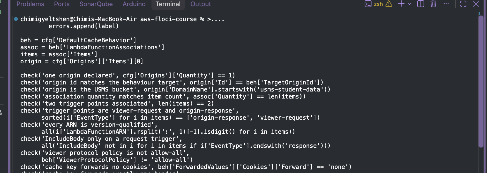


Step 16 - Run the edge chain end to end, without CloudFront¶
Nothing local runs a request path, so this script builds one: viewer event to the first function, a simulated origin response, then the second function, printing what a browser would receive. The property proved is composition: the header the first function writes is the one the second reads.

Command - part 1, write the script

```bash
rm -f outputs/.edge-step1.json outputs/.edge-step2-event.json outputs/.edge-step3.json
echo
echo "trace written to $TRACE"
EOF

chmod +x scripts/utilities/usms-edge-simulate.sh
bash -n scripts/utilities/usms-edge-simulate.sh && echo "syntax OK"
```
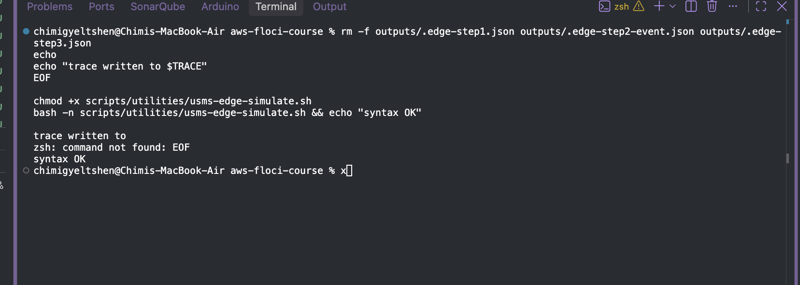

Command - part 2, run it, both ways

```bash
./scripts/utilities/usms-edge-simulate.sh

echo "-----------------------------------------------------------"

./scripts/utilities/usms-edge-simulate.sh templates/lab-10-viewer-request-denied.json
```
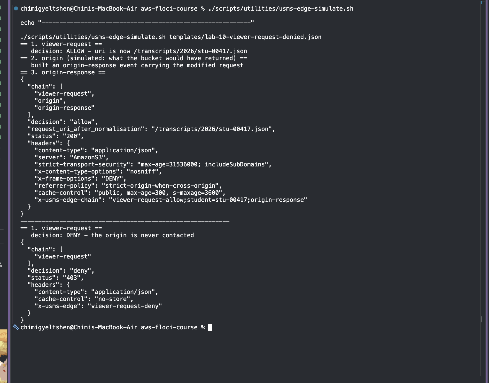

Verify

```bash
python3 -c "
import json
t = json.load(open('outputs/lab-10-edge-trace.json'))
print('chain    :', ' -> '.join(t['chain']))
print('decision :', t['decision'])
"
```
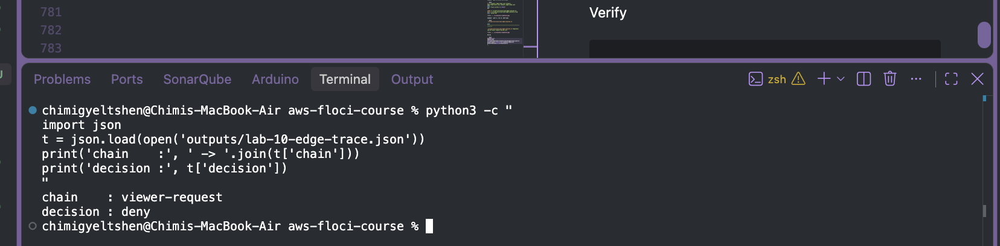

Step 17 - Write the regional notifier¶

```bash 
cat > labs/lab-10-lambda-edge/transcript-notifier/notifier.py << 'EOF'
"""usms-transcript-notifier

Regional Lambda, triggered by S3 ObjectCreated on usms-student-data.

Deliberately stays inside USMSLambdaBasic, the Lab 01 policy that grants
CloudWatch Logs writes and s3:GetObject and nothing else. When the SNS lab
arrives, the notify() call below becomes a real publish and the policy grows
by exactly one action.
"""

import json
import os
import urllib.parse

BUCKET_HINT = os.environ.get("USMS_BUCKET", "usms-student-data")
CHANNEL = os.environ.get("USMS_NOTIFY_CHANNEL", "stdout")


def describe(record):
    """Pull the four fields that matter out of one S3 event record."""
    s3 = record.get("s3", {})
    raw_key = s3.get("object", {}).get("key", "")
    return {
        "event": record.get("eventName"),
        "bucket": s3.get("bucket", {}).get("name"),
        # S3 URL-encodes the key in the event. A key with a space arrives as
        # "stu+00417 final.json"; unquote_plus is what turns it back into the
        # string you would pass to get_object.
        "key": urllib.parse.unquote_plus(raw_key),
        "size": s3.get("object", {}).get("size"),
    }


def notify(payload):
    """Where the results notification will eventually go.

    Today: a structured line on stdout, which CloudWatch Logs captures.
    Later: sns.publish(TopicArn=..., Message=json.dumps(payload)).
    """
    print("USMS_NOTIFY " + json.dumps(payload, sort_keys=True))


def handler(event, context):
    records = event.get("Records", [])
    print("usms-transcript-notifier: %d record(s), channel=%s, bucket_hint=%s"
          % (len(records), CHANNEL, BUCKET_HINT))

    processed = []
    for record in records:
        info = describe(record)

        if not info["key"].startswith("transcripts/"):
            print("skipping non-transcript object: %s" % info["key"])
            continue

        # Confirming the object is readable exercises s3:GetObject, the one
        # non-logging permission this function has. It is wrapped because the
        # emulator does not always give a Lambda container a route back to the
        # S3 API, and an unreachable endpoint is not a reason to fail the event.
        info["readable"] = False
        try:
            import boto3
            boto3.client("s3").head_object(Bucket=info["bucket"], Key=info["key"])
            info["readable"] = True
        except Exception as exc:                      # noqa: BLE001
            info["read_error"] = type(exc).__name__

        notify(info)
        processed.append(info["key"])

    return {"processed": len(processed), "keys": processed}
EOF

python3 -m py_compile labs/lab-10-lambda-edge/transcript-notifier/notifier.py \
  && echo "syntax OK (python3)"
```
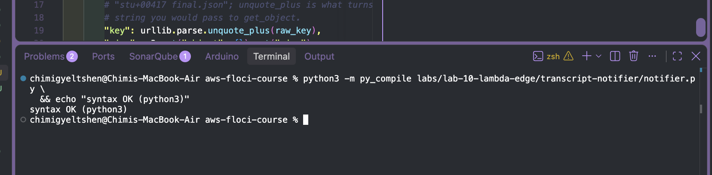

Verify

```bash 
grep -n 'os.environ.get' labs/lab-10-lambda-edge/transcript-notifier/notifier.py
```
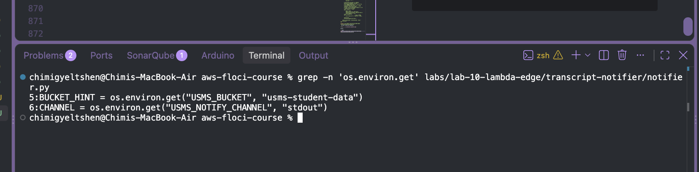

Step 18 - Create the notifier, publish it, and give it an alias¶

Command - part 1, create

```bash 
NOTIFIER_FN=usms-transcript-notifier
BUCKET="${USMS_BUCKET_NAME:-usms-student-data}"

( cd labs/lab-10-lambda-edge/transcript-notifier \
  && python3 -m zipfile -c "$COURSE_ROOT/outputs/usms-transcript-notifier.zip" notifier.py )

NOTIFIER_FN_ARN=$(aws lambda create-function \
  --function-name "$NOTIFIER_FN" \
  --runtime python3.12 \
  --role "$EDGE_ROLE_ARN" \
  --handler notifier.handler \
  --zip-file fileb://outputs/usms-transcript-notifier.zip \
  --timeout 30 \
  --memory-size 256 \
  --architectures x86_64 \
  --environment "Variables={USMS_BUCKET=$BUCKET,USMS_NOTIFY_CHANNEL=stdout}" \
  --description "USMS regional function: reacts to transcript uploads" \
  --tags Project=USMS,Tier=app,Lab=06 \
  --query 'FunctionArn' --output text)

echo "$NOTIFIER_FN_ARN"
```
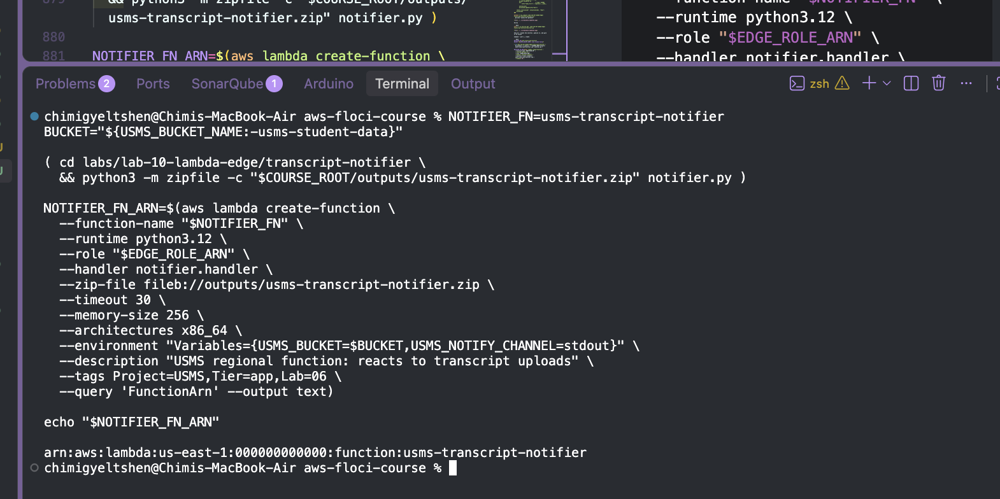

Command - part 2, publish and alias

```bash
aws lambda wait function-active-v2 --function-name "$NOTIFIER_FN" 2>/dev/null \
  || echo "waiter unsupported - continuing"

NOTIFIER_VERSION=$(aws lambda publish-version \
  --function-name "$NOTIFIER_FN" \
  --description "Lab 10 - initial release" \
  --query 'Version' --output text)

NOTIFIER_ALIAS_ARN=$(aws lambda create-alias \
  --function-name "$NOTIFIER_FN" \
  --name live \
  --function-version "$NOTIFIER_VERSION" \
  --description "The version S3 notifications invoke" \
  --query 'AliasArn' --output text)

printf 'version   : %s\n' "$NOTIFIER_VERSION"
printf 'alias ARN : %s\n' "$NOTIFIER_ALIAS_ARN"
```
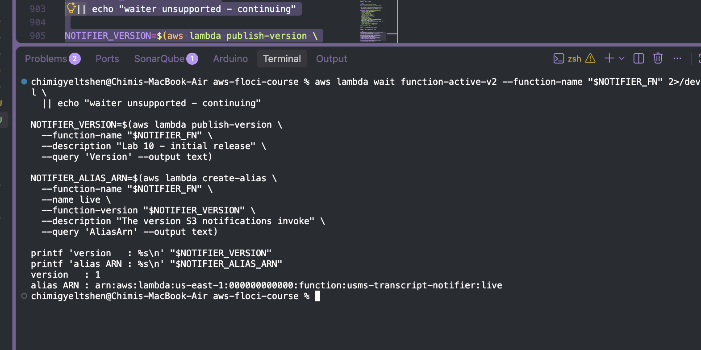

Verify

```bash 
aws lambda list-aliases --function-name "$NOTIFIER_FN" \
  --query 'Aliases[].[Name,FunctionVersion,Description]' --output table

aws lambda get-function-configuration --function-name "$NOTIFIER_FN" --qualifier live \
  --query '{Version:Version,Runtime:Runtime,Handler:Handler,Env:Environment.Variables}' \
  --output json

```
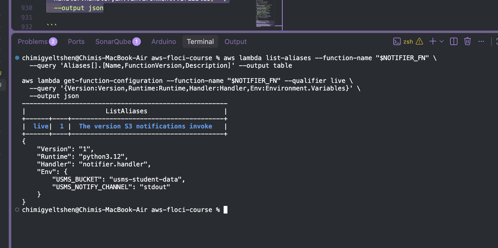

Step 19 - Let S3 invoke the function, and see the other kind of policy¶


```bash 
aws lambda add-permission \
  --function-name "$NOTIFIER_FN" \
  --qualifier live \
  --statement-id usms-s3-transcript-upload \
  --action lambda:InvokeFunction \
  --principal s3.amazonaws.com \
  --source-arn "arn:aws:s3:::$BUCKET" \
  --source-account "${USMS_ACCOUNT_ID:-000000000000}" \
  --query 'Statement' --output text | python3 -m json.tool
```
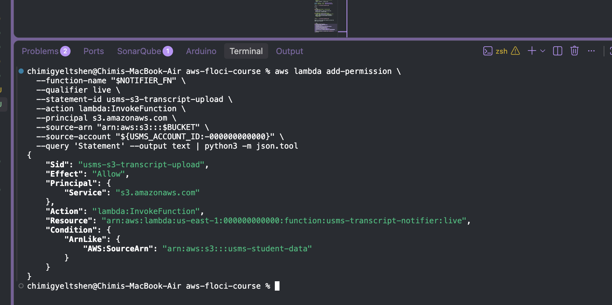

Verify

```bash
aws lambda get-policy --function-name "$NOTIFIER_FN" --qualifier live \
  --query 'Policy' --output text | python3 -m json.tool

aws lambda get-policy --function-name "$NOTIFIER_FN" --qualifier live \
  --query 'Policy' --output text \
  | python3 -c "
import json,sys
p = json.load(sys.stdin)
st = p['Statement'][0]
assert st['Principal']['Service'] == 's3.amazonaws.com'
cond = json.dumps(st.get('Condition', {}))
assert 'usms-student-data' in cond, 'source ARN condition missing - the deputy is still confused'
print('resource policy: scoped to one bucket in one account')
"
```
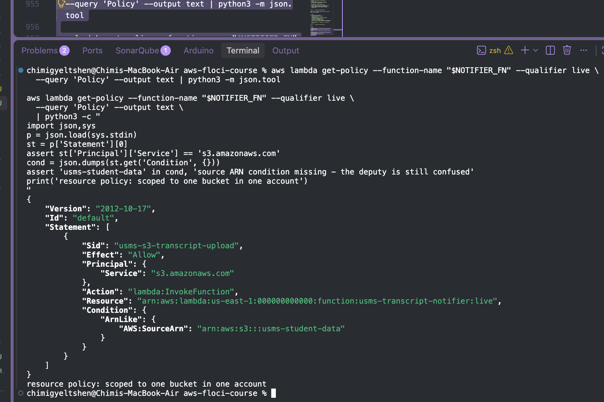

```bash
aws lambda remove-permission \
  --function-name "$NOTIFIER_FN" \
  --qualifier live \
  --statement-id usms-s3-transcript-upload
```
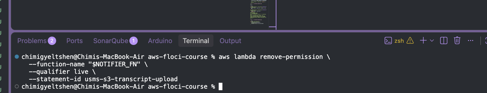

Step 20 - Wire the bucket notification and fire it for real¶
The notification is a property of the bucket and names the function. put-bucket-notification-configuration is replace-only: it overwrites every notification on the bucket, so on a bucket with existing notifications you must get, merge, put. This bucket has none yet.

Command - part 1, the configuration

```bash
cat > templates/lab-10-bucket-notification.json << EOF
{
  "LambdaFunctionConfigurations": [
    {
      "Id": "usms-transcript-upload",
      "LambdaFunctionArn": "${NOTIFIER_ALIAS_ARN}",
      "Events": ["s3:ObjectCreated:*"],
      "Filter": {
        "Key": {
          "FilterRules": [
            { "Name": "prefix", "Value": "transcripts/" },
            { "Name": "suffix", "Value": ".json" }
          ]
        }
      }
    }
  ]
}
EOF

python3 -m json.tool templates/lab-10-bucket-notification.json > /dev/null && echo "valid JSON"

aws s3api put-bucket-notification-configuration \
  --bucket "$BUCKET" \
  --notification-configuration file://templates/lab-10-bucket-notification.json
```
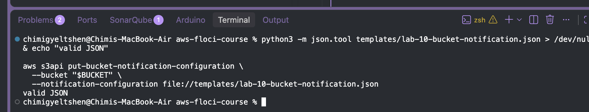

Command - part 2, fire it

```bash 
SOURCE=""
for candidate in outputs/lab-08-scaling-evidence.json \
                 outputs/lab-06-scaling-history.json \
                 outputs/lab-10-edge-trace.json; do
  [ -f "$candidate" ] && { SOURCE="$candidate"; break; }
done

if [ -z "$SOURCE" ]; then
  SOURCE=outputs/lab-10-first-object.json
  python3 -c "
import json, datetime
json.dump({'note': 'placeholder first object for usms-student-data',
           'created': datetime.datetime.utcnow().isoformat() + 'Z'},
          open('$SOURCE','w'), indent=2)
"
fi

printf 'uploading %s\n' "$SOURCE"

aws s3api put-object \
  --bucket "$BUCKET" \
  --key "transcripts/evidence/$(basename "$SOURCE")" \
  --body "$SOURCE" \
  --content-type application/json \
  --query '{ETag:ETag}' --output text
```
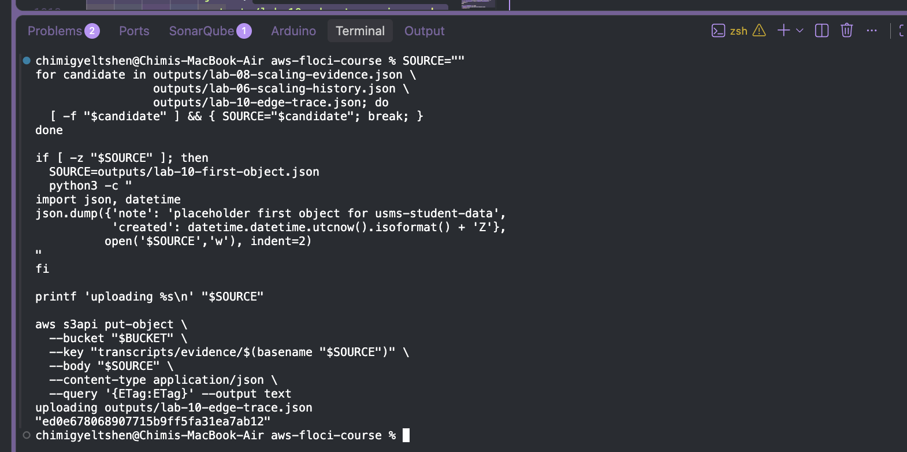

verify 
```bash 
aws s3api get-bucket-notification-configuration --bucket "$BUCKET" \
  --query 'LambdaFunctionConfigurations[].[Id,LambdaFunctionArn,Events[0]]' --output table

aws s3api list-objects-v2 --bucket "$BUCKET" --prefix transcripts/ \
  --query 'Contents[].[Key,Size]' --output table
```


Step 21 - Prove the notifier actually ran¶
Configuring a trigger and uploading an object is not evidence your code executed. Look for the evidence, with a fallback because event delivery is the least reliable part of any emulator.

Command - part 1, look for the log

```bash
LOG_GROUP="/aws/lambda/$NOTIFIER_FN"

aws logs describe-log-groups --log-group-name-prefix "$LOG_GROUP" \
  --query 'logGroups[].[logGroupName,storedBytes]' --output table

aws logs filter-log-events \
  --log-group-name "$LOG_GROUP" \
  --filter-pattern "USMS_NOTIFY" \
  --query 'events[].message' --output text 2>/dev/null \
  | tee outputs/lab-10-notifier-logs.txt
```


Command - part 2, the fallback: invoke with a synthetic S3 event

Do this if part 1 printed nothing. If the handler works on a hand-made event, your code and permissions are right and only delivery is missing; if it fails here too, the problem is in the handler.

```bash 
cat > templates/lab-10-s3-event.json << EOF
{
  "Records": [
    {
      "eventVersion": "2.1",
      "eventSource": "aws:s3",
      "awsRegion": "us-east-1",
      "eventName": "ObjectCreated:Put",
      "s3": {
        "s3SchemaVersion": "1.0",
        "bucket": {
          "name": "${BUCKET}",
          "arn": "arn:aws:s3:::${BUCKET}"
        },
        "object": {
          "key": "transcripts/evidence/synthetic-probe.json",
          "size": 1024,
          "eTag": "0123456789abcdef0123456789abcdef"
        }
      }
    }
  ]
}
EOF

python3 -m json.tool templates/lab-10-s3-event.json > /dev/null && echo "valid JSON"

aws lambda invoke \
  --function-name "$NOTIFIER_FN" \
  --qualifier live \
  --payload fileb://templates/lab-10-s3-event.json \
  --log-type Tail \
  --query 'LogResult' --output text \
  outputs/lab-10-notifier-direct.json \
  | openssl base64 -d -A | tee -a outputs/lab-10-notifier-logs.txt

python3 -m json.tool outputs/lab-10-notifier-direct.json
```


Step 22 - Restart Floci and read everything back¶
Prove persistence: create, perturb, read back. Lambda stores function code separately from metadata, and a build can keep one and lose the other, so the read-back also runs the code.

Command - part 1, record the state

```bash 
inventory() {
  aws lambda list-functions \
    --query 'sort_by(Functions[?starts_with(FunctionName, `usms-`)], &FunctionName)[].[FunctionName,Runtime,MemorySize]' \
    --output text
  aws lambda list-versions-by-function --function-name usms-edge-viewer-request \
    --query "sort_by(Versions[?Version!='\$LATEST'], &Version)[].Version" --output text
  aws lambda list-aliases --function-name usms-transcript-notifier \
    --query 'Aliases[].[Name,FunctionVersion]' --output text
  aws s3api list-objects-v2 --bucket "${USMS_BUCKET_NAME:-usms-student-data}" \
    --query 'sort_by(Contents, &Key)[].Key' --output text
  aws s3api get-bucket-notification-configuration --bucket "${USMS_BUCKET_NAME:-usms-student-data}" \
    --query 'LambdaFunctionConfigurations[].Id' --output text
}

inventory | tee outputs/lab-10-pre-restart.txt
```


Command - part 2, perturb

```bash 
./scripts/setup/floci-down.sh
./scripts/setup/floci-up.sh
./scripts/utilities/whoami.sh
```


Command - part 3, read back

```bash 
inventory | tee outputs/lab-10-post-restart.txt

diff outputs/lab-10-pre-restart.txt outputs/lab-10-post-restart.txt \
  && echo "IDENTICAL - every Lab 10 artefact survived the restart"

```


Verify - the stronger check

Names surviving is weaker evidence than code surviving, so invoke it:

```bash 
./scripts/utilities/usms-edge-simulate.sh | tail -20
```


Step 23 - Write configs/lab-10.env

```bash 
cat configs/lab-10.env
```


Verify

```bash 
grep -c '^export' configs/lab-10.env

grep -n 'export .*=$\|None' configs/lab-10.env || echo "all values populated"

source configs/lab-10.env && echo "sources cleanly"
```


Step 24 - Check what Git sees, and commit¶
