# Lab 11: Building a CI/CD Pipeline with AWS CodePipeline and CodeBuild

> **Project:** USMS (University Student Management System) · **Emulator:** Floci · **Account:** `000000000000` · **Region:** `us-east-1`

This lab builds a two-stage delivery pipeline for the USMS enrolment service. An **S3 source stage** passes a versioned source archive to a **CodeBuild stage**. The build validates, tests and packages the service. You run the build on its own first, then hand it to CodePipeline, run it end to end, break it on purpose and fix it.

---

## Table of Contents

1. [Architecture](#architecture)
2. [Learning Objectives](#learning-objectives)
3. [Prerequisites](#prerequisites)
4. [Resources Created](#resources-created)
5. [Part A: Environment Setup](#part-a-environment-setup) (Steps 1–4)
6. [Part B: Artifact Store](#part-b-artifact-store) (Steps 5–6)
7. [Part C: Application Source](#part-c-application-source) (Steps 7–8)
8. [Part D: CodeBuild](#part-d-codebuild) (Steps 9–14)
9. [Part E: CodePipeline](#part-e-codepipeline) (Steps 15–19)
10. [Part F: Failure and Recovery](#part-f-failure-and-recovery) (Step 20)
11. [Part G: Record and Commit](#part-g-record-and-commit) (Step 21)
12. [Verification](#verification)
13. [Cleanup](#cleanup)
14. [Troubleshooting](#troubleshooting)

---

## Architecture

```
 labs/lab-11-cicd/app ──pack──▶ s3://usms-pipeline-artifacts/source/usms-enrolment-src.zip
                                              │  (versioned object)
                                              ▼
                ┌──────────────────── usms-enrolment-pipeline ────────────────────┐
                │                                                                 │
                │   Stage 1: Source (S3)  ──SourceOutput──▶  Stage 2: Build       │
                │                                            usms-enrolment-build │
                │                                            install → pre_build  │
                │                                            → build → post_build │
                └─────────────────────────────────────────────────┬───────────────┘
                                                                  ▼
                          s3://usms-pipeline-artifacts/usms-enrolment-pipeline/BuildOutput/<id>.zip
```

Stages do not stream data to each other. Each stage writes a zip file to the artifact bucket, and the next stage reads it from there.

---

## Learning Objectives

By the end of this lab you will be able to:

- Create a versioned, private S3 artifact store and show that versioning works
- Write a `buildspec.yml` with all four build phases and a smoke test
- Create least-privilege IAM service roles for CodeBuild and CodePipeline
- Run and debug a CodeBuild project on its own, using phase timings and CloudWatch logs
- Define, create and run a CodePipeline, and confirm which source version it consumed
- Diagnose a deliberately broken build from the pipeline state, then recover

---

## Prerequisites

Labs 04, 05 and 10 must pass verification, and Floci must be in a persistent storage mode.

```bash
source configs/course.env

./scripts/utilities/floci-storage-check.sh
./scripts/utilities/verify-lab-04.sh
./scripts/utilities/verify-lab-05.sh
./scripts/utilities/verify-lab-10.sh
```

---

## Resources Created

| Type | Name |
|---|---|
| S3 bucket | `usms-pipeline-artifacts` (versioned, public access blocked) |
| IAM role | `usms-codebuild-role` |
| IAM policy | `USMSCodeBuildBase` |
| IAM role | `usms-codepipeline-role` |
| IAM policy | `USMSCodePipelineBase` |
| CodeBuild project | `usms-enrolment-build` |
| CodePipeline | `usms-enrolment-pipeline` |
| Log group | `/aws/codebuild/usms-enrolment-build` |

All resources are tagged `Project=USMS`, `Tier=pipeline`, `Lab=11`.

---

## Part A: Environment Setup

### Step 1: Start Floci and confirm where you are

> [!WARNING]
> If the emulator is not in hybrid storage mode, tonight's pipeline is gone tomorrow, while every command still reports success.

```bash
cd ~/aws-floci-course
./scripts/setup/floci-up.sh
./scripts/utilities/floci-storage-check.sh
./scripts/utilities/whoami.sh
```

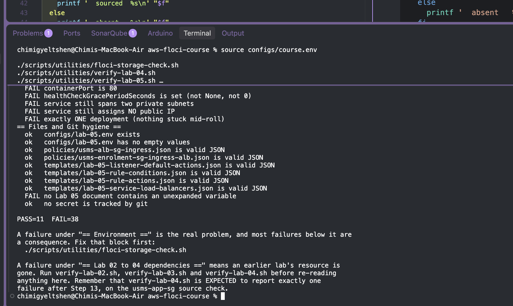

### Step 2: Source every earlier lab's environment

Read back the resource names that earlier labs recorded.

```bash
source configs/course.env

for f in configs/lab-01.env configs/lab-02.env configs/lab-03.env \
         configs/lab-04.env configs/lab-05.env configs/lab-06.env \
         configs/lab-09.env configs/lab-07.env configs/lab-08.env \
         configs/lab-10.env; do
  if [ -f "$f" ]; then
    source "$f"
    printf '  sourced  %s\n' "$f"
  else
    printf '  absent   %s\n' "$f"
  fi
done

./scripts/utilities/whoami.sh
```


**Verify:** none of these values should print `MISSING`.

```bash
printf 'cluster   : %s\nservice   : %s\ncontainer : %s\ntarget grp: %s\nexec role : %s\n' \
  "${USMS_ECS_CLUSTER:-MISSING}" \
  "${USMS_ENROLMENT_SERVICE:-MISSING}" \
  "${USMS_ENROLMENT_CONTAINER:-MISSING}" \
  "${USMS_TG_ARN:-MISSING}" \
  "${USMS_ECS_EXEC_ROLE_ARN:-MISSING}"
```


### Step 3: Probe CI/CD support and choose your path

The probe reports which of Path A, B or C your emulator supports. Write the result down, because it decides which verification failures are expected later.

```bash
chmod +x scripts/utilities/cicd-support-probe.sh
bash -n scripts/utilities/cicd-support-probe.sh && echo "syntax OK"
./scripts/utilities/cicd-support-probe.sh
```


### Step 4: Create this lab's directories

Create every directory this lab writes to, so no later step fails on a missing parent.

```bash
mkdir -p labs/lab-11-cicd/app/src \
         labs/lab-11-cicd/app/config \
         labs/lab-11-cicd/app/tests \
         policies templates scripts/utilities scripts/cleanup outputs notes

ls -d labs/lab-11-cicd/app/*
```

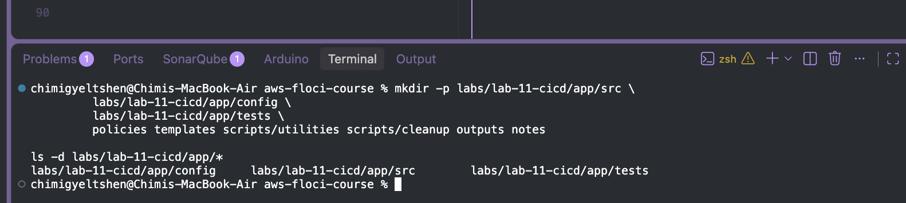

---

## Part B: Artifact Store

### Step 5: Create the pipeline artifact bucket

Every stage hands the next one a zip file through a single S3 bucket, the **artifact store**. The same bucket also holds the source archive. Because of this:

- the bucket must be in the pipeline's Region
- its policy must be scoped tightly, since artifacts contain configuration
- an unfamiliar key in an error message is usually an artifact key: `<pipeline-name>/<OutputArtifactName>/<random>.zip`

```bash
PIPELINE_BUCKET="usms-pipeline-artifacts"

aws s3api create-bucket --bucket "$PIPELINE_BUCKET"

aws s3api put-bucket-tagging \
  --bucket "$PIPELINE_BUCKET" \
  --tagging 'TagSet=[{Key=Project,Value=USMS},{Key=Tier,Value=pipeline},{Key=Lab,Value=11}]'

aws s3api put-bucket-versioning \
  --bucket "$PIPELINE_BUCKET" \
  --versioning-configuration Status=Enabled

aws s3api put-public-access-block \
  --bucket "$PIPELINE_BUCKET" \
  --public-access-block-configuration \
    BlockPublicAcls=true,IgnorePublicAcls=true,BlockPublicPolicy=true,RestrictPublicBuckets=true
```

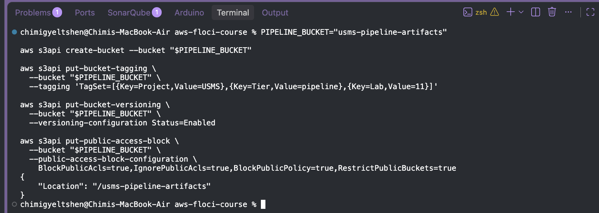

**Verify**

```bash
aws s3api get-bucket-versioning --bucket "$PIPELINE_BUCKET" --output table
aws s3api get-bucket-tagging    --bucket "$PIPELINE_BUCKET" \
  --query 'TagSet[].[Key,Value]' --output table
```


### Step 6: Prove versioning is on

CodePipeline refuses an unversioned S3 source. Test what the bucket actually does, not just what its configuration says: put two objects at one key, then list the versions.

```bash
printf 'first\n'  > /tmp/usms-version-probe.txt
aws s3api put-object --bucket "$PIPELINE_BUCKET" \
  --key probe/versioning.txt --body /tmp/usms-version-probe.txt >/dev/null

printf 'second\n' > /tmp/usms-version-probe.txt
aws s3api put-object --bucket "$PIPELINE_BUCKET" \
  --key probe/versioning.txt --body /tmp/usms-version-probe.txt >/dev/null

aws s3api list-object-versions \
  --bucket "$PIPELINE_BUCKET" \
  --prefix probe/versioning.txt \
  --query 'Versions[].{Version:VersionId,Latest:IsLatest,Size:Size}' \
  --output table
```

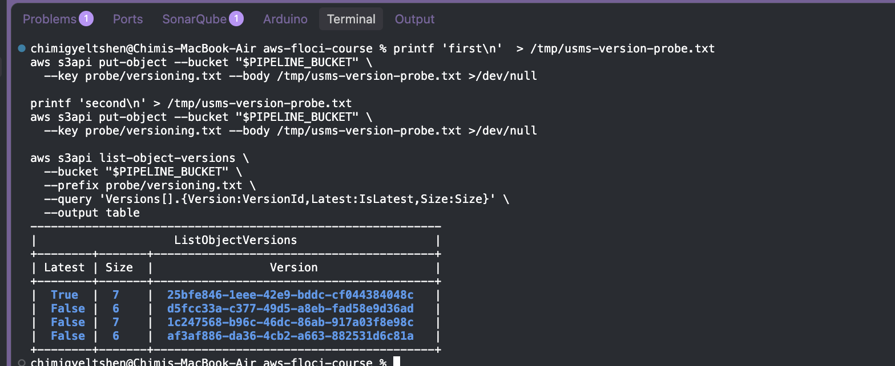

**Clean up the probe:** delete every version. The last command should print `0`.

```bash
aws s3api list-object-versions --bucket "$PIPELINE_BUCKET" --prefix probe/ \
  --query 'Versions[].[Key,VersionId]' --output text |
while read -r key vid; do
  [ -n "$key" ] && aws s3api delete-object --bucket "$PIPELINE_BUCKET" \
    --key "$key" --version-id "$vid" >/dev/null
done

aws s3api list-object-versions --bucket "$PIPELINE_BUCKET" --prefix probe/ \
  --query 'length(Versions || `[]`)' --output text
```

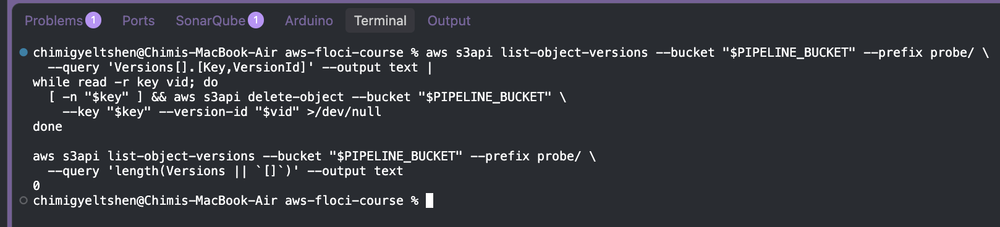

---

## Part C: Application Source

### Step 7: Write the enrolment service source tree

This gives the pipeline something to build, with a version number you can follow through each stage.

> **Run from:** `~/aws-floci-course/labs/lab-11-cicd/app/`

**Part 1: the application**

```bash
cd ~/aws-floci-course/labs/lab-11-cicd/app

printf 'r3\n' > VERSION

cat > src/index.html << 'EOF'
<!doctype html>
<html lang="en">
  <head><meta charset="utf-8"><title>USMS - Enrolment</title></head>
  <body>
    <h1>USMS Enrolment Service</h1>
    <p>University Student Management System</p>
    <p id="release">release: __RELEASE__</p>
    <p id="built">built: __BUILT_AT__</p>
  </body>
</html>
EOF

cat > src/healthz.html << 'EOF'
ok
EOF
```

**Part 2: the configuration the build validates**

```bash
cat > config/service.json << 'EOF'
{
  "service": "enrolment",
  "project": "USMS",
  "container": "enrolment-api",
  "port": 80,
  "healthPath": "/healthz.html",
  "cluster": "usms-ecs-cluster",
  "ecsService": "usms-enrolment-svc"
}
EOF

python3 -m json.tool config/service.json > /dev/null && echo "service.json is valid JSON"
```

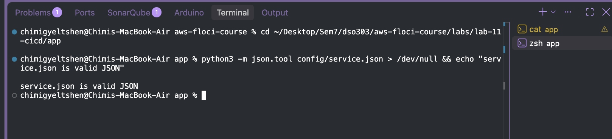

**Part 3: the smoke test**

```bash
cat > tests/smoke.sh << 'EOF'
#!/usr/bin/env bash
# Smoke tests for the USMS enrolment service artifact.
# Runs inside the build container, against the built output in ./dist.
set -uo pipefail

FAIL=0
t() {
  if eval "$2" >/dev/null 2>&1; then printf '  ok   %s\n' "$1"
  else printf '  FAIL %s\n' "$1"; FAIL=$((FAIL+1)); fi
}

echo "== smoke tests =="
t "dist/index.html exists"              "test -f dist/index.html"
t "dist/healthz.html exists"            "test -f dist/healthz.html"
t "release placeholder was replaced"    "! grep -q '__RELEASE__' dist/index.html"
t "build-time placeholder was replaced" "! grep -q '__BUILT_AT__' dist/index.html"
t "health endpoint says ok"             "grep -q '^ok$' dist/healthz.html"
t "build metadata is valid JSON"        "python3 -m json.tool dist/build-metadata.json"
t "container name matches the task def" "grep -q '\"container\": \"enrolment-api\"' config/service.json"

echo "smoke tests failed: $FAIL"
[ "$FAIL" -eq 0 ]
EOF

chmod +x tests/smoke.sh
bash -n tests/smoke.sh && echo "syntax OK"
```


**Verify**

```bash
cd ~/aws-floci-course
find labs/lab-11-cicd/app -type f | sort
```

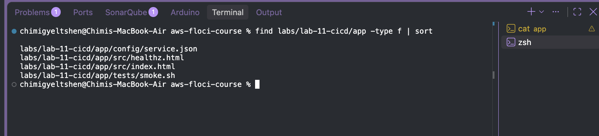

### Step 8: Write `buildspec.yml`

Create `labs/lab-11-cicd/app/buildspec.yml` with `version: 0.2`, all four phases (`install`, `pre_build`, `build`, `post_build`), and `artifacts.base-directory: dist`. Then validate it.

> **Run from:** `~/aws-floci-course/labs/lab-11-cicd/app/`

```bash
python3 - << 'PY'
import sys
try:
    import yaml
except ImportError:
    print("PyYAML not installed - skipping the YAML parse check.")
    print("Indentation errors will surface as a FAILED install phase instead.")
    sys.exit(0)
with open("buildspec.yml") as fh:
    doc = yaml.safe_load(fh)
assert doc["version"] == 0.2, "version must be 0.2"
for phase in ("install", "pre_build", "build", "post_build"):
    assert phase in doc["phases"], f"missing phase: {phase}"
print("buildspec.yml parses, and all four phases are present.")
PY
```


**Verify** (from the repository root)

```bash
grep -c '' labs/lab-11-cicd/app/buildspec.yml
grep -n 'base-directory\|^version\|^phases\|^artifacts' labs/lab-11-cicd/app/buildspec.yml
```


---

## Part D: CodeBuild

### Step 9: Create the CodeBuild service role and its policy

**Part 1: the trust policy.** Only CodeBuild, acting for this account, may assume the role.

```bash
cd ~/aws-floci-course

cat > policies/trust-codebuild.json << 'EOF'
{
  "Version": "2012-10-17",
  "Statement": [
    {
      "Sid": "CodeBuildAssumesThisRole",
      "Effect": "Allow",
      "Principal": { "Service": "codebuild.amazonaws.com" },
      "Action": "sts:AssumeRole",
      "Condition": {
        "StringEquals": { "aws:SourceAccount": "000000000000" }
      }
    }
  ]
}
EOF

python3 -m json.tool policies/trust-codebuild.json > /dev/null && echo "trust-codebuild.json is valid JSON"
```

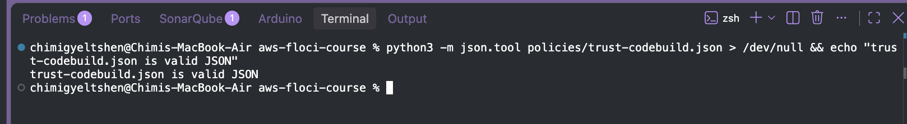

**Part 2: the permissions policy.** The build may write its own logs and use the artifact bucket, and is explicitly denied access to student records.

| Sid | Effect | Scope |
|---|---|---|
| `WriteItsOwnBuildLogs` | Allow | `/aws/codebuild/usms-enrolment-build` log group only |
| `ReadSourceAndWriteArtifacts` | Allow | `usms-pipeline-artifacts` bucket only |
| `BuildsDoNotTouchStudentRecords` | **Deny** | all `s3:*` on `usms-student-data` |

```bash
cat > policies/usms-codebuild-policy.json << 'EOF'
{
  "Version": "2012-10-17",
  "Statement": [
    {
      "Sid": "WriteItsOwnBuildLogs",
      "Effect": "Allow",
      "Action": [
        "logs:CreateLogGroup",
        "logs:CreateLogStream",
        "logs:PutLogEvents"
      ],
      "Resource": [
        "arn:aws:logs:us-east-1:000000000000:log-group:/aws/codebuild/usms-enrolment-build",
        "arn:aws:logs:us-east-1:000000000000:log-group:/aws/codebuild/usms-enrolment-build:*"
      ]
    },
    {
      "Sid": "ReadSourceAndWriteArtifacts",
      "Effect": "Allow",
      "Action": [
        "s3:GetObject",
        "s3:GetObjectVersion",
        "s3:PutObject",
        "s3:GetBucketAcl",
        "s3:GetBucketLocation"
      ],
      "Resource": [
        "arn:aws:s3:::usms-pipeline-artifacts",
        "arn:aws:s3:::usms-pipeline-artifacts/*"
      ]
    },
    {
      "Sid": "BuildsDoNotTouchStudentRecords",
      "Effect": "Deny",
      "Action": "s3:*",
      "Resource": [
        "arn:aws:s3:::usms-student-data",
        "arn:aws:s3:::usms-student-data/*"
      ]
    }
  ]
}
EOF

python3 -m json.tool policies/usms-codebuild-policy.json > /dev/null && echo "usms-codebuild-policy.json is valid JSON"
```


**Part 3: create the role and attach the policy**

```bash
BUILD_ROLE="usms-codebuild-role"
BUILD_POLICY="USMSCodeBuildBase"

aws iam create-role \
  --role-name "$BUILD_ROLE" \
  --assume-role-policy-document file://policies/trust-codebuild.json \
  --description "Role assumed by CodeBuild when it builds the USMS enrolment service" \
  --tags Key=Project,Value=USMS Key=Tier,Value=pipeline Key=Lab,Value=11 \
  --query 'Role.Arn' --output text

BUILD_POLICY_ARN=$(aws iam create-policy \
  --policy-name "$BUILD_POLICY" \
  --policy-document file://policies/usms-codebuild-policy.json \
  --description "What a USMS build may do: its own logs, the artifact bucket, nothing else" \
  --query 'Policy.Arn' --output text)

aws iam attach-role-policy \
  --role-name "$BUILD_ROLE" \
  --policy-arn "$BUILD_POLICY_ARN"

BUILD_ROLE_ARN=$(aws iam get-role --role-name "$BUILD_ROLE" --query 'Role.Arn' --output text)
echo "$BUILD_ROLE_ARN"
```

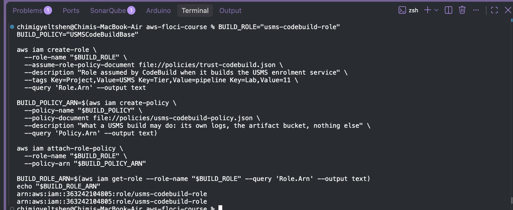

**Verify**

```bash
aws iam list-attached-role-policies --role-name "$BUILD_ROLE" --output table
aws iam get-role --role-name "$BUILD_ROLE" \
  --query 'Role.AssumeRolePolicyDocument.Statement[0].Principal' --output json
```


### Step 10: Create the CodeBuild project

**Write the template.** The heredoc is deliberately **unquoted** (`<< EOF`) so the shell expands `${BUILD_ROLE_ARN}`. The final `grep` should print `0`; anything else means a variable was left unexpanded.

```bash
cat > templates/lab-11-codebuild-project.json << EOF
{
  "name": "usms-enrolment-build",
  "description": "Builds the USMS enrolment service artifact from labs/lab-11-cicd/app",
  "source": {
    "type": "S3",
    "location": "usms-pipeline-artifacts/source/usms-enrolment-src.zip",
    "buildspec": "buildspec.yml"
  },
  "artifacts": {
    "type": "S3",
    "location": "usms-pipeline-artifacts",
    "path": "build",
    "name": "usms-enrolment-build.zip",
    "packaging": "ZIP",
    "namespaceType": "NONE"
  },
  "environment": {
    "type": "LINUX_CONTAINER",
    "image": "aws/codebuild/standard:7.0",
    "computeType": "BUILD_GENERAL1_SMALL",
    "privilegedMode": false,
    "environmentVariables": [
      { "name": "USMS_PROJECT", "value": "USMS", "type": "PLAINTEXT" },
      { "name": "USMS_SERVICE", "value": "enrolment", "type": "PLAINTEXT" }
    ]
  },
  "serviceRole": "${BUILD_ROLE_ARN}",
  "timeoutInMinutes": 15,
  "queuedTimeoutInMinutes": 30,
  "logsConfig": {
    "cloudWatchLogs": {
      "status": "ENABLED",
      "groupName": "/aws/codebuild/usms-enrolment-build"
    }
  },
  "tags": [
    { "key": "Project", "value": "USMS" },
    { "key": "Tier", "value": "pipeline" },
    { "key": "Lab", "value": "11" }
  ]
}
EOF

python3 -m json.tool templates/lab-11-codebuild-project.json > /dev/null \
  && echo "project template is valid JSON"
grep -c '\$' templates/lab-11-codebuild-project.json
```


**Create the project**

```bash
aws codebuild create-project \
  --cli-input-json file://templates/lab-11-codebuild-project.json \
  --query 'project.{Name:name,Role:serviceRole,Image:environment.image,Source:source.type}' \
  --output table
```


### Step 11: Package and upload the source

**Part 1: check the packer script**

```bash
chmod +x scripts/utilities/usms-pack-source.sh
bash -n scripts/utilities/usms-pack-source.sh && echo "syntax OK"
```

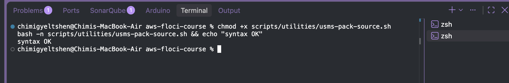

**Part 2: pack and upload.** The command prints the new object's `VersionId`.

```bash
./scripts/utilities/usms-pack-source.sh \
  labs/lab-11-cicd/app \
  outputs/usms-enrolment-src.zip

aws s3api put-object \
  --bucket usms-pipeline-artifacts \
  --key source/usms-enrolment-src.zip \
  --body outputs/usms-enrolment-src.zip \
  --query 'VersionId' --output text
```

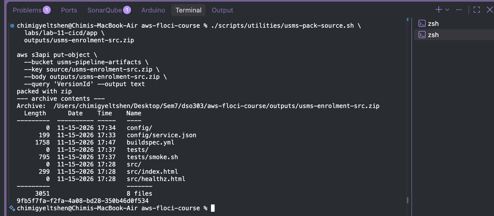

### Step 12: Run the build on its own

> [!TIP]
> Get the build working before you put it in a pipeline. Otherwise you are debugging two systems at once.

```bash
BUILD_ID=$(aws codebuild start-build \
  --project-name usms-enrolment-build \
  --query 'build.id' --output text)

echo "$BUILD_ID"
```


**Verify:** poll until the build finishes.

```bash
for i in $(seq 1 40); do
  STATUS=$(aws codebuild batch-get-builds --ids "$BUILD_ID" \
             --query 'builds[0].buildStatus' --output text 2>/dev/null)
  PHASE=$(aws codebuild batch-get-builds --ids "$BUILD_ID" \
            --query 'builds[0].currentPhase' --output text 2>/dev/null)
  printf '  %2d  status=%-12s phase=%s\n' "$i" "${STATUS:-unknown}" "${PHASE:-unknown}"
  case "$STATUS" in
    SUCCEEDED|FAILED|FAULT|STOPPED|TIMED_OUT) break ;;
  esac
  sleep 10
done
```


### Step 13: Read the build output and the logs

You will use per-phase timings and the build log together to investigate every failed build.

**Phase timings**

```bash
aws codebuild batch-get-builds --ids "$BUILD_ID" \
  --query 'builds[0].phases[].{Phase:phaseType,Status:phaseStatus,Seconds:durationInSeconds}' \
  --output table

aws codebuild batch-get-builds --ids "$BUILD_ID" > "outputs/lab-11-build-$(date +%s).json"
```

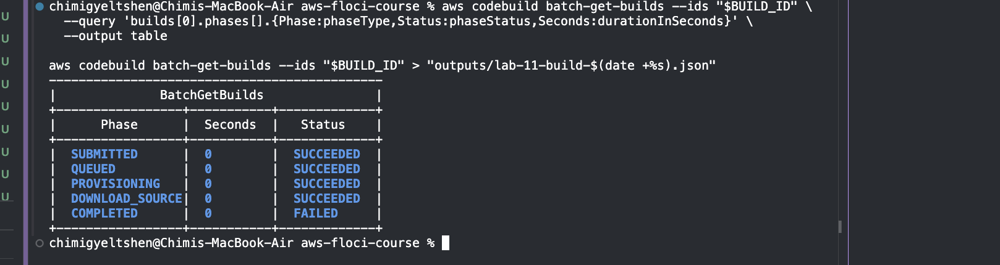

**The log**

```bash
LOG_GROUP=$(aws codebuild batch-get-builds --ids "$BUILD_ID" \
  --query 'builds[0].logs.groupName' --output text)
LOG_STREAM=$(aws codebuild batch-get-builds --ids "$BUILD_ID" \
  --query 'builds[0].logs.streamName' --output text)

echo "group=$LOG_GROUP stream=$LOG_STREAM"

aws logs get-log-events \
  --log-group-name "$LOG_GROUP" \
  --log-stream-name "$LOG_STREAM" \
  --limit 60 \
  --query 'events[].message' --output text
```

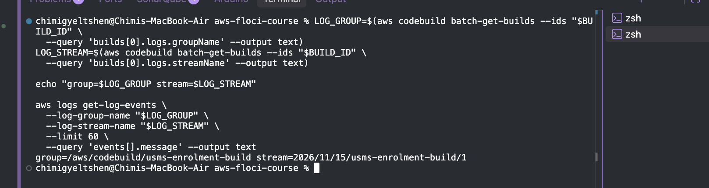

**Read the artifact back**

```bash
aws s3api list-objects-v2 --bucket usms-pipeline-artifacts --prefix build/ \
  --query 'Contents[].{Key:Key,Size:Size}' --output table
```


### Step 14: Run the buildspec locally

The local runner executes the same phases on your machine, so you can catch errors before you upload anything.

```bash
chmod +x scripts/utilities/usms-buildspec-run.sh
bash -n scripts/utilities/usms-buildspec-run.sh && echo "syntax OK"

./scripts/utilities/usms-buildspec-run.sh labs/lab-11-cicd/app
```

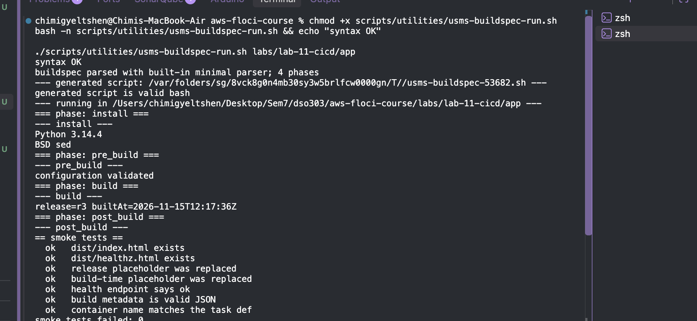

**Verify**

```bash
cat labs/lab-11-cicd/app/dist/build-metadata.json
grep -n 'release:' labs/lab-11-cicd/app/dist/index.html
```

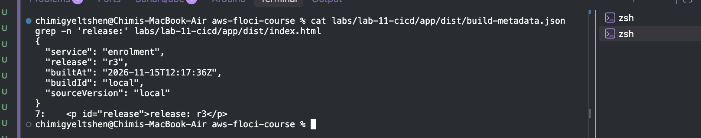

**Keep build output out of Git**

```bash
grep -q '^labs/lab-11-cicd/app/dist/' .gitignore || \
  printf 'labs/lab-11-cicd/app/dist/\n' >> .gitignore

git check-ignore -v labs/lab-11-cicd/app/dist/build-metadata.json
```


---

## Part E: CodePipeline

### Step 15: Create the CodePipeline service role and its policy

**Part 1: validate the documents.** Write `policies/trust-codepipeline.json`, which trusts `codepipeline.amazonaws.com`, and `policies/usms-codepipeline-policy.json`. The policy should allow the artifact store, one build project, and a scoped `iam:PassRole`. Then check that both are valid JSON:

```bash
for f in policies/trust-codepipeline.json policies/usms-codepipeline-policy.json; do
  python3 -m json.tool "$f" > /dev/null && echo "$f is valid JSON"
done
```

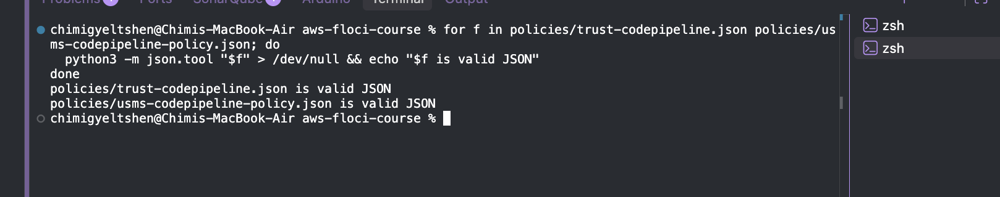

**Part 2: create the role and attach the policy**

```bash
PIPELINE_ROLE="usms-codepipeline-role"
PIPELINE_POLICY="USMSCodePipelineBase"

aws iam create-role \
  --role-name "$PIPELINE_ROLE" \
  --assume-role-policy-document file://policies/trust-codepipeline.json \
  --description "Role assumed by CodePipeline when it runs usms-enrolment-pipeline" \
  --tags Key=Project,Value=USMS Key=Tier,Value=pipeline Key=Lab,Value=11 \
  --query 'Role.Arn' --output text

PIPELINE_POLICY_ARN=$(aws iam create-policy \
  --policy-name "$PIPELINE_POLICY" \
  --policy-document file://policies/usms-codepipeline-policy.json \
  --description "What the USMS pipeline may do: its artifact store, one build project, one PassRole" \
  --query 'Policy.Arn' --output text)

aws iam attach-role-policy --role-name "$PIPELINE_ROLE" --policy-arn "$PIPELINE_POLICY_ARN"

PIPELINE_ROLE_ARN=$(aws iam get-role --role-name "$PIPELINE_ROLE" --query 'Role.Arn' --output text)
echo "$PIPELINE_ROLE_ARN"
```


**Verify**

```bash
aws iam get-policy --policy-arn "$PIPELINE_POLICY_ARN" \
  --query 'Policy.{Name:PolicyName,Default:DefaultVersionId,Attached:AttachmentCount}' --output table
```


### Step 16: Write the pipeline definition

Write `templates/lab-11-pipeline.json`. It defines `usms-enrolment-pipeline` with two stages, **Source** (S3 provider, output `SourceOutput`) and **Build** (CodeBuild `usms-enrolment-build`, output `BuildOutput`), and uses `usms-pipeline-artifacts` as the artifact store. Validate it; the `grep` should print `0`.

```bash
python3 -m json.tool templates/lab-11-pipeline.json > /dev/null && echo "pipeline template is valid JSON"
grep -c '\$' templates/lab-11-pipeline.json
```


### Step 17: Create the pipeline

This step turns the template into a pipeline. It also introduces `get-pipeline-state`, the command you will use most often.

```bash
aws codepipeline create-pipeline \
  --cli-input-json file://templates/lab-11-pipeline.json \
  --query 'pipeline.{Name:name,Role:roleArn,Stages:length(stages)}' \
  --output table
```


**Verify**

```bash
aws codepipeline get-pipeline-state --name usms-enrolment-pipeline \
  --query 'stageStates[].{Stage:stageName,Status:latestExecution.status,Action:actionStates[0].actionName,ActionStatus:actionStates[0].latestExecution.status}' \
  --output table
```


### Step 18: Hand the project to the pipeline

Switch the project's source and artifacts to `CODEPIPELINE`. From now on the pipeline supplies the build's input and receives its output.

```bash
aws codebuild update-project \
  --name usms-enrolment-build \
  --source type=CODEPIPELINE,buildspec=buildspec.yml \
  --artifacts type=CODEPIPELINE \
  --query 'project.{Source:source.type,Artifacts:artifacts.type}' \
  --output table
```

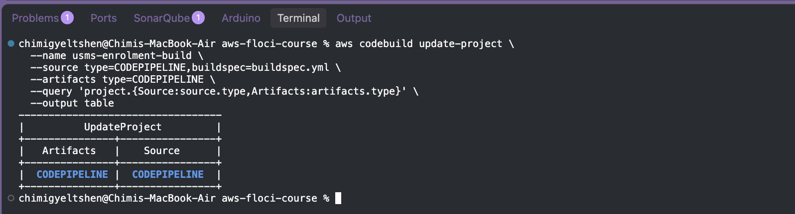

**Verify the trade-off:** the project can no longer be started on its own. Running it directly now fails, because only the pipeline can supply its source.

```bash
aws codebuild start-build --project-name usms-enrolment-build 2>&1 | head -3
```


### Step 19: Run the pipeline end to end and confirm it used your source

**Part 1: bump the release and upload a new source version**

```bash
printf 'r4\n' > labs/lab-11-cicd/app/VERSION

./scripts/utilities/usms-pack-source.sh \
  labs/lab-11-cicd/app \
  outputs/usms-enrolment-src.zip

NEW_VERSION_ID=$(aws s3api put-object \
  --bucket usms-pipeline-artifacts \
  --key source/usms-enrolment-src.zip \
  --body outputs/usms-enrolment-src.zip \
  --query 'VersionId' --output text)

echo "uploaded source version: $NEW_VERSION_ID"

aws s3api list-object-versions --bucket usms-pipeline-artifacts \
  --prefix source/usms-enrolment-src.zip \
  --query 'Versions[].{Version:VersionId,Latest:IsLatest,Modified:LastModified}' \
  --output table
```


**Part 2: run and watch**

```bash
EXEC_ID=$(aws codepipeline start-pipeline-execution \
  --name usms-enrolment-pipeline \
  --query 'pipelineExecutionId' --output text)

echo "execution: $EXEC_ID"

for i in $(seq 1 30); do
  aws codepipeline get-pipeline-state --name usms-enrolment-pipeline \
    --query 'stageStates[].[stageName,latestExecution.status]' --output text |
    sed 's/^/    /'
  STATE=$(aws codepipeline get-pipeline-execution \
            --pipeline-name usms-enrolment-pipeline \
            --pipeline-execution-id "$EXEC_ID" \
            --query 'pipelineExecution.status' --output text 2>/dev/null)
  printf '  %2d  execution=%s\n' "$i" "${STATE:-unknown}"
  case "$STATE" in
    Succeeded|Failed|Stopped|Superseded) break ;;
  esac
  sleep 10
done
```


**Part 3: read the artifact back.** `release` should be `r4`, and `srcVersion` should match `$NEW_VERSION_ID`.

```bash
BUILD_ART_KEY=$(aws s3api list-objects-v2 \
  --bucket usms-pipeline-artifacts \
  --prefix usms-enrolment-pipeline/BuildOutput/ \
  --query 'sort_by(Contents, &LastModified)[-1].Key' --output text)

echo "newest build artifact: $BUILD_ART_KEY"

aws s3api get-object \
  --bucket usms-pipeline-artifacts \
  --key "$BUILD_ART_KEY" \
  outputs/lab-11-buildoutput.zip > /dev/null

python3 - << 'PY'
import json, zipfile
with zipfile.ZipFile("outputs/lab-11-buildoutput.zip") as z:
    names = sorted(z.namelist())
    print("artifact contents:")
    for n in names:
        print("   ", n)
    meta = json.loads(z.read("build-metadata.json"))
print("release  :", meta["release"])
print("builtAt  :", meta["builtAt"])
print("buildId  :", meta["buildId"])
print("srcVersion:", meta["sourceVersion"])
PY
```

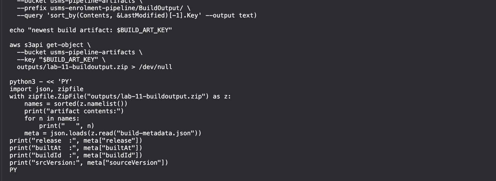

---

## Part F: Failure and Recovery

### Step 20: Make the build fail on purpose, then fix it

Practise reading a failure when you already know its cause.

**Part 1: break it** by changing the container name so it no longer matches the ECS task definition.

```bash
python3 - << 'PY'
import json
p = "labs/lab-11-cicd/app/config/service.json"
doc = json.load(open(p))
doc["container"] = "enrolment-api-v2"      # deliberately wrong
json.dump(doc, open(p, "w"), indent=2)
print("container is now:", doc["container"])
PY

./scripts/utilities/usms-pack-source.sh labs/lab-11-cicd/app outputs/usms-enrolment-src.zip >/dev/null
aws s3api put-object --bucket usms-pipeline-artifacts \
  --key source/usms-enrolment-src.zip --body outputs/usms-enrolment-src.zip \
  --query 'VersionId' --output text

BAD_EXEC=$(aws codepipeline start-pipeline-execution --name usms-enrolment-pipeline \
  --query 'pipelineExecutionId' --output text)
echo "execution: $BAD_EXEC"
```


**Part 2: diagnose it.** The Build stage should show `Failed`, and the error should point to the smoke test.

```bash
sleep 20

aws codepipeline get-pipeline-state --name usms-enrolment-pipeline \
  --query 'stageStates[].{Stage:stageName,Status:latestExecution.status,Summary:actionStates[0].latestExecution.summary,Error:actionStates[0].latestExecution.errorDetails.message}' \
  --output json | tee outputs/lab-11-pipeline-state.json
```

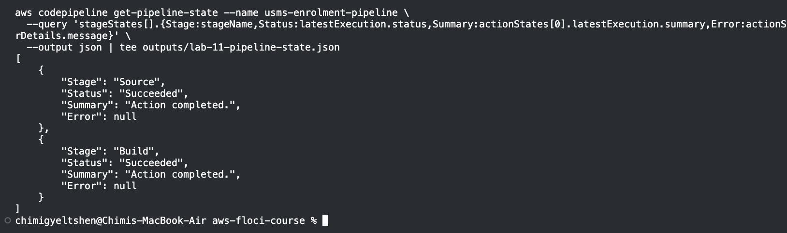

**Part 3: fix it.** Restore the value, check it locally first, then repack and rerun.

```bash
python3 - << 'PY'
import json
p = "labs/lab-11-cicd/app/config/service.json"
doc = json.load(open(p))
doc["container"] = "enrolment-api"
json.dump(doc, open(p, "w"), indent=2)
print("container is now:", doc["container"])
PY

./scripts/utilities/usms-buildspec-run.sh labs/lab-11-cicd/app >/dev/null 2>&1 \
  && echo "local build passes again" || echo "local build STILL fails - fix it before repacking"

./scripts/utilities/usms-pack-source.sh labs/lab-11-cicd/app outputs/usms-enrolment-src.zip >/dev/null
aws s3api put-object --bucket usms-pipeline-artifacts \
  --key source/usms-enrolment-src.zip --body outputs/usms-enrolment-src.zip \
  --query 'VersionId' --output text

aws codepipeline start-pipeline-execution --name usms-enrolment-pipeline \
  --query 'pipelineExecutionId' --output text
```


---

## Part G: Record and Commit

### Step 21: Record this lab's outputs and commit

Write `configs/lab-11.env` with this lab's values, then check that none are empty or `None`:

```bash
grep -n 'export .*=$\|None' configs/lab-11.env || echo "all values populated"
grep -c '^export' configs/lab-11.env
```


**Verify**

```bash
source configs/lab-11.env
printf 'bucket=%s versioning=%s project=%s stages=%s release=%s path=%s\n' \
  "$USMS_PIPELINE_BUCKET" "$USMS_PIPELINE_BUCKET_VERSIONING" \
  "$USMS_BUILD_PROJECT" "$USMS_PIPELINE_STAGE_COUNT" \
  "$USMS_RELEASE_TAG" "$USMS_CICD_SUPPORT_PATH"
```

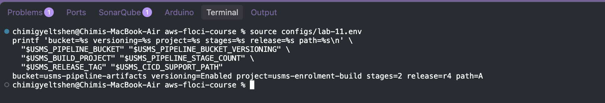

**Stage and commit**

```bash
git add labs/lab-11-cicd
git add policies templates scripts/utilities scripts/cleanup outputs notes configs/lab-11.env
git commit -m "Lab 11: CI/CD pipeline with CodePipeline and CodeBuild"
```

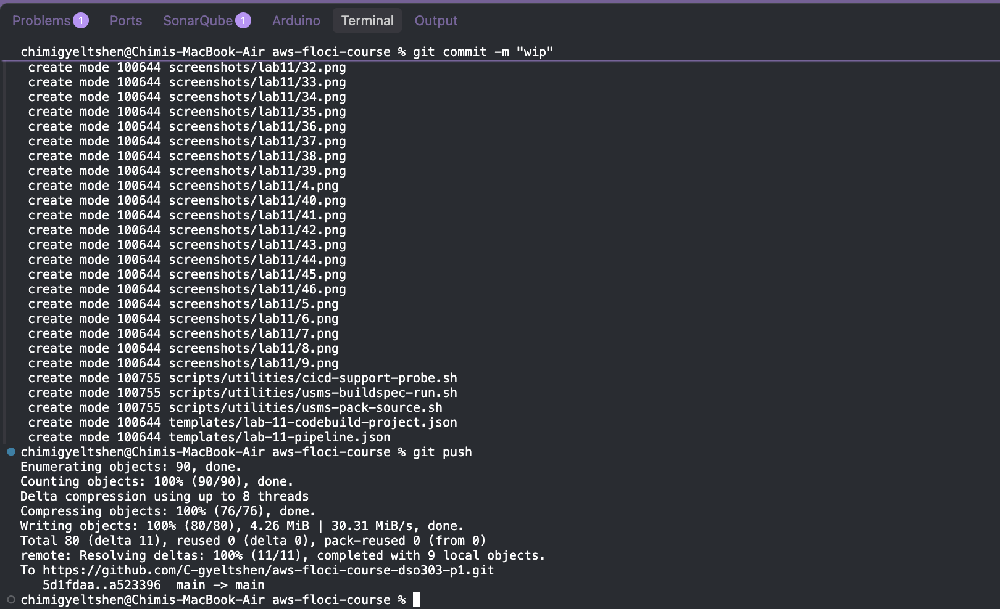

---

## Verification

The script checks the environment first. A script that only checks its own resources keeps passing until a restart deletes them.

```bash
chmod +x scripts/utilities/verify-lab-11.sh
bash -n scripts/utilities/verify-lab-11.sh && echo "syntax OK"
./scripts/utilities/verify-lab-11.sh
```

<details>
<summary><strong>Sample output: PASS=44, FAIL=2</strong></summary>

```text
syntax OK
== Environment ==
  ok   Floci container running
  ok   storage mode is NOT memory
  ok   AWS CLI reaches Floci
  ok   account is 000000000000
== Earlier-lab dependencies ==
  ok   configs/lab-04.env present
  ok   configs/lab-10.env present
  ok   ECS cluster usms-ecs-cluster exists
  ok   ECS service usms-enrolment-svc exists
  ok   container name is enrolment-api
== Artifact store ==
  ok   bucket usms-pipeline-artifacts exists
  ok   versioning is Enabled
  ok   public access is blocked
  ok   source object present
  ok   source has at least two versions
== Pipeline identities ==
  ok   role usms-codebuild-role exists
  ok   build role trusts codebuild.amazonaws.com
  ok   policy USMSCodeBuildBase exists
  ok   USMSCodeBuildBase attached to the build role
  ok   role usms-codepipeline-role exists
  ok   pipeline role trusts codepipeline.amazonaws.com
  ok   policy USMSCodePipelineBase exists
  ok   USMSCodePipelineBase attached to the pipeline role
  ok   pipeline policy scopes iam:PassRole
== CodeBuild ==
  ok   project usms-enrolment-build exists
  ok   project source type is CODEPIPELINE
  ok   project runs as usms-codebuild-role
  FAIL project image is standard:7.0
== CodePipeline ==
  ok   pipeline usms-enrolment-pipeline exists
  ok   pipeline has 2 stages
  ok   stage 1 provider is S3
  ok   stage 2 builds usms-enrolment-build
== Source tree and scripts ==
  ok   buildspec.yml present
  ok   buildspec declares version 0.2
  ok   buildspec has all four phases
  ok   artifacts base-directory is dist
  ok   smoke test is valid bash
  ok   usms-pack-source.sh executable and valid
  ok   usms-buildspec-run.sh executable and valid
== Files and Git hygiene ==
  ok   configs/lab-11.env present
  ok   no empty or None values in lab-11.env
  ok   codebuild project template is valid JSON
  ok   pipeline template is valid JSON
  FAIL templates contain no unexpanded variables
  ok   all four policy documents are valid JSON
  ok   no secret is tracked
  ok   build output dist/ is git-ignored

PASS=44  FAIL=2
```

</details>

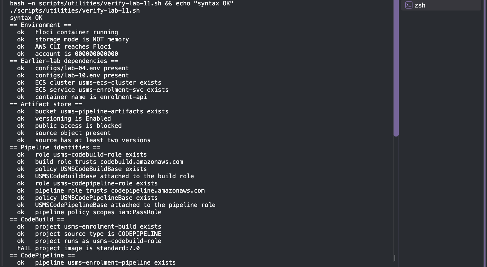

### Reading the results

Read failures from the top down. A failure in an earlier block often causes the failures below it.

| Failing block | Likely cause / where to look |
|---|---|
| Environment | Floci is not running, or is in memory mode. Fix this first. |
| Earlier-lab dependencies | Re-run `verify-lab-04.sh` and `verify-lab-10.sh`. |
| Artifact store | Steps 5 and 6. |
| CodeBuild / CodePipeline | If the support probe reported **Path B or C**, eight failures here are **expected**. Record the path. |
| Source tree | Steps 7, 8, 11 and 14. |
| Files and Git hygiene | Step 21 and `.gitignore`. |

### Notes on the two failures above

| Check | Explanation |
|---|---|
| `project image is standard:7.0` | Step 18's `update-project` call can cause the emulator to report a different image. Run `aws codebuild batch-get-projects --names usms-enrolment-build --query 'projects[0].environment.image'` and compare. |
| `templates contain no unexpanded variables` | A template still contains a literal `$`. Usually `BUILD_ROLE_ARN` was empty when Step 10 ran, or a quoted heredoc (`<< 'EOF'`) was used. Run `grep -n '\$' templates/lab-11-*.json`, set the variable, and regenerate the file. |

---

## Cleanup

The cleanup script removes everything this lab created. Build it and check its syntax now, but **do not run it** until the end of the course, because later labs depend on these resources.

```bash
chmod +x scripts/cleanup/lab-11-cleanup.sh
bash -n scripts/cleanup/lab-11-cleanup.sh && echo "syntax OK - do NOT run it"
```

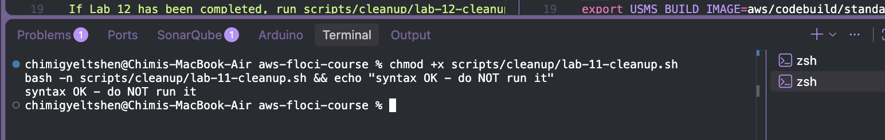

---

## Troubleshooting

| Symptom | Fix |
|---|---|
| Resources disappear after a restart | Floci is in memory mode. Re-run `floci-storage-check.sh` and switch to hybrid storage. |
| An unfamiliar S3 key appears in an error | It is an artifact key (`<pipeline>/<OutputArtifact>/<random>.zip`). Look in the artifact bucket. |
| Pipeline Source stage fails | The source bucket is not versioned. Repeat Step 6. |
| Build fails in `install` | `buildspec.yml` indentation. Run the Step 8 YAML check. |
| Build fails in `post_build` / smoke tests | Run `usms-buildspec-run.sh` locally and read which `FAIL` line fired. |
| `start-build` fails after Step 18 | Expected. The project now accepts source only from CodePipeline. |
| Artifact shows the old release | You started the pipeline before the new source version finished uploading. Check `list-object-versions`, then rerun. |