# Building a CI/CD Pipeline with AWS CodePipeline and CodeBuild

## Prerequisites

```bash
source configs/course.env

./scripts/utilities/floci-storage-check.sh      
./scripts/utilities/verify-lab-04.sh           
./scripts/utilities/verify-lab-05.sh         
./scripts/utilities/verify-lab-10.sh      
```


## Step-by-Step Implementation

Step 1 - Start Floci and confirm where you are¶
If the emulator is not in hybrid storage mode, tonight's pipeline is gone tomorrow while every command still reports success.

```bash 
cd ~/aws-floci-course
./scripts/setup/floci-up.sh
./scripts/utilities/floci-storage-check.sh
./scripts/utilities/whoami.sh
```


Step 2 - Source every earlier lab's environment¶
Read back the names earlier labs recorded.

```bash
source configs/course.env

for f in configs/lab-01.env configs/lab-02.env configs/lab-03.env \
         configs/lab-04.env configs/lab-05.env configs/lab-06.env \
         configs/lab-09.env configs/lab-07.env configs/lab-08.env \
         configs/lab-10.env; do
  if [ -f "$f" ]; then
    source "$f"
    printf '  sourced  %s\n' "$f"
  else
    printf '  absent   %s\n' "$f"
  fi
done

./scripts/utilities/whoami.sh
```
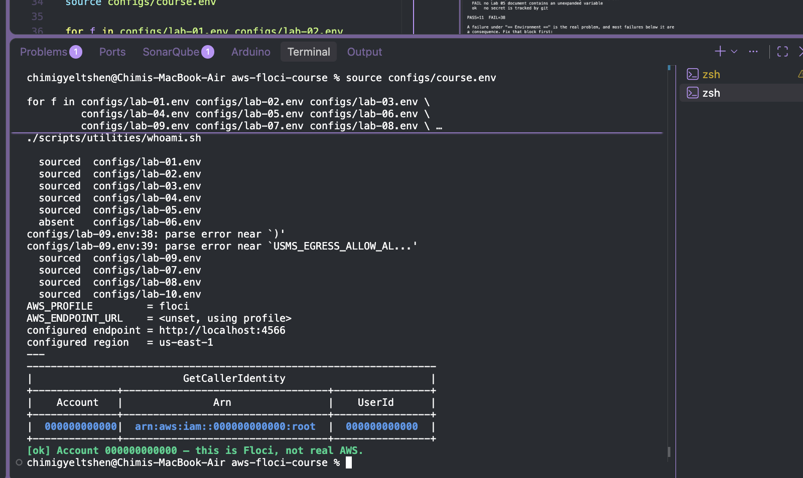


Verify

```bash 
printf 'cluster   : %s\nservice   : %s\ncontainer : %s\ntarget grp: %s\nexec role : %s\n' \
  "${USMS_ECS_CLUSTER:-MISSING}" \
  "${USMS_ENROLMENT_SERVICE:-MISSING}" \
  "${USMS_ENROLMENT_CONTAINER:-MISSING}" \
  "${USMS_TG_ARN:-MISSING}" \
  "${USMS_ECS_EXEC_ROLE_ARN:-MISSING}"
```
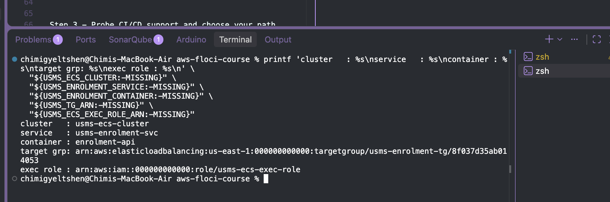


Step 3 - Probe CI/CD support and choose your path

```bash 
chmod +x scripts/utilities/cicd-support-probe.sh
bash -n scripts/utilities/cicd-support-probe.sh && echo "syntax OK"
./scripts/utilities/cicd-support-probe.sh
```
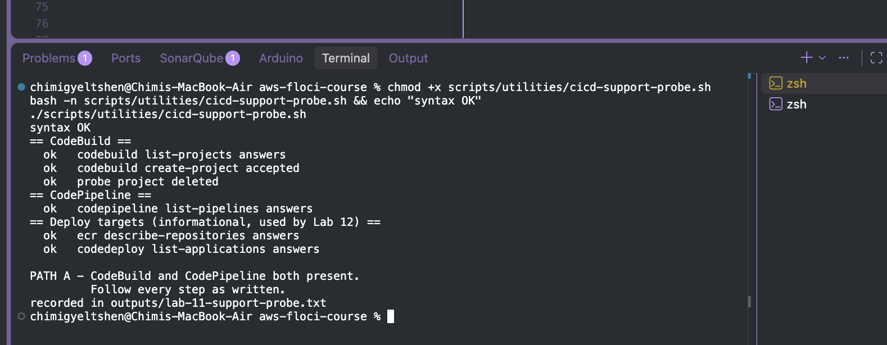

Step 4 - Create this lab's directories¶
Create every directory this lab writes to, so no later step fails on a missing parent.

```bash
mkdir -p labs/lab-11-cicd/app/src \
         labs/lab-11-cicd/app/config \
         labs/lab-11-cicd/app/tests \
         policies templates scripts/utilities scripts/cleanup outputs notes

ls -d labs/lab-11-cicd/app/*
```


Step 5 - Create the pipeline artifact bucket¶
Every stage hands the next a zip file in one S3 bucket, the artifact store; this bucket also holds the source archive. Nothing streams between stages, so the bucket must be in the pipeline's Region, its policy must be scoped (artifacts contain configuration), and an unfamiliar key in an error is an artifact key (<pipeline-name>/<OutputArtifactName>/<random>.zip). See AWS CodePipeline.

```bash
PIPELINE_BUCKET="usms-pipeline-artifacts"

aws s3api create-bucket --bucket "$PIPELINE_BUCKET"

aws s3api put-bucket-tagging \
  --bucket "$PIPELINE_BUCKET" \
  --tagging 'TagSet=[{Key=Project,Value=USMS},{Key=Tier,Value=pipeline},{Key=Lab,Value=11}]'

aws s3api put-bucket-versioning \
  --bucket "$PIPELINE_BUCKET" \
  --versioning-configuration Status=Enabled

aws s3api put-public-access-block \
  --bucket "$PIPELINE_BUCKET" \
  --public-access-block-configuration \
    BlockPublicAcls=true,IgnorePublicAcls=true,BlockPublicPolicy=true,RestrictPublicBuckets=true
```


Verify

```bash
aws s3api get-bucket-versioning --bucket "$PIPELINE_BUCKET" --output table
aws s3api get-bucket-tagging    --bucket "$PIPELINE_BUCKET" \
  --query 'TagSet[].[Key,Value]' --output table
```
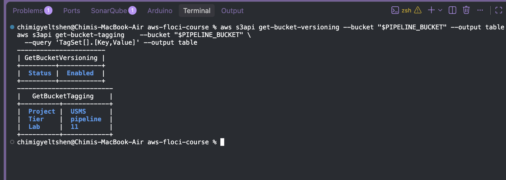

Step 6 - Prove versioning is on¶
CodePipeline refuses an unversioned S3 source, so prove what the bucket does, not what its configuration says: put two objects at one key, then list the versions. See S3 versioning.

```bash
printf 'first\n'  > /tmp/usms-version-probe.txt
aws s3api put-object --bucket "$PIPELINE_BUCKET" \
  --key probe/versioning.txt --body /tmp/usms-version-probe.txt >/dev/null

printf 'second\n' > /tmp/usms-version-probe.txt
aws s3api put-object --bucket "$PIPELINE_BUCKET" \
  --key probe/versioning.txt --body /tmp/usms-version-probe.txt >/dev/null

aws s3api list-object-versions \
  --bucket "$PIPELINE_BUCKET" \
  --prefix probe/versioning.txt \
  --query 'Versions[].{Version:VersionId,Latest:IsLatest,Size:Size}' \
  --output table
```


```bash
aws s3api list-object-versions --bucket "$PIPELINE_BUCKET" --prefix probe/ \
  --query 'Versions[].[Key,VersionId]' --output text |
while read -r key vid; do
  [ -n "$key" ] && aws s3api delete-object --bucket "$PIPELINE_BUCKET" \
    --key "$key" --version-id "$vid" >/dev/null
done

aws s3api list-object-versions --bucket "$PIPELINE_BUCKET" --prefix probe/ \
  --query 'length(Versions || `[]`)' --output text
```


Step 7 - Write the enrolment service source tree¶
Give the pipeline something to build, with a version number you can watch move through it.

Run from

```bash
aws-floci-course/labs/lab-11-cicd/app/
```


Command - part 1, the application itself

```bash
cd ~/aws-floci-course/labs/lab-11-cicd/app

printf 'r3\n' > VERSION

cat > src/index.html << 'EOF'
<!doctype html>
<html lang="en">
  <head><meta charset="utf-8"><title>USMS - Enrolment</title></head>
  <body>
    <h1>USMS Enrolment Service</h1>
    <p>University Student Management System</p>
    <p id="release">release: __RELEASE__</p>
    <p id="built">built: __BUILT_AT__</p>
  </body>
</html>
EOF

cat > src/healthz.html << 'EOF'
ok
EOF
```


Command - part 2, the configuration the build validates

```bash
cat > config/service.json << 'EOF'
{
  "service": "enrolment",
  "project": "USMS",
  "container": "enrolment-api",
  "port": 80,
  "healthPath": "/healthz.html",
  "cluster": "usms-ecs-cluster",
  "ecsService": "usms-enrolment-svc"
}
EOF

python3 -m json.tool config/service.json > /dev/null && echo "service.json is valid JSON"
```


Command - part 3, the test

```bash
cat > tests/smoke.sh << 'EOF'
#!/usr/bin/env bash
# Smoke tests for the USMS enrolment service artifact.
# Runs inside the build container, against the built output in ./dist.
set -uo pipefail

FAIL=0
t() {
  if eval "$2" >/dev/null 2>&1; then printf '  ok   %s\n' "$1"
  else printf '  FAIL %s\n' "$1"; FAIL=$((FAIL+1)); fi
}

echo "== smoke tests =="
t "dist/index.html exists"              "test -f dist/index.html"
t "dist/healthz.html exists"            "test -f dist/healthz.html"
t "release placeholder was replaced"    "! grep -q '__RELEASE__' dist/index.html"
t "build-time placeholder was replaced" "! grep -q '__BUILT_AT__' dist/index.html"
t "health endpoint says ok"             "grep -q '^ok$' dist/healthz.html"
t "build metadata is valid JSON"        "python3 -m json.tool dist/build-metadata.json"
t "container name matches the task def" "grep -q '\"container\": \"enrolment-api\"' config/service.json"

echo "smoke tests failed: $FAIL"
[ "$FAIL" -eq 0 ]
EOF

chmod +x tests/smoke.sh
bash -n tests/smoke.sh && echo "syntax OK"
```
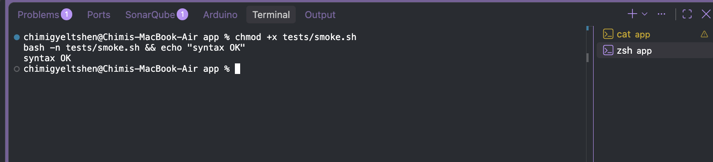

verify

```bash

cd ~/aws-floci-course
find labs/lab-11-cicd/app -type f | sort
```


Step 8 - Write buildspec.yml¶

Run from

```bash
python3 - << 'PY'
import sys
try:
    import yaml
except ImportError:
    print("PyYAML not installed - skipping the YAML parse check.")
    print("Indentation errors will surface as a FAILED install phase instead.")
    sys.exit(0)
with open("buildspec.yml") as fh:
    doc = yaml.safe_load(fh)
assert doc["version"] == 0.2, "version must be 0.2"
for phase in ("install", "pre_build", "build", "post_build"):
    assert phase in doc["phases"], f"missing phase: {phase}"
print("buildspec.yml parses, and all four phases are present.")
```
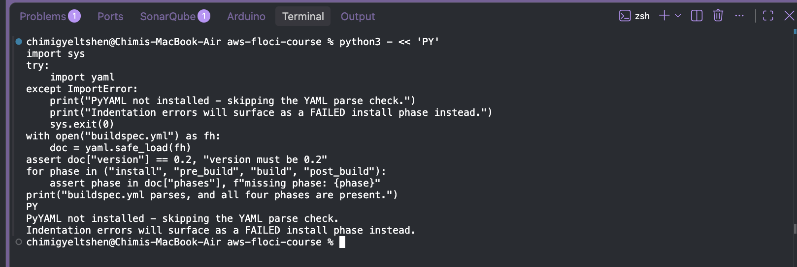


verify

```bash
grep -c '' labs/lab-11-cicd/app/buildspec.yml
grep -n 'base-directory\|^version\|^phases\|^artifacts' labs/lab-11-cicd/app/buildspec.yml
```
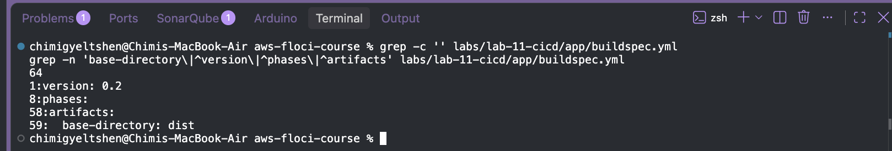

Step 9 - Create the CodeBuild service role and its policy

Command - part 1, the trust policy

```bash
cd ~/aws-floci-course

cat > policies/trust-codebuild.json << 'EOF'
{
  "Version": "2012-10-17",
  "Statement": [
    {
      "Sid": "CodeBuildAssumesThisRole",
      "Effect": "Allow",
      "Principal": { "Service": "codebuild.amazonaws.com" },
      "Action": "sts:AssumeRole",
      "Condition": {
        "StringEquals": { "aws:SourceAccount": "000000000000" }
      }
    }
  ]
}
EOF

python3 -m json.tool policies/trust-codebuild.json > /dev/null && echo "trust-codebuild.json is valid JSON"
```


Command - part 2, the permissions policy

```bash
cat > policies/usms-codebuild-policy.json << 'EOF'
{
  "Version": "2012-10-17",
  "Statement": [
    {
      "Sid": "WriteItsOwnBuildLogs",
      "Effect": "Allow",
      "Action": [
        "logs:CreateLogGroup",
        "logs:CreateLogStream",
        "logs:PutLogEvents"
      ],
      "Resource": [
        "arn:aws:logs:us-east-1:000000000000:log-group:/aws/codebuild/usms-enrolment-build",
        "arn:aws:logs:us-east-1:000000000000:log-group:/aws/codebuild/usms-enrolment-build:*"
      ]
    },
    {
      "Sid": "ReadSourceAndWriteArtifacts",
      "Effect": "Allow",
      "Action": [
        "s3:GetObject",
        "s3:GetObjectVersion",
        "s3:PutObject",
        "s3:GetBucketAcl",
        "s3:GetBucketLocation"
      ],
      "Resource": [
        "arn:aws:s3:::usms-pipeline-artifacts",
        "arn:aws:s3:::usms-pipeline-artifacts/*"
      ]
    },
    {
      "Sid": "BuildsDoNotTouchStudentRecords",
      "Effect": "Deny",
      "Action": "s3:*",
      "Resource": [
        "arn:aws:s3:::usms-student-data",
        "arn:aws:s3:::usms-student-data/*"
      ]
    }
  ]
}
EOF

python3 -m json.tool policies/usms-codebuild-policy.json > /dev/null && echo "usms-codebuild-policy.json is valid JSON"
```
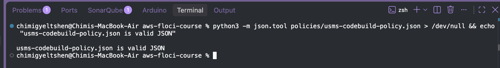

Command - part 3, create the role and attach

```bash
BUILD_ROLE="usms-codebuild-role"
BUILD_POLICY="USMSCodeBuildBase"

aws iam create-role \
  --role-name "$BUILD_ROLE" \
  --assume-role-policy-document file://policies/trust-codebuild.json \
  --description "Role assumed by CodeBuild when it builds the USMS enrolment service" \
  --tags Key=Project,Value=USMS Key=Tier,Value=pipeline Key=Lab,Value=11 \
  --query 'Role.Arn' --output text

BUILD_POLICY_ARN=$(aws iam create-policy \
  --policy-name "$BUILD_POLICY" \
  --policy-document file://policies/usms-codebuild-policy.json \
  --description "What a USMS build may do: its own logs, the artifact bucket, nothing else" \
  --query 'Policy.Arn' --output text)

aws iam attach-role-policy \
  --role-name "$BUILD_ROLE" \
  --policy-arn "$BUILD_POLICY_ARN"

BUILD_ROLE_ARN=$(aws iam get-role --role-name "$BUILD_ROLE" --query 'Role.Arn' --output text)
echo "$BUILD_ROLE_ARN"
```


Verify

```bash
aws iam list-attached-role-policies --role-name "$BUILD_ROLE" --output table
aws iam get-role --role-name "$BUILD_ROLE" \
  --query 'Role.AssumeRolePolicyDocument.Statement[0].Principal' --output json
```
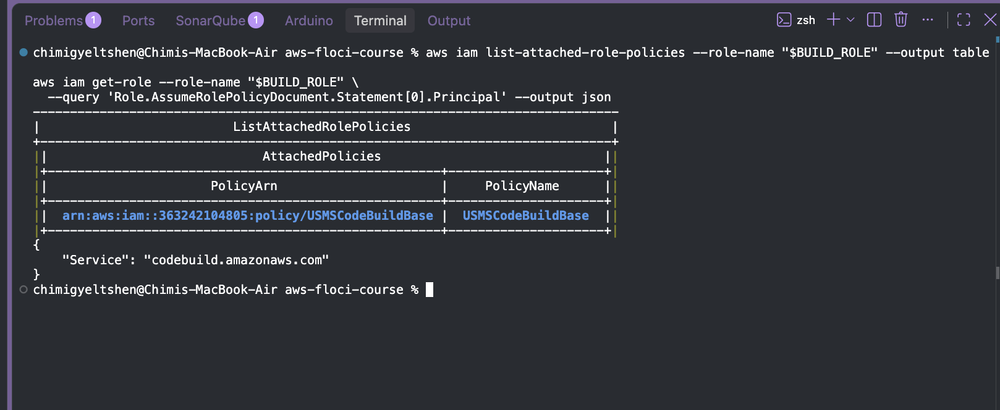

Step 10 - Create the CodeBuild project

```bash
cat > templates/lab-11-codebuild-project.json << EOF
{
  "name": "usms-enrolment-build",
  "description": "Builds the USMS enrolment service artifact from labs/lab-11-cicd/app",
  "source": {
    "type": "S3",
    "location": "usms-pipeline-artifacts/source/usms-enrolment-src.zip",
    "buildspec": "buildspec.yml"
  },
  "artifacts": {
    "type": "S3",
    "location": "usms-pipeline-artifacts",
    "path": "build",
    "name": "usms-enrolment-build.zip",
    "packaging": "ZIP",
    "namespaceType": "NONE"
  },
  "environment": {
    "type": "LINUX_CONTAINER",
    "image": "aws/codebuild/standard:7.0",
    "computeType": "BUILD_GENERAL1_SMALL",
    "privilegedMode": false,
    "environmentVariables": [
      { "name": "USMS_PROJECT", "value": "USMS", "type": "PLAINTEXT" },
      { "name": "USMS_SERVICE", "value": "enrolment", "type": "PLAINTEXT" }
    ]
  },
  "serviceRole": "${BUILD_ROLE_ARN}",
  "timeoutInMinutes": 15,
  "queuedTimeoutInMinutes": 30,
  "logsConfig": {
    "cloudWatchLogs": {
      "status": "ENABLED",
      "groupName": "/aws/codebuild/usms-enrolment-build"
    }
  },
  "tags": [
    { "key": "Project", "value": "USMS" },
    { "key": "Tier", "value": "pipeline" },
    { "key": "Lab", "value": "11" }
  ]
}
EOF

python3 -m json.tool templates/lab-11-codebuild-project.json > /dev/null \
  && echo "project template is valid JSON"
grep -c '\$' templates/lab-11-codebuild-project.json
```
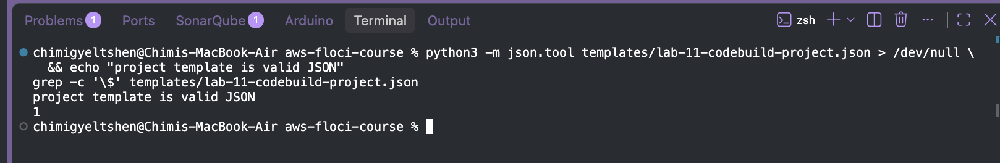

Command - create it

```bash
aws codebuild create-project \
  --cli-input-json file://templates/lab-11-codebuild-project.json \
  --query 'project.{Name:name,Role:serviceRole,Image:environment.image,Source:source.type}' \
  --output table
```
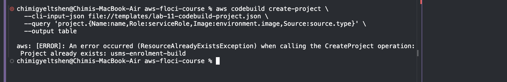

Step 11 - Package and upload the source
Command - part 1, the packer
```bash
chmod +x scripts/utilities/usms-pack-source.sh
bash -n scripts/utilities/usms-pack-source.sh && echo "syntax OK"
```


Command - part 2, pack and upload

```bash
./scripts/utilities/usms-pack-source.sh \
  labs/lab-11-cicd/app \
  outputs/usms-enrolment-src.zip

aws s3api put-object \
  --bucket usms-pipeline-artifacts \
  --key source/usms-enrolment-src.zip \
  --body outputs/usms-enrolment-src.zip \
  --query 'VersionId' --output text
```


Step 12 - Run the build on its own¶
Prove the build works before putting it in a pipeline; otherwise you debug two systems at once.

```bash
BUILD_ID=$(aws codebuild start-build \
  --project-name usms-enrolment-build \
  --query 'build.id' --output text)

echo "$BUILD_ID"
```
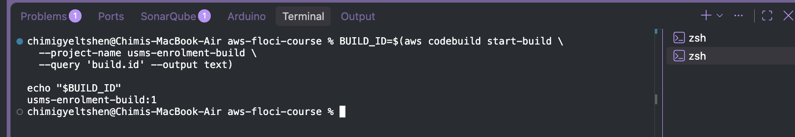


Verify - poll until it finishes

```bash
for i in $(seq 1 40); do
  STATUS=$(aws codebuild batch-get-builds --ids "$BUILD_ID" \
             --query 'builds[0].buildStatus' --output text 2>/dev/null)
  PHASE=$(aws codebuild batch-get-builds --ids "$BUILD_ID" \
            --query 'builds[0].currentPhase' --output text 2>/dev/null)
  printf '  %2d  status=%-12s phase=%s\n' "$i" "${STATUS:-unknown}" "${PHASE:-unknown}"
  case "$STATUS" in
    SUCCEEDED|FAILED|FAULT|STOPPED|TIMED_OUT) break ;;
  esac
  sleep 10
done
```
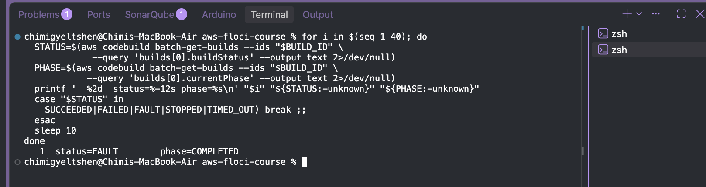


Step 13 - Read the build output and the logs¶
Per-phase timing and the log are the pair you use for every failed build.

```bash
aws codebuild batch-get-builds --ids "$BUILD_ID" \
  --query 'builds[0].phases[].{Phase:phaseType,Status:phaseStatus,Seconds:durationInSeconds}' \
  --output table

aws codebuild batch-get-builds --ids "$BUILD_ID" > "outputs/lab-11-build-$(date +%s).json"
```


Command - the log

```bash
LOG_GROUP=$(aws codebuild batch-get-builds --ids "$BUILD_ID" \
  --query 'builds[0].logs.groupName' --output text)
LOG_STREAM=$(aws codebuild batch-get-builds --ids "$BUILD_ID" \
  --query 'builds[0].logs.streamName' --output text)

echo "group=$LOG_GROUP stream=$LOG_STREAM"

aws logs get-log-events \
  --log-group-name "$LOG_GROUP" \
  --log-stream-name "$LOG_STREAM" \
  --limit 60 \
  --query 'events[].message' --output text
```


Command - read the artifact back

```bash
aws s3api list-objects-v2 --bucket usms-pipeline-artifacts --prefix build/ \
  --query 'Contents[].{Key:Key,Size:Size}' --output table
```
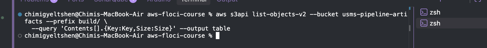

Step 14 - The local buildspec runner
```bash 
chmod +x scripts/utilities/usms-buildspec-run.sh
bash -n scripts/utilities/usms-buildspec-run.sh && echo "syntax OK"

./scripts/utilities/usms-buildspec-run.sh labs/lab-11-cicd/app
```


Verify

```bash 
cat labs/lab-11-cicd/app/dist/build-metadata.json
grep -n 'release:' labs/lab-11-cicd/app/dist/index.html
```


```bash 
grep -q '^labs/lab-11-cicd/app/dist/' .gitignore || \
  printf 'labs/lab-11-cicd/app/dist/\n' >> .gitignore

git check-ignore -v labs/lab-11-cicd/app/dist/build-metadata.json
```
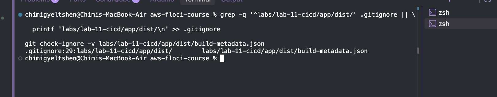

Step 15 - Create the CodePipeline service role and its policy

Command - part 1, the documents

```bash
for f in policies/trust-codepipeline.json policies/usms-codepipeline-policy.json; do
  python3 -m json.tool "$f" > /dev/null && echo "$f is valid JSON"
done
```


Command - part 2, create and attach

```bash
PIPELINE_ROLE="usms-codepipeline-role"
PIPELINE_POLICY="USMSCodePipelineBase"

aws iam create-role \
  --role-name "$PIPELINE_ROLE" \
  --assume-role-policy-document file://policies/trust-codepipeline.json \
  --description "Role assumed by CodePipeline when it runs usms-enrolment-pipeline" \
  --tags Key=Project,Value=USMS Key=Tier,Value=pipeline Key=Lab,Value=11 \
  --query 'Role.Arn' --output text

PIPELINE_POLICY_ARN=$(aws iam create-policy \
  --policy-name "$PIPELINE_POLICY" \
  --policy-document file://policies/usms-codepipeline-policy.json \
  --description "What the USMS pipeline may do: its artifact store, one build project, one PassRole" \
  --query 'Policy.Arn' --output text)

aws iam attach-role-policy --role-name "$PIPELINE_ROLE" --policy-arn "$PIPELINE_POLICY_ARN"

PIPELINE_ROLE_ARN=$(aws iam get-role --role-name "$PIPELINE_ROLE" --query 'Role.Arn' --output text)
echo "$PIPELINE_ROLE_ARN"
```
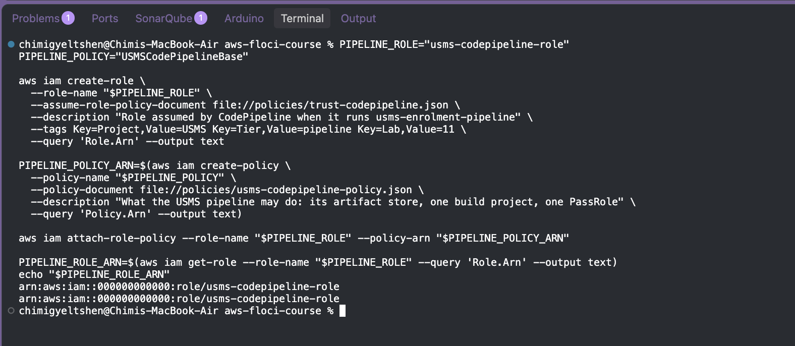

Verify

```bash
aws iam get-policy --policy-arn "$PIPELINE_POLICY_ARN" \
  --query 'Policy.{Name:PolicyName,Default:DefaultVersionId,Attached:AttachmentCount}' --output table
```
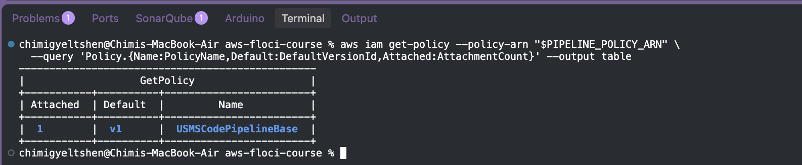

Step 16 - Write the pipeline definition

```bash

python3 -m json.tool templates/lab-11-pipeline.json > /dev/null && echo "pipeline template is valid JSON"
grep -c '\$' templates/lab-11-pipeline.json
```
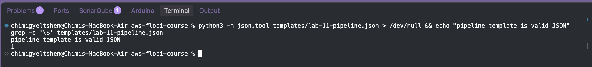


Step 17 - Create the pipeline¶
Turn the document into a pipeline and learn get-pipeline-state, the command you will use most.

```bash
aws codepipeline create-pipeline \
  --cli-input-json file://templates/lab-11-pipeline.json \
  --query 'pipeline.{Name:name,Role:roleArn,Stages:length(stages)}' \
  --output table
```
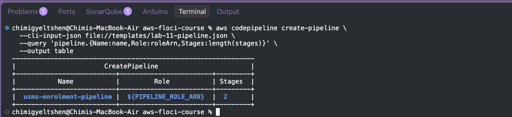

Verify

```bash
aws codepipeline get-pipeline-state --name usms-enrolment-pipeline \
  --query 'stageStates[].{Stage:stageName,Status:latestExecution.status,Action:actionStates[0].actionName,ActionStatus:actionStates[0].latestExecution.status}' \
  --output table
```
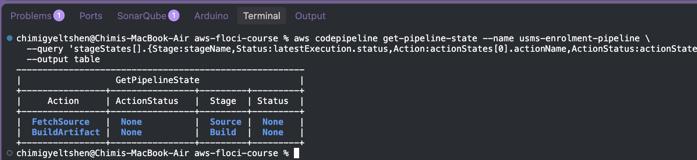


Step 18 - Hand the project to the pipeline¶

```bash 
aws codebuild update-project \
  --name usms-enrolment-build \
  --source type=CODEPIPELINE,buildspec=buildspec.yml \
  --artifacts type=CODEPIPELINE \
  --query 'project.{Source:source.type,Artifacts:artifacts.type}' \
  --output table
```


Verify - the escape hatch, and the cost

```bash
aws codebuild start-build --project-name usms-enrolment-build 2>&1 | head -3
```
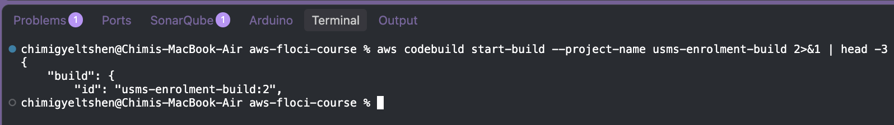

Step 19 - Run the pipeline end to end, and prove it consumed your source¶

```bash 
printf 'r4\n' > labs/lab-11-cicd/app/VERSION

./scripts/utilities/usms-pack-source.sh \
  labs/lab-11-cicd/app \
  outputs/usms-enrolment-src.zip

NEW_VERSION_ID=$(aws s3api put-object \
  --bucket usms-pipeline-artifacts \
  --key source/usms-enrolment-src.zip \
  --body outputs/usms-enrolment-src.zip \
  --query 'VersionId' --output text)

echo "uploaded source version: $NEW_VERSION_ID"

aws s3api list-object-versions --bucket usms-pipeline-artifacts \
  --prefix source/usms-enrolment-src.zip \
  --query 'Versions[].{Version:VersionId,Latest:IsLatest,Modified:LastModified}' \
  --output table
```
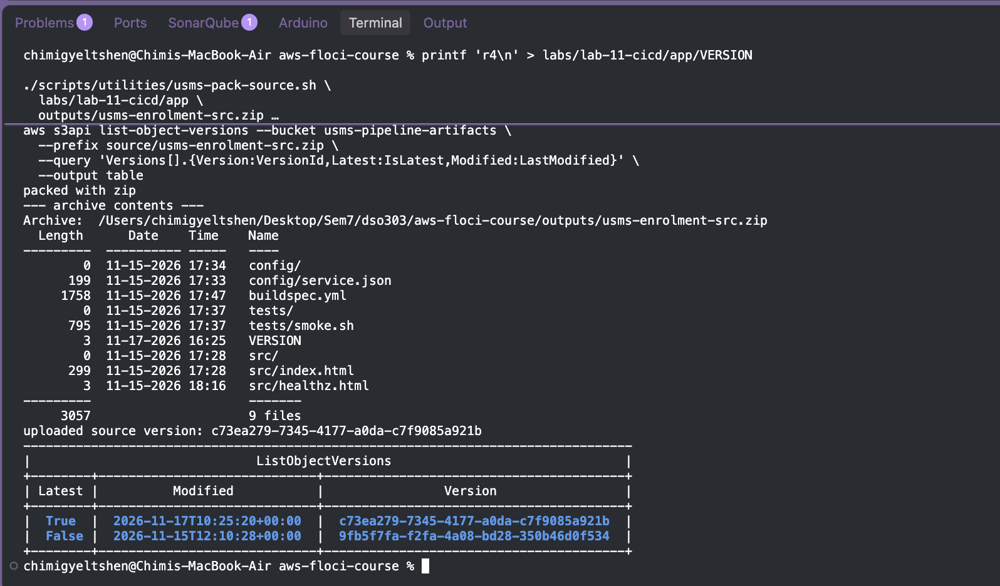

Command - part 2, run

```bash
EXEC_ID=$(aws codepipeline start-pipeline-execution \
  --name usms-enrolment-pipeline \
  --query 'pipelineExecutionId' --output text)

echo "execution: $EXEC_ID"

for i in $(seq 1 30); do
  aws codepipeline get-pipeline-state --name usms-enrolment-pipeline \
    --query 'stageStates[].[stageName,latestExecution.status]' --output text |
    sed 's/^/    /'
  STATE=$(aws codepipeline get-pipeline-execution \
            --pipeline-name usms-enrolment-pipeline \
            --pipeline-execution-id "$EXEC_ID" \
            --query 'pipelineExecution.status' --output text 2>/dev/null)
  printf '  %2d  execution=%s\n' "$i" "${STATE:-unknown}"
  case "$STATE" in
    Succeeded|Failed|Stopped|Superseded) break ;;
  esac
  sleep 10
done
```
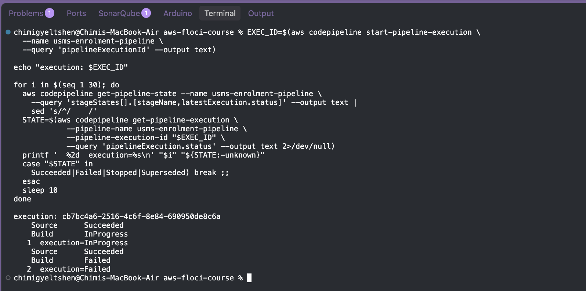


Command - part 3, read back

```bash
BUILD_ART_KEY=$(aws s3api list-objects-v2 \
  --bucket usms-pipeline-artifacts \
  --prefix usms-enrolment-pipeline/BuildOutput/ \
  --query 'sort_by(Contents, &LastModified)[-1].Key' --output text)

echo "newest build artifact: $BUILD_ART_KEY"

aws s3api get-object \
  --bucket usms-pipeline-artifacts \
  --key "$BUILD_ART_KEY" \
  outputs/lab-11-buildoutput.zip > /dev/null

python3 - << 'PY'
import json, zipfile
with zipfile.ZipFile("outputs/lab-11-buildoutput.zip") as z:
    names = sorted(z.namelist())
    print("artifact contents:")
    for n in names:
        print("   ", n)
    meta = json.loads(z.read("build-metadata.json"))
print("release  :", meta["release"])
print("builtAt  :", meta["builtAt"])
print("buildId  :", meta["buildId"])
print("srcVersion:", meta["sourceVersion"])
PY
```


Step 20 - Make the build fail on purpose, then fix it¶
Learn to read a failure you broke deliberately, where you already know the answer.

Command - part 1, break it

```bash
python3 - << 'PY'
import json
p = "labs/lab-11-cicd/app/config/service.json"
doc = json.load(open(p))
doc["container"] = "enrolment-api-v2"      # deliberately wrong
json.dump(doc, open(p, "w"), indent=2)
print("container is now:", doc["container"])
PY

./scripts/utilities/usms-pack-source.sh labs/lab-11-cicd/app outputs/usms-enrolment-src.zip >/dev/null
aws s3api put-object --bucket usms-pipeline-artifacts \
  --key source/usms-enrolment-src.zip --body outputs/usms-enrolment-src.zip \
  --query 'VersionId' --output text

BAD_EXEC=$(aws codepipeline start-pipeline-execution --name usms-enrolment-pipeline \
  --query 'pipelineExecutionId' --output text)
echo "execution: $BAD_EXEC"
```
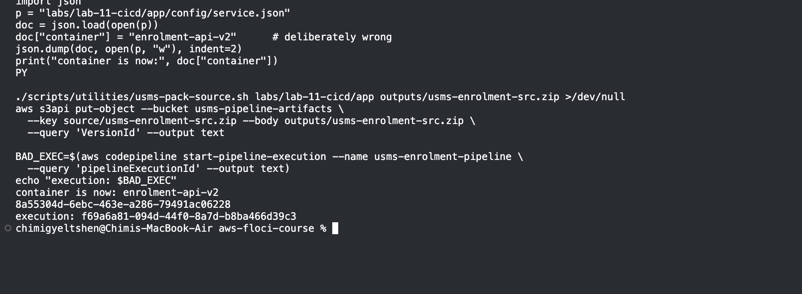

Command - part 2, diagnose it

```bash
sleep 20

aws codepipeline get-pipeline-state --name usms-enrolment-pipeline \
  --query 'stageStates[].{Stage:stageName,Status:latestExecution.status,Summary:actionStates[0].latestExecution.summary,Error:actionStates[0].latestExecution.errorDetails.message}' \
  --output json | tee outputs/lab-11-pipeline-state.json
```


Command - part 3, fix it
```bash 
python3 - << 'PY'
import json
p = "labs/lab-11-cicd/app/config/service.json"
doc = json.load(open(p))
doc["container"] = "enrolment-api"
json.dump(doc, open(p, "w"), indent=2)
print("container is now:", doc["container"])
PY

./scripts/utilities/usms-buildspec-run.sh labs/lab-11-cicd/app >/dev/null 2>&1 \
  && echo "local build passes again" || echo "local build STILL fails - fix it before repacking"

./scripts/utilities/usms-pack-source.sh labs/lab-11-cicd/app outputs/usms-enrolment-src.zip >/dev/null
aws s3api put-object --bucket usms-pipeline-artifacts \
  --key source/usms-enrolment-src.zip --body outputs/usms-enrolment-src.zip \
  --query 'VersionId' --output text

aws codepipeline start-pipeline-execution --name usms-enrolment-pipeline \
  --query 'pipelineExecutionId' --output text

```
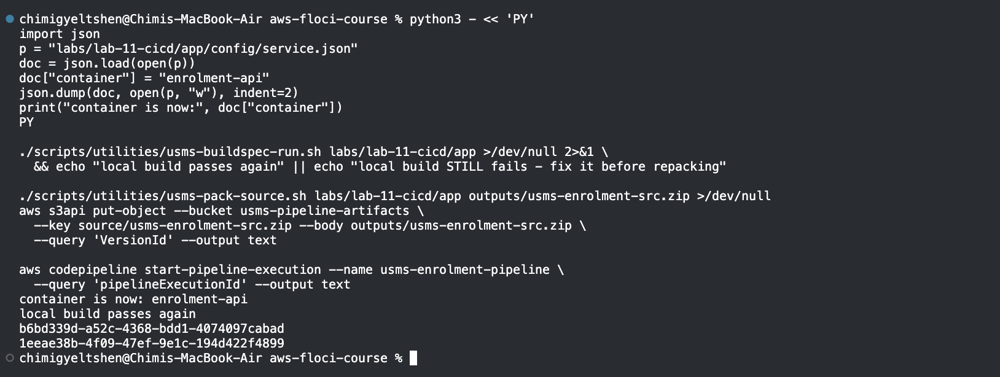


Step 21 - Record this lab's outputs, and commit¶

```bash 
grep -n 'export .*=$\|None' configs/lab-11.env || echo "all values populated"
grep -c '^export' configs/lab-11.env
```
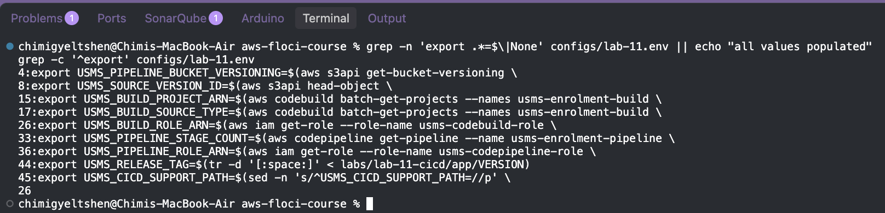


Verify

```bash
source configs/lab-11.env
printf 'bucket=%s versioning=%s project=%s stages=%s release=%s path=%s\n' \
  "$USMS_PIPELINE_BUCKET" "$USMS_PIPELINE_BUCKET_VERSIONING" \
  "$USMS_BUILD_PROJECT" "$USMS_PIPELINE_STAGE_COUNT" \
  "$USMS_RELEASE_TAG" "$USMS_CICD_SUPPORT_PATH"
```


Command - commit

```bash
git add labs/lab-11-cicd/app labs/lab-11-cicd
git add policies templates scripts/utilities scripts/cleanup outputs notes configs/lab-11.env 


