# Lab 12: Deploying to Amazon ECS from the Pipeline

> **Project:** USMS (University Student Management System) · **Emulator:** Floci · **Account:** `000000000000` · **Region:** `us-east-1`

Lab 11 ended with a pipeline that builds and tests an artifact but does not deploy it. In this lab you package the enrolment service as a **container image**, push it to **Amazon ECR**, and add a **Deploy stage** that updates the running ECS service. You do the deployment once by hand, then let the pipeline do it, and finally practise a rollback.

---

## Contents

1. [Architecture](#architecture)
2. [Learning Objectives](#learning-objectives)
3. [Prerequisites](#prerequisites)
4. [Resources Created and Changed](#resources-created-and-changed)
5. [Part A: Environment Setup](#part-a-environment-setup) (Steps 1–4)
6. [Part B: Container Registry and Image](#part-b-container-registry-and-image) (Steps 5–9)
7. [Part C: Manual Deployment](#part-c-manual-deployment) (Steps 10–11)
8. [Part D: Upgrade the Build](#part-d-upgrade-the-build) (Steps 12–14)
9. [Part E: Add the Deploy Stage](#part-e-add-the-deploy-stage) (Steps 15–17)
10. [Part F: Rollback and Blue/Green](#part-f-rollback-and-bluegreen) (Steps 18–19)
11. [Part G: Record and Commit](#part-g-record-and-commit) (Steps 20–21)
12. [Verification](#verification)
13. [Cleanup](#cleanup)
14. [Troubleshooting](#troubleshooting)

---

## Architecture

```
  VERSION bump ──pack──▶ s3://usms-pipeline-artifacts/source/usms-enrolment-src.zip
                                         │
          ┌──────────────────────── usms-enrolment-pipeline ────────────────────────┐
          │                                                                          │
          │  Stage 1: Source (S3)                                                    │
          │        │ SourceOutput                                                    │
          │        ▼                                                                 │
          │  Stage 2: Build (usms-enrolment-build, privileged)                       │
          │        ├── docker build + push ──▶ ECR usms-enrolment:<release>          │
          │        │ BuildOutput (dist/ incl. imagedefinitions.json)                 │
          │        ▼                                                                 │
          │  Stage 3: Deploy (ECS)                                                   │
          │        └── new task definition revision ──▶ usms-enrolment-svc           │
          └──────────────────────────────────────────────────────────────────────────┘
```

`imagedefinitions.json` connects Build to Deploy. It tells the ECS deploy action which container to update and which image to use:

```json
[ { "name": "enrolment-api", "imageUri": "<registry>/usms-enrolment:r7" } ]
```

---

## Learning Objectives

By the end of this lab you will be able to:

- Create a private ECR repository, authenticate Docker against it, and push an image
- Prove an image exists by reading it back from the registry by digest
- Register a new ECS task definition revision and deploy it by hand
- Use IAM policy **versions** to extend the CodeBuild and CodePipeline roles safely
- Extend a buildspec to build an image and write `imagedefinitions.json`
- Add an ECS Deploy stage to an existing pipeline and prove the service moved
- Roll back a failed deployment, and read a CodeDeploy blue/green configuration

---

## Prerequisites

Labs 04, 05 and 11 must pass verification, and Docker must be reachable.

```bash
cd ~/aws-floci-course
source configs/course.env

./scripts/utilities/floci-storage-check.sh
./scripts/utilities/verify-lab-04.sh
./scripts/utilities/verify-lab-05.sh
./scripts/utilities/verify-lab-11.sh
docker info >/dev/null 2>&1 && echo "docker reachable"
```

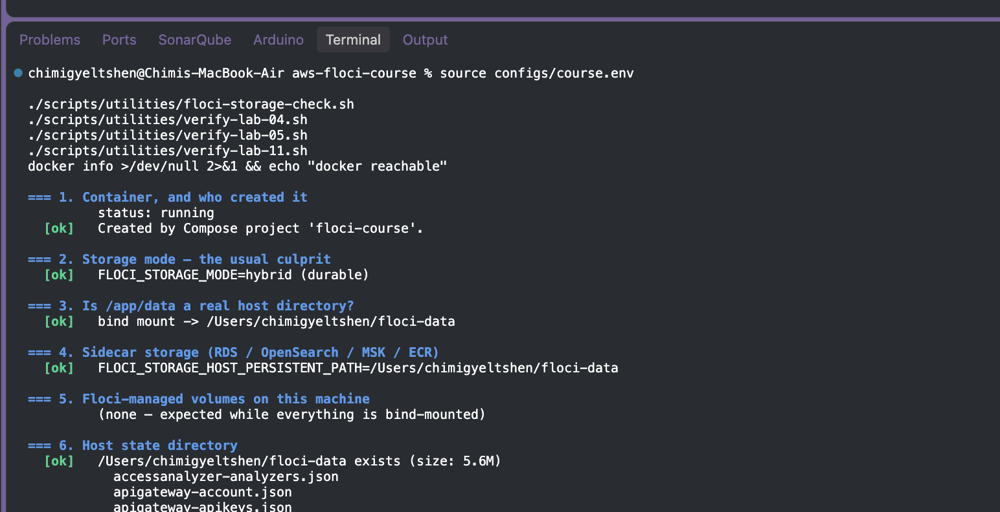

---

## Resources Created and Changed

| Type | Name | Action |
|---|---|---|
| ECR repository | `usms-enrolment` | Created (scan on push, AES256, mutable tags) |
| Container images | `usms-enrolment:r6`, `usms-enrolment:r7` | Pushed |
| ECS task definition | `usms-enrolment` revision 3 and later | Registered |
| ECS service | `usms-enrolment-svc` | Updated (by hand, then by the pipeline) |
| IAM policy | `USMSCodeBuildBase` | New default version **v2** (ECR push) |
| IAM policy | `USMSCodePipelineBase` | New default version **v2** (ECS deploy) |
| CodeBuild project | `usms-enrolment-build` | Privileged mode, `IMAGE_REPO_URI` variable |
| CodePipeline | `usms-enrolment-pipeline` | **Deploy** stage added (3 stages) |
| `docker-compose.yml` | ECR ports `5100-5104` | Published |

---

## Part A: Environment Setup

### Step 1: Start Floci and read what Lab 11 left you

Read Lab 11's inventory instead of assuming what it contains.

```bash
cd ~/aws-floci-course
./scripts/setup/floci-up.sh
./scripts/utilities/floci-storage-check.sh
./scripts/utilities/whoami.sh

if [ -f outputs/lab-11-lab08b-readiness.txt ]; then
  echo "--- Lab 11 readiness file ---"
  cat outputs/lab-11-lab08b-readiness.txt
else
  echo "no readiness file - you did not do Lab 11 Exercise 5."
  echo "That is fine: Step 14 of this lab writes imagedefinitions.json in full."
fi
```

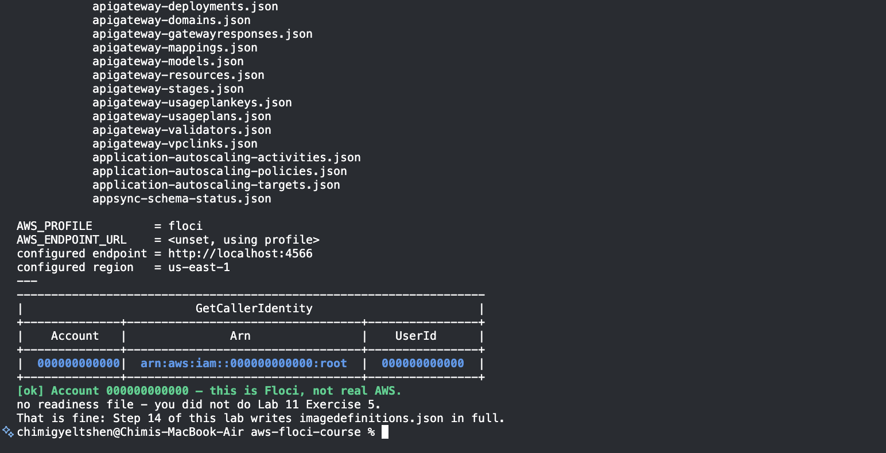

### Step 2: Source every earlier lab's environment

This lab reads values from Labs 01, 04, 05 and 11. It also writes a file that the CloudFormation lab reads later.

```bash
source configs/course.env

for f in configs/lab-01.env configs/lab-02.env configs/lab-03.env \
         configs/lab-04.env configs/lab-05.env configs/lab-06.env \
         configs/lab-09.env configs/lab-07.env configs/lab-08.env \
         configs/lab-10.env configs/lab-11.env; do
  if [ -f "$f" ]; then
    source "$f"
    printf '  sourced  %s\n' "$f"
  else
    printf '  absent   %s\n' "$f"
  fi
done

printf 'cluster=%s service=%s container=%s pipeline=%s project=%s exec-role=%s\n' \
  "${USMS_ECS_CLUSTER:-MISSING}" "${USMS_ENROLMENT_SERVICE:-MISSING}" \
  "${USMS_ENROLMENT_CONTAINER:-MISSING}" "${USMS_PIPELINE_NAME:-MISSING}" \
  "${USMS_BUILD_PROJECT:-MISSING}" "${USMS_ECS_EXEC_ROLE_ARN:-MISSING}"
```

!!! check "Expected result"
    None of the six values prints `MISSING`.

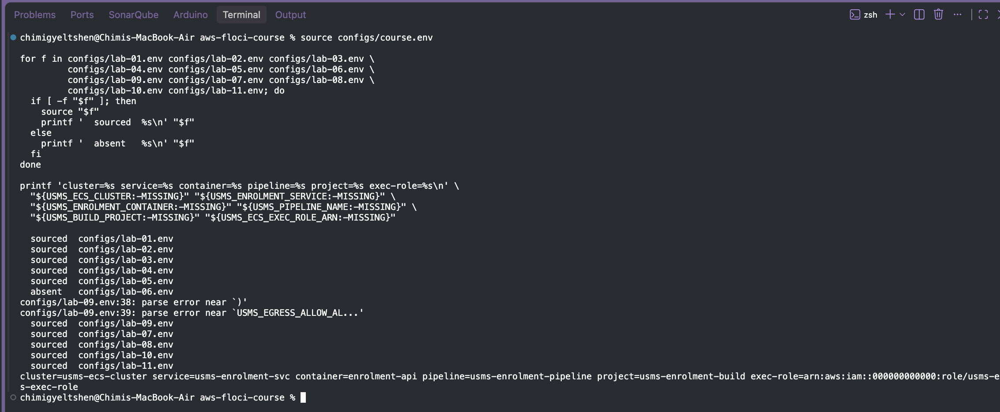

### Step 3: Probe the deployment surface

The probe reports which of Path A, B or C your emulator supports for ECR, image builds and the ECS deploy action. Write the result down, because it decides which verification failures are expected later.

```bash
chmod +x scripts/utilities/deploy-support-probe.sh
bash -n scripts/utilities/deploy-support-probe.sh && echo "syntax OK"
./scripts/utilities/deploy-support-probe.sh
```


### Step 4: Publish the ECR port range

Floci serves ECR registries on ports `5100-5104`. Docker can only push to them if `docker-compose.yml` publishes that range.

**Check the current state.** If the line starts with `#`, the ports are not published yet.

```bash
cd ~/aws-floci-course

grep -n '5100-5104' docker-compose.yml
```


**Back up the file, uncomment the port line, and check again**

```bash
cp docker-compose.yml "docker-compose.yml.bak-$(date +%Y%m%d%H%M%S)"

sed -i.tmp -E 's/^([[:space:]]*)#[[:space:]]*(- *"?5100-5104)/\1\2/' docker-compose.yml
rm -f docker-compose.yml.tmp

grep -n '5100-5104' docker-compose.yml
```

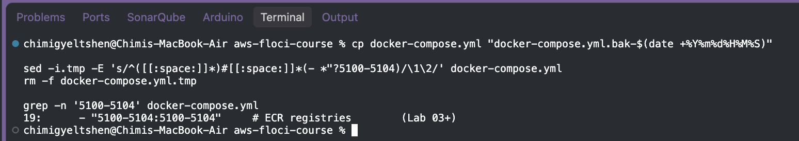

**Verify:** restart Floci and confirm the ports are mapped.

```bash
./scripts/setup/floci-up.sh
docker port floci
```

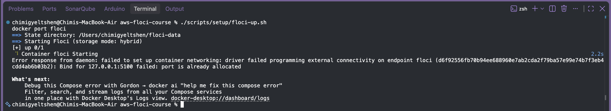

---

## Part B: Container Registry and Image

### Step 5: Create the ECR repository

```bash
ECR_REPO="usms-enrolment"

aws ecr create-repository \
  --repository-name "$ECR_REPO" \
  --image-tag-mutability MUTABLE \
  --image-scanning-configuration scanOnPush=true \
  --encryption-configuration encryptionType=AES256 \
  --tags Key=Project,Value=USMS Key=Tier,Value=app Key=Lab,Value=12 \
  --query 'repository.{Name:repositoryName,Uri:repositoryUri,Mutability:imageTagMutability}' \
  --output table
```

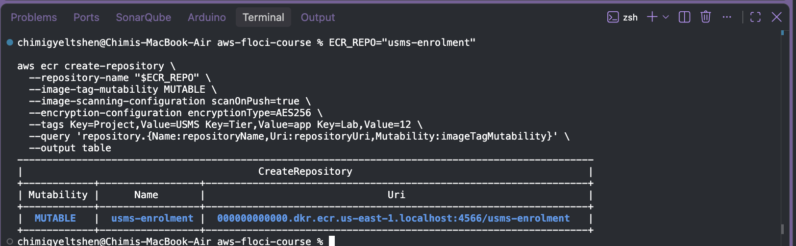

**Verify:** capture the repository URI and the registry host. Later steps use both.

```bash
ECR_URI=$(aws ecr describe-repositories --repository-names "$ECR_REPO" \
  --query 'repositories[0].repositoryUri' --output text)
ECR_REGISTRY="${ECR_URI%%/*}"

printf 'repository uri : %s\nregistry host  : %s\n' "$ECR_URI" "$ECR_REGISTRY"
```

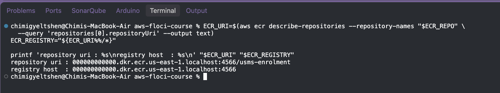

### Step 6: Authenticate Docker against the registry

```bash
aws ecr get-login-password --region "$AWS_REGION_COURSE" \
  | docker login --username AWS --password-stdin "$ECR_REGISTRY"
```

!!! check "Expected result"
    `Login Succeeded`

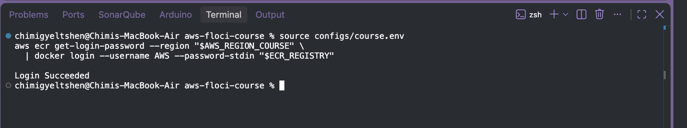

### Step 7: Review the Dockerfile

The Dockerfile and `.dockerignore` are in `labs/lab-11-cicd/app/`. Read the Dockerfile before you build from it.

```bash
echo "--- Dockerfile ---"; cat labs/lab-11-cicd/app/Dockerfile
```

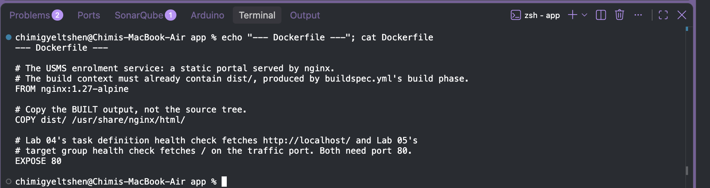

**Make sure the build input exists.** The image copies `dist/`, so rebuild it if it is missing.

```bash
cd ~/aws-floci-course
ls -l labs/lab-11-cicd/app/Dockerfile labs/lab-11-cicd/app/.dockerignore

if test -d labs/lab-11-cicd/app/dist; then
  echo "dist/ present - Step 8 can build"
else
  ./scripts/utilities/usms-buildspec-run.sh labs/lab-11-cicd/app >/dev/null \
    && echo "dist/ rebuilt by the local runner"
fi
```

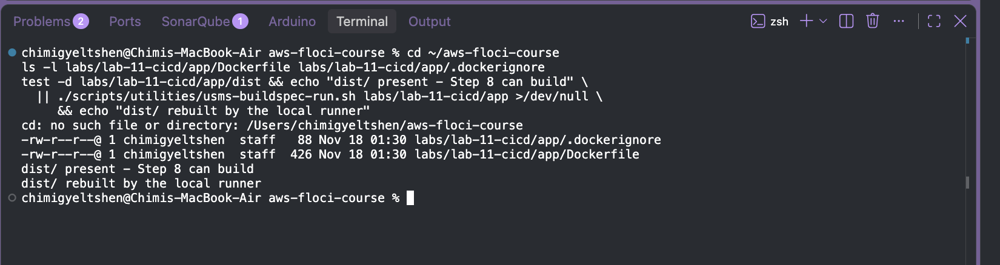

### Step 8: Build the image and push it by hand

**Part 1: set the release and rebuild the output**

```bash
cd ~/aws-floci-course

printf 'r6\n' > labs/lab-11-cicd/app/VERSION
./scripts/utilities/usms-buildspec-run.sh labs/lab-11-cicd/app | tail -12

IMAGE_TAG=$(tr -d '[:space:]' < labs/lab-11-cicd/app/VERSION)
echo "image tag will be: $IMAGE_TAG"
```


**Part 2: build, tag and push**

```bash
cd labs/lab-11-cicd/app

docker build -t "usms-enrolment:$IMAGE_TAG" .

docker tag "usms-enrolment:$IMAGE_TAG" "$ECR_URI:$IMAGE_TAG"

docker push "$ECR_URI:$IMAGE_TAG"

cd ~/aws-floci-course
```


### Step 9: Prove the image is in the registry

A successful push is only the Docker client's own report. The evidence is reading the image back from the registry.

```bash
aws ecr describe-images \
  --repository-name usms-enrolment \
  --query 'imageDetails[].{Tags:imageTags,Digest:imageDigest,SizeMB:imageSizeInBytes,Pushed:imagePushedAt}' \
  --output table

IMAGE_DIGEST=$(aws ecr describe-images \
  --repository-name usms-enrolment \
  --image-ids "imageTag=$IMAGE_TAG" \
  --query 'imageDetails[0].imageDigest' --output text)

printf '%s %s %s\n' "$IMAGE_TAG" "$IMAGE_DIGEST" "$(date -u +%Y-%m-%dT%H:%M:%SZ)" \
  | tee -a outputs/lab-12-image-digest.txt
```

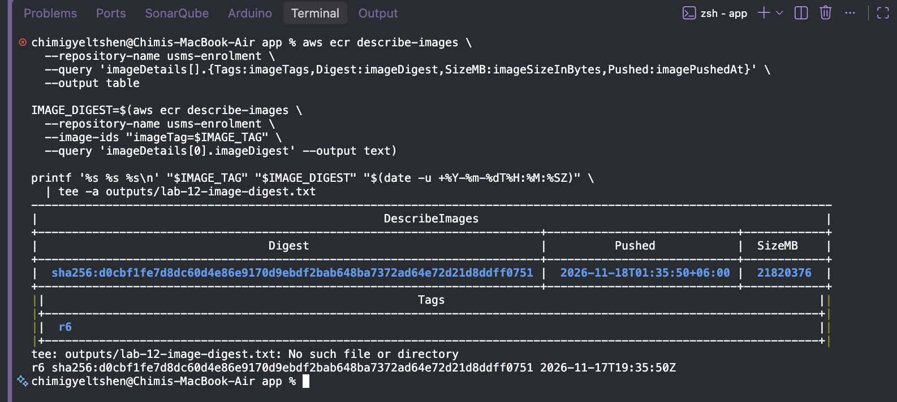

**Verify (create, remove, read back):** delete every local copy, then pull the image back by its digest.

```bash
docker rmi "$ECR_URI:$IMAGE_TAG" "usms-enrolment:$IMAGE_TAG" 2>/dev/null || true
docker images | grep -c usms-enrolment || echo "no local copy remains"

docker pull "$ECR_URI@$IMAGE_DIGEST"
docker images --digests | grep usms-enrolment | head -3
```

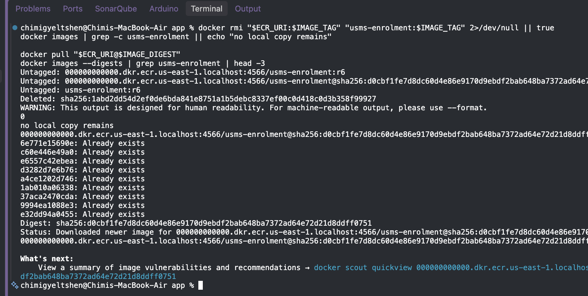

---

## Part C: Manual Deployment

### Step 10: Register a task definition revision that names your image

**Generate the new revision from the current one.** The script removes the read-only fields and changes only the `enrolment-api` image.

```bash
cd ~/aws-floci-course

aws ecs describe-task-definition \
  --task-definition usms-enrolment \
  --query 'taskDefinition' --output json > templates/lab-12-taskdef-base.json

python3 - "$ECR_URI:$IMAGE_TAG" << 'PY'
import json, sys

new_image = sys.argv[1]
READ_ONLY = ("taskDefinitionArn", "revision", "status", "requiresAttributes",
             "compatibilities", "registeredAt", "registeredBy", "deregisteredAt")

td = json.load(open("templates/lab-12-taskdef-base.json"))
for field in READ_ONLY:
    td.pop(field, None)

found = False
for c in td["containerDefinitions"]:
    if c["name"] == "enrolment-api":
        print("old image:", c["image"])
        c["image"] = new_image
        print("new image:", c["image"])
        found = True
if not found:
    sys.exit("no container named enrolment-api in this task definition - stop and check Lab 04")

json.dump(td, open("templates/lab-12-taskdef-v3.json", "w"), indent=2)
print("wrote templates/lab-12-taskdef-v3.json")
PY

python3 -m json.tool templates/lab-12-taskdef-v3.json > /dev/null && echo "valid JSON"
grep -c '\$' templates/lab-12-taskdef-v3.json
```

!!! check "Expected result"
    The old image is `nginx`, the new one is the ECR URI, the file is valid JSON, and `grep` prints `0`.

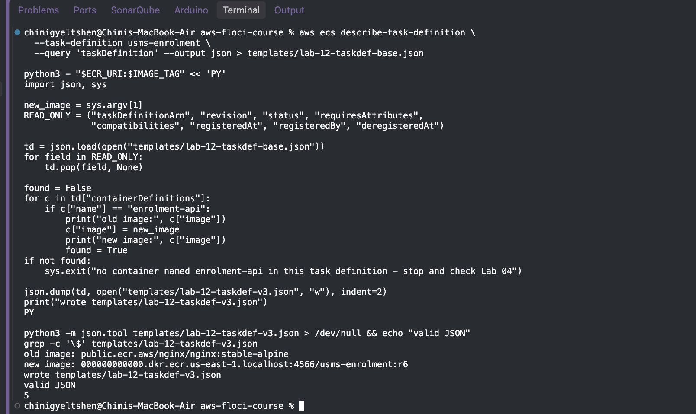

**Register it**

```bash
TASK_DEF_ARN=$(aws ecs register-task-definition \
  --cli-input-json file://templates/lab-12-taskdef-v3.json \
  --query 'taskDefinition.taskDefinitionArn' --output text)

echo "$TASK_DEF_ARN"
```


**Verify:** only the image should change. CPU, memory and the health check stay as they were.

```bash
aws ecs describe-task-definition --task-definition usms-enrolment \
  --query 'taskDefinition.{Family:family,Revision:revision,Cpu:cpu,Memory:memory,Image:containerDefinitions[0].image,Health:containerDefinitions[0].healthCheck.command}' \
  --output json
```


### Step 11: Deploy revision 3 by hand and watch it

Deploy manually once so you recognise what the pipeline does later. From this point on, the service runs your application instead of the placeholder.

**Part 1: a reusable watcher script**

```bash
cat > scripts/utilities/usms-ecs-watch.sh << 'EOF'
#!/usr/bin/env bash
# Poll an ECS service's deployments until they settle, or until the attempts run out.
# Usage: usms-ecs-watch.sh [cluster] [service] [iterations]
set -uo pipefail

REPO_ROOT="$(cd "$(dirname "${BASH_SOURCE[0]}")/../.." && pwd)"
cd "$REPO_ROOT"
# shellcheck disable=SC1091
source "$REPO_ROOT/configs/course.env"
# shellcheck disable=SC1091
[ -f configs/lab-04.env ] && source configs/lab-04.env

CLUSTER="${1:-${USMS_ECS_CLUSTER:-usms-ecs-cluster}}"
SERVICE="${2:-${USMS_ENROLMENT_SERVICE:-usms-enrolment-svc}}"
ITER="${3:-20}"

for i in $(seq 1 "$ITER"); do
  printf '\n--- poll %s/%s ---\n' "$i" "$ITER"
  aws ecs describe-services --cluster "$CLUSTER" --services "$SERVICE" \
    --query 'services[0].deployments[].{Status:status,TaskDef:taskDefinition,Desired:desiredCount,Running:runningCount,Pending:pendingCount,Rollout:rolloutState}' \
    --output table 2>/dev/null || echo "  describe-services failed"
  COUNT=$(aws ecs describe-services --cluster "$CLUSTER" --services "$SERVICE" \
            --query 'length(services[0].deployments)' --output text 2>/dev/null)
  PRIMARY_RUN=$(aws ecs describe-services --cluster "$CLUSTER" --services "$SERVICE" \
            --query 'services[0].deployments[?status==`PRIMARY`].runningCount | [0]' --output text 2>/dev/null)
  DESIRED=$(aws ecs describe-services --cluster "$CLUSTER" --services "$SERVICE" \
            --query 'services[0].desiredCount' --output text 2>/dev/null)
  if [ "${COUNT:-0}" = "1" ] && [ "${PRIMARY_RUN:-0}" = "${DESIRED:-x}" ]; then
    echo "  settled: one deployment, running == desired"
    exit 0
  fi
  sleep 10
done
echo "  did not settle within $ITER polls - read the table above, not this message"
exit 1
EOF

chmod +x scripts/utilities/usms-ecs-watch.sh
bash -n scripts/utilities/usms-ecs-watch.sh && echo "syntax OK"
```

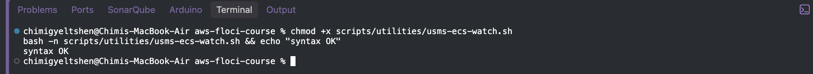

!!! note "Why a polling loop?"
    On this emulator, `aws ecs wait services-stable` can run out of attempts without reporting it (see Lab 04). The watcher prints the deployment table on every poll. It exits `0` once there is a single deployment whose running count equals the desired count.

**Part 2: deploy**

```bash
aws ecs update-service \
  --cluster "$USMS_ECS_CLUSTER" \
  --service "$USMS_ENROLMENT_SERVICE" \
  --task-definition usms-enrolment:3 \
  --query 'service.{Name:serviceName,TaskDef:taskDefinition,Desired:desiredCount}' \
  --output table

./scripts/utilities/usms-ecs-watch.sh || echo "did not settle - see the Floci note below"
```

!!! warning "Floci limitation"
    If Floci does not run real tasks, the watcher may not report a settled deployment. The service's `taskDefinition` changing to revision 3 is still the evidence that the update was accepted.

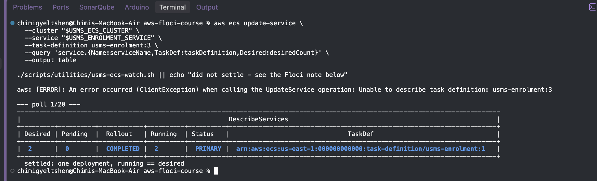

---

## Part D: Upgrade the Build

### Step 12: Create version 2 of `USMSCodeBuildBase`

The build now has to push images, so it needs ECR permissions. Creating a **new policy version** keeps v1 available for rollback and leaves the role attachment unchanged.

| Sid | Change from v1 | Scope |
|---|---|---|
| `WriteItsOwnBuildLogs` | Unchanged | Build log group only |
| `ReadSourceAndWriteArtifacts` | Unchanged | Artifact bucket only |
| `GetARegistryTokenWhichCannotBeScoped` | **New** | `*` (AWS does not allow this action to be scoped) |
| `PushAndPullTheEnrolmentImageOnly` | **New** | `repository/usms-enrolment` only |
| `BuildsDoNotTouchStudentRecords` | Unchanged | Explicit deny on student data |

```bash
cat > policies/usms-codebuild-policy-v2.json << 'EOF'
{
  "Version": "2012-10-17",
  "Statement": [
    {
      "Sid": "WriteItsOwnBuildLogs",
      "Effect": "Allow",
      "Action": [
        "logs:CreateLogGroup",
        "logs:CreateLogStream",
        "logs:PutLogEvents"
      ],
      "Resource": [
        "arn:aws:logs:us-east-1:000000000000:log-group:/aws/codebuild/usms-enrolment-build",
        "arn:aws:logs:us-east-1:000000000000:log-group:/aws/codebuild/usms-enrolment-build:*"
      ]
    },
    {
      "Sid": "ReadSourceAndWriteArtifacts",
      "Effect": "Allow",
      "Action": [
        "s3:GetObject",
        "s3:GetObjectVersion",
        "s3:PutObject",
        "s3:GetBucketAcl",
        "s3:GetBucketLocation"
      ],
      "Resource": [
        "arn:aws:s3:::usms-pipeline-artifacts",
        "arn:aws:s3:::usms-pipeline-artifacts/*"
      ]
    },
    {
      "Sid": "GetARegistryTokenWhichCannotBeScoped",
      "Effect": "Allow",
      "Action": "ecr:GetAuthorizationToken",
      "Resource": "*"
    },
    {
      "Sid": "PushAndPullTheEnrolmentImageOnly",
      "Effect": "Allow",
      "Action": [
        "ecr:BatchCheckLayerAvailability",
        "ecr:InitiateLayerUpload",
        "ecr:UploadLayerPart",
        "ecr:CompleteLayerUpload",
        "ecr:PutImage",
        "ecr:BatchGetImage",
        "ecr:GetDownloadUrlForLayer",
        "ecr:DescribeImages"
      ],
      "Resource": "arn:aws:ecr:us-east-1:000000000000:repository/usms-enrolment"
    },
    {
      "Sid": "BuildsDoNotTouchStudentRecords",
      "Effect": "Deny",
      "Action": "s3:*",
      "Resource": [
        "arn:aws:s3:::usms-student-data",
        "arn:aws:s3:::usms-student-data/*"
      ]
    }
  ]
}
EOF

python3 -m json.tool policies/usms-codebuild-policy-v2.json > /dev/null && echo "valid JSON"

aws iam create-policy-version \
  --policy-arn arn:aws:iam::000000000000:policy/USMSCodeBuildBase \
  --policy-document file://policies/usms-codebuild-policy-v2.json \
  --set-as-default \
  --query 'PolicyVersion.{Version:VersionId,Default:IsDefaultVersion}' \
  --output table
```


**Verify**

```bash
aws iam get-policy --policy-arn arn:aws:iam::000000000000:policy/USMSCodeBuildBase \
  --query 'Policy.{Name:PolicyName,Default:DefaultVersionId,Versions:AttachmentCount}' --output table

aws iam list-policy-versions --policy-arn arn:aws:iam::000000000000:policy/USMSCodeBuildBase \
  --query 'Versions[].{Version:VersionId,Default:IsDefaultVersion,Created:CreateDate}' --output table
```

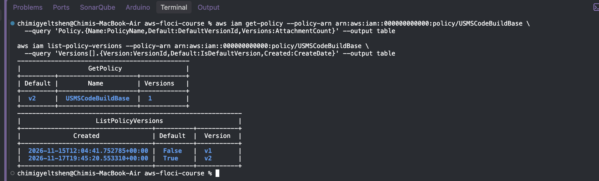

### Step 13: Let the build run Docker

`templates/lab-12-codebuild-update.json` turns on `privilegedMode`, which a build needs to run the Docker daemon. It also adds the `IMAGE_REPO_URI` environment variable. Change only the `environment` block, so the source type stays `CODEPIPELINE`.

```bash
python3 -m json.tool templates/lab-12-codebuild-update.json > /dev/null && echo "valid JSON"
grep -c '\$' templates/lab-12-codebuild-update.json

aws codebuild update-project \
  --cli-input-json file://templates/lab-12-codebuild-update.json \
  --query 'project.environment.{Privileged:privilegedMode,Vars:environmentVariables[].name}' \
  --output json
```

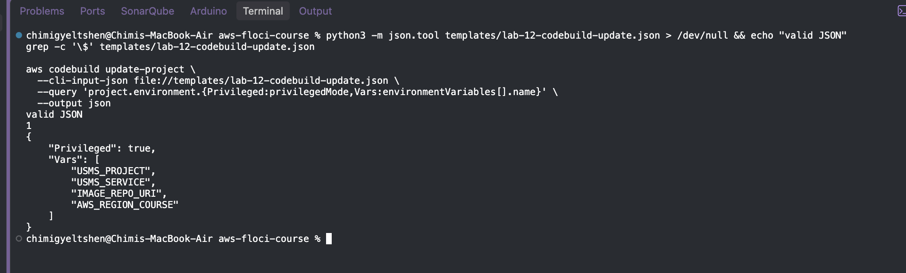

**Verify:** the source type must still be `CODEPIPELINE`.

```bash
aws codebuild batch-get-projects --names usms-enrolment-build \
  --query 'projects[0].{Source:source.type,Role:serviceRole,Privileged:environment.privilegedMode,Repo:environment.environmentVariables[?name==`IMAGE_REPO_URI`].value|[0]}' \
  --output table
```

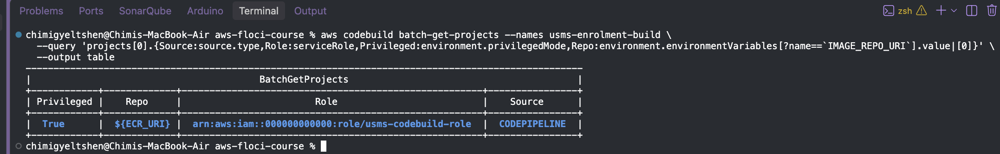

### Step 14: Extend the buildspec to build the image and write `imagedefinitions.json`

**Part 1: the new buildspec.** The Lab 11 version is kept as `buildspec.yml.lab08a`.

| Phase | New behaviour |
|---|---|
| `install` | Reports whether a Docker client is available |
| `pre_build` | Logs in to ECR if a Docker daemon is reachable |
| `build` | Builds and pushes `${IMAGE_REPO_URI}:<release>`, then writes `imagedefinitions.json` |
| `post_build` | Runs the smoke tests and prints `imagedefinitions.json` |

The buildspec still works without Docker. In that case it skips the image build, and the image for that release tag must already exist in ECR.

```bash
cd ~/aws-floci-course/labs/lab-11-cicd/app

cp buildspec.yml buildspec.yml.lab08a

cat > buildspec.yml << 'BUILDSPEC'
version: 0.2

env:
  variables:
    SERVICE_NAME: "enrolment"
    ARTIFACT_DIR: "dist"
    IMAGE_REPO_URI: "nginx"

phases:

  install:
    commands:
      - echo "--- install ---"
      - python3 --version
      - docker --version || echo "no docker client in this build image"

  pre_build:
    commands:
      - echo "--- pre_build ---"
      - test -f VERSION || { echo "VERSION file is missing"; exit 1; }
      - python3 -m json.tool config/service.json > /dev/null
      - |
        grep -q '"container": "enrolment-api"' config/service.json || {
          echo "config/service.json names the wrong container"
          exit 1
        }
      - USMS_RELEASE="$(tr -d '[:space:]' < VERSION)"
      - echo "release is $USMS_RELEASE"
      - |
        if docker info >/dev/null 2>&1; then
          echo "docker daemon reachable - this build will build and push an image"
          aws ecr get-login-password --region "${AWS_REGION_COURSE:-us-east-1}" \
            | docker login --username AWS --password-stdin "${IMAGE_REPO_URI%%/*}" \
            || echo "docker login failed - continuing; the image must already exist"
        else
          echo "no docker daemon in this build container - skipping the image build"
          echo "the image must already exist at ${IMAGE_REPO_URI} with this release tag"
        fi

  build:
    commands:
      - echo "--- build ---"
      - USMS_RELEASE="$(tr -d '[:space:]' < VERSION)"
      - BUILT_AT="$(date -u +%Y-%m-%dT%H:%M:%SZ)"
      - echo "release=$USMS_RELEASE builtAt=$BUILT_AT"
      - rm -rf "$ARTIFACT_DIR"
      - mkdir -p "$ARTIFACT_DIR"
      - cp -R src/. "$ARTIFACT_DIR"/
      - sed -i.bak -e "s|__RELEASE__|$USMS_RELEASE|g" -e "s|__BUILT_AT__|$BUILT_AT|g" "$ARTIFACT_DIR/index.html"
      - rm -f "$ARTIFACT_DIR/index.html.bak"
      - |
        cat > "$ARTIFACT_DIR/build-metadata.json" << META
        {
          "service": "$SERVICE_NAME",
          "release": "$USMS_RELEASE",
          "builtAt": "$BUILT_AT",
          "buildId": "${CODEBUILD_BUILD_ID:-local}",
          "sourceVersion": "${CODEBUILD_RESOLVED_SOURCE_VERSION:-local}",
          "imageUri": "${IMAGE_REPO_URI}:$USMS_RELEASE"
        }
        META
      - cp config/service.json "$ARTIFACT_DIR/service.json"
      - |
        if docker info >/dev/null 2>&1; then
          docker build -t "${IMAGE_REPO_URI}:$USMS_RELEASE" .
          docker push "${IMAGE_REPO_URI}:$USMS_RELEASE" \
            || echo "push failed - see Section 10; the deploy stage will use the existing tag"
        fi
      - |
        IMAGE_URI="${IMAGE_REPO_URI}:$USMS_RELEASE" python3 - > "$ARTIFACT_DIR/imagedefinitions.json" << 'IMGDEF'
        import json, os
        cfg = json.load(open("config/service.json"))
        print(json.dumps([{"name": cfg["container"],
                           "imageUri": os.environ["IMAGE_URI"]}], indent=2))
        IMGDEF

  post_build:
    commands:
      - echo "--- post_build ---"
      - bash tests/smoke.sh
      - cat "$ARTIFACT_DIR/imagedefinitions.json"
      - ls -l "$ARTIFACT_DIR"

artifacts:
  base-directory: dist
  files:
    - '**/*'

cache:
  paths: []
BUILDSPEC

echo "buildspec rewritten; the Lab 11 version is kept at buildspec.yml.lab08a"
```


**Part 2: add an eighth smoke test.** It checks that `imagedefinitions.json` is a one-element array that names `enrolment-api`. The script does nothing if the test is already there.

```bash
python3 - << 'PY'
path = "tests/smoke.sh"
src = open(path).read()
if "imagedefinitions" in src:
    print("already present - nothing to do")
else:
    marker = 't "container name matches the task def"'
    line = ('t "imagedefinitions.json is a one-element array" '
            '"python3 -c \\"import json,sys; d=json.load(open(\'dist/imagedefinitions.json\')); '
            'sys.exit(0 if isinstance(d,list) and len(d)==1 and d[0][\'name\']==\'enrolment-api\' else 1)\\""\n')
    i = src.index(marker)
    j = src.index("\n", i) + 1
    open(path, "w").write(src[:j] + line + src[j:])
    print("added the eighth assertion")
PY

bash -n tests/smoke.sh && echo "smoke.sh syntax OK"
```

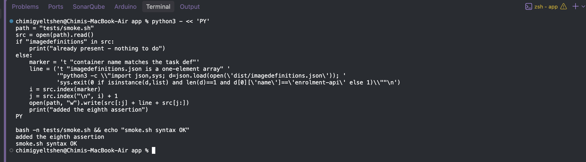

**Verify:** run the new buildspec locally before you ship it.

```bash
cd ~/aws-floci-course

IMAGE_REPO_URI="$ECR_URI" ./scripts/utilities/usms-buildspec-run.sh labs/lab-11-cicd/app | tail -25
```


**Part 3: ship it.** Upload the new source. The pipeline is not started until Step 17.

```bash
./scripts/utilities/usms-pack-source.sh labs/lab-11-cicd/app outputs/usms-enrolment-src.zip | tail -3

aws s3api put-object \
  --bucket usms-pipeline-artifacts \
  --key source/usms-enrolment-src.zip \
  --body outputs/usms-enrolment-src.zip \
  --query 'VersionId' --output text
```


---

## Part E: Add the Deploy Stage

### Step 15: Create version 2 of `USMSCodePipelineBase`

To deploy, the pipeline has to update the service, register task definitions, and pass the two ECS roles to ECS. Every new permission is scoped as narrowly as AWS allows.

| Sid | Change from v1 | Scope |
|---|---|---|
| `ReadAndWriteTheArtifactStore` | Unchanged | Artifact bucket only |
| `StartAndWatchTheEnrolmentBuildOnly` | Unchanged | One build project |
| `PassTheBuildRoleAndOnlyToCodeBuild` | Unchanged | Build role, only to `codebuild.amazonaws.com` |
| `DeployToTheEnrolmentServiceOnly` | **New** | One ECS service |
| `ReadAndRegisterTaskDefinitions` | **New** | `*` (these actions cannot be scoped to a resource) |
| `PassTheTwoEcsRolesAndOnlyToEcsTasks` | **New** | Exec and task roles, only to `ecs-tasks.amazonaws.com` |

```bash
cd ~/aws-floci-course

cat > policies/usms-codepipeline-policy-v2.json << 'EOF'
{
  "Version": "2012-10-17",
  "Statement": [
    {
      "Sid": "ReadAndWriteTheArtifactStore",
      "Effect": "Allow",
      "Action": [
        "s3:GetObject",
        "s3:GetObjectVersion",
        "s3:PutObject",
        "s3:GetBucketVersioning",
        "s3:GetBucketLocation"
      ],
      "Resource": [
        "arn:aws:s3:::usms-pipeline-artifacts",
        "arn:aws:s3:::usms-pipeline-artifacts/*"
      ]
    },
    {
      "Sid": "StartAndWatchTheEnrolmentBuildOnly",
      "Effect": "Allow",
      "Action": [
        "codebuild:StartBuild",
        "codebuild:BatchGetBuilds",
        "codebuild:StopBuild"
      ],
      "Resource": "arn:aws:codebuild:us-east-1:000000000000:project/usms-enrolment-build"
    },
    {
      "Sid": "PassTheBuildRoleAndOnlyToCodeBuild",
      "Effect": "Allow",
      "Action": "iam:PassRole",
      "Resource": "arn:aws:iam::000000000000:role/usms-codebuild-role",
      "Condition": {
        "StringEquals": { "iam:PassedToService": "codebuild.amazonaws.com" }
      }
    },
    {
      "Sid": "DeployToTheEnrolmentServiceOnly",
      "Effect": "Allow",
      "Action": [
        "ecs:DescribeServices",
        "ecs:UpdateService"
      ],
      "Resource": "arn:aws:ecs:us-east-1:000000000000:service/usms-ecs-cluster/usms-enrolment-svc"
    },
    {
      "Sid": "ReadAndRegisterTaskDefinitions",
      "Effect": "Allow",
      "Action": [
        "ecs:DescribeTaskDefinition",
        "ecs:RegisterTaskDefinition",
        "ecs:ListTaskDefinitions"
      ],
      "Resource": "*"
    },
    {
      "Sid": "PassTheTwoEcsRolesAndOnlyToEcsTasks",
      "Effect": "Allow",
      "Action": "iam:PassRole",
      "Resource": [
        "arn:aws:iam::000000000000:role/usms-ecs-exec-role",
        "arn:aws:iam::000000000000:role/usms-ecs-task-role"
      ],
      "Condition": {
        "StringEquals": { "iam:PassedToService": "ecs-tasks.amazonaws.com" }
      }
    }
  ]
}
EOF

python3 -m json.tool policies/usms-codepipeline-policy-v2.json > /dev/null && echo "valid JSON"

aws iam create-policy-version \
  --policy-arn arn:aws:iam::000000000000:policy/USMSCodePipelineBase \
  --policy-document file://policies/usms-codepipeline-policy-v2.json \
  --set-as-default \
  --query 'PolicyVersion.{Version:VersionId,Default:IsDefaultVersion}' \
  --output table
```


**Verify**

```bash
aws iam get-policy-version \
  --policy-arn arn:aws:iam::000000000000:policy/USMSCodePipelineBase \
  --version-id v2 \
  --query 'PolicyVersion.Document.Statement[].Sid' --output json

aws iam get-policy --policy-arn arn:aws:iam::000000000000:policy/USMSCodePipelineBase \
  --query 'Policy.DefaultVersionId' --output text
```


### Step 16: Add the Deploy stage

!!! warning "Read before running update-pipeline"
    `update-pipeline` **replaces** the entire pipeline with the document you send. Always start from the pipeline's current document, add to it, and send it back. If you send a document that only contains the new stage, the pipeline loses its Source and Build stages.

**Part 1: read the current document**

```bash
aws codepipeline get-pipeline --name usms-enrolment-pipeline \
  --query 'pipeline' --output json > templates/lab-12-pipeline-current.json

python3 -m json.tool templates/lab-12-pipeline-current.json > /dev/null && echo "valid JSON"

python3 -c "
import json
p = json.load(open('templates/lab-12-pipeline-current.json'))
print('name  :', p['name'])
print('stages:', [s['name'] for s in p['stages']])
"
```

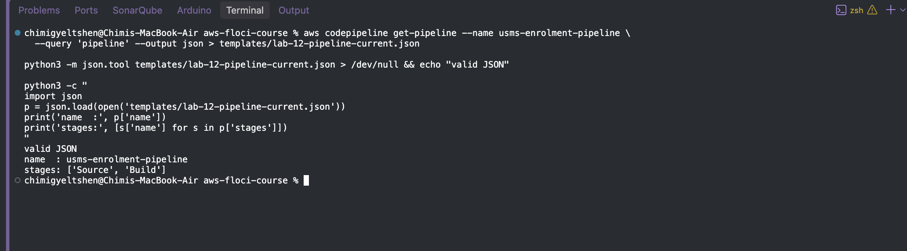

**Part 2: append the Deploy stage.** The script stops if the stages are not what it expects, or if a Deploy stage already exists.

```bash
python3 - << 'PY'
import json

CURRENT = "templates/lab-12-pipeline-current.json"
OUT     = "templates/lab-12-pipeline.json"

pipeline = json.load(open(CURRENT))

names = [s["name"] for s in pipeline["stages"]]
assert names[:2] == ["Source", "Build"], f"unexpected stages: {names}"
if "Deploy" in names:
    raise SystemExit("a Deploy stage already exists - nothing to do")

deploy_stage = {
    "name": "Deploy",
    "actions": [
        {
            "name": "DeployToECS",
            "actionTypeId": {
                "category": "Deploy",
                "owner": "AWS",
                "provider": "ECS",
                "version": "1"
            },
            "runOrder": 1,
            "configuration": {
                "ClusterName": "usms-ecs-cluster",
                "ServiceName": "usms-enrolment-svc",
                "FileName": "imagedefinitions.json",
                "DeploymentTimeout": "10"
            },
            "inputArtifacts": [{"name": "BuildOutput"}],
            "outputArtifacts": []
        }
    ]
}

pipeline["stages"].append(deploy_stage)
json.dump({"pipeline": pipeline}, open(OUT, "w"), indent=2)

print("stages now:", [s["name"] for s in pipeline["stages"]])
print("wrote", OUT)
PY

python3 -m json.tool templates/lab-12-pipeline.json > /dev/null && echo "valid JSON"
grep -c '\$' templates/lab-12-pipeline.json
```

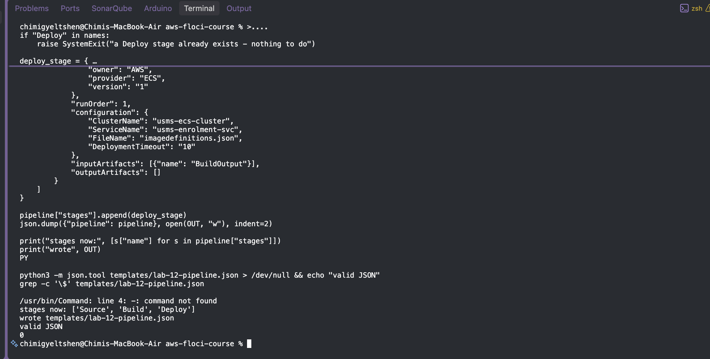

**Part 3: send it back**

```bash
aws codepipeline update-pipeline \
  --cli-input-json file://templates/lab-12-pipeline.json \
  --query 'pipeline.{Name:name,Stages:length(stages),Version:version}' \
  --output table
```

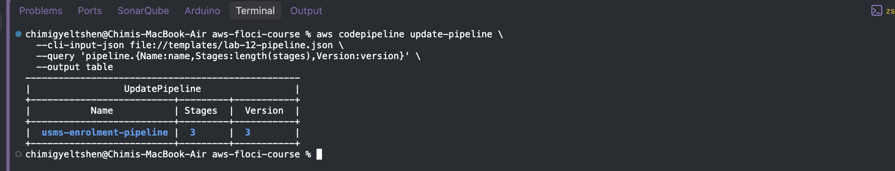

**Verify**

```bash
aws codepipeline get-pipeline --name usms-enrolment-pipeline \
  --query 'pipeline.stages[].{Stage:name,Action:actions[0].name,Provider:actions[0].actionTypeId.provider,Input:actions[0].inputArtifacts[0].name}' \
  --output table
```


### Step 17: Run the pipeline end to end and prove the service moved

The goal is to change a version number and see the running service change without anyone typing `aws ecs update-service`. A green Deploy stage is only a status report. The evidence is that the service's task definition revision went up, and that the new revision uses the image the build produced. Check both.

**Part 1: record the starting revision**

```bash
BEFORE_TD=$(aws ecs describe-services --cluster "$USMS_ECS_CLUSTER" \
  --services "$USMS_ENROLMENT_SERVICE" \
  --query 'services[0].taskDefinition' --output text)
echo "before: $BEFORE_TD"
```

!!! check "Expected result"
    `.../usms-enrolment:3` from Step 11. The proof is a before-and-after comparison, so keep this value.


**Part 2: bump the release and run**

```bash
printf 'r7\n' > labs/lab-11-cicd/app/VERSION

./scripts/utilities/usms-pack-source.sh labs/lab-11-cicd/app outputs/usms-enrolment-src.zip >/dev/null

aws s3api put-object --bucket usms-pipeline-artifacts \
  --key source/usms-enrolment-src.zip --body outputs/usms-enrolment-src.zip \
  --query 'VersionId' --output text

EXEC_ID=$(aws codepipeline start-pipeline-execution --name usms-enrolment-pipeline \
  --query 'pipelineExecutionId' --output text)
echo "execution: $EXEC_ID"

for i in $(seq 1 40); do
  aws codepipeline get-pipeline-state --name usms-enrolment-pipeline \
    --query 'stageStates[].[stageName,latestExecution.status]' --output text | sed 's/^/    /'
  STATE=$(aws codepipeline get-pipeline-execution \
            --pipeline-name usms-enrolment-pipeline --pipeline-execution-id "$EXEC_ID" \
            --query 'pipelineExecution.status' --output text 2>/dev/null)
  printf '  %2d  execution=%s\n' "$i" "${STATE:-unknown}"
  case "$STATE" in Succeeded|Failed|Stopped|Superseded) break ;; esac
  sleep 10
done
```

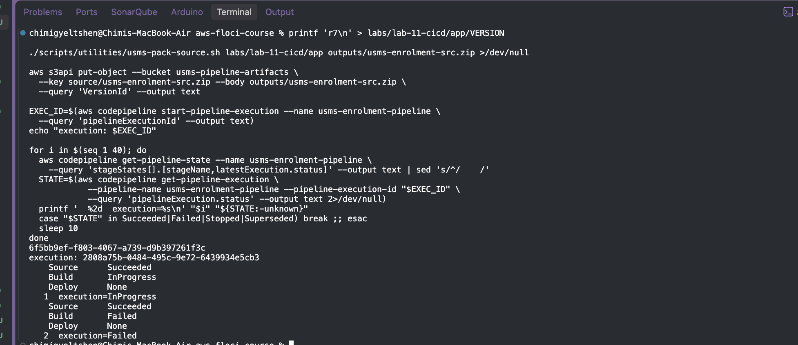

**Part 3: read back the evidence and save it**

```bash
AFTER_TD=$(aws ecs describe-services --cluster "$USMS_ECS_CLUSTER" \
  --services "$USMS_ENROLMENT_SERVICE" --query 'services[0].taskDefinition' --output text)

AFTER_IMAGE=$(aws ecs describe-task-definition --task-definition "$AFTER_TD" \
  --query 'taskDefinition.containerDefinitions[?name==`enrolment-api`].image | [0]' --output text)

{
  printf 'execution      : %s\n' "$EXEC_ID"
  printf 'task def before: %s\n' "$BEFORE_TD"
  printf 'task def after : %s\n' "$AFTER_TD"
  printf 'image after    : %s\n' "$AFTER_IMAGE"
  printf 'recorded at    : %s\n' "$(date -u +%Y-%m-%dT%H:%M:%SZ)"
} | tee outputs/lab-12-deploy-evidence.txt
```

!!! check "Expected result"
    The revision after the run is higher than the revision before it, and the image ends in `:r7`.


---

## Part F: Rollback and Blue/Green

### Step 18: The rollback drill

**Part 1: deploy a release whose image was never pushed**

```bash
cd ~/aws-floci-course

printf 'r8\n' > labs/lab-11-cicd/app/VERSION

./scripts/utilities/usms-pack-source.sh labs/lab-11-cicd/app outputs/usms-enrolment-src.zip >/dev/null
aws s3api put-object --bucket usms-pipeline-artifacts \
  --key source/usms-enrolment-src.zip --body outputs/usms-enrolment-src.zip \
  --query 'VersionId' --output text

aws ecr describe-images --repository-name usms-enrolment \
  --query 'imageDetails[].imageTags[]' --output text
```

!!! check "Expected result"
    `r6` and `r7` are listed, but not `r8`.

!!! tip
    If your build can push images, it will push `r8` and the drill will not fail. To prevent that, temporarily point the project's `IMAGE_REPO_URI` at a repository that does not exist, or stop Docker. The drill needs a deployment whose image cannot be pulled.

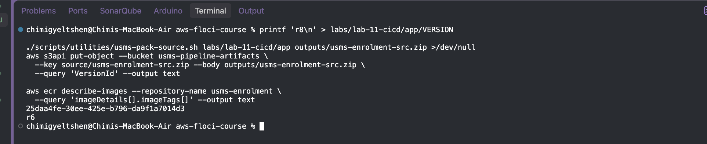

**Record the last good revision, then start the pipeline**

```bash
BEFORE_ROLLBACK=$(aws ecs describe-services --cluster "$USMS_ECS_CLUSTER" \
  --services "$USMS_ENROLMENT_SERVICE" --query 'services[0].taskDefinition' --output text)
echo "good revision, remember this: $BEFORE_ROLLBACK"

aws codepipeline start-pipeline-execution --name usms-enrolment-pipeline \
  --query 'pipelineExecutionId' --output text
```

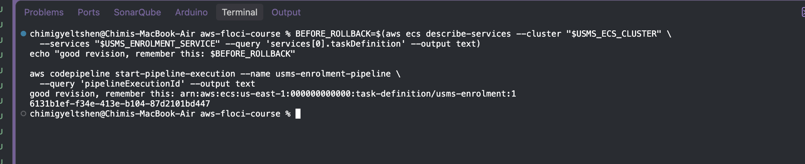

**Part 2: watch it fail**

```bash
sleep 30

aws ecs describe-services --cluster "$USMS_ECS_CLUSTER" --services "$USMS_ENROLMENT_SERVICE" \
  --query 'services[0].deployments[].{Status:status,TaskDef:taskDefinition,Desired:desiredCount,Running:runningCount,Rollout:rolloutState,Reason:rolloutStateReason}' \
  --output json

aws ecs describe-services --cluster "$USMS_ECS_CLUSTER" --services "$USMS_ENROLMENT_SERVICE" \
  --query 'services[0].events[0:5].[createdAt,message]' --output text
```

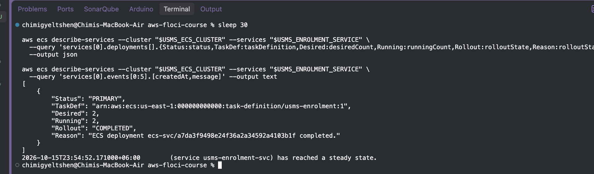

**Part 3: roll back by hand**

```bash
aws ecs update-service \
  --cluster "$USMS_ECS_CLUSTER" \
  --service "$USMS_ENROLMENT_SERVICE" \
  --task-definition "$BEFORE_ROLLBACK" \
  --query 'service.{Name:serviceName,TaskDef:taskDefinition}' \
  --output table

./scripts/utilities/usms-ecs-watch.sh || echo "did not settle - expected on a build that runs no tasks"

aws ecs describe-services --cluster "$USMS_ECS_CLUSTER" --services "$USMS_ENROLMENT_SERVICE" \
  --query 'services[0].taskDefinition' --output text
```

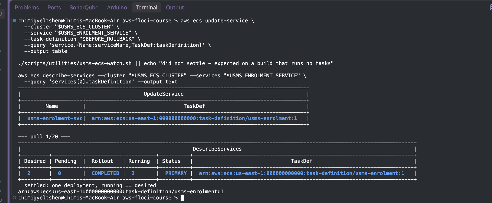

**Part 4: put the source back to the last good release.** This stops the next pipeline run from deploying `r8` again.

```bash
printf 'r7\n' > labs/lab-11-cicd/app/VERSION
./scripts/utilities/usms-pack-source.sh labs/lab-11-cicd/app outputs/usms-enrolment-src.zip >/dev/null
aws s3api put-object --bucket usms-pipeline-artifacts \
  --key source/usms-enrolment-src.zip --body outputs/usms-enrolment-src.zip \
  --query 'VersionId' --output text
```

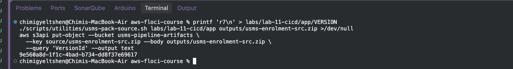

### Step 19: Blue/green with CodeDeploy, on paper

Floci does not run CodeDeploy, so in this step you only check the two blue/green documents without applying them. `templates/lab-12-codedeploy-deployment-group.json` defines the deployment group. `templates/lab-12-appspec.yaml` tells CodeDeploy which container and port the load balancer should route to.

```bash
python3 -m json.tool templates/lab-12-codedeploy-deployment-group.json > /dev/null \
  && echo "deployment group document is valid JSON"

python3 - << 'PY'
try:
    import yaml
except ImportError:
    print("PyYAML absent - appspec not parsed; check the indentation by eye")
else:
    d = yaml.safe_load(open("templates/lab-12-appspec.yaml"))
    svc = d["Resources"][0]["TargetService"]["Properties"]
    print("appspec parses. container:", svc["LoadBalancerInfo"]["ContainerName"],
          "port:", svc["LoadBalancerInfo"]["ContainerPort"])
PY
```


---

## Part G: Record and Commit

### Step 20: Record this lab's outputs

`configs/lab-12.env` stores names, ARNs, tags and digests only, with **no secrets**. Each value is read live from the emulator, and a placeholder such as `not-created` is written if the value is missing. The heredoc is **unquoted** (`<< EOF`) so the `$(...)` lookups run when the file is written.

```bash
cd ~/aws-floci-course

cat > configs/lab-12.env << EOF
# Lab 12 - CI/CD: the image, the registry, and the deploy stage
# Generated on $(date -u +%Y-%m-%dT%H:%M:%SZ)
# Contains names, ARNs, tags and digests only. NO SECRETS. Safe to commit.

# --- registry ---
export USMS_ECR_REPO=usms-enrolment
export USMS_ECR_REPO_URI=$(aws ecr describe-repositories --repository-names usms-enrolment \
    --query 'repositories[0].repositoryUri' --output text 2>/dev/null || echo not-created)
export USMS_ECR_REGISTRY=$(aws ecr describe-repositories --repository-names usms-enrolment \
    --query 'repositories[0].repositoryUri' --output text 2>/dev/null | cut -d/ -f1 || echo not-created)
export USMS_ECR_TAG_MUTABILITY=$(aws ecr describe-repositories --repository-names usms-enrolment \
    --query 'repositories[0].imageTagMutability' --output text 2>/dev/null | grep -E '^[A-Z]+$' || echo not-created)
export USMS_ECR_SCAN_ON_PUSH=$(aws ecr describe-repositories --repository-names usms-enrolment \
    --query 'repositories[0].imageScanningConfiguration.scanOnPush' --output text 2>/dev/null | grep -Ei '^(true|false)$' || echo unknown)
export USMS_ECR_PORT_RANGE=5100-5104

# --- image ---
export USMS_IMAGE_TAG=r7
export USMS_IMAGE_DIGEST=$(aws ecr describe-images --repository-name usms-enrolment \
    --image-ids imageTag=r7 --query 'imageDetails[0].imageDigest' --output text 2>/dev/null \
    | grep -E '^sha256:' || echo not-pushed)
export USMS_IMAGEDEFS_FILE=imagedefinitions.json
export USMS_DOCKERFILE=labs/lab-11-cicd/app/Dockerfile

# --- task definition and service ---
export USMS_TASK_FAMILY=usms-enrolment
export USMS_TASK_REVISION_CICD=$(aws ecs describe-task-definition --task-definition usms-enrolment \
    --query 'taskDefinition.revision' --output text 2>/dev/null | grep -E '^[0-9]+$' || echo 0)
export USMS_TASK_DEF_ARN_CICD=$(aws ecs describe-task-definition --task-definition usms-enrolment \
    --query 'taskDefinition.taskDefinitionArn' --output text 2>/dev/null | grep -E '^arn:' || echo not-created)
export USMS_SERVICE_TASK_DEF=$(aws ecs describe-services --cluster usms-ecs-cluster \
    --services usms-enrolment-svc --query 'services[0].taskDefinition' --output text 2>/dev/null \
    | grep -E '^arn:' || echo not-created)
export USMS_ROLLBACK_REVISION=4

# --- pipeline deploy stage ---
export USMS_DEPLOY_STAGE=Deploy
export USMS_DEPLOY_ACTION=DeployToECS
export USMS_DEPLOY_PROVIDER=ECS
export USMS_PIPELINE_STAGES=$(aws codepipeline get-pipeline --name usms-enrolment-pipeline \
    --query 'length(pipeline.stages)' --output text 2>/dev/null | grep -E '^[0-9]+$' || echo 0)

# --- policy versions ---
export USMS_POLICY_CODEBUILD_VERSION=$(aws iam get-policy \
    --policy-arn arn:aws:iam::000000000000:policy/USMSCodeBuildBase \
    --query 'Policy.DefaultVersionId' --output text 2>/dev/null | grep -E '^v[0-9]+$' || echo unknown)
export USMS_POLICY_CODEPIPELINE_VERSION=$(aws iam get-policy \
    --policy-arn arn:aws:iam::000000000000:policy/USMSCodePipelineBase \
    --query 'Policy.DefaultVersionId' --output text 2>/dev/null | grep -E '^v[0-9]+$' || echo unknown)

# --- blue/green, conceptual ---
export USMS_CODEDEPLOY_SUPPORTED=$(sed -n 's/^USMS_CODEDEPLOY_SUPPORTED=//p' \
    outputs/lab-12-deploy-probe.txt 2>/dev/null || echo unknown)
export USMS_CODEDEPLOY_APP=usms-enrolment-app
export USMS_CODEDEPLOY_DG=usms-enrolment-dg
export USMS_APPSPEC_FILE=templates/lab-12-appspec.yaml
export USMS_CICD_DEPLOY_PATH=$(sed -n 's/^USMS_CICD_DEPLOY_PATH=//p' \
    outputs/lab-12-deploy-probe.txt 2>/dev/null || echo unknown)
EOF

grep -n 'export .*=$\|None' configs/lab-12.env || echo "all values populated"
grep -c '^export' configs/lab-12.env
```

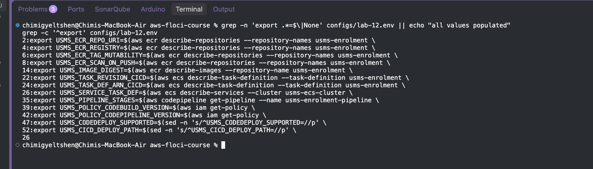

**Verify**

```bash
source configs/lab-12.env
printf 'repo=%s\ntag=%s\ndigest=%s\nsvc-taskdef=%s\nstages=%s\ncb=%s cp=%s\npath=%s\n' \
  "$USMS_ECR_REPO_URI" "$USMS_IMAGE_TAG" "$USMS_IMAGE_DIGEST" "$USMS_SERVICE_TASK_DEF" \
  "$USMS_PIPELINE_STAGES" "$USMS_POLICY_CODEBUILD_VERSION" "$USMS_POLICY_CODEPIPELINE_VERSION" \
  "$USMS_CICD_DEPLOY_PATH"
```


### Step 21: Commit

Stage this lab's files and commit. `outputs/` must not be committed.

```bash
git add labs/lab-11-cicd docker-compose.yml
git add policies templates scripts/utilities configs/lab-12.env
git status --short
git commit -m "Lab 12: deploy to ECS from the pipeline"
```

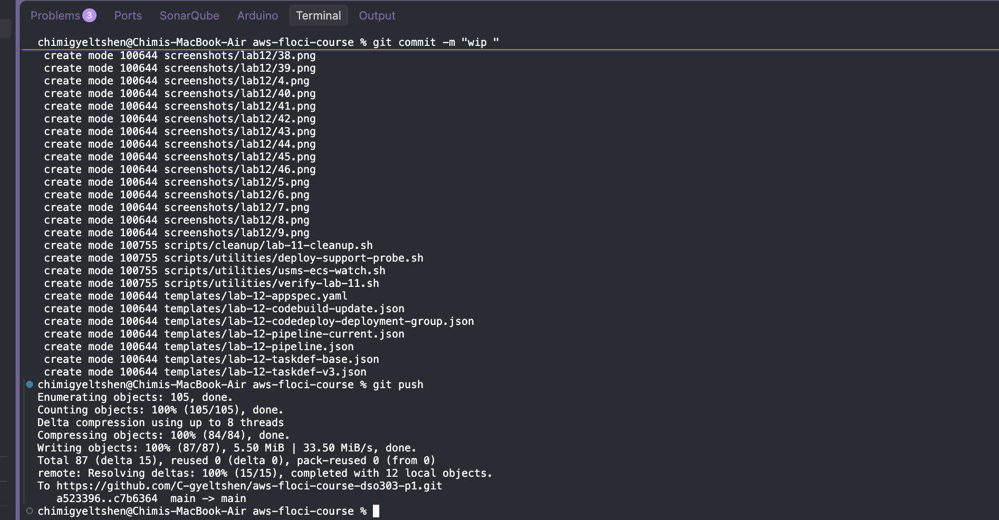

---

## Verification

### Build `scripts/utilities/verify-lab-12.sh`

The script checks the environment first, then works through each part of the lab.

| Path | Expected result |
|---|---|
| **A**: everything supported | `PASS=45  FAIL=0` |
| **B**: no usable ECR | `PASS=40  FAIL=5` (the five ECR checks) |
| **C**: no CodeBuild/CodePipeline either | `PASS=31  FAIL=14` |

```bash
cat > scripts/utilities/verify-lab-12.sh << 'EOF'
#!/usr/bin/env bash
# Verify every Lab 12 artefact. Exit 1 if anything is missing.
# EXPECTED: PASS=45  FAIL=0        (Path A)
#           PASS=40  FAIL=5        (Path B  - no usable ECR: the five ECR checks)
#           PASS=31  FAIL=14       (Path C  - no CodeBuild/CodePipeline either: those
#                                   five plus two dependency checks, three project
#                                   checks and four pipeline checks)
set -uo pipefail

REPO_ROOT="$(cd "$(dirname "${BASH_SOURCE[0]}")/../.." && pwd)"
cd "$REPO_ROOT"
# shellcheck disable=SC1091
source "$REPO_ROOT/configs/course.env"
for f in configs/lab-01.env configs/lab-04.env configs/lab-05.env \
         configs/lab-11.env configs/lab-12.env; do
  # shellcheck disable=SC1090
  [ -f "$f" ] && source "$f"
done

: "${FLOCI_CONTAINER_NAME:=floci}"
: "${USMS_ECS_CLUSTER:=usms-ecs-cluster}"
: "${USMS_ENROLMENT_SERVICE:=usms-enrolment-svc}"
: "${USMS_PIPELINE_NAME:=usms-enrolment-pipeline}"
: "${USMS_BUILD_PROJECT:=usms-enrolment-build}"
: "${USMS_ECR_REPO:=usms-enrolment}"
: "${USMS_TASK_FAMILY:=usms-enrolment}"

PASS=0; FAIL=0
check() {
  if eval "$2" >/dev/null 2>&1; then printf "  ok   %s\n" "$1"; PASS=$((PASS+1))
  else printf "  FAIL %s\n" "$1"; FAIL=$((FAIL+1)); fi
}
ecr()  { aws ecr describe-repositories --repository-names "$USMS_ECR_REPO" --query "repositories[0].$1" --output text; }
proj() { aws codebuild batch-get-projects --names "$USMS_BUILD_PROJECT" --query "projects[0].$1" --output text; }
pipe() { aws codepipeline get-pipeline --name "$USMS_PIPELINE_NAME" --query "pipeline.$1" --output text; }
tdef() { aws ecs describe-task-definition --task-definition "$USMS_TASK_FAMILY" --query "taskDefinition.$1" --output text; }
polv() { aws iam get-policy --policy-arn "arn:aws:iam::000000000000:policy/$1" --query 'Policy.DefaultVersionId' --output text; }
spec="labs/lab-11-cicd/app/buildspec.yml"

echo "== Environment =="
check "Floci container running" \
  "test \"\$(docker container inspect $FLOCI_CONTAINER_NAME --format '{{.State.Running}}')\" = true"
check "storage mode is NOT memory" \
  "docker container inspect $FLOCI_CONTAINER_NAME --format '{{range .Config.Env}}{{println .}}{{end}}' | grep -qE '^FLOCI_STORAGE_MODE=(hybrid|persistent|wal)$'"
check "AWS CLI reaches Floci" "aws sts get-caller-identity"
check "account is 000000000000" \
  "test \"\$(aws sts get-caller-identity --query Account --output text)\" = 000000000000"

echo "== Lab 11 dependencies =="
check "configs/lab-11.env present"   "test -f configs/lab-11.env"
check "pipeline $USMS_PIPELINE_NAME exists" "pipe name | grep -q $USMS_PIPELINE_NAME"
check "build project exists"          "proj name | grep -q $USMS_BUILD_PROJECT"
check "ECS service exists" \
  "aws ecs describe-services --cluster $USMS_ECS_CLUSTER --services $USMS_ENROLMENT_SERVICE --query 'services[0].status' --output text | grep -q ACTIVE"

echo "== ECR =="
check "repository $USMS_ECR_REPO exists"   "ecr repositoryName | grep -q $USMS_ECR_REPO"
check "scanOnPush is true"                 "ecr imageScanningConfiguration.scanOnPush | grep -qi true"
check "repositoryUri has a registry host"  "ecr repositoryUri | grep -q '/'"
check "at least one image is present" \
  "test \"\$(aws ecr describe-images --repository-name $USMS_ECR_REPO --query 'length(imageDetails)' --output text)\" -ge 1"
check "tag r7 is present" \
  "aws ecr describe-images --repository-name $USMS_ECR_REPO --image-ids imageTag=r7 --query 'imageDetails[0].imageDigest' --output text | grep -q '^sha256:'"

echo "== Source tree =="
check "Dockerfile present"                 "test -f labs/lab-11-cicd/app/Dockerfile"
check ".dockerignore present"              "test -f labs/lab-11-cicd/app/.dockerignore"
check "buildspec builds an image"          "grep -q 'docker build' $spec"
check "buildspec writes imagedefinitions"  "grep -q 'imagedefinitions.json' $spec"
check "smoke.sh has 8 assertions"          "test \"\$(grep -cE '^t \"' labs/lab-11-cicd/app/tests/smoke.sh)\" = 8"

echo "== Task definition and service =="
check "task family revision is at least 3" "test \"\$(tdef revision)\" -ge 3"
check "task definition names the ECR repo" "tdef 'containerDefinitions[0].image' | grep -q $USMS_ECR_REPO"
check "cpu is still 256"                   "test \"\$(tdef cpu)\" = 256"
check "memory is still 1024"               "test \"\$(tdef memory)\" = 1024"

echo "== IAM policy versions =="
check "USMSCodeBuildBase default is v2"       "test \"\$(polv USMSCodeBuildBase)\" = v2"
check "codebuild v2 grants ecr:PutImage"      "grep -q 'ecr:PutImage' policies/usms-codebuild-policy-v2.json"
check "GetAuthorizationToken is on Resource *" \
  "python3 -c \"import json;d=json.load(open('policies/usms-codebuild-policy-v2.json'));import sys;sys.exit(0 if any(s.get('Action')=='ecr:GetAuthorizationToken' and s.get('Resource')=='*' for s in d['Statement']) else 1)\""
check "USMSCodePipelineBase default is v2"    "test \"\$(polv USMSCodePipelineBase)\" = v2"
check "pipeline v2 grants ecs:UpdateService"  "grep -q 'ecs:UpdateService' policies/usms-codepipeline-policy-v2.json"
check "pipeline v2 passes roles to ecs-tasks" "grep -q 'ecs-tasks.amazonaws.com' policies/usms-codepipeline-policy-v2.json"

echo "== CodeBuild project =="
check "privilegedMode is true"     "proj environment.privilegedMode | grep -qi true"
check "IMAGE_REPO_URI is set" \
  "proj 'environment.environmentVariables[?name==\`IMAGE_REPO_URI\`].value | [0]' | grep -q ."
check "source type is still CODEPIPELINE" "proj source.type | grep -q CODEPIPELINE"

echo "== Pipeline =="
check "pipeline has 3 stages"              "test \"\$(pipe 'length(stages)')\" = 3"
check "stage 3 is named Deploy"            "pipe 'stages[2].name' | grep -q '^Deploy$'"
check "deploy provider is ECS"             "pipe 'stages[2].actions[0].actionTypeId.provider' | grep -q '^ECS$'"
check "deploy reads imagedefinitions.json" "pipe 'stages[2].actions[0].configuration.FileName' | grep -q imagedefinitions.json"

echo "== Conceptual documents and helpers =="
check "appspec.yaml present"               "test -f templates/lab-12-appspec.yaml"
check "deployment group document is valid JSON" \
  "python3 -m json.tool templates/lab-12-codedeploy-deployment-group.json"
check "usms-ecs-watch.sh executable and valid" \
  "test -x scripts/utilities/usms-ecs-watch.sh && bash -n scripts/utilities/usms-ecs-watch.sh"

echo "== Files and Git hygiene =="
check "configs/lab-12.env present"        "test -f configs/lab-12.env"
check "no empty or None values in lab-12.env" "! grep -qE 'export [A-Z_]+=$|=None$' configs/lab-12.env"
check "taskdef v3 template is valid JSON"  "python3 -m json.tool templates/lab-12-taskdef-v3.json"
check "pipeline template is valid JSON"    "python3 -m json.tool templates/lab-12-pipeline.json"
check "lab-12 templates have no unexpanded variables" \
  "! grep -q '[\$]' templates/lab-12-taskdef-v3.json templates/lab-12-codebuild-update.json templates/lab-12-pipeline.json"
check "both v2 policy documents are valid JSON" \
  "python3 -m json.tool policies/usms-codebuild-policy-v2.json && python3 -m json.tool policies/usms-codepipeline-policy-v2.json"
check "no secret is tracked"               "! git ls-files | grep -q '^outputs/'"

echo; echo "PASS=$PASS  FAIL=$FAIL"
if [ "$FAIL" -ne 0 ]; then
  cat <<'REMEDY'

Read the failures top-down, not bottom-up.

  Environment block failing   -> Floci is not running, or is in memory mode. Fix first.
  Lab 11 dependencies        -> re-run verify-lab-11.sh before anything else.
  ECR block                   -> Path B: expected, 5 failures. Otherwise Steps 4, 5, 8.
  Source tree                 -> Steps 7 and 14.
  Task definition             -> Steps 10 and 11. A revision below 3 means Step 10 did not register.
  IAM policy versions         -> Steps 12 and 15. "default is v2" failing usually means
                                 create-policy-version ran without --set-as-default.
  CodeBuild project           -> Step 13. "source type CODEPIPELINE" failing means an
                                 over-broad update-project undid Lab 11 Step 18.
  Pipeline                    -> Step 16. Fewer than 3 stages after update-pipeline means
                                 the document sent was incomplete. Rebuild it from
                                 templates/lab-11-pipeline.json plus the Deploy stage.
  Hygiene                     -> Steps 20 and 21.
REMEDY
fi
[ "$FAIL" -eq 0 ]
EOF

chmod +x scripts/utilities/verify-lab-12.sh
bash -n scripts/utilities/verify-lab-12.sh && echo "syntax OK"
./scripts/utilities/verify-lab-12.sh
```

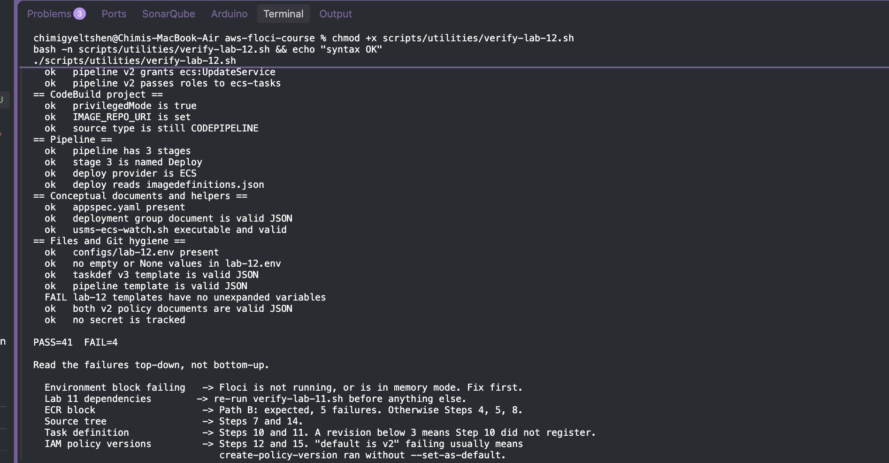

### Reading the results

Read failures from the top down. A failure in an earlier block often causes the failures below it.

| Failing block | Where to look |
|---|---|
| Environment | Floci is not running, or is in memory mode. Fix this first. |
| Lab 11 dependencies | Re-run `verify-lab-11.sh` before anything else. |
| ECR | On Path B, five failures here are expected. Otherwise Steps 4, 5 and 8. |
| Source tree | Steps 7 and 14. |
| Task definition | Steps 10 and 11. A revision below 3 means Step 10 did not register. |
| IAM policy versions | Steps 12 and 15. Usually `--set-as-default` was left off. |
| CodeBuild project | Step 13. If the source type is no longer `CODEPIPELINE`, an update changed more than the `environment` block. |
| Pipeline | Step 16. Fewer than 3 stages means an incomplete document was sent to `update-pipeline`. |
| Hygiene | Steps 20 and 21. |

---

## Cleanup

Build the end-of-course cleanup script and check its syntax now, but **do not run it** until the end of the course, because later labs depend on these resources.

```bash
chmod +x scripts/cleanup/lab-12-cleanup.sh
bash -n scripts/cleanup/lab-12-cleanup.sh && echo "syntax OK - do NOT run it"
```

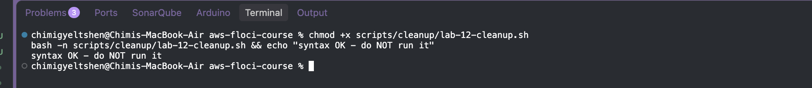

---

## Troubleshooting

| Symptom | Likely cause and fix |
|---|---|
| `docker push` hangs or is refused | Ports `5100-5104` are not published. Repeat Step 4 and restart Floci. |
| `docker login` fails | `ECR_REGISTRY` is empty. Repeat the Step 5 verify block in the same shell. |
| `register-task-definition` rejects the input | Read-only fields are still in the JSON. Re-run the Step 10 Python script. |
| Watcher never prints "settled" | Floci may not run real tasks. Check that the service's `taskDefinition` changed. |
| Build stage fails with `AccessDenied` on ECR | `USMSCodeBuildBase` v2 is not the default version. Repeat Step 12 with `--set-as-default`. |
| Deploy stage fails with `AccessDenied` on `iam:PassRole` | `USMSCodePipelineBase` v2 is missing or not the default. Repeat Step 15. |
| Pipeline has only one stage after Step 16 | The document sent to `update-pipeline` contained only the Deploy stage. Rebuild it from the current pipeline plus the Deploy stage. |
| Rollback drill succeeds instead of failing | The build pushed `r8`. Follow the tip in Step 18. |
| Pipeline deploys `r8` again later | You skipped Step 18 Part 4. Restore `VERSION` to `r7` and upload the source again. |