# Lab12- Deploying to Amazon ECS from the Pipeline¶

prequsites
```bash 
cd ~/aws-floci-course
source configs/course.env

./scripts/utilities/floci-storage-check.sh      
./scripts/utilities/verify-lab-04.sh           
./scripts/utilities/verify-lab-05.sh           
./scripts/utilities/verify-lab-11.sh           
docker info >/dev/null 2>&1 && echo "docker reachable"
```


7. Step-by-Step Implementation¶

Step 1 - Start Floci, and read what Lab 11 left you¶
Start the environment and read Lab 11's inventory rather than assuming it.

```bash
cd ~/aws-floci-course
./scripts/setup/floci-up.sh
./scripts/utilities/floci-storage-check.sh
./scripts/utilities/whoami.sh

if [ -f outputs/lab-11-lab08b-readiness.txt ]; then
  echo "--- Lab 11 readiness file ---"
  cat outputs/lab-11-lab08b-readiness.txt
else
  echo "no readiness file - you did not do Lab 11 Exercise 5."
  echo "That is fine: Step 14 of this lab writes imagedefinitions.json in full."
fi
```


Step 2 - Source every earlier lab's environment¶
This lab reads Labs 01, 04, 05 and 11 and writes a file the CloudFormation lab will read.

```bash
source configs/course.env

for f in configs/lab-01.env configs/lab-02.env configs/lab-03.env \
         configs/lab-04.env configs/lab-05.env configs/lab-06.env \
         configs/lab-09.env configs/lab-07.env configs/lab-08.env \
         configs/lab-10.env configs/lab-11.env; do
  if [ -f "$f" ]; then
    source "$f"
    printf '  sourced  %s\n' "$f"
  else
    printf '  absent   %s\n' "$f"
  fi
done

printf 'cluster=%s service=%s container=%s pipeline=%s project=%s exec-role=%s\n' \
  "${USMS_ECS_CLUSTER:-MISSING}" "${USMS_ENROLMENT_SERVICE:-MISSING}" \
  "${USMS_ENROLMENT_CONTAINER:-MISSING}" "${USMS_PIPELINE_NAME:-MISSING}" \
  "${USMS_BUILD_PROJECT:-MISSING}" "${USMS_ECS_EXEC_ROLE_ARN:-MISSING}"
```


Step 3 - Probe the deployment surface¶
```bash
chmod +x scripts/utilities/deploy-support-probe.sh
bash -n scripts/utilities/deploy-support-probe.sh && echo "syntax OK"
./scripts/utilities/deploy-support-probe.sh
```
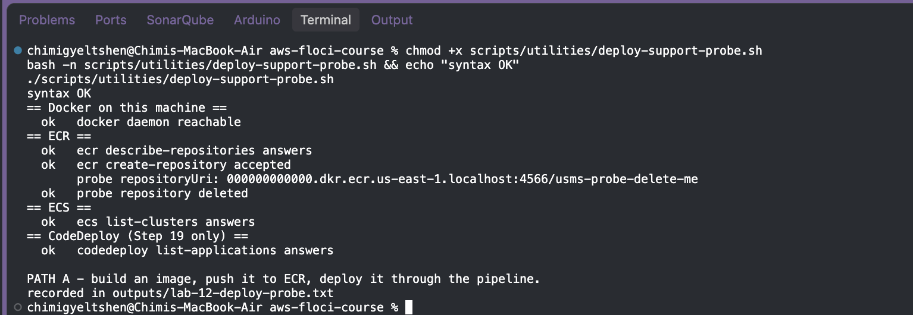

Step 4 - Publish the ECR port range¶

Command
```bash 
cd ~/aws-floci-course

grep -n '5100-5104' docker-compose.yml
```
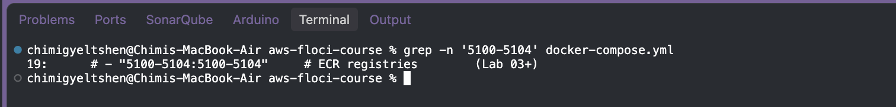

```bash 
cp docker-compose.yml "docker-compose.yml.bak-$(date +%Y%m%d%H%M%S)"

sed -i.tmp -E 's/^([[:space:]]*)#[[:space:]]*(- *"?5100-5104)/\1\2/' docker-compose.yml
rm -f docker-compose.yml.tmp

grep -n '5100-5104' docker-compose.yml
```


Verify

```bash
./scripts/setup/floci-up.sh
docker port floci
```


Step 5 - Create the ECR repository¶

```bash 
ECR_REPO="usms-enrolment"

aws ecr create-repository \
  --repository-name "$ECR_REPO" \
  --image-tag-mutability MUTABLE \
  --image-scanning-configuration scanOnPush=true \
  --encryption-configuration encryptionType=AES256 \
  --tags Key=Project,Value=USMS Key=Tier,Value=app Key=Lab,Value=12 \
  --query 'repository.{Name:repositoryName,Uri:repositoryUri,Mutability:imageTagMutability}' \
  --output table
```


Verify

```bash
ECR_URI=$(aws ecr describe-repositories --repository-names "$ECR_REPO" \
  --query 'repositories[0].repositoryUri' --output text)
ECR_REGISTRY="${ECR_URI%%/*}"

printf 'repository uri : %s\nregistry host  : %s\n' "$ECR_URI" "$ECR_REGISTRY"
```


Step 6 - Authenticate Docker against the registry¶
```bash 
aws ecr get-login-password --region "$AWS_REGION_COURSE" \
  | docker login --username AWS --password-stdin "$ECR_REGISTRY"
```


Step 7 - Write the Dockerfile¶
```bash
echo "--- Dockerfile ---"; cat Dockerfile
```


```bash 
cd ~/aws-floci-course
ls -l labs/lab-11-cicd/app/Dockerfile labs/lab-11-cicd/app/.dockerignore
test -d labs/lab-11-cicd/app/dist && echo "dist/ present - Step 8 can build" \
  || ./scripts/utilities/usms-buildspec-run.sh labs/lab-11-cicd/app >/dev/null \
     && echo "dist/ rebuilt by the local runner"
```


Step 8 - Build the image and push it, by hand¶

Command - part 1, set the release and rebuild the output

```bash
cd ~/aws-floci-course

printf 'r6\n' > labs/lab-11-cicd/app/VERSION
./scripts/utilities/usms-buildspec-run.sh labs/lab-11-cicd/app | tail -12

IMAGE_TAG=$(tr -d '[:space:]' < labs/lab-11-cicd/app/VERSION)
echo "image tag will be: $IMAGE_TAG"
```
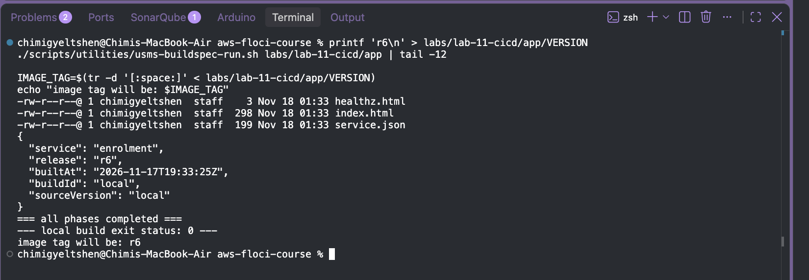


Command - part 2, build, tag, push

```bash
cd labs/lab-11-cicd/app

docker build -t "usms-enrolment:$IMAGE_TAG" .

docker tag "usms-enrolment:$IMAGE_TAG" "$ECR_URI:$IMAGE_TAG"

docker push "$ECR_URI:$IMAGE_TAG"

cd ~/aws-floci-course
```
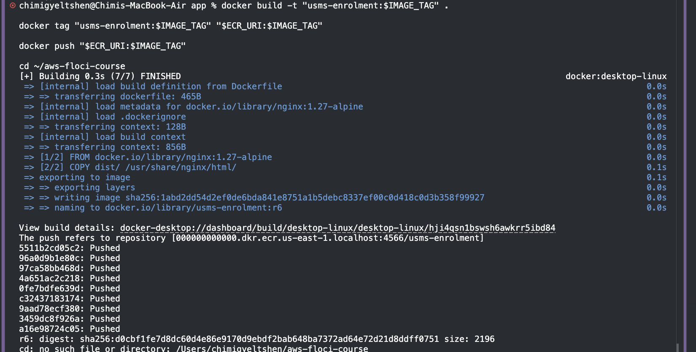

Step 9 - Prove the image is in the registry¶
Pushed is the client reporting its own success; the registry's read-back is the evidence.

```bash 
aws ecr describe-images \
  --repository-name usms-enrolment \
  --query 'imageDetails[].{Tags:imageTags,Digest:imageDigest,SizeMB:imageSizeInBytes,Pushed:imagePushedAt}' \
  --output table

IMAGE_DIGEST=$(aws ecr describe-images \
  --repository-name usms-enrolment \
  --image-ids "imageTag=$IMAGE_TAG" \
  --query 'imageDetails[0].imageDigest' --output text)

printf '%s %s %s\n' "$IMAGE_TAG" "$IMAGE_DIGEST" "$(date -u +%Y-%m-%dT%H:%M:%SZ)" \
  | tee -a outputs/lab-12-image-digest.txt
```


Verify - the create, perturb, read back proof

```bash 
docker rmi "$ECR_URI:$IMAGE_TAG" "usms-enrolment:$IMAGE_TAG" 2>/dev/null || true
docker images | grep -c usms-enrolment || echo "no local copy remains"

docker pull "$ECR_URI@$IMAGE_DIGEST"
docker images --digests | grep usms-enrolment | head -3
```


Step 10 - Register a task definition revision that names your image¶

```bash 
cd ~/aws-floci-course

aws ecs describe-task-definition \
  --task-definition usms-enrolment \
  --query 'taskDefinition' --output json > templates/lab-12-taskdef-base.json

python3 - "$ECR_URI:$IMAGE_TAG" << 'PY'
import json, sys

new_image = sys.argv[1]
READ_ONLY = ("taskDefinitionArn", "revision", "status", "requiresAttributes",
             "compatibilities", "registeredAt", "registeredBy", "deregisteredAt")

td = json.load(open("templates/lab-12-taskdef-base.json"))
for field in READ_ONLY:
    td.pop(field, None)

found = False
for c in td["containerDefinitions"]:
    if c["name"] == "enrolment-api":
        print("old image:", c["image"])
        c["image"] = new_image
        print("new image:", c["image"])
        found = True
if not found:
    sys.exit("no container named enrolment-api in this task definition - stop and check Lab 04")

json.dump(td, open("templates/lab-12-taskdef-v3.json", "w"), indent=2)
print("wrote templates/lab-12-taskdef-v3.json")
PY

python3 -m json.tool templates/lab-12-taskdef-v3.json > /dev/null && echo "valid JSON"
grep -c '\$' templates/lab-12-taskdef-v3.json
```


Command - register it

```bash 
TASK_DEF_ARN=$(aws ecs register-task-definition \
  --cli-input-json file://templates/lab-12-taskdef-v3.json \
  --query 'taskDefinition.taskDefinitionArn' --output text)

echo "$TASK_DEF_ARN"
```
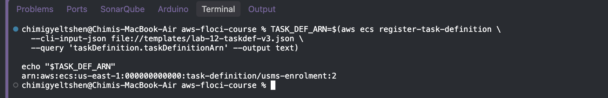


Verify

```bash 
aws ecs describe-task-definition --task-definition usms-enrolment \
  --query 'taskDefinition.{Family:family,Revision:revision,Cpu:cpu,Memory:memory,Image:containerDefinitions[0].image,Health:containerDefinitions[0].healthCheck.command}' \
  --output json
```
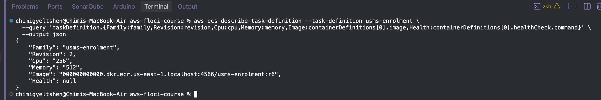

Step 11 - Deploy revision 3 by hand, and watch it¶
Do it manually once so you recognise what the pipeline does later. From here the service runs your application.

Command - part 1, a watcher you will reuse

```bash
cat > scripts/utilities/usms-ecs-watch.sh << 'EOF'
#!/usr/bin/env bash
# Poll an ECS service's deployments until they settle, or until the attempts run out.
# Usage: usms-ecs-watch.sh [cluster] [service] [iterations]
set -uo pipefail

REPO_ROOT="$(cd "$(dirname "${BASH_SOURCE[0]}")/../.." && pwd)"
cd "$REPO_ROOT"
# shellcheck disable=SC1091
source "$REPO_ROOT/configs/course.env"
# shellcheck disable=SC1091
[ -f configs/lab-04.env ] && source configs/lab-04.env

CLUSTER="${1:-${USMS_ECS_CLUSTER:-usms-ecs-cluster}}"
SERVICE="${2:-${USMS_ENROLMENT_SERVICE:-usms-enrolment-svc}}"
ITER="${3:-20}"

for i in $(seq 1 "$ITER"); do
  printf '\n--- poll %s/%s ---\n' "$i" "$ITER"
  aws ecs describe-services --cluster "$CLUSTER" --services "$SERVICE" \
    --query 'services[0].deployments[].{Status:status,TaskDef:taskDefinition,Desired:desiredCount,Running:runningCount,Pending:pendingCount,Rollout:rolloutState}' \
    --output table 2>/dev/null || echo "  describe-services failed"
  COUNT=$(aws ecs describe-services --cluster "$CLUSTER" --services "$SERVICE" \
            --query 'length(services[0].deployments)' --output text 2>/dev/null)
  PRIMARY_RUN=$(aws ecs describe-services --cluster "$CLUSTER" --services "$SERVICE" \
            --query 'services[0].deployments[?status==`PRIMARY`].runningCount | [0]' --output text 2>/dev/null)
  DESIRED=$(aws ecs describe-services --cluster "$CLUSTER" --services "$SERVICE" \
            --query 'services[0].desiredCount' --output text 2>/dev/null)
  if [ "${COUNT:-0}" = "1" ] && [ "${PRIMARY_RUN:-0}" = "${DESIRED:-x}" ]; then
    echo "  settled: one deployment, running == desired"
    exit 0
  fi
  sleep 10
done
echo "  did not settle within $ITER polls - read the table above, not this message"
exit 1
EOF

chmod +x scripts/utilities/usms-ecs-watch.sh
bash -n scripts/utilities/usms-ecs-watch.sh && echo "syntax OK"
```


A polling loop rather than aws ecs wait services-stable, which on this emulator can exhaust its attempts silently (Lab 04). It prints the deployment table every poll and exits 0 when there is one deployment with running equal to desired.

Command - part 2, deploy

```bash 
aws ecs update-service \
  --cluster "$USMS_ECS_CLUSTER" \
  --service "$USMS_ENROLMENT_SERVICE" \
  --task-definition usms-enrolment:3 \
  --query 'service.{Name:serviceName,TaskDef:taskDefinition,Desired:desiredCount}' \
  --output table

./scripts/utilities/usms-ecs-watch.sh || echo "did not settle - see the Floci note below"
```


Step 12 - Version 2 of USMSCodeBuildBase¶

```bash 
cat > policies/usms-codebuild-policy-v2.json << 'EOF'
{
  "Version": "2012-10-17",
  "Statement": [
    {
      "Sid": "WriteItsOwnBuildLogs",
      "Effect": "Allow",
      "Action": [
        "logs:CreateLogGroup",
        "logs:CreateLogStream",
        "logs:PutLogEvents"
      ],
      "Resource": [
        "arn:aws:logs:us-east-1:000000000000:log-group:/aws/codebuild/usms-enrolment-build",
        "arn:aws:logs:us-east-1:000000000000:log-group:/aws/codebuild/usms-enrolment-build:*"
      ]
    },
    {
      "Sid": "ReadSourceAndWriteArtifacts",
      "Effect": "Allow",
      "Action": [
        "s3:GetObject",
        "s3:GetObjectVersion",
        "s3:PutObject",
        "s3:GetBucketAcl",
        "s3:GetBucketLocation"
      ],
      "Resource": [
        "arn:aws:s3:::usms-pipeline-artifacts",
        "arn:aws:s3:::usms-pipeline-artifacts/*"
      ]
    },
    {
      "Sid": "GetARegistryTokenWhichCannotBeScoped",
      "Effect": "Allow",
      "Action": "ecr:GetAuthorizationToken",
      "Resource": "*"
    },
    {
      "Sid": "PushAndPullTheEnrolmentImageOnly",
      "Effect": "Allow",
      "Action": [
        "ecr:BatchCheckLayerAvailability",
        "ecr:InitiateLayerUpload",
        "ecr:UploadLayerPart",
        "ecr:CompleteLayerUpload",
        "ecr:PutImage",
        "ecr:BatchGetImage",
        "ecr:GetDownloadUrlForLayer",
        "ecr:DescribeImages"
      ],
      "Resource": "arn:aws:ecr:us-east-1:000000000000:repository/usms-enrolment"
    },
    {
      "Sid": "BuildsDoNotTouchStudentRecords",
      "Effect": "Deny",
      "Action": "s3:*",
      "Resource": [
        "arn:aws:s3:::usms-student-data",
        "arn:aws:s3:::usms-student-data/*"
      ]
    }
  ]
}
EOF

python3 -m json.tool policies/usms-codebuild-policy-v2.json > /dev/null && echo "valid JSON"

aws iam create-policy-version \
  --policy-arn arn:aws:iam::000000000000:policy/USMSCodeBuildBase \
  --policy-document file://policies/usms-codebuild-policy-v2.json \
  --set-as-default \
  --query 'PolicyVersion.{Version:VersionId,Default:IsDefaultVersion}' \
  --output table
```
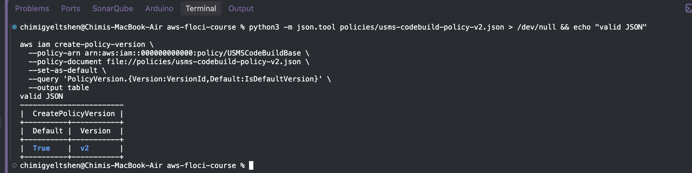

Verify

```bash
aws iam get-policy --policy-arn arn:aws:iam::000000000000:policy/USMSCodeBuildBase \
  --query 'Policy.{Name:PolicyName,Default:DefaultVersionId,Versions:AttachmentCount}' --output table

aws iam list-policy-versions --policy-arn arn:aws:iam::000000000000:policy/USMSCodeBuildBase \
  --query 'Versions[].{Version:VersionId,Default:IsDefaultVersion,Created:CreateDate}' --output table
```


Step 13 - Let the build run Docker¶

```bash 
python3 -m json.tool templates/lab-12-codebuild-update.json > /dev/null && echo "valid JSON"
grep -c '\$' templates/lab-12-codebuild-update.json

aws codebuild update-project \
  --cli-input-json file://templates/lab-12-codebuild-update.json \
  --query 'project.environment.{Privileged:privilegedMode,Vars:environmentVariables[].name}' \
  --output json
```

Verify

```bash 
aws codebuild batch-get-projects --names usms-enrolment-build \
  --query 'projects[0].{Source:source.type,Role:serviceRole,Privileged:environment.privilegedMode,Repo:environment.environmentVariables[?name==`IMAGE_REPO_URI`].value|[0]}' \
  --output table
```


Step 14 - Extend the buildspec: build the image, write imagedefinitions.json¶

Command - part 1, the new buildspec

```bash 
cd ~/aws-floci-course/labs/lab-11-cicd/app

cp buildspec.yml buildspec.yml.lab08a

cat > buildspec.yml << 'BUILDSPEC'
version: 0.2

env:
  variables:
    SERVICE_NAME: "enrolment"
    ARTIFACT_DIR: "dist"
    IMAGE_REPO_URI: "nginx"

phases:

  install:
    commands:
      - echo "--- install ---"
      - python3 --version
      - docker --version || echo "no docker client in this build image"

  pre_build:
    commands:
      - echo "--- pre_build ---"
      - test -f VERSION || { echo "VERSION file is missing"; exit 1; }
      - python3 -m json.tool config/service.json > /dev/null
      - |
        grep -q '"container": "enrolment-api"' config/service.json || {
          echo "config/service.json names the wrong container"
          exit 1
        }
      - USMS_RELEASE="$(tr -d '[:space:]' < VERSION)"
      - echo "release is $USMS_RELEASE"
      - |
        if docker info >/dev/null 2>&1; then
          echo "docker daemon reachable - this build will build and push an image"
          aws ecr get-login-password --region "${AWS_REGION_COURSE:-us-east-1}" \
            | docker login --username AWS --password-stdin "${IMAGE_REPO_URI%%/*}" \
            || echo "docker login failed - continuing; the image must already exist"
        else
          echo "no docker daemon in this build container - skipping the image build"
          echo "the image must already exist at ${IMAGE_REPO_URI} with this release tag"
        fi

  build:
    commands:
      - echo "--- build ---"
      - USMS_RELEASE="$(tr -d '[:space:]' < VERSION)"
      - BUILT_AT="$(date -u +%Y-%m-%dT%H:%M:%SZ)"
      - echo "release=$USMS_RELEASE builtAt=$BUILT_AT"
      - rm -rf "$ARTIFACT_DIR"
      - mkdir -p "$ARTIFACT_DIR"
      - cp -R src/. "$ARTIFACT_DIR"/
      - sed -i.bak -e "s|__RELEASE__|$USMS_RELEASE|g" -e "s|__BUILT_AT__|$BUILT_AT|g" "$ARTIFACT_DIR/index.html"
      - rm -f "$ARTIFACT_DIR/index.html.bak"
      - |
        cat > "$ARTIFACT_DIR/build-metadata.json" << META
        {
          "service": "$SERVICE_NAME",
          "release": "$USMS_RELEASE",
          "builtAt": "$BUILT_AT",
          "buildId": "${CODEBUILD_BUILD_ID:-local}",
          "sourceVersion": "${CODEBUILD_RESOLVED_SOURCE_VERSION:-local}",
          "imageUri": "${IMAGE_REPO_URI}:$USMS_RELEASE"
        }
        META
      - cp config/service.json "$ARTIFACT_DIR/service.json"
      - |
        if docker info >/dev/null 2>&1; then
          docker build -t "${IMAGE_REPO_URI}:$USMS_RELEASE" .
          docker push "${IMAGE_REPO_URI}:$USMS_RELEASE" \
            || echo "push failed - see Section 10; the deploy stage will use the existing tag"
        fi
      - |
        IMAGE_URI="${IMAGE_REPO_URI}:$USMS_RELEASE" python3 - > "$ARTIFACT_DIR/imagedefinitions.json" << 'IMGDEF'
        import json, os
        cfg = json.load(open("config/service.json"))
        print(json.dumps([{"name": cfg["container"],
                           "imageUri": os.environ["IMAGE_URI"]}], indent=2))
        IMGDEF

  post_build:
    commands:
      - echo "--- post_build ---"
      - bash tests/smoke.sh
      - cat "$ARTIFACT_DIR/imagedefinitions.json"
      - ls -l "$ARTIFACT_DIR"

artifacts:
  base-directory: dist
  files:
    - '**/*'

cache:
  paths: []
BUILDSPEC

echo "buildspec rewritten; the Lab 11 version is kept at buildspec.yml.lab08a"
```
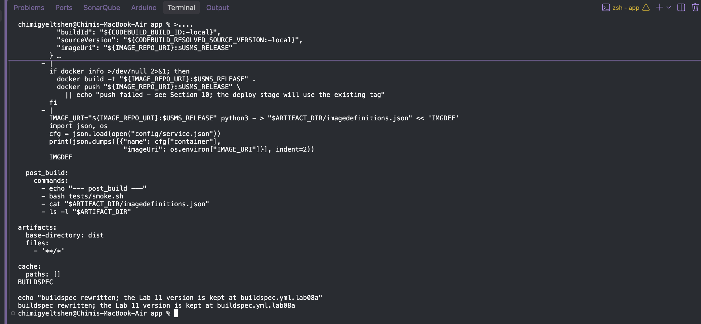

Command - part 2, the eighth smoke test

```bash 
python3 - << 'PY'
path = "tests/smoke.sh"
src = open(path).read()
if "imagedefinitions" in src:
    print("already present - nothing to do")
else:
    marker = 't "container name matches the task def"'
    line = ('t "imagedefinitions.json is a one-element array" '
            '"python3 -c \\"import json,sys; d=json.load(open(\'dist/imagedefinitions.json\')); '
            'sys.exit(0 if isinstance(d,list) and len(d)==1 and d[0][\'name\']==\'enrolment-api\' else 1)\\""\n')
    i = src.index(marker)
    j = src.index("\n", i) + 1
    open(path, "w").write(src[:j] + line + src[j:])
    print("added the eighth assertion")
PY

bash -n tests/smoke.sh && echo "smoke.sh syntax OK"
```


Verify - run it locally first

```bash 
cd ~/aws-floci-course

IMAGE_REPO_URI="$ECR_URI" ./scripts/utilities/usms-buildspec-run.sh labs/lab-11-cicd/app | tail -25
```
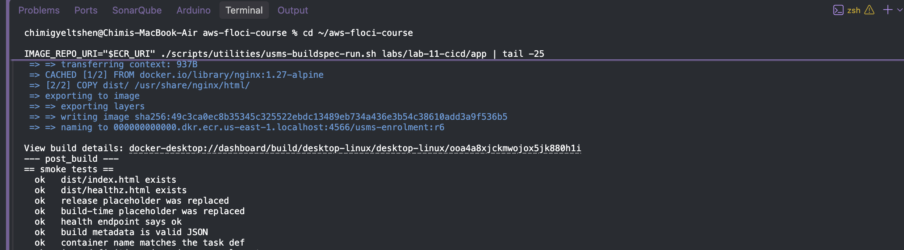

Command - part 3, ship it

```bash
./scripts/utilities/usms-pack-source.sh labs/lab-11-cicd/app outputs/usms-enrolment-src.zip | tail -3

aws s3api put-object \
  --bucket usms-pipeline-artifacts \
  --key source/usms-enrolment-src.zip \
  --body outputs/usms-enrolment-src.zip \
  --query 'VersionId' --output text
```

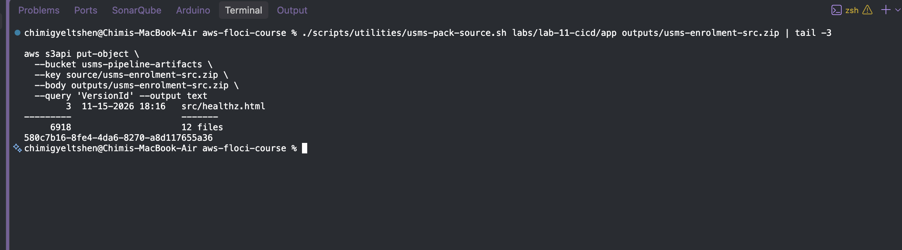

Step 15 - Version 2 of USMSCodePipelineBase¶

```bash 
cd ~/aws-floci-course

cat > policies/usms-codepipeline-policy-v2.json << 'EOF'
{
  "Version": "2012-10-17",
  "Statement": [
    {
      "Sid": "ReadAndWriteTheArtifactStore",
      "Effect": "Allow",
      "Action": [
        "s3:GetObject",
        "s3:GetObjectVersion",
        "s3:PutObject",
        "s3:GetBucketVersioning",
        "s3:GetBucketLocation"
      ],
      "Resource": [
        "arn:aws:s3:::usms-pipeline-artifacts",
        "arn:aws:s3:::usms-pipeline-artifacts/*"
      ]
    },
    {
      "Sid": "StartAndWatchTheEnrolmentBuildOnly",
      "Effect": "Allow",
      "Action": [
        "codebuild:StartBuild",
        "codebuild:BatchGetBuilds",
        "codebuild:StopBuild"
      ],
      "Resource": "arn:aws:codebuild:us-east-1:000000000000:project/usms-enrolment-build"
    },
    {
      "Sid": "PassTheBuildRoleAndOnlyToCodeBuild",
      "Effect": "Allow",
      "Action": "iam:PassRole",
      "Resource": "arn:aws:iam::000000000000:role/usms-codebuild-role",
      "Condition": {
        "StringEquals": { "iam:PassedToService": "codebuild.amazonaws.com" }
      }
    },
    {
      "Sid": "DeployToTheEnrolmentServiceOnly",
      "Effect": "Allow",
      "Action": [
        "ecs:DescribeServices",
        "ecs:UpdateService"
      ],
      "Resource": "arn:aws:ecs:us-east-1:000000000000:service/usms-ecs-cluster/usms-enrolment-svc"
    },
    {
      "Sid": "ReadAndRegisterTaskDefinitions",
      "Effect": "Allow",
      "Action": [
        "ecs:DescribeTaskDefinition",
        "ecs:RegisterTaskDefinition",
        "ecs:ListTaskDefinitions"
      ],
      "Resource": "*"
    },
    {
      "Sid": "PassTheTwoEcsRolesAndOnlyToEcsTasks",
      "Effect": "Allow",
      "Action": "iam:PassRole",
      "Resource": [
        "arn:aws:iam::000000000000:role/usms-ecs-exec-role",
        "arn:aws:iam::000000000000:role/usms-ecs-task-role"
      ],
      "Condition": {
        "StringEquals": { "iam:PassedToService": "ecs-tasks.amazonaws.com" }
      }
    }
  ]
}
EOF

python3 -m json.tool policies/usms-codepipeline-policy-v2.json > /dev/null && echo "valid JSON"

aws iam create-policy-version \
  --policy-arn arn:aws:iam::000000000000:policy/USMSCodePipelineBase \
  --policy-document file://policies/usms-codepipeline-policy-v2.json \
  --set-as-default \
  --query 'PolicyVersion.{Version:VersionId,Default:IsDefaultVersion}' \
  --output table
```
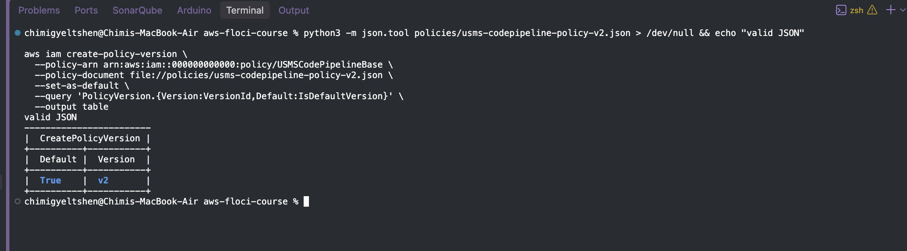

Verify

```bash 
aws iam get-policy-version \
  --policy-arn arn:aws:iam::000000000000:policy/USMSCodePipelineBase \
  --version-id v2 \
  --query 'PolicyVersion.Document.Statement[].Sid' --output json

aws iam get-policy --policy-arn arn:aws:iam::000000000000:policy/USMSCodePipelineBase \
  --query 'Policy.DefaultVersionId' --output text
```


Step 16 - Add the Deploy stage¶

Command - part 1, read the current document

```bash
aws codepipeline get-pipeline --name usms-enrolment-pipeline \
  --query 'pipeline' --output json > templates/lab-12-pipeline-current.json

python3 -m json.tool templates/lab-12-pipeline-current.json > /dev/null && echo "valid JSON"

python3 -c "
import json
p = json.load(open('templates/lab-12-pipeline-current.json'))
print('name  :', p['name'])
print('stages:', [s['name'] for s in p['stages']])
"
```


Command - part 2, the surgery

```bash
python3 - << 'PY'
import json

CURRENT = "templates/lab-12-pipeline-current.json"
OUT     = "templates/lab-12-pipeline.json"

pipeline = json.load(open(CURRENT))

names = [s["name"] for s in pipeline["stages"]]
assert names[:2] == ["Source", "Build"], f"unexpected stages: {names}"
if "Deploy" in names:
    raise SystemExit("a Deploy stage already exists - nothing to do")

deploy_stage = {
    "name": "Deploy",
    "actions": [
        {
            "name": "DeployToECS",
            "actionTypeId": {
                "category": "Deploy",
                "owner": "AWS",
                "provider": "ECS",
                "version": "1"
            },
            "runOrder": 1,
            "configuration": {
                "ClusterName": "usms-ecs-cluster",
                "ServiceName": "usms-enrolment-svc",
                "FileName": "imagedefinitions.json",
                "DeploymentTimeout": "10"
            },
            "inputArtifacts": [{"name": "BuildOutput"}],
            "outputArtifacts": []
        }
    ]
}

pipeline["stages"].append(deploy_stage)
json.dump({"pipeline": pipeline}, open(OUT, "w"), indent=2)

print("stages now:", [s["name"] for s in pipeline["stages"]])
print("wrote", OUT)
PY

python3 -m json.tool templates/lab-12-pipeline.json > /dev/null && echo "valid JSON"
grep -c '\$' templates/lab-12-pipeline.json
```


Command - part 3, put it back

```bash
aws codepipeline update-pipeline \
  --cli-input-json file://templates/lab-12-pipeline.json \
  --query 'pipeline.{Name:name,Stages:length(stages),Version:version}' \
  --output table
```


Verify

```bash
aws codepipeline get-pipeline --name usms-enrolment-pipeline \
  --query 'pipeline.stages[].{Stage:name,Action:actions[0].name,Provider:actions[0].actionTypeId.provider,Input:actions[0].inputArtifacts[0].name}' \
  --output table
```
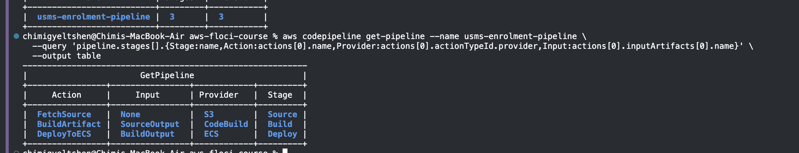

Step 17 - Run it end to end, and prove the service moved¶
Change a version number and have a running service change with no human typing aws ecs update-service. A green Deploy stage is a report; the evidence is that the service's revision increased and that the new revision's image is the one the build produced. Check both.

Command - part 1, record the before

```bash
BEFORE_TD=$(aws ecs describe-services --cluster "$USMS_ECS_CLUSTER" \
  --services "$USMS_ENROLMENT_SERVICE" \
  --query 'services[0].taskDefinition' --output text)
echo "before: $BEFORE_TD"
```
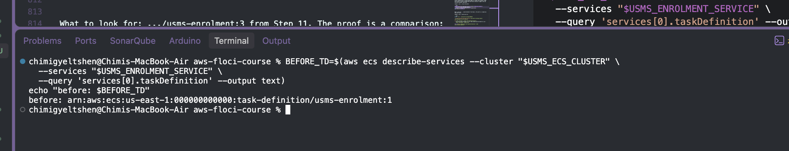


What to look for: .../usms-enrolment:3 from Step 11. The proof is a comparison; keep both halves.

Command - part 2, perturb and run

```bash 
printf 'r7\n' > labs/lab-11-cicd/app/VERSION

./scripts/utilities/usms-pack-source.sh labs/lab-11-cicd/app outputs/usms-enrolment-src.zip >/dev/null

aws s3api put-object --bucket usms-pipeline-artifacts \
  --key source/usms-enrolment-src.zip --body outputs/usms-enrolment-src.zip \
  --query 'VersionId' --output text

EXEC_ID=$(aws codepipeline start-pipeline-execution --name usms-enrolment-pipeline \
  --query 'pipelineExecutionId' --output text)
echo "execution: $EXEC_ID"

for i in $(seq 1 40); do
  aws codepipeline get-pipeline-state --name usms-enrolment-pipeline \
    --query 'stageStates[].[stageName,latestExecution.status]' --output text | sed 's/^/    /'
  STATE=$(aws codepipeline get-pipeline-execution \
            --pipeline-name usms-enrolment-pipeline --pipeline-execution-id "$EXEC_ID" \
            --query 'pipelineExecution.status' --output text 2>/dev/null)
  printf '  %2d  execution=%s\n' "$i" "${STATE:-unknown}"
  case "$STATE" in Succeeded|Failed|Stopped|Superseded) break ;; esac
  sleep 10
done
```


Command - part 3, read back the three proofs

```bash
AFTER_TD=$(aws ecs describe-services --cluster "$USMS_ECS_CLUSTER" \
  --services "$USMS_ENROLMENT_SERVICE" --query 'services[0].taskDefinition' --output text)

AFTER_IMAGE=$(aws ecs describe-task-definition --task-definition "$AFTER_TD" \
  --query 'taskDefinition.containerDefinitions[?name==`enrolment-api`].image | [0]' --output text)

{
  printf 'execution      : %s\n' "$EXEC_ID"
  printf 'task def before: %s\n' "$BEFORE_TD"
  printf 'task def after : %s\n' "$AFTER_TD"
  printf 'image after    : %s\n' "$AFTER_IMAGE"
  printf 'recorded at    : %s\n' "$(date -u +%Y-%m-%dT%H:%M:%SZ)"
} | tee outputs/lab-12-deploy-evidence.txt
```
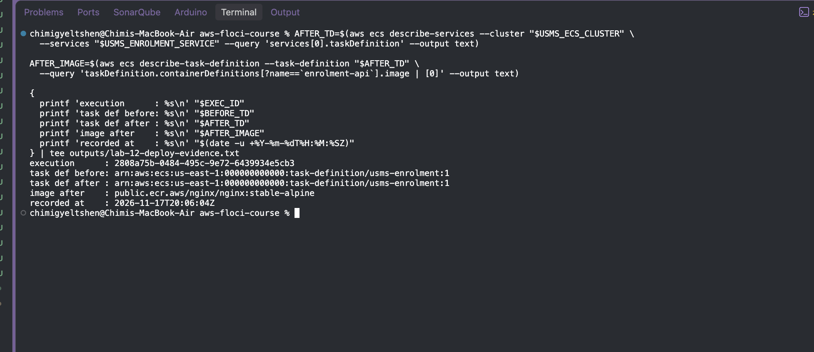

Step 18 - The rollback drill¶

Command - part 1, deploy a release whose image was never pushed

```bash
cd ~/aws-floci-course

printf 'r8\n' > labs/lab-11-cicd/app/VERSION

./scripts/utilities/usms-pack-source.sh labs/lab-11-cicd/app outputs/usms-enrolment-src.zip >/dev/null
aws s3api put-object --bucket usms-pipeline-artifacts \
  --key source/usms-enrolment-src.zip --body outputs/usms-enrolment-src.zip \
  --query 'VersionId' --output text

aws ecr describe-images --repository-name usms-enrolment \
  --query 'imageDetails[].imageTags[]' --output text
```


What to look for: r6 and r7, no r8. If your build can push, temporarily point the project's IMAGE_REPO_URI at a nonexistent repository or stop Docker; the point is a deploy whose image cannot be pulled.

```bash
BEFORE_ROLLBACK=$(aws ecs describe-services --cluster "$USMS_ECS_CLUSTER" \
  --services "$USMS_ENROLMENT_SERVICE" --query 'services[0].taskDefinition' --output text)
echo "good revision, remember this: $BEFORE_ROLLBACK"

aws codepipeline start-pipeline-execution --name usms-enrolment-pipeline \
  --query 'pipelineExecutionId' --output text
```


Command - part 2, watch it fail

```bash
sleep 30

aws ecs describe-services --cluster "$USMS_ECS_CLUSTER" --services "$USMS_ENROLMENT_SERVICE" \
  --query 'services[0].deployments[].{Status:status,TaskDef:taskDefinition,Desired:desiredCount,Running:runningCount,Rollout:rolloutState,Reason:rolloutStateReason}' \
  --output json

aws ecs describe-services --cluster "$USMS_ECS_CLUSTER" --services "$USMS_ENROLMENT_SERVICE" \
  --query 'services[0].events[0:5].[createdAt,message]' --output text
```


Command - part 3, roll back by hand

```bash 
aws ecs update-service \
  --cluster "$USMS_ECS_CLUSTER" \
  --service "$USMS_ENROLMENT_SERVICE" \
  --task-definition "$BEFORE_ROLLBACK" \
  --query 'service.{Name:serviceName,TaskDef:taskDefinition}' \
  --output table

./scripts/utilities/usms-ecs-watch.sh || echo "did not settle - expected on a build that runs no tasks"

aws ecs describe-services --cluster "$USMS_ECS_CLUSTER" --services "$USMS_ENROLMENT_SERVICE" \
  --query 'services[0].taskDefinition' --output text
```


```bash
printf 'r7\n' > labs/lab-11-cicd/app/VERSION
./scripts/utilities/usms-pack-source.sh labs/lab-11-cicd/app outputs/usms-enrolment-src.zip >/dev/null
aws s3api put-object --bucket usms-pipeline-artifacts \
  --key source/usms-enrolment-src.zip --body outputs/usms-enrolment-src.zip \
  --query 'VersionId' --output text
```


Step 19 - Blue/green with CodeDeploy, on paper¶

```bash 
python3 -m json.tool templates/lab-12-codedeploy-deployment-group.json > /dev/null \
  && echo "deployment group document is valid JSON"

python3 - << 'PY'
try:
    import yaml
except ImportError:
    print("PyYAML absent - appspec not parsed; check the indentation by eye")
else:
    d = yaml.safe_load(open("templates/lab-12-appspec.yaml"))
    svc = d["Resources"][0]["TargetService"]["Properties"]
    print("appspec parses. container:", svc["LoadBalancerInfo"]["ContainerName"],
          "port:", svc["LoadBalancerInfo"]["ContainerPort"])
PY
```
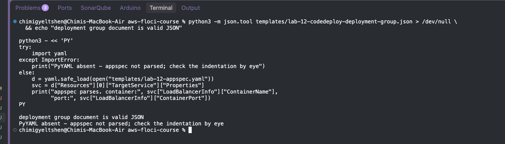

Step 20 - Record this lab's outputs¶
```bash
cd ~/aws-floci-course

cat > configs/lab-12.env << EOF
# Lab 12 - CI/CD: the image, the registry, and the deploy stage
# Generated on $(date -u +%Y-%m-%dT%H:%M:%SZ)
# Contains names, ARNs, tags and digests only. NO SECRETS. Safe to commit.

# --- registry ---
export USMS_ECR_REPO=usms-enrolment
export USMS_ECR_REPO_URI=$(aws ecr describe-repositories --repository-names usms-enrolment \
    --query 'repositories[0].repositoryUri' --output text 2>/dev/null || echo not-created)
export USMS_ECR_REGISTRY=$(aws ecr describe-repositories --repository-names usms-enrolment \
    --query 'repositories[0].repositoryUri' --output text 2>/dev/null | cut -d/ -f1 || echo not-created)
export USMS_ECR_TAG_MUTABILITY=$(aws ecr describe-repositories --repository-names usms-enrolment \
    --query 'repositories[0].imageTagMutability' --output text 2>/dev/null | grep -E '^[A-Z]+$' || echo not-created)
export USMS_ECR_SCAN_ON_PUSH=$(aws ecr describe-repositories --repository-names usms-enrolment \
    --query 'repositories[0].imageScanningConfiguration.scanOnPush' --output text 2>/dev/null | grep -Ei '^(true|false)$' || echo unknown)
export USMS_ECR_PORT_RANGE=5100-5104

# --- image ---
export USMS_IMAGE_TAG=r7
export USMS_IMAGE_DIGEST=$(aws ecr describe-images --repository-name usms-enrolment \
    --image-ids imageTag=r7 --query 'imageDetails[0].imageDigest' --output text 2>/dev/null \
    | grep -E '^sha256:' || echo not-pushed)
export USMS_IMAGEDEFS_FILE=imagedefinitions.json
export USMS_DOCKERFILE=labs/lab-11-cicd/app/Dockerfile

# --- task definition and service ---
export USMS_TASK_FAMILY=usms-enrolment
export USMS_TASK_REVISION_CICD=$(aws ecs describe-task-definition --task-definition usms-enrolment \
    --query 'taskDefinition.revision' --output text 2>/dev/null | grep -E '^[0-9]+$' || echo 0)
export USMS_TASK_DEF_ARN_CICD=$(aws ecs describe-task-definition --task-definition usms-enrolment \
    --query 'taskDefinition.taskDefinitionArn' --output text 2>/dev/null | grep -E '^arn:' || echo not-created)
export USMS_SERVICE_TASK_DEF=$(aws ecs describe-services --cluster usms-ecs-cluster \
    --services usms-enrolment-svc --query 'services[0].taskDefinition' --output text 2>/dev/null \
    | grep -E '^arn:' || echo not-created)
export USMS_ROLLBACK_REVISION=4

# --- pipeline deploy stage ---
export USMS_DEPLOY_STAGE=Deploy
export USMS_DEPLOY_ACTION=DeployToECS
export USMS_DEPLOY_PROVIDER=ECS
export USMS_PIPELINE_STAGES=$(aws codepipeline get-pipeline --name usms-enrolment-pipeline \
    --query 'length(pipeline.stages)' --output text 2>/dev/null | grep -E '^[0-9]+$' || echo 0)

# --- policy versions ---
export USMS_POLICY_CODEBUILD_VERSION=$(aws iam get-policy \
    --policy-arn arn:aws:iam::000000000000:policy/USMSCodeBuildBase \
    --query 'Policy.DefaultVersionId' --output text 2>/dev/null | grep -E '^v[0-9]+$' || echo unknown)
export USMS_POLICY_CODEPIPELINE_VERSION=$(aws iam get-policy \
    --policy-arn arn:aws:iam::000000000000:policy/USMSCodePipelineBase \
    --query 'Policy.DefaultVersionId' --output text 2>/dev/null | grep -E '^v[0-9]+$' || echo unknown)

# --- blue/green, conceptual ---
export USMS_CODEDEPLOY_SUPPORTED=$(sed -n 's/^USMS_CODEDEPLOY_SUPPORTED=//p' \
    outputs/lab-12-deploy-probe.txt 2>/dev/null || echo unknown)
export USMS_CODEDEPLOY_APP=usms-enrolment-app
export USMS_CODEDEPLOY_DG=usms-enrolment-dg
export USMS_APPSPEC_FILE=templates/lab-12-appspec.yaml
export USMS_CICD_DEPLOY_PATH=$(sed -n 's/^USMS_CICD_DEPLOY_PATH=//p' \
    outputs/lab-12-deploy-probe.txt 2>/dev/null || echo unknown)
EOF

grep -n 'export .*=$\|None' configs/lab-12.env || echo "all values populated"
grep -c '^export' configs/lab-12.env
```


Verify

```bash
source configs/lab-12.env
printf 'repo=%s\ntag=%s\ndigest=%s\nsvc-taskdef=%s\nstages=%s\ncb=%s cp=%s\npath=%s\n' \
  "$USMS_ECR_REPO_URI" "$USMS_IMAGE_TAG" "$USMS_IMAGE_DIGEST" "$USMS_SERVICE_TASK_DEF" \
  "$USMS_PIPELINE_STAGES" "$USMS_POLICY_CODEBUILD_VERSION" "$USMS_POLICY_CODEPIPELINE_VERSION" \
  "$USMS_CICD_DEPLOY_PATH"
```
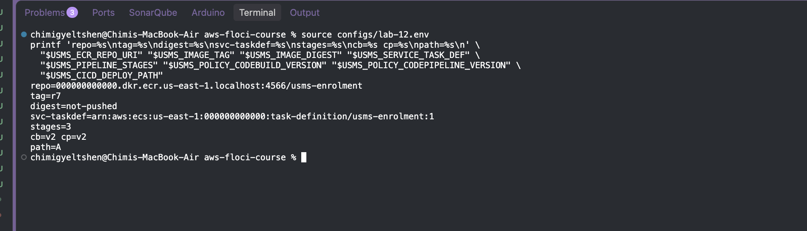

Step 21 - Commit¶


