# Lab 13 - Centralized Logging and Monitoring with CloudWatch and X-Ray

## Preewqusite

```bash
./scripts/utilities/floci-storage-check.sh
./scripts/utilities/verify-lab-10.sh | tail -2
```
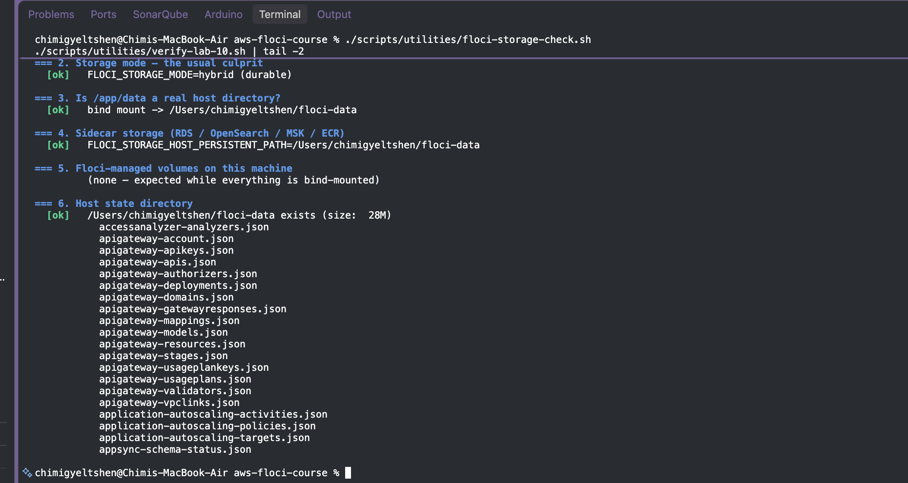

## directory structure 

```bash
cd ~/aws-floci-course
mkdir -p labs/lab-13-cloudwatch-xray/transcript-notifier-v2 project/checkpoint-01
ls -d labs/*
```
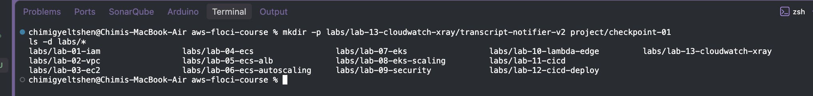

## 7. Step-by-Step Implementation¶

Step 1 - Start the environment and prove a new terminal can find it¶

```bash 
./scripts/setup/floci-up.sh
./scripts/utilities/floci-storage-check.sh
```
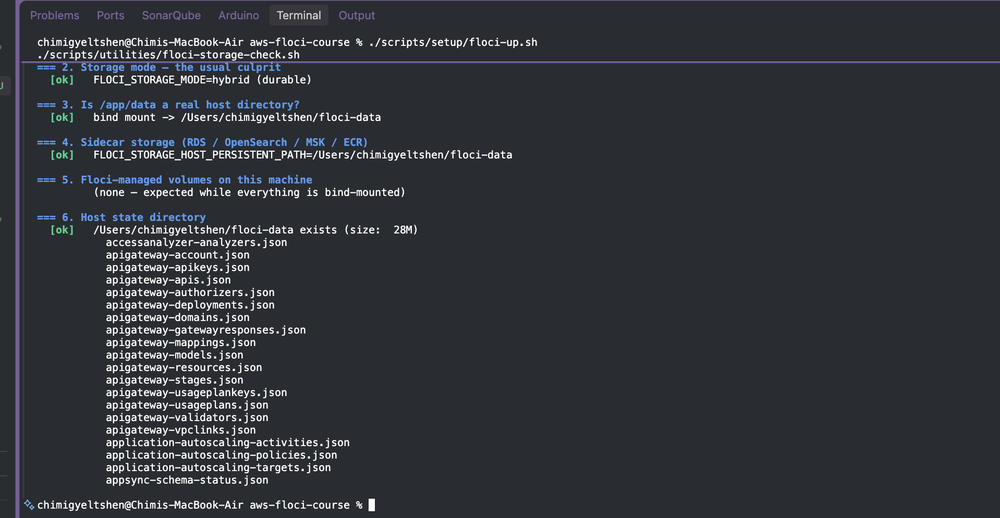


Step 2 - Source every lab environment file that exists, and confirm your identity¶
Source whatever env files are present and report what was found, rather than assuming every earlier file exists.

```bash
source configs/course.env

for f in configs/lab-01.env configs/lab-02.env configs/lab-03.env \
         configs/lab-04.env configs/lab-05.env configs/lab-06.env \
         configs/lab-07.env configs/lab-08.env configs/lab-09.env \
         configs/lab-10.env configs/lab-11.env configs/lab-12.env; do
  if [ -f "$f" ]; then
    source "$f"
    printf '  sourced  %s\n' "$f"
  else
    printf '  absent   %s\n' "$f"
  fi
done

./scripts/utilities/whoami.sh
```


Verify

```bash
printf 'bucket       : %s\n' "${USMS_BUCKET_NAME:-<UNSET>}"
printf 'notifier     : %s\n' "${USMS_LAMBDA_NOTIFIER_FN:-<UNSET>}"
printf 'notifier log : %s\n' "${USMS_LOG_GROUP_NOTIFIER:-<UNSET>}"
printf 'lambda role  : %s\n' "${USMS_ROLE_LAMBDA:-<UNSET>}"
printf 'account id   : %s\n' "${USMS_ACCOUNT_ID:-<UNSET>}"
```
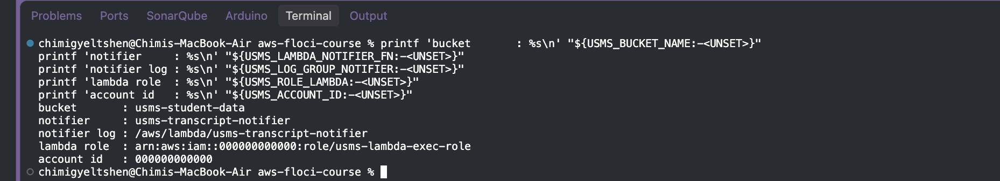


Step 3 - Create this lab's directories and confirm the repository shape¶
One directory for the instrumented handler, one for the project checkpoint, so no later step fails on a missing parent.

```bash
mkdir -p labs/lab-13-cloudwatch-xray/transcript-notifier-v2 \
         project/checkpoint-01

ls -d labs/lab-13-cloudwatch-xray/*/ project/*/
```


Verify

```bash
test -d labs/lab-13-cloudwatch-xray/transcript-notifier-v2 && echo "source tree ready"
```


Step 4 - Find out what this Floci build actually supports¶
Logs are usually good, metrics and alarms are stored but not evaluated, Logs Insights is often absent, and X-Ray varies most. Establish which you have, in writing, before depending on it.

```bash
probe() {  
  if eval "$2" >/dev/null 2>&1; then
    printf '  SUPPORTED    %s\n' "$1"
  else
    printf '  UNSUPPORTED  %s\n' "$1"
  fi
}

{
  printf 'Floci support probe for Lab 13 - %s\n\n' "$(date -u +%Y-%m-%dT%H:%M:%SZ)"
  probe "logs       (describe-log-groups)"    "aws logs describe-log-groups --limit 1"
  probe "logs       (put-metric-filter API)"  "aws logs describe-metric-filters --limit 1"
  probe "logs       (Insights start-query)"   "aws logs describe-queries --max-results 1"
  probe "cloudwatch (list-metrics)"           "aws cloudwatch list-metrics --namespace AWS/Lambda"
  probe "cloudwatch (describe-alarms)"        "aws cloudwatch describe-alarms --max-records 1"
  probe "cloudwatch (list-dashboards)"        "aws cloudwatch list-dashboards"
  probe "xray       (get-sampling-rules)"     "aws xray get-sampling-rules"
  probe "xray       (get-service-graph)"      "aws xray get-service-graph --start-time $(date -u -d '-5 minutes' +%s 2>/dev/null || date -u -v-5M +%s) --end-time $(date -u +%s)"
  probe "lambda     (get-function-config)"    "aws lambda get-function-configuration --function-name ${USMS_LAMBDA_NOTIFIER_FN:-usms-transcript-notifier}"
} | tee outputs/lab-13-support-probe.txt
```


Step 5 - Inventory the monitoring you already have and did not know about¶

```bash
{
  printf 'USMS telemetry inventory - %s\n\n' "$(date -u +%Y-%m-%dT%H:%M:%SZ)"

  printf '== log groups ==\n'
  aws logs describe-log-groups \
    --query 'sort_by(logGroups, &logGroupName)[].[logGroupName,retentionInDays,storedBytes]' \
    --output text

  printf '\n== alarms ==\n'
  aws cloudwatch describe-alarms \
    --query 'MetricAlarms[].[AlarmName,Namespace,MetricName,StateValue]' \
    --output text

  printf '\n== metric namespaces already present ==\n'
  aws cloudwatch list-metrics \
    --query 'sort_by(Metrics, &Namespace)[].Namespace' --output text \
    | tr '\t' '\n' | sort -u

  printf '\n== dashboards ==\n'
  aws cloudwatch list-dashboards --query 'DashboardEntries[].DashboardName' --output text
} | tee outputs/lab-13-telemetry-inventory.txt
```


Step 6 - Create the central log group and set retention on everything¶

Command - part 1, create the central group

```bash
CENTRAL_LOG_GROUP=/usms/central/application

aws logs describe-log-groups --log-group-name-prefix "$CENTRAL_LOG_GROUP" \
  --query 'length(logGroups)' --output text | grep -q '^0$' \
  && aws logs create-log-group --log-group-name "$CENTRAL_LOG_GROUP" \
  || echo "log group already exists - skipping create"

aws logs put-retention-policy \
  --log-group-name "$CENTRAL_LOG_GROUP" \
  --retention-in-days 30

```


Command - part 2, fix every USMS log group

```bash
NOTIFIER_LOG_GROUP="${USMS_LOG_GROUP_NOTIFIER:-/aws/lambda/usms-transcript-notifier}"

set_retention() {   
  if aws logs describe-log-groups --log-group-name-prefix "$1" \
       --query "logGroups[?logGroupName=='$1'] | length(@)" --output text | grep -q '^1$'; then
    aws logs put-retention-policy --log-group-name "$1" --retention-in-days "$2"
    printf '  set %4s days on %s\n' "$2" "$1"
  else
    printf '  absent, skipped   %s\n' "$1"
  fi
}

set_retention "$CENTRAL_LOG_GROUP"                 30
set_retention /usms/ecs/enrolment                  30
set_retention "$NOTIFIER_LOG_GROUP"                14
set_retention /aws/lambda/usms-edge-viewer-request 14
set_retention /aws/lambda/usms-edge-origin-response 14
```


Verify

```bash
aws logs describe-log-groups \
  --query 'sort_by(logGroups, &logGroupName)[].{Group:logGroupName,Days:retentionInDays}' \
  --output table
```
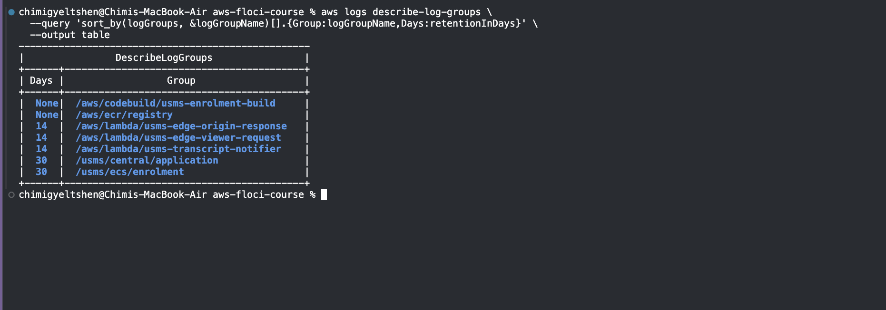

Step 7 - Write log events, and get the timestamp units right¶

```bash 
STREAM="lab-13-$(date -u +%Y%m%d)"

aws logs create-log-stream \
  --log-group-name "$CENTRAL_LOG_GROUP" \
  --log-stream-name "$STREAM" 2>/dev/null \
  || echo "stream already exists - continuing"

EVENTS=$(python3 - <<'EOF'
import json, time
now = int(time.time() * 1000)   
print(json.dumps([
  {"timestamp": now-4000, "message": 'USMS_EVENT {"event":"transcript.requested","student":"stu-00417","faculty":"science"}'},
  {"timestamp": now-2000, "message": 'USMS_EVENT {"event":"transcript.processed","student":"stu-00417","faculty":"science","seconds":0.42}'},
  {"timestamp": now-1000, "message": 'USMS_EVENT {"event":"transcript.processed","student":"stu-00982","faculty":"engineering","seconds":1.91}'},
  {"timestamp": now,      "message": 'ERROR USMS_EVENT {"event":"transcript.failed","student":"stu-01044","faculty":"science","reason":"render timeout"}'},
]))

)

aws logs put-log-events \
  --log-group-name "$CENTRAL_LOG_GROUP" \
  --log-stream-name "$STREAM" \
  --log-events "$EVENTS" \
  --query 'rejectedLogEventsInfo' --output json
```
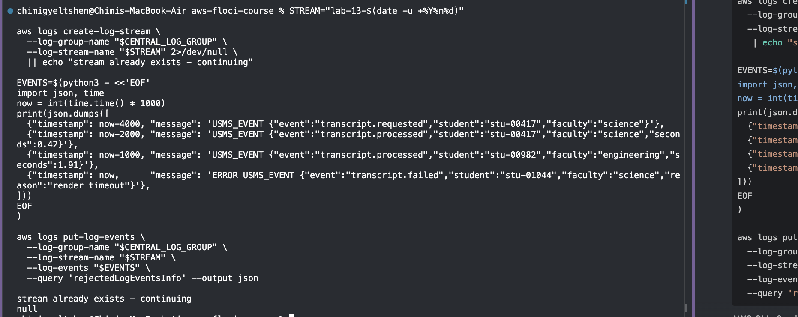

Verify

```bash
aws logs filter-log-events \
  --log-group-name "$CENTRAL_LOG_GROUP" \
  --query 'events[].[timestamp,message]' --output text
```


Step 8 - Test a filter pattern before you deploy it¶

```bash
aws logs test-metric-filter \
  --filter-pattern 'USMS_NOTIFY' \
  --log-event-messages \
    'USMS_NOTIFY {"bucket": "usms-student-data", "key": "transcripts/evidence/a.json", "readable": true}' \
    'usms-transcript-notifier: 1 record(s), channel=stdout, bucket_hint=usms-student-data' \
    'REPORT RequestId: 4c8e	Duration: 18.42 ms	Billed Duration: 19 ms' \
    'skipping non-transcript object: notes/ignore-me.json' \
  --query 'matches[].[eventNumber,eventMessage]' --output table \
  | tee outputs/lab-13-filter-test.json
```


Step 8 - Test a filter pattern before you deploy it¶

```bash 
aws logs test-metric-filter \
  --filter-pattern 'USMS_NOTIFY' \
  --log-event-messages \
    'USMS_NOTIFY {"bucket": "usms-student-data", "key": "transcripts/evidence/a.json", "readable": true}' \
    'usms-transcript-notifier: 1 record(s), channel=stdout, bucket_hint=usms-student-data' \
    'REPORT RequestId: 4c8e	Duration: 18.42 ms	Billed Duration: 19 ms' \
    'skipping non-transcript object: notes/ignore-me.json' \
  --query 'matches[].[eventNumber,eventMessage]' --output table \
  | tee outputs/lab-13-filter-test.json
```
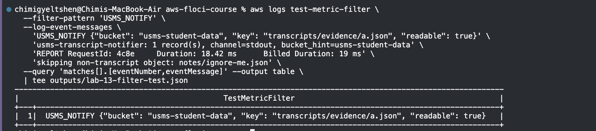

Step 9 - Deploy two metric filters¶

```bash
aws logs put-metric-filter \
  --log-group-name "$NOTIFIER_LOG_GROUP" \
  --filter-name usms-notify-count \
  --filter-pattern 'USMS_NOTIFY' \
  --metric-transformations \
      metricName=NotifyCount,metricNamespace=USMS/Application,metricValue=1,defaultValue=0

aws logs put-metric-filter \
  --log-group-name "$CENTRAL_LOG_GROUP" \
  --filter-name usms-central-errors \
  --filter-pattern 'ERROR' \
  --metric-transformations \
      metricName=CentralErrorCount,metricNamespace=USMS/Application,metricValue=1,defaultValue=0
```
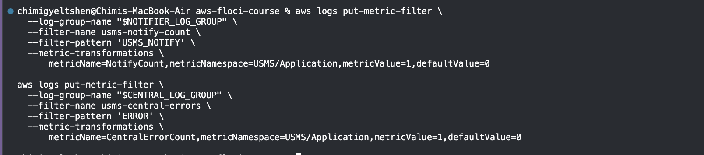

Verify

```bash
aws logs describe-metric-filters \
  --query 'metricFilters[?starts_with(filterName, `usms-`)].[filterName,logGroupName,filterPattern,metricTransformations[0].metricName]' \
  --output table
```


Step 10 - Prove the filter end to end¶
Create, perturb, read back: make the notifier run, then look for the metric.

Command - part 1, perturb

```bash
BUCKET="${USMS_BUCKET_NAME:-usms-student-data}"
NOTIFIER="${USMS_LAMBDA_NOTIFIER_FN:-usms-transcript-notifier}"

python3 -c "
import json, datetime
json.dump({'note': 'lab-13 telemetry probe',
           'created': datetime.datetime.now(datetime.timezone.utc).isoformat()},
          open('outputs/lab-13-probe-object.json','w'), indent=2)
"

aws s3api put-object \
  --bucket "$BUCKET" \
  --key transcripts/evidence/lab-13-probe-object.json \
  --body outputs/lab-13-probe-object.json \
  --content-type application/json \
  --query 'ETag' --output text

sleep 5

aws lambda invoke \
  --function-name "$NOTIFIER" \
  --qualifier live \
  --payload fileb://templates/lab-10-s3-event.json \
  --query 'FunctionError' --output text \
  outputs/lab-13-notifier-probe.json
```


Command - part 2, read back

```bash
WINDOW=$(python3 -c "
import datetime
now = datetime.datetime.now(datetime.timezone.utc).replace(microsecond=0)
start = now - datetime.timedelta(minutes=15)
print(start.strftime('%Y-%m-%dT%H:%M:%SZ'), now.strftime('%Y-%m-%dT%H:%M:%SZ'))
")
START=${WINDOW% *}
END=${WINDOW#* }

printf 'window: %s .. %s\n' "$START" "$END"

aws cloudwatch get-metric-statistics \
  --namespace USMS/Application \
  --metric-name NotifyCount \
  --start-time "$START" \
  --end-time "$END" \
  --period 60 \
  --statistics Sum SampleCount \
  --query 'sort_by(Datapoints, &Timestamp)[].[Timestamp,Sum,SampleCount]' \
  --output table \
  | tee outputs/lab-13-metric-readback.json
```
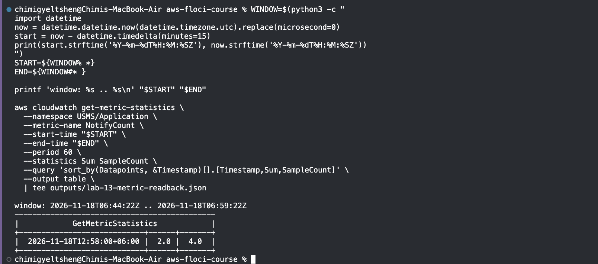

Step 11 - Publish custom metrics, and meet dimensions¶

Command - part 1, the shorthand form

```bash
aws cloudwatch put-metric-data \
  --namespace USMS/Application \
  --metric-data \
    'MetricName=TranscriptsProcessed,Unit=Count,Value=1,Dimensions=[{Name=Faculty,Value=science},{Name=Stage,Value=notify}]'

aws cloudwatch put-metric-data \
  --namespace USMS/Application \
  --metric-data 'MetricName=TranscriptsProcessed,Unit=Count,Value=1'
```


Command - part 2, the JSON form, with timestamps

```bash
NOW_ISO=$(python3 -c "
import datetime
print(datetime.datetime.now(datetime.timezone.utc).replace(microsecond=0).isoformat().replace('+00:00','Z'))
")

cat > templates/lab-13-metric-data.json << EOF
[
  {
    "MetricName": "TranscriptsProcessed",
    "Timestamp": "${NOW_ISO}",
    "Unit": "Count",
    "Value": 3,
    "Dimensions": [
      { "Name": "Faculty", "Value": "engineering" },
      { "Name": "Stage",   "Value": "notify" }
    ]
  },
  {
    "MetricName": "TranscriptLagSeconds",
    "Timestamp": "${NOW_ISO}",
    "Unit": "Seconds",
    "Value": 0.42,
    "Dimensions": [
      { "Name": "Stage", "Value": "notify" }
    ]
  },
  {
    "MetricName": "TranscriptLagSeconds",
    "Timestamp": "${NOW_ISO}",
    "Unit": "Seconds",
    "Value": 1.91,
    "Dimensions": [
      { "Name": "Stage", "Value": "notify" }
    ]
  },
  {
    "MetricName": "EdgeDenyCount",
    "Timestamp": "${NOW_ISO}",
    "Unit": "Count",
    "Value": 1,
    "Dimensions": [
      { "Name": "Stage", "Value": "viewer-request" }
    ]
  }
]
EOF

python3 -m json.tool templates/lab-13-metric-data.json > /dev/null && echo "valid JSON"

aws cloudwatch put-metric-data \
  --namespace USMS/Application \
  --metric-data file://templates/lab-13-metric-data.json
```


Verify

```bash
aws cloudwatch list-metrics --namespace USMS/Application \
  --query 'sort_by(Metrics, &MetricName)[].[MetricName,join(`,`, Dimensions[].Name) || `(none)`]' \
  --output table

aws cloudwatch get-metric-statistics \
  --namespace USMS/Application \
  --metric-name TranscriptLagSeconds \
  --dimensions Name=Stage,Value=notify \
  --start-time "$START" --end-time "$END" \
  --period 300 \
  --statistics SampleCount Sum Average Maximum \
  --query 'Datapoints[0]' --output json
```
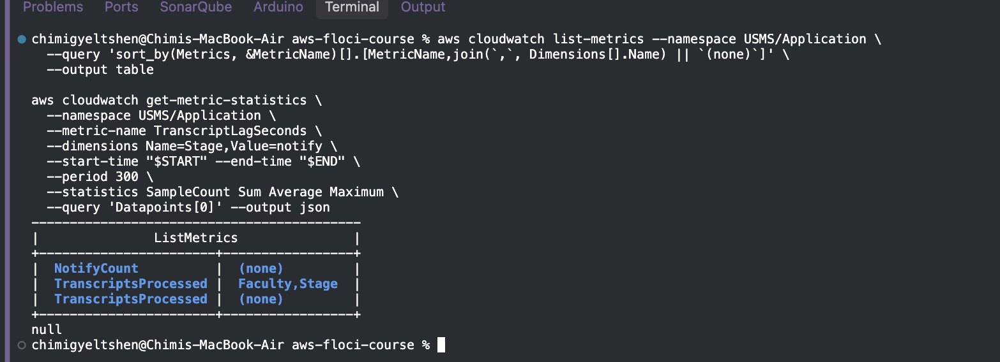

Step 12 - Give the roles permission to emit telemetry¶
```bash 
python3 -m json.tool policies/usms-observability-write-policy.json > /dev/null && echo "valid JSON"
```
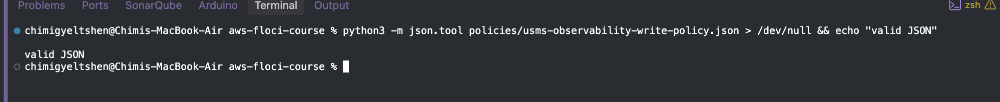

Command - part 2, create and attach

```bash
OBS_POLICY_ARN=$(aws iam create-policy \
  --policy-name USMSObservabilityWrite \
  --policy-document file://policies/usms-observability-write-policy.json \
  --description "Write logs to USMS groups, publish USMS/Application metrics, send X-Ray traces" \
  --query 'Policy.Arn' --output text 2>/dev/null \
  || aws iam list-policies --scope Local \
       --query "Policies[?PolicyName=='USMSObservabilityWrite'].Arn | [0]" --output text)

echo "$OBS_POLICY_ARN"

for role_ref in "${USMS_ROLE_LAMBDA:-usms-lambda-exec-role}" "${USMS_ROLE_EC2:-usms-ec2-app-role}"; do
  role="${role_ref##*/}"   # the vars may hold a full ARN; attach-role-policy needs only the name
  aws iam attach-role-policy --role-name "$role" --policy-arn "$OBS_POLICY_ARN" \
    && printf '  attached to %s\n' "$role"
done
```
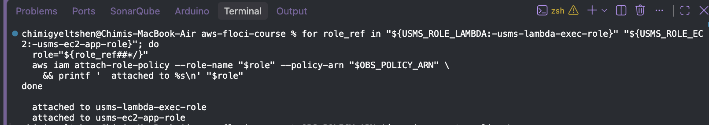

Verify

```bash
aws iam list-attached-role-policies --role-name "$(basename "${USMS_ROLE_LAMBDA:-usms-lambda-exec-role}")" \
  --query 'AttachedPolicies[].PolicyName' --output text

aws iam get-policy-version \
  --policy-arn "$OBS_POLICY_ARN" \
  --version-id "$(aws iam get-policy --policy-arn "$OBS_POLICY_ARN" \
                    --query 'Policy.DefaultVersionId' --output text)" \
  --query 'PolicyVersion.Document.Statement[].[Sid,Effect]' --output table
```


Step 13 - Instrument the notifier, and use an alias for what aliases are for¶

Command - part 1, the instrumented handler
```bash 
python3 -m py_compile labs/lab-13-cloudwatch-xray/transcript-notifier-v2/notifier.py \
  && echo "syntax OK (python3)"
```
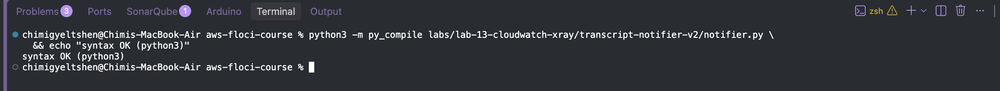

Command - part 2, deploy, publish, repoint

```bash
( cd labs/lab-13-cloudwatch-xray/transcript-notifier-v2 \
  && python3 -m zipfile -c "$COURSE_ROOT/outputs/lab-13-notifier-v2.zip" notifier.py )

python3 -m zipfile -l outputs/lab-13-notifier-v2.zip

aws lambda update-function-code \
  --function-name "$NOTIFIER" \
  --zip-file fileb://outputs/lab-13-notifier-v2.zip \
  --query '{Name:FunctionName,CodeSize:CodeSize,Version:Version}' --output table

aws lambda update-function-configuration \
  --function-name "$NOTIFIER" \
  --environment "Variables={USMS_BUCKET=$BUCKET,USMS_NOTIFY_CHANNEL=stdout,USMS_METRIC_NAMESPACE=USMS/Application,USMS_FACULTY_DEFAULT=unknown}" \
  --query 'Environment.Variables' --output json

aws lambda wait function-updated-v2 --function-name "$NOTIFIER" 2>/dev/null \
  || { echo "waiter unsupported - pausing instead"; sleep 5; }

NOTIFIER_V2=$(aws lambda publish-version \
  --function-name "$NOTIFIER" \
  --description "Lab 13 - instrumented: custom metrics and trace id" \
  --query 'Version' --output text)

aws lambda update-alias \
  --function-name "$NOTIFIER" \
  --name live \
  --function-version "$NOTIFIER_V2" \
  --query '{Alias:Name,Version:FunctionVersion}' --output table
```
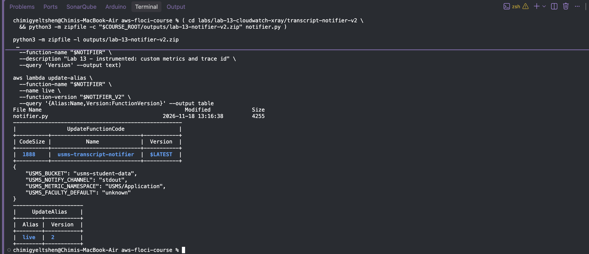

Verify

```bash
aws lambda get-function-configuration --function-name "$NOTIFIER" --qualifier live \
  --query '{Version:Version,Handler:Handler,Runtime:Runtime}' --output json

aws lambda invoke \
  --function-name "$NOTIFIER" --qualifier live \
  --payload fileb://templates/lab-10-s3-event.json \
  --log-type Tail --query 'LogResult' --output text \
  outputs/lab-13-notifier-v2-probe.json \
  | openssl base64 -d -A

python3 -m json.tool outputs/lab-13-notifier-v2-probe.json
```


Step 14 - Turn on active tracing¶

```bash
aws lambda update-function-configuration \
  --function-name "$NOTIFIER" \
  --tracing-config Mode=Active \
  --query '{Name:FunctionName,Tracing:TracingConfig.Mode}' --output table

aws lambda wait function-updated-v2 --function-name "$NOTIFIER" 2>/dev/null \
  || { echo "waiter unsupported - pausing instead"; sleep 5; }

NOTIFIER_V3=$(aws lambda publish-version \
  --function-name "$NOTIFIER" \
  --description "Lab 13 - instrumented + active tracing" \
  --query 'Version' --output text)

aws lambda update-alias \
  --function-name "$NOTIFIER" --name live \
  --function-version "$NOTIFIER_V3" \
  --query 'FunctionVersion' --output text
```
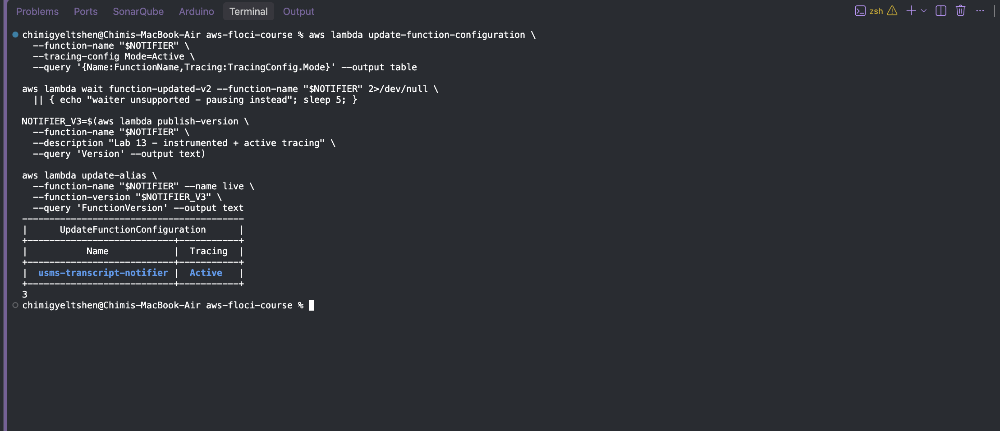

Verify

```bash
aws lambda get-function-configuration --function-name "$NOTIFIER" --qualifier live \
  --query '{Version:Version,Tracing:TracingConfig.Mode}' --output json

aws iam list-attached-role-policies --role-name "$(basename "${USMS_ROLE_LAMBDA:-usms-lambda-exec-role}")" \
  --query "AttachedPolicies[?PolicyName=='USMSObservabilityWrite'] | length(@)" --output text
```
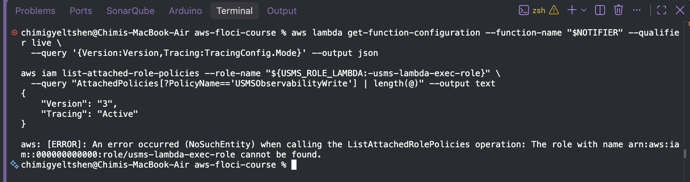

Step 15 - The X-Ray data model, and your first segment¶

```bash
python3 - << 'PY' > templates/lab-13-segment-parent.json
import json, os, time

now = time.time()
trace_id = "1-%08x-%s" % (int(now), os.urandom(12).hex())
seg_id = os.urandom(8).hex()

segment = {
    "name": "usms-transcript-notifier",
    "id": seg_id,
    "trace_id": trace_id,
    "start_time": round(now - 0.120, 3),
    "end_time": round(now, 3),
    "origin": "AWS::Lambda::Function",
    "annotations": {
        "faculty": "science",
        "stage": "notify",
        "transcript_bytes": 2184,
        "readable": True
    },
    "metadata": {
        "usms": {
            "key": "transcripts/science/stu-00417.json",
            "bucket": "usms-student-data",
            "alias": "live",
            "handler": "notifier.handler"
        }
    }
}

print(json.dumps(segment, indent=2))
with open("outputs/lab-13-trace-ids.txt", "a") as fh:
    fh.write("%s %s parent\n" % (trace_id, seg_id))
PY

python3 -m json.tool templates/lab-13-segment-parent.json > /dev/null && echo "valid JSON"
tail -1 outputs/lab-13-trace-ids.txt
```
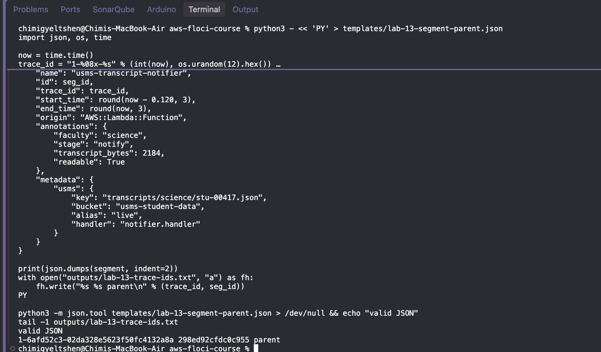

Step 16 - Subsegments, a downstream service, and reading a trace back¶
A trace answers where rather than how long once it has internal structure and more than one service.

Command - part 1, the same segment with subsegments

```bash
TRACE_ID=$(awk 'END {print $1}' outputs/lab-13-trace-ids.txt)
PARENT_ID=$(awk 'END {print $2}' outputs/lab-13-trace-ids.txt)

printf 'trace  : %s\nparent : %s\n' "$TRACE_ID" "$PARENT_ID"

python3 - "$TRACE_ID" "$PARENT_ID" << 'PY' > templates/lab-13-segment-subsegments.json
import json, os, sys, time

trace_id, parent_id = sys.argv[1], sys.argv[2]
now = time.time()

def sub(name, offset, duration, namespace, extra=None):
    doc = {
        "id": os.urandom(8).hex(),
        "name": name,
        "start_time": round(now - offset, 3),
        "end_time": round(now - offset + duration, 3),
        "namespace": namespace,
    }
    if extra:
        doc.update(extra)
    return doc

segment = {
    "name": "usms-transcript-notifier",
    "id": parent_id,
    "trace_id": trace_id,
    "start_time": round(now - 0.120, 3),
    "end_time": round(now, 3),
    "origin": "AWS::Lambda::Function",
    "annotations": {
        "faculty": "science",
        "stage": "notify",
        "transcript_bytes": 2184,
        "readable": True,
    },
    "metadata": {
        "usms": {
            "key": "transcripts/science/stu-00417.json",
            "bucket": "usms-student-data",
            "alias": "live",
        }
    },
    "subsegments": [
        sub("s3-head-object", 0.118, 0.018, "aws", {
            "aws": {"operation": "HeadObject",
                    "bucket_name": "usms-student-data",
                    "region": "us-east-1"}}),
        sub("render-pdf", 0.098, 0.074, "remote", {
            "metadata": {"usms": {"pages": 3, "renderer": "wkhtmltopdf"}}}),
        sub("cloudwatch-put-metric-data", 0.022, 0.011, "aws", {
            "aws": {"operation": "PutMetricData"}}),
    ],
}

print(json.dumps(segment, indent=2))
PY

python3 -m json.tool templates/lab-13-segment-subsegments.json > /dev/null && echo "valid JSON"
```
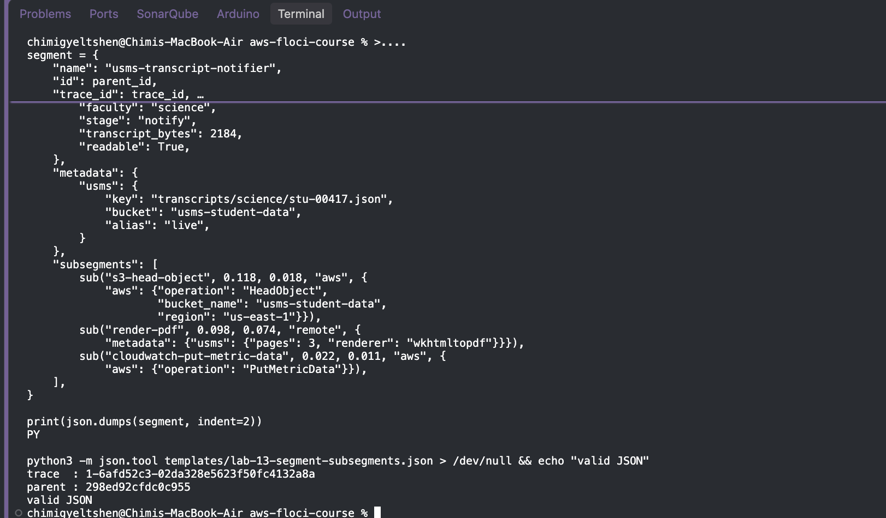

Command - part 2, a second service in the same trace

```bash
python3 - "$TRACE_ID" "$PARENT_ID" << 'PY' > templates/lab-13-segment-downstream.json
import json, os, sys, time

trace_id, parent_id = sys.argv[1], sys.argv[2]
now = time.time()

segment = {
    "name": "usms-student-data",
    "id": os.urandom(8).hex(),
    "trace_id": trace_id,
    "parent_id": parent_id,
    "type": "subsegment",
    "start_time": round(now - 0.118, 3),
    "end_time": round(now - 0.100, 3),
    "origin": "AWS::S3::Bucket",
    "http": {
        "request": {"method": "HEAD",
                    "url": "https://usms-student-data.s3.us-east-1.amazonaws.com/transcripts/science/stu-00417.json"},
        "response": {"status": 200, "content_length": 2184},
    },
    "annotations": {"faculty": "science", "stage": "origin"},
}

print(json.dumps(segment, indent=2))
PY

python3 -m json.tool templates/lab-13-segment-downstream.json > /dev/null && echo "valid JSON"

aws xray put-trace-segments \
  --trace-segment-documents \
    "$(cat templates/lab-13-segment-subsegments.json)" \
    "$(cat templates/lab-13-segment-downstream.json)" \
  --query 'UnprocessedTraceSegments' --output json
```
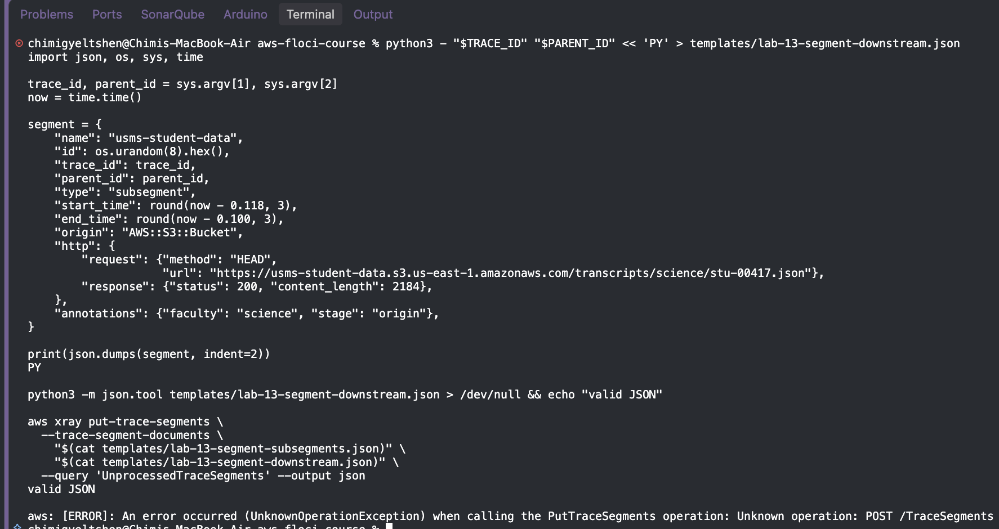

Command - part 3, read it back

```bash
XW=$(python3 -c "
import datetime
now = datetime.datetime.now(datetime.timezone.utc).replace(microsecond=0)
start = now - datetime.timedelta(minutes=15)
print(int(start.timestamp()), int(now.timestamp()))
")
XSTART=${XW% *}
XEND=${XW#* }

aws xray get-trace-summaries \
  --start-time "$XSTART" --end-time "$XEND" \
  --query 'TraceSummaries[].{Id:Id,Duration:Duration,Http:Http.HttpStatus,Annotations:keys(Annotations)}' \
  --output json | tee outputs/lab-13-trace-summaries.json

aws xray batch-get-traces --trace-ids "$TRACE_ID" \
  --query 'Traces[0].{Id:Id,Duration:Duration,Segments:length(Segments)}' \
  --output json
```
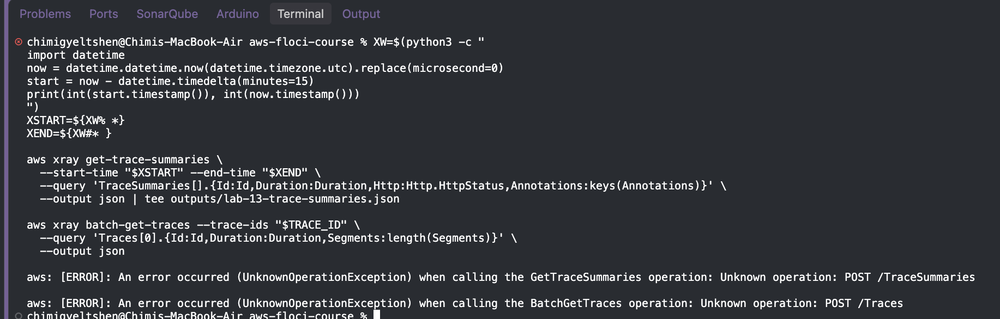

Step 17 - Search by annotation, read the service graph, and write the emitter¶
Command - part 1, search

```bash
aws xray get-trace-summaries \
  --start-time "$XSTART" --end-time "$XEND" \
  --filter-expression 'annotation.faculty = "science"' \
  --query 'length(TraceSummaries)' --output text \
  || echo "filter expressions unsupported on this build"

aws xray get-trace-summaries \
  --start-time "$XSTART" --end-time "$XEND" \
  --filter-expression 'annotation.faculty = "engineering"' \
  --query 'length(TraceSummaries)' --output text \
  || echo "filter expressions unsupported on this build"
1 then 0. The second call proves the filter actually filters.
```


Command - part 2, the service graph

```bash
aws xray get-service-graph \
  --start-time "$XSTART" --end-time "$XEND" \
  --query 'Services[].{Name:Name,Type:Type,Edges:length(Edges),Ok:SummaryStatistics.OkCount}' \
  --output table | tee outputs/lab-13-service-graph.json
```


Command - part 3, one script that emits all three signals


```bash
chmod +x scripts/utilities/usms-emit-telemetry.sh
bash -n scripts/utilities/usms-emit-telemetry.sh && echo "syntax OK"

./scripts/utilities/usms-emit-telemetry.sh science 0.51
./scripts/utilities/usms-emit-telemetry.sh engineering 2.40
./scripts/utilities/usms-emit-telemetry.sh engineering 3.10
```
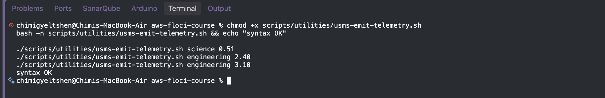


Step 18 - Decide what gets traced at all¶

```bash
aws xray get-sampling-rules \
  --query 'SamplingRuleRecords[].SamplingRule.{Name:RuleName,Priority:Priority,Rate:FixedRate,Reservoir:ReservoirSize,Service:ServiceName}' \
  --output table

cat > templates/lab-13-sampling-rule.json << 'EOF'
{
  "RuleName": "usms-transcripts-sampling",
  "ResourceARN": "*",
  "Priority": 1000,
  "FixedRate": 0.10,
  "ReservoirSize": 2,
  "ServiceName": "usms-transcript-notifier",
  "ServiceType": "*",
  "Host": "*",
  "HTTPMethod": "*",
  "URLPath": "*",
  "Version": 1
}
EOF

python3 -m json.tool templates/lab-13-sampling-rule.json > /dev/null && echo "valid JSON"

aws xray create-sampling-rule \
  --sampling-rule file://templates/lab-13-sampling-rule.json \
  --query 'SamplingRuleRecord.SamplingRule.{Name:RuleName,Priority:Priority,Rate:FixedRate,Reservoir:ReservoirSize}' \
  --output table \
  || echo "create-sampling-rule unsupported on this build - the document above is the deliverable"
```


Command - part 2, the absence alarm

```bash
aws cloudwatch put-metric-alarm \
  --alarm-name usms-notify-silence \
  --alarm-description "No transcript notifications for 15 minutes - the pipeline has gone quiet" \
  --namespace USMS/Application \
  --metric-name NotifyCount \
  --statistic Sum \
  --period 300 \
  --evaluation-periods 3 \
  --datapoints-to-alarm 3 \
  --threshold 1 \
  --comparison-operator LessThanThreshold \
  --treat-missing-data breaching \
  --tags Key=Project,Value=USMS Key=Lab,Value=08
```
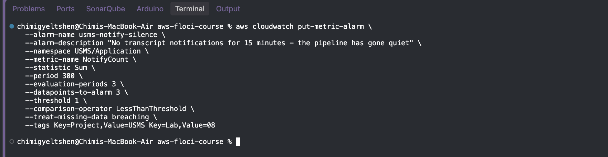

Verify

```bash
aws cloudwatch describe-alarms \
  --alarm-names usms-transcript-lag-high usms-notify-silence \
  --query 'MetricAlarms[].{Name:AlarmName,Metric:MetricName,Stat:Statistic,Th:Threshold,Op:ComparisonOperator,Missing:TreatMissingData,State:StateValue}' \
  --output table
```
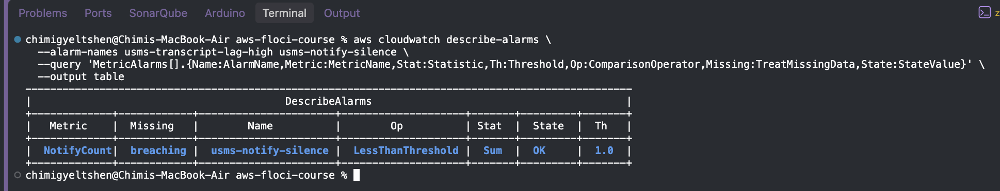


Step 19 - Create two alarms, one of which watches for an absence¶

Command - part 1, the threshold alarm

```bash
aws cloudwatch put-metric-alarm \
  --alarm-name usms-transcript-lag-high \
  --alarm-description "Transcript notification latency above 2s for 2 of 3 minutes" \
  --namespace USMS/Application \
  --metric-name TranscriptLagSeconds \
  --dimensions Name=Stage,Value=notify \
  --statistic Maximum \
  --period 60 \
  --evaluation-periods 3 \
  --datapoints-to-alarm 2 \
  --threshold 2 \
  --comparison-operator GreaterThanThreshold \
  --treat-missing-data notBreaching \
  --unit Seconds \
  --tags Key=Project,Value=USMS Key=Lab,Value=08
```


Command - part 2, the absence alarm

```bash
aws cloudwatch put-metric-alarm \
  --alarm-name usms-notify-silence \
  --alarm-description "No transcript notifications for 15 minutes - the pipeline has gone quiet" \
  --namespace USMS/Application \
  --metric-name NotifyCount \
  --statistic Sum \
  --period 300 \
  --evaluation-periods 3 \
  --datapoints-to-alarm 3 \
  --threshold 1 \
  --comparison-operator LessThanThreshold \
  --treat-missing-data breaching \
  --tags Key=Project,Value=USMS Key=Lab,Value=08
```


Verify

```bash
aws cloudwatch describe-alarms \
  --alarm-names usms-transcript-lag-high usms-notify-silence \
  --query 'MetricAlarms[].{Name:AlarmName,Metric:MetricName,Stat:Statistic,Th:Threshold,Op:ComparisonOperator,Missing:TreatMissingData,State:StateValue}' \
  --output table
```
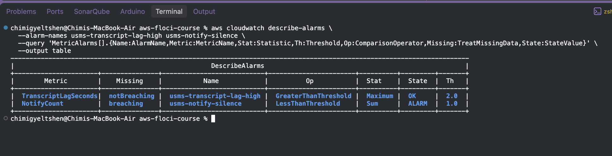

Step 20 - Prove the alarms, by making one fire¶

Command - part 1, force the transition

```bash
aws cloudwatch set-alarm-state \
  --alarm-name usms-transcript-lag-high \
  --state-value ALARM \
  --state-reason "Lab 13 Step 20: forced transition to prove the alarm is wired and records history" \
  --state-reason-data '{"lab":"08","step":20,"synthetic":true}'

sleep 2

aws cloudwatch describe-alarms --alarm-names usms-transcript-lag-high \
  --query 'MetricAlarms[0].{State:StateValue,Reason:StateReason,Since:StateUpdatedTimestamp}' \
  --output json
```
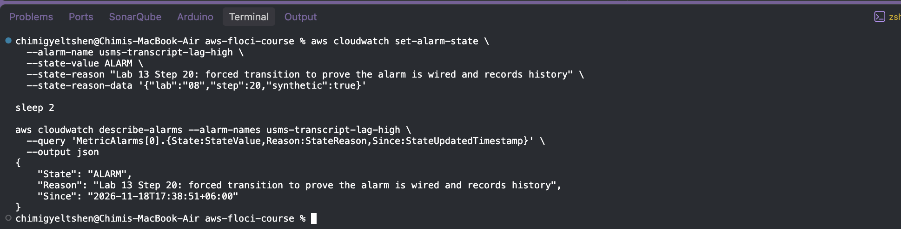


Command - part 2, read the history

```bash
aws cloudwatch describe-alarm-history \
  --alarm-name usms-transcript-lag-high \
  --history-item-type StateUpdate \
  --max-records 5 \
  --query 'sort_by(AlarmHistoryItems, &Timestamp)[].[Timestamp,HistorySummary]' \
  --output table \
  | tee outputs/lab-13-alarm-history.json
```


Command - part 3, put it back

```bash
aws cloudwatch set-alarm-state \
  --alarm-name usms-transcript-lag-high \
  --state-value OK \
  --state-reason "Lab 13 Step 20: restoring state after the forced-transition proof"

aws cloudwatch describe-alarms --alarm-names usms-transcript-lag-high \
  --query 'MetricAlarms[0].StateValue' --output text
```
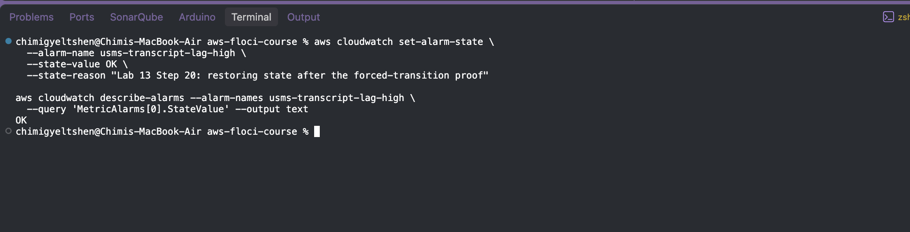

Step 21 - Combine them into one incident¶

> **Floci limitation:** `PutCompositeAlarm` is not implemented in Floci's CloudWatch
> (`UnsupportedOperation ... not supported by CloudWatch JSON`). The command below is correct
> against real AWS but will fail here. On Floci, record the error as your evidence and skip the
> composite-specific verification; the two child alarms are the part that can be demonstrated.

```bash
aws cloudwatch put-composite-alarm \
  --alarm-name usms-transcript-pipeline-down \
  --alarm-description "The USMS transcript pipeline is failing or silent. One incident, one page." \
  --alarm-rule 'ALARM("usms-transcript-lag-high") OR ALARM("usms-notify-silence")' \
  --actions-enabled \
  --tags Key=Project,Value=USMS Key=Lab,Value=08
```


Verify

```bash
aws cloudwatch describe-alarms --alarm-types CompositeAlarm \
  --query 'CompositeAlarms[].{Name:AlarmName,Rule:AlarmRule,State:StateValue}' --output json

aws cloudwatch set-alarm-state \
  --alarm-name usms-notify-silence \
  --state-value ALARM \
  --state-reason "Lab 13 Step 21: driving a child alarm to observe the composite"

sleep 3

aws cloudwatch describe-alarms --alarm-names usms-transcript-pipeline-down \
  --alarm-types CompositeAlarm \
  --query 'CompositeAlarms[0].{State:StateValue,Reason:StateReason}' --output json

aws cloudwatch set-alarm-state \
  --alarm-name usms-notify-silence \
  --state-value OK \
  --state-reason "Lab 13 Step 21: restoring state"
```


Step 22 - Build the dashboard¶

```bash
python3 -m json.tool templates/lab-13-dashboard.json > /dev/null && echo "valid JSON"

aws cloudwatch put-dashboard \
  --dashboard-name usms-overview \
  --dashboard-body file://templates/lab-13-dashboard.json \
  --query 'DashboardValidationMessages' --output json
```


Verify

```bash
aws cloudwatch list-dashboards \
  --query 'DashboardEntries[].[DashboardName,Size]' --output table

aws cloudwatch get-dashboard --dashboard-name usms-overview \
  --query 'DashboardBody' --output text \
  | python3 -c "
import json, sys
body = json.load(sys.stdin)
print('widgets     :', len(body['widgets']))
print('types       :', ', '.join(sorted({w['type'] for w in body['widgets']})))
print('grid width  :', max(w['x'] + w['width'] for w in body['widgets']))
rows = sorted((w['y'], w['y'] + w['height'], w['x'], w['x'] + w['width']) for w in body['widgets'])
overlap = any(a[1] > b[0] and a[3] > b[2] and b[3] > a[2] for a, b in zip(rows, rows[1:]))
print('overlapping :', overlap)
"
```


Step 23 - Query the logs properly¶

Command - path A, if Step 4 reported Insights as SUPPORTED

```bash
QUERY_ID=$(aws logs start-query \
  --log-group-name "$CENTRAL_LOG_GROUP" \
  --start-time "$XSTART" --end-time "$XEND" \
  --query-string 'fields @timestamp, @message
| filter @message like /USMS_EVENT/
| parse @message "*\"faculty\":\"*\"*" as pre, faculty, post
| stats count() as events by faculty
| sort events desc' \
  --query 'queryId' --output text)

echo "query: $QUERY_ID"

for attempt in 1 2 3 4 5 6; do
  STATUS=$(aws logs get-query-results --query-id "$QUERY_ID" --query 'status' --output text)
  [ "$STATUS" = "Complete" ] && break
  printf '  status %s, waiting\n' "$STATUS"
  sleep 3
done

aws logs get-query-results --query-id "$QUERY_ID" \
  --query 'results[].[ [0].value, [1].value ]' --output table
```
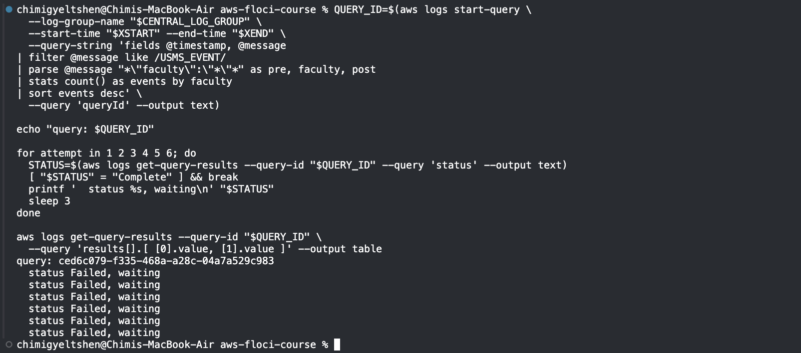


Command - path B, if Insights is unsupported

Answer the same question with the tool you have:

```bash
aws logs filter-log-events \
  --log-group-name "$CENTRAL_LOG_GROUP" \
  --filter-pattern 'USMS_EVENT' \
  --query 'events[].message' --output text \
  | python3 -c "
import collections, json, re, sys

counts = collections.Counter()
for line in sys.stdin.read().split('USMS_EVENT'):
    line = line.strip()
    if not line.startswith('{'):
        continue
    match = re.match(r'\{.*?\}', line, re.S)
    if not match:
        continue
    try:
        payload = json.loads(match.group(0))
    except json.JSONDecodeError:
        continue
    counts[payload.get('faculty', 'unknown')] += 1

for faculty, n in counts.most_common():
    print('%-14s %d' % (faculty, n))
"
```
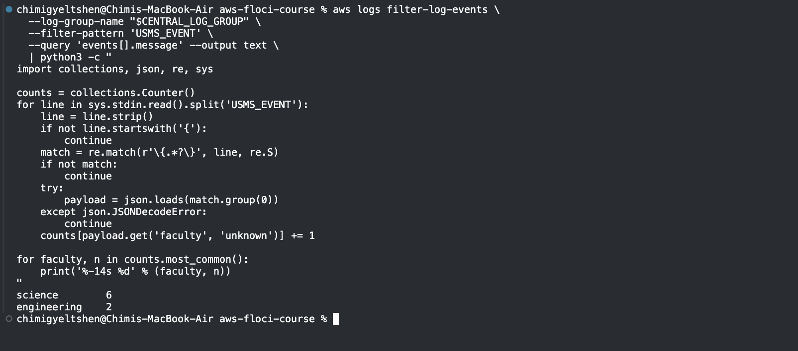


Verify

```bash
aws logs describe-log-groups --log-group-name-prefix /usms/central \
  --query 'logGroups[0].{Group:logGroupName,Retention:retentionInDays,Bytes:storedBytes}' \
  --output json
```
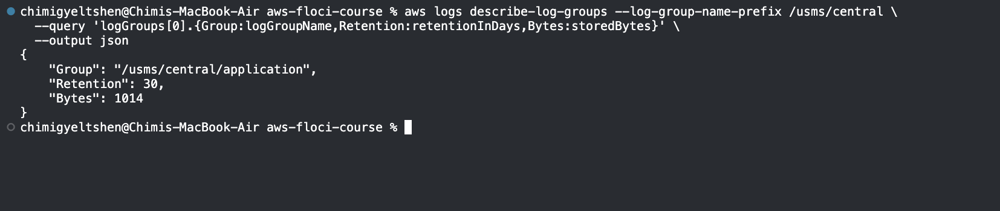

Step 24 - Restart Floci and read everything back¶

Command - part 1, record the state

```bash
inventory() {
  echo "--- log groups ---"
  aws logs describe-log-groups \
    --query 'sort_by(logGroups, &logGroupName)[].[logGroupName,retentionInDays]' --output text
  echo "--- metric filters ---"
  aws logs describe-metric-filters \
    --query 'sort_by(metricFilters, &filterName)[].[filterName,logGroupName]' --output text
  echo "--- metrics ---"
  aws cloudwatch list-metrics --namespace USMS/Application \
    --query 'sort_by(Metrics, &MetricName)[].MetricName' --output text | tr '\t' '\n' | sort -u
  echo "--- alarms ---"
  aws cloudwatch describe-alarms \
    --query 'sort_by(MetricAlarms, &AlarmName)[].[AlarmName,StateValue]' --output text
  aws cloudwatch describe-alarms --alarm-types CompositeAlarm \
    --query 'sort_by(CompositeAlarms, &AlarmName)[].[AlarmName,AlarmRule]' --output text
  echo "--- dashboards ---"
  aws cloudwatch list-dashboards --query 'DashboardEntries[].DashboardName' --output text
  echo "--- notifier ---"
  aws lambda get-function-configuration --function-name "$NOTIFIER" --qualifier live \
    --query '[Version,TracingConfig.Mode]' --output text
}

inventory | tee outputs/lab-13-pre-restart.txt

DATA_BEFORE=$(aws cloudwatch get-metric-statistics \
  --namespace USMS/Application --metric-name TranscriptsProcessed \
  --start-time "$START" --end-time "$END" --period 300 --statistics Sum \
  --query 'length(Datapoints)' --output text)

echo "metric data points before restart: $DATA_BEFORE"
```


Command - part 2, perturb

```bash
./scripts/setup/floci-down.sh
./scripts/setup/floci-up.sh
./scripts/utilities/whoami.sh
```
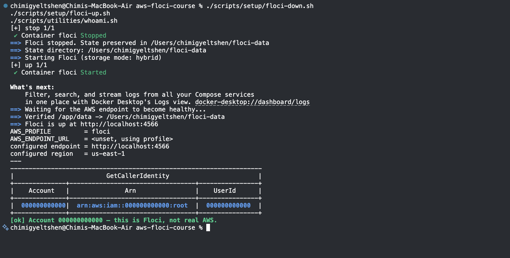


Command - part 3, read back

```bash
source configs/course.env
for f in configs/lab-01.env configs/lab-10.env; do [ -f "$f" ] && source "$f"; done
NOTIFIER="${USMS_LAMBDA_NOTIFIER_FN:-usms-transcript-notifier}"
CENTRAL_LOG_GROUP=/usms/central/application

inventory | tee outputs/lab-13-post-restart.txt

diff outputs/lab-13-pre-restart.txt outputs/lab-13-post-restart.txt \
  && echo "CONFIGURATION IDENTICAL - every Lab 13 object survived the restart"

DATA_AFTER=$(aws cloudwatch get-metric-statistics \
  --namespace USMS/Application --metric-name TranscriptsProcessed \
  --start-time "$START" --end-time "$END" --period 300 --statistics Sum \
  --query 'length(Datapoints)' --output text)

printf 'metric data points: before=%s after=%s\n' "$DATA_BEFORE" "$DATA_AFTER"
```


Step 25 - Write configs/lab-13.env¶

```bash 
cat > configs/lab-13.env << EOF
# Lab 13 - Centralized logging and monitoring with CloudWatch and X-Ray
# Generated on $(date -u +%Y-%m-%dT%H:%M:%SZ)
# Contains names, ARNs and IDs only. NO SECRETS. Safe to commit.

# --- log layer ------------------------------------------------------------
export USMS_LOG_GROUP_CENTRAL=/usms/central/application
export USMS_LOG_GROUP_ECS=/usms/ecs/enrolment
export USMS_LOG_STREAM_CENTRAL=$(aws logs describe-log-streams \
  --log-group-name /usms/central/application \
  --order-by LastEventTime --descending --max-items 1 \
  --query 'logStreams[0].logStreamName' --output text | head -1)
export USMS_LOG_RETENTION_APP=30
export USMS_LOG_RETENTION_FN=14

# --- metric layer ---------------------------------------------------------
export USMS_METRIC_NAMESPACE=USMS/Application
export USMS_METRIC_FILTER_NOTIFY=usms-notify-count
export USMS_METRIC_FILTER_ERRORS=usms-central-errors
export USMS_METRIC_NOTIFY_COUNT=NotifyCount
export USMS_METRIC_ERROR_COUNT=CentralErrorCount
export USMS_METRIC_PROCESSED=TranscriptsProcessed
export USMS_METRIC_LAG=TranscriptLagSeconds
export USMS_METRIC_EDGE_DENY=EdgeDenyCount

# --- iam ------------------------------------------------------------------
export USMS_POLICY_OBSERVABILITY=USMSObservabilityWrite
export USMS_POLICY_OBSERVABILITY_ARN=$(aws iam list-policies --scope Local \
  --query "Policies[?PolicyName=='USMSObservabilityWrite'].Arn | [0]" --output text)

# --- the instrumented notifier -------------------------------------------
export USMS_NOTIFIER_VERSION_INSTRUMENTED=${NOTIFIER_V2}
export USMS_NOTIFIER_VERSION_TRACED=${NOTIFIER_V3}
export USMS_NOTIFIER_ALIAS_VERSION=$(aws lambda get-alias \
  --function-name usms-transcript-notifier --name live \
  --query 'FunctionVersion' --output text)
export USMS_NOTIFIER_TRACING_MODE=$(aws lambda get-function-configuration \
  --function-name usms-transcript-notifier --qualifier live \
  --query 'TracingConfig.Mode' --output text)

# --- alarms - a future alerting lab attaches SNS actions to these three ------------------
export USMS_ALARM_LAG_HIGH=usms-transcript-lag-high
export USMS_ALARM_NOTIFY_SILENCE=usms-notify-silence
export USMS_ALARM_COMPOSITE=usms-transcript-pipeline-down

# --- dashboard ------------------------------------------------------------
export USMS_DASHBOARD=usms-overview

# --- x-ray ----------------------------------------------------------------
export USMS_XRAY_SAMPLING_RULE=usms-transcripts-sampling
export USMS_XRAY_SUPPORTED=$(aws xray get-sampling-rules >/dev/null 2>&1 && echo yes || echo no)
export USMS_XRAY_LAST_TRACE_ID=$(awk 'END {print $1}' outputs/lab-13-trace-ids.txt 2>/dev/null | grep -E '^1-' || echo none)

# --- capability flags recorded at lab time --------------------------------
export USMS_INSIGHTS_SUPPORTED=$(aws logs describe-queries --max-results 1 >/dev/null 2>&1 && echo yes || echo no)
export USMS_TELEMETRY_EMITTER=scripts/utilities/usms-emit-telemetry.sh
EOF

cat configs/lab-13.env
```


Verify

```bash
grep -c '^export' configs/lab-13.env

grep -nE '^export [A-Z_]+=$|None' configs/lab-13.env || echo "all values populated"

( source configs/lab-13.env && echo "sources cleanly" )
```
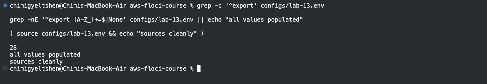


Step 26 - Check what Git sees, and commit¶


