# Lab 13: Centralized Logging and Monitoring with CloudWatch and X-Ray

> **Project:** USMS (University Student Management System) · **Emulator:** Floci · **Account:** `000000000000` · **Region:** `us-east-1`

So far the USMS services write logs, but nothing collects them in one place or alerts anyone when something goes wrong. In this lab you build the three observability signals for the transcript pipeline:

- **Logs:** a central log group, retention policies, and metric filters
- **Metrics:** custom metrics with dimensions, alarms, and a dashboard
- **Traces:** an instrumented Lambda with active X-Ray tracing, hand-built segments, and a sampling rule

You check every signal by reading it back, and finally restart Floci to confirm that everything persists.

---

## Contents

1. [Architecture](#architecture)
2. [Learning Objectives](#learning-objectives)
3. [Prerequisites](#prerequisites)
4. [Resources Created and Changed](#resources-created-and-changed)
5. [Part A: Environment and Discovery](#part-a-environment-and-discovery) (Steps 1–5)
6. [Part B: Logs](#part-b-logs) (Steps 6–10)
7. [Part C: Custom Metrics and Permissions](#part-c-custom-metrics-and-permissions) (Steps 11–12)
8. [Part D: Instrumentation and Tracing](#part-d-instrumentation-and-tracing) (Steps 13–18)
9. [Part E: Alarms](#part-e-alarms) (Steps 19–21)
10. [Part F: Dashboard and Log Queries](#part-f-dashboard-and-log-queries) (Steps 22–23)
11. [Part G: Persistence, Record and Commit](#part-g-persistence-record-and-commit) (Steps 24–26)
12. [Verification](#verification)
13. [Cleanup](#cleanup)
14. [Troubleshooting](#troubleshooting)

---

## Architecture

```
                    ┌──────────────────────────────────────────────┐
  S3 put / invoke ─▶│  usms-transcript-notifier  (alias: live)     │
                    │  instrumented handler, tracing = Active      │
                    └──────┬──────────────────┬──────────────┬─────┘
                           │ logs             │ metrics      │ traces
                           ▼                  ▼              ▼
  /aws/lambda/usms-transcript-notifier   USMS/Application   X-Ray
           │ metric filter                 namespace        segments + subsegments
           │ usms-notify-count ──────────▶ NotifyCount      sampling rule
                                           TranscriptsProcessed
  /usms/central/application                TranscriptLagSeconds
           │ metric filter                 EdgeDenyCount
           │ usms-central-errors ────────▶ CentralErrorCount
           ▼                                   │
     Logs Insights / filter-log-events         ▼
                                   ┌───────────────────────────┐
                                   │ usms-transcript-lag-high  │─┐
                                   │ usms-notify-silence       │─┼─▶ usms-transcript-pipeline-down
                                   └───────────────────────────┘ │      (composite alarm)
                                                                 ▼
                                                     usms-overview dashboard
```

---

## Learning Objectives

By the end of this lab you will be able to:

- Find out which CloudWatch and X-Ray features your emulator supports, and record the result
- Create a central log group and set retention on every USMS log group
- Write log events with correctly formatted timestamps, and test filter patterns before deploying them
- Turn log lines into metrics with metric filters, and confirm the metric appears end to end
- Publish custom metrics with dimensions, and explain why the dimensioned and total series are separate
- Grant a scoped observability policy to the Lambda and EC2 roles
- Instrument a Lambda, publish versions, and move an alias between them
- Build X-Ray segments and subsegments, search by annotation, and read a service graph
- Create a threshold alarm, an absence alarm, and a composite alarm, and prove they work
- Build a dashboard and query logs with Logs Insights, or without it if it is unsupported

---

## Prerequisites

Floci must be in a persistent storage mode, and Lab 10 must pass verification.

```bash
./scripts/utilities/floci-storage-check.sh
./scripts/utilities/verify-lab-10.sh | tail -2
```


**Prepare the directory layout**

```bash
cd ~/aws-floci-course
mkdir -p labs/lab-13-cloudwatch-xray/transcript-notifier-v2 project/checkpoint-01
ls -d labs/*
```


---

## Resources Created and Changed

| Type | Name | Notes |
|---|---|---|
| Log group | `/usms/central/application` | Created, 30-day retention |
| Log groups | `/usms/ecs/enrolment`, `/aws/lambda/usms-*` | Retention set (30 or 14 days) |
| Metric filter | `usms-notify-count` | Notifier log group → `NotifyCount` |
| Metric filter | `usms-central-errors` | Central log group → `CentralErrorCount` |
| Custom metrics | `TranscriptsProcessed`, `TranscriptLagSeconds`, `EdgeDenyCount` | Namespace `USMS/Application` |
| IAM policy | `USMSObservabilityWrite` | Attached to `usms-lambda-exec-role` and `usms-ec2-app-role` |
| Lambda | `usms-transcript-notifier` | Two new versions; alias `live` moved; tracing `Active` |
| X-Ray sampling rule | `usms-transcripts-sampling` | 10% fixed rate, reservoir of 2 |
| Metric alarms | `usms-transcript-lag-high`, `usms-notify-silence` | Threshold and absence alarms |
| Composite alarm | `usms-transcript-pipeline-down` | Not supported by Floci |
| Dashboard | `usms-overview` | 5 widgets |

---

## Part A: Environment and Discovery

### Step 1: Start the environment and confirm a new terminal can find it

```bash
./scripts/setup/floci-up.sh
./scripts/utilities/floci-storage-check.sh
```


### Step 2: Source every lab environment file that exists, and confirm your identity

Source whichever env files are present and report what was found, instead of assuming every earlier file exists.

```bash
source configs/course.env

for f in configs/lab-01.env configs/lab-02.env configs/lab-03.env \
         configs/lab-04.env configs/lab-05.env configs/lab-06.env \
         configs/lab-07.env configs/lab-08.env configs/lab-09.env \
         configs/lab-10.env configs/lab-11.env configs/lab-12.env; do
  if [ -f "$f" ]; then
    source "$f"
    printf '  sourced  %s\n' "$f"
  else
    printf '  absent   %s\n' "$f"
  fi
done

./scripts/utilities/whoami.sh
```

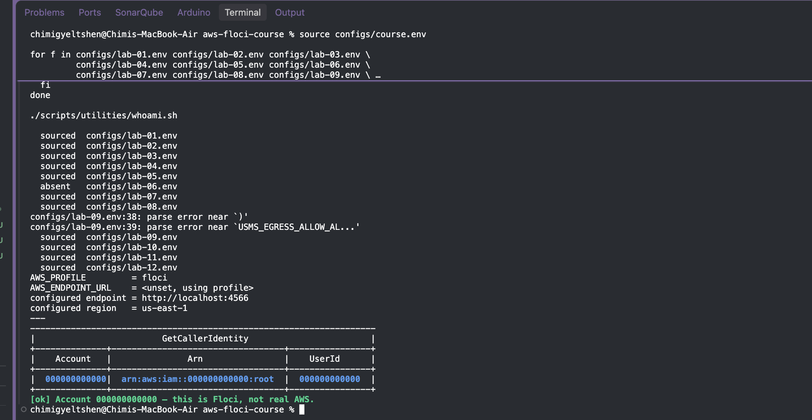

**Verify:** none of these values should print `<UNSET>`.

```bash
printf 'bucket       : %s\n' "${USMS_BUCKET_NAME:-<UNSET>}"
printf 'notifier     : %s\n' "${USMS_LAMBDA_NOTIFIER_FN:-<UNSET>}"
printf 'notifier log : %s\n' "${USMS_LOG_GROUP_NOTIFIER:-<UNSET>}"
printf 'lambda role  : %s\n' "${USMS_ROLE_LAMBDA:-<UNSET>}"
printf 'account id   : %s\n' "${USMS_ACCOUNT_ID:-<UNSET>}"
```


### Step 3: Create this lab's directories and confirm the repository layout

Create one directory for the instrumented handler and one for the project checkpoint, so no later step fails on a missing parent directory.

```bash
mkdir -p labs/lab-13-cloudwatch-xray/transcript-notifier-v2 \
         project/checkpoint-01

ls -d labs/lab-13-cloudwatch-xray/*/ project/*/
```

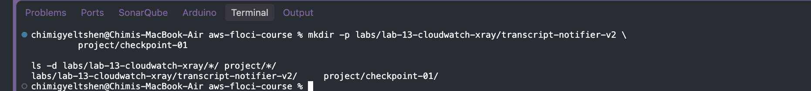

**Verify**

```bash
test -d labs/lab-13-cloudwatch-xray/transcript-notifier-v2 && echo "source tree ready"
```

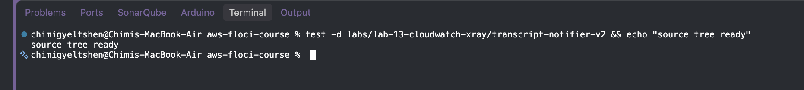

### Step 4: Find out what this Floci build supports

Emulators support these services unevenly. Logs usually work. Metrics and alarms are stored but not evaluated. Logs Insights is often missing, and X-Ray support varies the most. Record what your build supports before you depend on it.

```bash
probe() {  
  if eval "$2" >/dev/null 2>&1; then
    printf '  SUPPORTED    %s\n' "$1"
  else
    printf '  UNSUPPORTED  %s\n' "$1"
  fi
}

{
  printf 'Floci support probe for Lab 13 - %s\n\n' "$(date -u +%Y-%m-%dT%H:%M:%SZ)"
  probe "logs       (describe-log-groups)"    "aws logs describe-log-groups --limit 1"
  probe "logs       (put-metric-filter API)"  "aws logs describe-metric-filters --limit 1"
  probe "logs       (Insights start-query)"   "aws logs describe-queries --max-results 1"
  probe "cloudwatch (list-metrics)"           "aws cloudwatch list-metrics --namespace AWS/Lambda"
  probe "cloudwatch (describe-alarms)"        "aws cloudwatch describe-alarms --max-records 1"
  probe "cloudwatch (list-dashboards)"        "aws cloudwatch list-dashboards"
  probe "xray       (get-sampling-rules)"     "aws xray get-sampling-rules"
  probe "xray       (get-service-graph)"      "aws xray get-service-graph --start-time $(date -u -d '-5 minutes' +%s 2>/dev/null || date -u -v-5M +%s) --end-time $(date -u +%s)"
  probe "lambda     (get-function-config)"    "aws lambda get-function-configuration --function-name ${USMS_LAMBDA_NOTIFIER_FN:-usms-transcript-notifier}"
} | tee outputs/lab-13-support-probe.txt
```

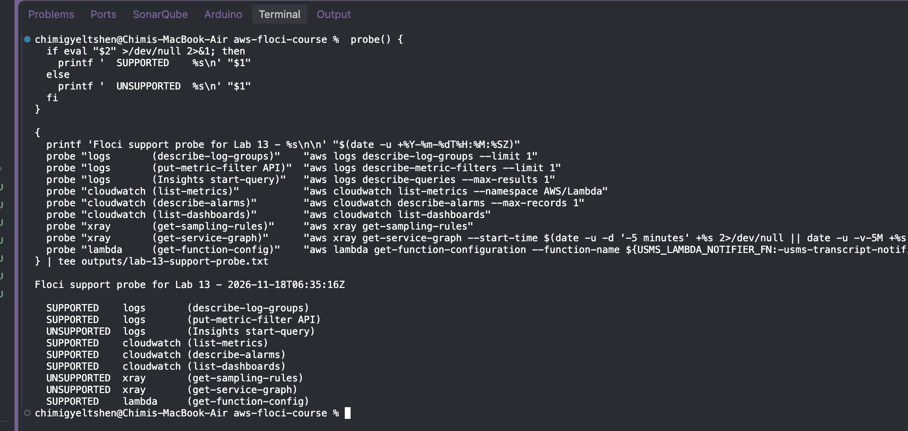

!!! note
    Keep `outputs/lab-13-support-probe.txt`. Step 23 uses the Logs Insights result to choose between Path A and Path B.

### Step 5: List the monitoring you already have

Earlier labs already created log groups and metrics as a side effect. List them before adding more.

```bash
{
  printf 'USMS telemetry inventory - %s\n\n' "$(date -u +%Y-%m-%dT%H:%M:%SZ)"

  printf '== log groups ==\n'
  aws logs describe-log-groups \
    --query 'sort_by(logGroups, &logGroupName)[].[logGroupName,retentionInDays,storedBytes]' \
    --output text

  printf '\n== alarms ==\n'
  aws cloudwatch describe-alarms \
    --query 'MetricAlarms[].[AlarmName,Namespace,MetricName,StateValue]' \
    --output text

  printf '\n== metric namespaces already present ==\n'
  aws cloudwatch list-metrics \
    --query 'sort_by(Metrics, &Namespace)[].Namespace' --output text \
    | tr '\t' '\n' | sort -u

  printf '\n== dashboards ==\n'
  aws cloudwatch list-dashboards --query 'DashboardEntries[].DashboardName' --output text
} | tee outputs/lab-13-telemetry-inventory.txt
```

!!! tip
    A `None` in the retention column means the log group never expires. Step 6 fixes this.

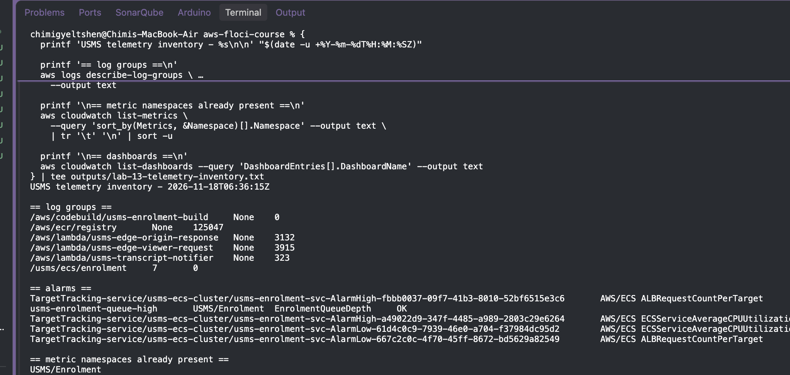

---

## Part B: Logs

### Step 6: Create the central log group and set retention on every log group

**Part 1: create the central group.** The command only creates the group if it does not already exist, so it is safe to run again.

```bash
CENTRAL_LOG_GROUP=/usms/central/application

aws logs describe-log-groups --log-group-name-prefix "$CENTRAL_LOG_GROUP" \
  --query 'length(logGroups)' --output text | grep -q '^0$' \
  && aws logs create-log-group --log-group-name "$CENTRAL_LOG_GROUP" \
  || echo "log group already exists - skipping create"

aws logs put-retention-policy \
  --log-group-name "$CENTRAL_LOG_GROUP" \
  --retention-in-days 30
```

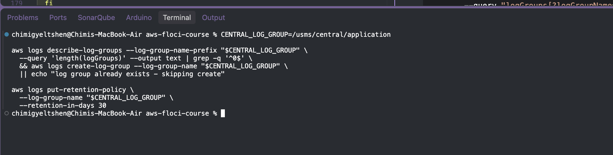

**Part 2: set retention on every USMS log group.** Application logs are kept for 30 days and function logs for 14. Any group that does not exist is skipped.

```bash
NOTIFIER_LOG_GROUP="${USMS_LOG_GROUP_NOTIFIER:-/aws/lambda/usms-transcript-notifier}"

set_retention() {   
  if aws logs describe-log-groups --log-group-name-prefix "$1" \
       --query "logGroups[?logGroupName=='$1'] | length(@)" --output text | grep -q '^1$'; then
    aws logs put-retention-policy --log-group-name "$1" --retention-in-days "$2"
    printf '  set %4s days on %s\n' "$2" "$1"
  else
    printf '  absent, skipped   %s\n' "$1"
  fi
}

set_retention "$CENTRAL_LOG_GROUP"                 30
set_retention /usms/ecs/enrolment                  30
set_retention "$NOTIFIER_LOG_GROUP"                14
set_retention /aws/lambda/usms-edge-viewer-request 14
set_retention /aws/lambda/usms-edge-origin-response 14
```

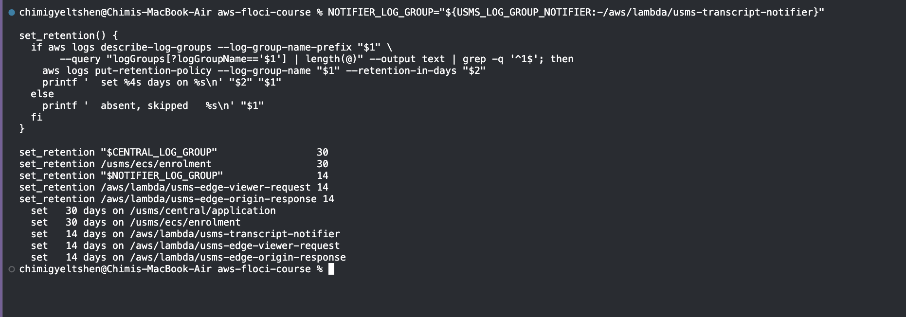

**Verify**

```bash
aws logs describe-log-groups \
  --query 'sort_by(logGroups, &logGroupName)[].{Group:logGroupName,Days:retentionInDays}' \
  --output table
```


### Step 7: Write log events with the correct timestamp units

!!! warning "Timestamps are in milliseconds"
    `put-log-events` expects timestamps in **milliseconds** since the epoch. If you pass seconds, the events are dated in 1970 and are rejected as too old. That is why the script multiplies `time.time()` by 1000.

```bash
STREAM="lab-13-$(date -u +%Y%m%d)"

aws logs create-log-stream \
  --log-group-name "$CENTRAL_LOG_GROUP" \
  --log-stream-name "$STREAM" 2>/dev/null \
  || echo "stream already exists - continuing"

EVENTS=$(python3 - <<'EOF'
import json, time
now = int(time.time() * 1000)   
print(json.dumps([
  {"timestamp": now-4000, "message": 'USMS_EVENT {"event":"transcript.requested","student":"stu-00417","faculty":"science"}'},
  {"timestamp": now-2000, "message": 'USMS_EVENT {"event":"transcript.processed","student":"stu-00417","faculty":"science","seconds":0.42}'},
  {"timestamp": now-1000, "message": 'USMS_EVENT {"event":"transcript.processed","student":"stu-00982","faculty":"engineering","seconds":1.91}'},
  {"timestamp": now,      "message": 'ERROR USMS_EVENT {"event":"transcript.failed","student":"stu-01044","faculty":"science","reason":"render timeout"}'},
]))
EOF
)

aws logs put-log-events \
  --log-group-name "$CENTRAL_LOG_GROUP" \
  --log-stream-name "$STREAM" \
  --log-events "$EVENTS" \
  --query 'rejectedLogEventsInfo' --output json
```

!!! check "Expected result"
    `null`, meaning no events were rejected.


**Verify**

```bash
aws logs filter-log-events \
  --log-group-name "$CENTRAL_LOG_GROUP" \
  --query 'events[].[timestamp,message]' --output text
```

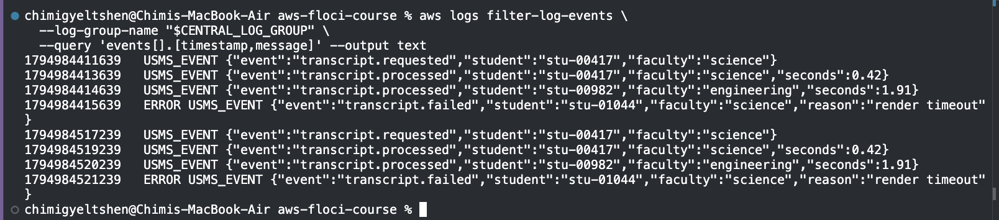

### Step 8: Test a filter pattern before you deploy it

`test-metric-filter` shows which sample lines a pattern matches, without creating anything. Only the first of the four sample lines should match.

```bash
aws logs test-metric-filter \
  --filter-pattern 'USMS_NOTIFY' \
  --log-event-messages \
    'USMS_NOTIFY {"bucket": "usms-student-data", "key": "transcripts/evidence/a.json", "readable": true}' \
    'usms-transcript-notifier: 1 record(s), channel=stdout, bucket_hint=usms-student-data' \
    'REPORT RequestId: 4c8e	Duration: 18.42 ms	Billed Duration: 19 ms' \
    'skipping non-transcript object: notes/ignore-me.json' \
  --query 'matches[].[eventNumber,eventMessage]' --output table \
  | tee outputs/lab-13-filter-test.json
```


### Step 9: Deploy two metric filters

| Filter | Log group | Pattern | Metric |
|---|---|---|---|
| `usms-notify-count` | Notifier log group | `USMS_NOTIFY` | `NotifyCount` |
| `usms-central-errors` | `/usms/central/application` | `ERROR` | `CentralErrorCount` |

`defaultValue=0` makes the filter publish a zero when nothing matches. Without it, quiet periods would have no data points at all.

```bash
aws logs put-metric-filter \
  --log-group-name "$NOTIFIER_LOG_GROUP" \
  --filter-name usms-notify-count \
  --filter-pattern 'USMS_NOTIFY' \
  --metric-transformations \
      metricName=NotifyCount,metricNamespace=USMS/Application,metricValue=1,defaultValue=0

aws logs put-metric-filter \
  --log-group-name "$CENTRAL_LOG_GROUP" \
  --filter-name usms-central-errors \
  --filter-pattern 'ERROR' \
  --metric-transformations \
      metricName=CentralErrorCount,metricNamespace=USMS/Application,metricValue=1,defaultValue=0
```


**Verify**

```bash
aws logs describe-metric-filters \
  --query 'metricFilters[?starts_with(filterName, `usms-`)].[filterName,logGroupName,filterPattern,metricTransformations[0].metricName]' \
  --output table
```

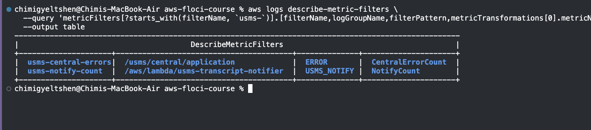

### Step 10: Prove the filter works end to end

To prove the filter works, make the notifier run, then look for the metric it should produce.

**Part 1: trigger the notifier**

```bash
BUCKET="${USMS_BUCKET_NAME:-usms-student-data}"
NOTIFIER="${USMS_LAMBDA_NOTIFIER_FN:-usms-transcript-notifier}"

python3 -c "
import json, datetime
json.dump({'note': 'lab-13 telemetry probe',
           'created': datetime.datetime.now(datetime.timezone.utc).isoformat()},
          open('outputs/lab-13-probe-object.json','w'), indent=2)
"

aws s3api put-object \
  --bucket "$BUCKET" \
  --key transcripts/evidence/lab-13-probe-object.json \
  --body outputs/lab-13-probe-object.json \
  --content-type application/json \
  --query 'ETag' --output text

sleep 5

aws lambda invoke \
  --function-name "$NOTIFIER" \
  --qualifier live \
  --payload fileb://templates/lab-10-s3-event.json \
  --query 'FunctionError' --output text \
  outputs/lab-13-notifier-probe.json
```

!!! check "Expected result"
    An ETag, followed by `None`, which means the function ran without an error.

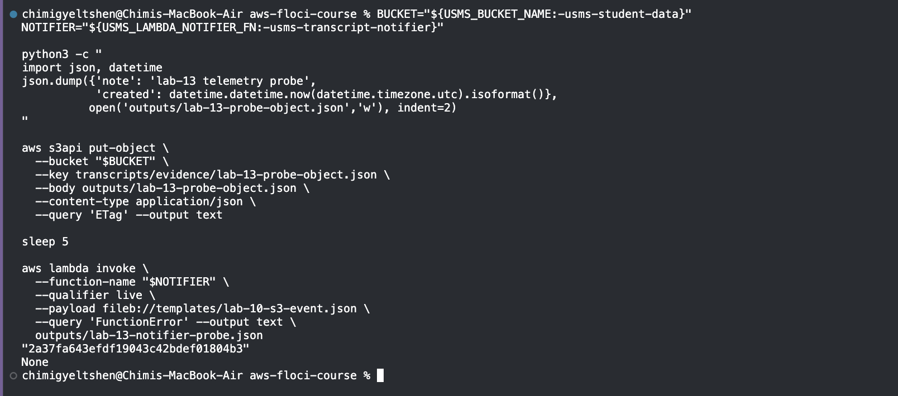

**Part 2: read the metric back over the last 15 minutes.** `START` and `END` are reused in Steps 11 and 24.

```bash
WINDOW=$(python3 -c "
import datetime
now = datetime.datetime.now(datetime.timezone.utc).replace(microsecond=0)
start = now - datetime.timedelta(minutes=15)
print(start.strftime('%Y-%m-%dT%H:%M:%SZ'), now.strftime('%Y-%m-%dT%H:%M:%SZ'))
")
START=${WINDOW% *}
END=${WINDOW#* }

printf 'window: %s .. %s\n' "$START" "$END"

aws cloudwatch get-metric-statistics \
  --namespace USMS/Application \
  --metric-name NotifyCount \
  --start-time "$START" \
  --end-time "$END" \
  --period 60 \
  --statistics Sum SampleCount \
  --query 'sort_by(Datapoints, &Timestamp)[].[Timestamp,Sum,SampleCount]' \
  --output table \
  | tee outputs/lab-13-metric-readback.json
```


---

## Part C: Custom Metrics and Permissions

### Step 11: Publish custom metrics with dimensions

!!! note "Dimensions create separate metrics"
    CloudWatch does not add up metrics across dimensions. `TranscriptsProcessed` published with `Faculty` and `Stage` dimensions is a separate metric from `TranscriptsProcessed` published with no dimensions. To see a per-faculty breakdown **and** an overall total, you must publish both.

**Part 1: the shorthand form**

```bash
aws cloudwatch put-metric-data \
  --namespace USMS/Application \
  --metric-data \
    'MetricName=TranscriptsProcessed,Unit=Count,Value=1,Dimensions=[{Name=Faculty,Value=science},{Name=Stage,Value=notify}]'

aws cloudwatch put-metric-data \
  --namespace USMS/Application \
  --metric-data 'MetricName=TranscriptsProcessed,Unit=Count,Value=1'
```

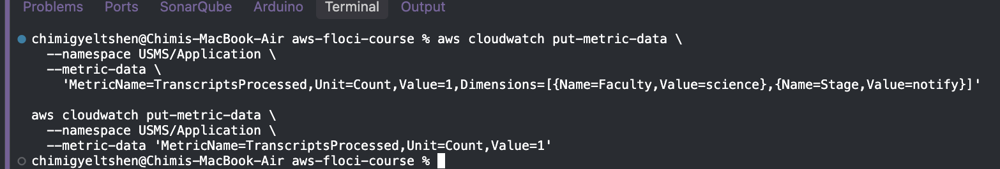

**Part 2: the JSON form, with timestamps.** The heredoc is **unquoted** (`<< EOF`) so the shell fills in `${NOW_ISO}`.

```bash
NOW_ISO=$(python3 -c "
import datetime
print(datetime.datetime.now(datetime.timezone.utc).replace(microsecond=0).isoformat().replace('+00:00','Z'))
")

cat > templates/lab-13-metric-data.json << EOF
[
  {
    "MetricName": "TranscriptsProcessed",
    "Timestamp": "${NOW_ISO}",
    "Unit": "Count",
    "Value": 3,
    "Dimensions": [
      { "Name": "Faculty", "Value": "engineering" },
      { "Name": "Stage",   "Value": "notify" }
    ]
  },
  {
    "MetricName": "TranscriptLagSeconds",
    "Timestamp": "${NOW_ISO}",
    "Unit": "Seconds",
    "Value": 0.42,
    "Dimensions": [
      { "Name": "Stage", "Value": "notify" }
    ]
  },
  {
    "MetricName": "TranscriptLagSeconds",
    "Timestamp": "${NOW_ISO}",
    "Unit": "Seconds",
    "Value": 1.91,
    "Dimensions": [
      { "Name": "Stage", "Value": "notify" }
    ]
  },
  {
    "MetricName": "EdgeDenyCount",
    "Timestamp": "${NOW_ISO}",
    "Unit": "Count",
    "Value": 1,
    "Dimensions": [
      { "Name": "Stage", "Value": "viewer-request" }
    ]
  }
]
EOF

python3 -m json.tool templates/lab-13-metric-data.json > /dev/null && echo "valid JSON"

aws cloudwatch put-metric-data \
  --namespace USMS/Application \
  --metric-data file://templates/lab-13-metric-data.json
```

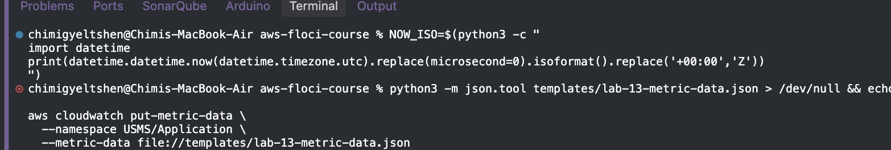

**Verify:** list the metrics and their dimensions, then get statistics for the two lag values.

```bash
aws cloudwatch list-metrics --namespace USMS/Application \
  --query 'sort_by(Metrics, &MetricName)[].[MetricName,join(`,`, Dimensions[].Name) || `(none)`]' \
  --output table

aws cloudwatch get-metric-statistics \
  --namespace USMS/Application \
  --metric-name TranscriptLagSeconds \
  --dimensions Name=Stage,Value=notify \
  --start-time "$START" --end-time "$END" \
  --period 300 \
  --statistics SampleCount Sum Average Maximum \
  --query 'Datapoints[0]' --output json
```

!!! check "Expected result"
    For `TranscriptLagSeconds`, SampleCount is 2, Sum is 2.33, Average is 1.165 and Maximum is 1.91.


### Step 12: Give the roles permission to send telemetry

`policies/usms-observability-write-policy.json` grants three permissions:

- writing log events to USMS log groups. Each ARN ends in `:*` so the permission covers the log streams, not just the group.
- `PutMetricData`, limited to the `USMS/Application` namespace by a `cloudwatch:namespace` condition
- sending X-Ray trace segments

**Part 1: validate the document**

```bash
python3 -m json.tool policies/usms-observability-write-policy.json > /dev/null && echo "valid JSON"
```


**Part 2: create the policy and attach it to both roles.** If the policy already exists, the command looks up its ARN instead of creating it again.

```bash
OBS_POLICY_ARN=$(aws iam create-policy \
  --policy-name USMSObservabilityWrite \
  --policy-document file://policies/usms-observability-write-policy.json \
  --description "Write logs to USMS groups, publish USMS/Application metrics, send X-Ray traces" \
  --query 'Policy.Arn' --output text 2>/dev/null \
  || aws iam list-policies --scope Local \
       --query "Policies[?PolicyName=='USMSObservabilityWrite'].Arn | [0]" --output text)

echo "$OBS_POLICY_ARN"

for role_ref in "${USMS_ROLE_LAMBDA:-usms-lambda-exec-role}" "${USMS_ROLE_EC2:-usms-ec2-app-role}"; do
  role="${role_ref##*/}"   # the vars may hold a full ARN; attach-role-policy needs only the name
  aws iam attach-role-policy --role-name "$role" --policy-arn "$OBS_POLICY_ARN" \
    && printf '  attached to %s\n' "$role"
done
```


**Verify**

```bash
aws iam list-attached-role-policies --role-name "$(basename "${USMS_ROLE_LAMBDA:-usms-lambda-exec-role}")" \
  --query 'AttachedPolicies[].PolicyName' --output text

aws iam get-policy-version \
  --policy-arn "$OBS_POLICY_ARN" \
  --version-id "$(aws iam get-policy --policy-arn "$OBS_POLICY_ARN" \
                    --query 'Policy.DefaultVersionId' --output text)" \
  --query 'PolicyVersion.Document.Statement[].[Sid,Effect]' --output table
```

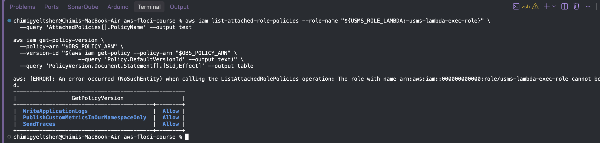

---

## Part D: Instrumentation and Tracing

### Step 13: Instrument the notifier and move the alias

`labs/lab-13-cloudwatch-xray/transcript-notifier-v2/notifier.py` is the instrumented handler. It publishes custom metrics, logs a `USMS_SUMMARY` line, and records the trace ID. You deploy it as a new **version** and move the `live` alias to that version. Anything that calls `live` picks up the new code, and you can roll back by moving the alias to the previous version.

**Part 1: check the handler compiles**

```bash
python3 -m py_compile labs/lab-13-cloudwatch-xray/transcript-notifier-v2/notifier.py \
  && echo "syntax OK (python3)"
```


**Part 2: deploy, publish a version, and move the alias**

```bash
( cd labs/lab-13-cloudwatch-xray/transcript-notifier-v2 \
  && python3 -m zipfile -c "$COURSE_ROOT/outputs/lab-13-notifier-v2.zip" notifier.py )

python3 -m zipfile -l outputs/lab-13-notifier-v2.zip

aws lambda update-function-code \
  --function-name "$NOTIFIER" \
  --zip-file fileb://outputs/lab-13-notifier-v2.zip \
  --query '{Name:FunctionName,CodeSize:CodeSize,Version:Version}' --output table

aws lambda update-function-configuration \
  --function-name "$NOTIFIER" \
  --environment "Variables={USMS_BUCKET=$BUCKET,USMS_NOTIFY_CHANNEL=stdout,USMS_METRIC_NAMESPACE=USMS/Application,USMS_FACULTY_DEFAULT=unknown}" \
  --query 'Environment.Variables' --output json

aws lambda wait function-updated-v2 --function-name "$NOTIFIER" 2>/dev/null \
  || { echo "waiter unsupported - pausing instead"; sleep 5; }

NOTIFIER_V2=$(aws lambda publish-version \
  --function-name "$NOTIFIER" \
  --description "Lab 13 - instrumented: custom metrics and trace id" \
  --query 'Version' --output text)

aws lambda update-alias \
  --function-name "$NOTIFIER" \
  --name live \
  --function-version "$NOTIFIER_V2" \
  --query '{Alias:Name,Version:FunctionVersion}' --output table
```


**Verify:** call the alias and decode the end of its log.

```bash
aws lambda get-function-configuration --function-name "$NOTIFIER" --qualifier live \
  --query '{Version:Version,Handler:Handler,Runtime:Runtime}' --output json

aws lambda invoke \
  --function-name "$NOTIFIER" --qualifier live \
  --payload fileb://templates/lab-10-s3-event.json \
  --log-type Tail --query 'LogResult' --output text \
  outputs/lab-13-notifier-v2-probe.json \
  | openssl base64 -d -A

python3 -m json.tool outputs/lab-13-notifier-v2-probe.json
```

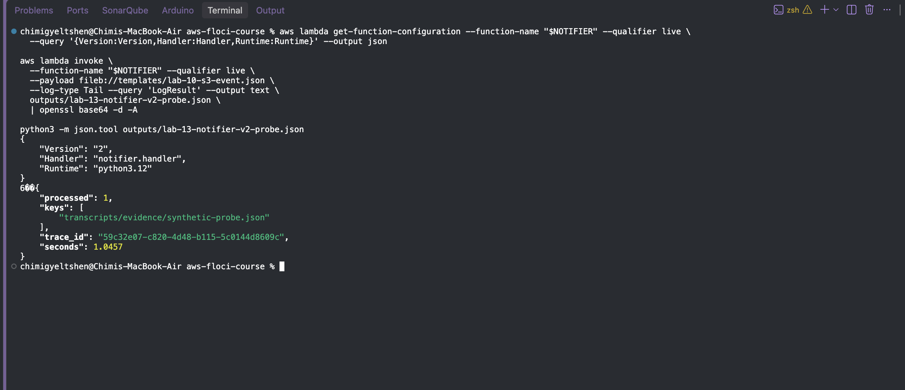

### Step 14: Turn on active tracing

A published version cannot be changed. To serve the tracing setting through `live`, you change the function, publish another version, and move the alias again.

```bash
aws lambda update-function-configuration \
  --function-name "$NOTIFIER" \
  --tracing-config Mode=Active \
  --query '{Name:FunctionName,Tracing:TracingConfig.Mode}' --output table

aws lambda wait function-updated-v2 --function-name "$NOTIFIER" 2>/dev/null \
  || { echo "waiter unsupported - pausing instead"; sleep 5; }

NOTIFIER_V3=$(aws lambda publish-version \
  --function-name "$NOTIFIER" \
  --description "Lab 13 - instrumented + active tracing" \
  --query 'Version' --output text)

aws lambda update-alias \
  --function-name "$NOTIFIER" --name live \
  --function-version "$NOTIFIER_V3" \
  --query 'FunctionVersion' --output text
```


**Verify:** tracing is `Active` on the alias, and the role still has the observability policy (`1`).

```bash
aws lambda get-function-configuration --function-name "$NOTIFIER" --qualifier live \
  --query '{Version:Version,Tracing:TracingConfig.Mode}' --output json

aws iam list-attached-role-policies --role-name "$(basename "${USMS_ROLE_LAMBDA:-usms-lambda-exec-role}")" \
  --query "AttachedPolicies[?PolicyName=='USMSObservabilityWrite'] | length(@)" --output text
```


### Step 15: The X-Ray data model and your first segment

A **trace** is one request moving through the system. It is made up of **segments**, one for each service that handled the request, and each segment can contain **subsegments** for the work inside it.

| Field | Format | Purpose |
|---|---|---|
| `trace_id` | `1-<8 hex: epoch seconds>-<24 hex>` | Groups every segment of one request |
| `id` | 16 hex characters | Identifies this segment |
| `start_time` / `end_time` | Epoch **seconds** (decimal) | Duration |
| `annotations` | Flat key/value pairs, **indexed** | Searchable with filter expressions |
| `metadata` | Any JSON, **not indexed** | Context for reading the trace, not for searching |

```bash
python3 - << 'PY' > templates/lab-13-segment-parent.json
import json, os, time

now = time.time()
trace_id = "1-%08x-%s" % (int(now), os.urandom(12).hex())
seg_id = os.urandom(8).hex()

segment = {
    "name": "usms-transcript-notifier",
    "id": seg_id,
    "trace_id": trace_id,
    "start_time": round(now - 0.120, 3),
    "end_time": round(now, 3),
    "origin": "AWS::Lambda::Function",
    "annotations": {
        "faculty": "science",
        "stage": "notify",
        "transcript_bytes": 2184,
        "readable": True
    },
    "metadata": {
        "usms": {
            "key": "transcripts/science/stu-00417.json",
            "bucket": "usms-student-data",
            "alias": "live",
            "handler": "notifier.handler"
        }
    }
}

print(json.dumps(segment, indent=2))
with open("outputs/lab-13-trace-ids.txt", "a") as fh:
    fh.write("%s %s parent\n" % (trace_id, seg_id))
PY

python3 -m json.tool templates/lab-13-segment-parent.json > /dev/null && echo "valid JSON"
tail -1 outputs/lab-13-trace-ids.txt
```


### Step 16: Add subsegments and a downstream service, then read the trace back

A trace with only one timing tells you how long a request took. Once it contains subsegments and more than one service, it also tells you where the time was spent.

**Part 1: the same segment with three subsegments**

```bash
TRACE_ID=$(awk 'END {print $1}' outputs/lab-13-trace-ids.txt)
PARENT_ID=$(awk 'END {print $2}' outputs/lab-13-trace-ids.txt)

printf 'trace  : %s\nparent : %s\n' "$TRACE_ID" "$PARENT_ID"

python3 - "$TRACE_ID" "$PARENT_ID" << 'PY' > templates/lab-13-segment-subsegments.json
import json, os, sys, time

trace_id, parent_id = sys.argv[1], sys.argv[2]
now = time.time()

def sub(name, offset, duration, namespace, extra=None):
    doc = {
        "id": os.urandom(8).hex(),
        "name": name,
        "start_time": round(now - offset, 3),
        "end_time": round(now - offset + duration, 3),
        "namespace": namespace,
    }
    if extra:
        doc.update(extra)
    return doc

segment = {
    "name": "usms-transcript-notifier",
    "id": parent_id,
    "trace_id": trace_id,
    "start_time": round(now - 0.120, 3),
    "end_time": round(now, 3),
    "origin": "AWS::Lambda::Function",
    "annotations": {
        "faculty": "science",
        "stage": "notify",
        "transcript_bytes": 2184,
        "readable": True,
    },
    "metadata": {
        "usms": {
            "key": "transcripts/science/stu-00417.json",
            "bucket": "usms-student-data",
            "alias": "live",
        }
    },
    "subsegments": [
        sub("s3-head-object", 0.118, 0.018, "aws", {
            "aws": {"operation": "HeadObject",
                    "bucket_name": "usms-student-data",
                    "region": "us-east-1"}}),
        sub("render-pdf", 0.098, 0.074, "remote", {
            "metadata": {"usms": {"pages": 3, "renderer": "wkhtmltopdf"}}}),
        sub("cloudwatch-put-metric-data", 0.022, 0.011, "aws", {
            "aws": {"operation": "PutMetricData"}}),
    ],
}

print(json.dumps(segment, indent=2))
PY

python3 -m json.tool templates/lab-13-segment-subsegments.json > /dev/null && echo "valid JSON"
```


**Part 2: add a second service to the same trace and send both segments.** The downstream segment shares the `trace_id`, and its `parent_id` points at the notifier segment.

```bash
python3 - "$TRACE_ID" "$PARENT_ID" << 'PY' > templates/lab-13-segment-downstream.json
import json, os, sys, time

trace_id, parent_id = sys.argv[1], sys.argv[2]
now = time.time()

segment = {
    "name": "usms-student-data",
    "id": os.urandom(8).hex(),
    "trace_id": trace_id,
    "parent_id": parent_id,
    "type": "subsegment",
    "start_time": round(now - 0.118, 3),
    "end_time": round(now - 0.100, 3),
    "origin": "AWS::S3::Bucket",
    "http": {
        "request": {"method": "HEAD",
                    "url": "https://usms-student-data.s3.us-east-1.amazonaws.com/transcripts/science/stu-00417.json"},
        "response": {"status": 200, "content_length": 2184},
    },
    "annotations": {"faculty": "science", "stage": "origin"},
}

print(json.dumps(segment, indent=2))
PY

python3 -m json.tool templates/lab-13-segment-downstream.json > /dev/null && echo "valid JSON"

aws xray put-trace-segments \
  --trace-segment-documents \
    "$(cat templates/lab-13-segment-subsegments.json)" \
    "$(cat templates/lab-13-segment-downstream.json)" \
  --query 'UnprocessedTraceSegments' --output json
```

!!! check "Expected result"
    `[]`, meaning both segments were accepted.


**Part 3: read the trace back.** X-Ray time windows are in epoch **seconds**. `XSTART` and `XEND` are reused in Steps 17 and 23.

```bash
XW=$(python3 -c "
import datetime
now = datetime.datetime.now(datetime.timezone.utc).replace(microsecond=0)
start = now - datetime.timedelta(minutes=15)
print(int(start.timestamp()), int(now.timestamp()))
")
XSTART=${XW% *}
XEND=${XW#* }

aws xray get-trace-summaries \
  --start-time "$XSTART" --end-time "$XEND" \
  --query 'TraceSummaries[].{Id:Id,Duration:Duration,Http:Http.HttpStatus,Annotations:keys(Annotations)}' \
  --output json | tee outputs/lab-13-trace-summaries.json

aws xray batch-get-traces --trace-ids "$TRACE_ID" \
  --query 'Traces[0].{Id:Id,Duration:Duration,Segments:length(Segments)}' \
  --output json
```


### Step 17: Search by annotation, read the service graph, and run the emitter script

**Part 1: search by annotation.** The second query should return nothing, which confirms the filter is really filtering.

```bash
aws xray get-trace-summaries \
  --start-time "$XSTART" --end-time "$XEND" \
  --filter-expression 'annotation.faculty = "science"' \
  --query 'length(TraceSummaries)' --output text \
  || echo "filter expressions unsupported on this build"

aws xray get-trace-summaries \
  --start-time "$XSTART" --end-time "$XEND" \
  --filter-expression 'annotation.faculty = "engineering"' \
  --query 'length(TraceSummaries)' --output text \
  || echo "filter expressions unsupported on this build"
```

!!! check "Expected result"
    `1`, then `0`.

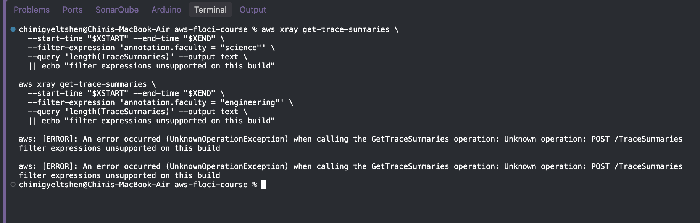

**Part 2: the service graph**

```bash
aws xray get-service-graph \
  --start-time "$XSTART" --end-time "$XEND" \
  --query 'Services[].{Name:Name,Type:Type,Edges:length(Edges),Ok:SummaryStatistics.OkCount}' \
  --output table | tee outputs/lab-13-service-graph.json
```

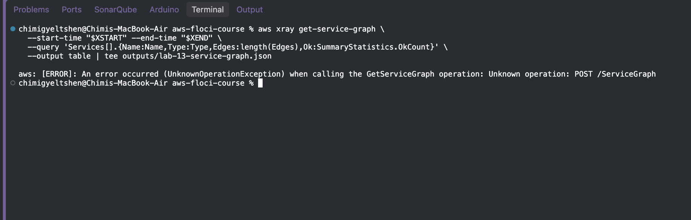

**Part 3: one script that sends all three signals.** `scripts/utilities/usms-emit-telemetry.sh <faculty> <seconds>` writes a log event, publishes metrics, and sends a trace segment for one simulated transcript. Two of the runs below are deliberately over 2 seconds; Step 19's lag alarm uses that threshold.

```bash
chmod +x scripts/utilities/usms-emit-telemetry.sh
bash -n scripts/utilities/usms-emit-telemetry.sh && echo "syntax OK"

./scripts/utilities/usms-emit-telemetry.sh science 0.51
./scripts/utilities/usms-emit-telemetry.sh engineering 2.40
./scripts/utilities/usms-emit-telemetry.sh engineering 3.10
```


### Step 18: Decide what gets traced

Tracing every request costs money and adds noise. A sampling rule sets how much is traced. This rule traces the first 2 requests each second (the **reservoir**), then 10% of the rest (the **fixed rate**), and applies only to the notifier.

```bash
aws xray get-sampling-rules \
  --query 'SamplingRuleRecords[].SamplingRule.{Name:RuleName,Priority:Priority,Rate:FixedRate,Reservoir:ReservoirSize,Service:ServiceName}' \
  --output table

cat > templates/lab-13-sampling-rule.json << 'EOF'
{
  "RuleName": "usms-transcripts-sampling",
  "ResourceARN": "*",
  "Priority": 1000,
  "FixedRate": 0.10,
  "ReservoirSize": 2,
  "ServiceName": "usms-transcript-notifier",
  "ServiceType": "*",
  "Host": "*",
  "HTTPMethod": "*",
  "URLPath": "*",
  "Version": 1
}
EOF

python3 -m json.tool templates/lab-13-sampling-rule.json > /dev/null && echo "valid JSON"

aws xray create-sampling-rule \
  --sampling-rule file://templates/lab-13-sampling-rule.json \
  --query 'SamplingRuleRecord.SamplingRule.{Name:RuleName,Priority:Priority,Rate:FixedRate,Reservoir:ReservoirSize}' \
  --output table \
  || echo "create-sampling-rule unsupported on this build - the document above is the deliverable"
```

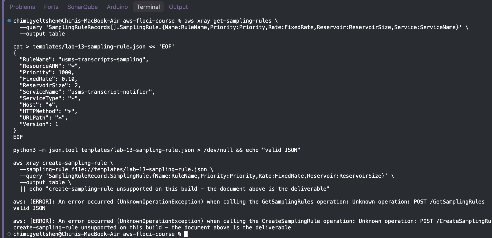

---

## Part E: Alarms

### Step 19: Create two alarms, one of which watches for an absence

| Alarm | Watches | Statistic | Fires when | Missing data |
|---|---|---|---|---|
| `usms-transcript-lag-high` | `TranscriptLagSeconds` (Stage=notify) | **Maximum** | Above 2 s in 2 of 3 one-minute periods | `notBreaching` |
| `usms-notify-silence` | `NotifyCount` | Sum | Below 1 for 3 five-minute periods (15 min) | **`breaching`** |

!!! note "Why these settings?"
    - The lag alarm uses **Maximum** because an average can hide one very slow transcript among many fast ones.
    - The silence alarm watches for something **not** happening. When the pipeline stops, no data arrives at all, so missing data has to count as breaching. Otherwise the alarm would never fire in the situation it exists to catch.

**Part 1: the threshold alarm**

```bash
aws cloudwatch put-metric-alarm \
  --alarm-name usms-transcript-lag-high \
  --alarm-description "Transcript notification latency above 2s for 2 of 3 minutes" \
  --namespace USMS/Application \
  --metric-name TranscriptLagSeconds \
  --dimensions Name=Stage,Value=notify \
  --statistic Maximum \
  --period 60 \
  --evaluation-periods 3 \
  --datapoints-to-alarm 2 \
  --threshold 2 \
  --comparison-operator GreaterThanThreshold \
  --treat-missing-data notBreaching \
  --unit Seconds \
  --tags Key=Project,Value=USMS Key=Lab,Value=08
```

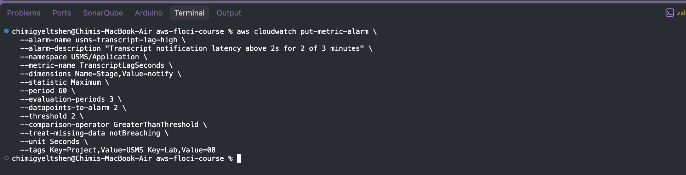

**Part 2: the absence alarm**

```bash
aws cloudwatch put-metric-alarm \
  --alarm-name usms-notify-silence \
  --alarm-description "No transcript notifications for 15 minutes - the pipeline has gone quiet" \
  --namespace USMS/Application \
  --metric-name NotifyCount \
  --statistic Sum \
  --period 300 \
  --evaluation-periods 3 \
  --datapoints-to-alarm 3 \
  --threshold 1 \
  --comparison-operator LessThanThreshold \
  --treat-missing-data breaching \
  --tags Key=Project,Value=USMS Key=Lab,Value=08
```

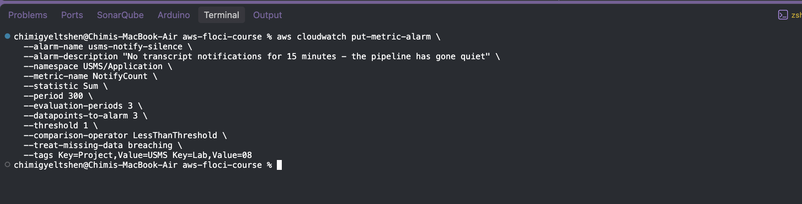

**Verify**

```bash
aws cloudwatch describe-alarms \
  --alarm-names usms-transcript-lag-high usms-notify-silence \
  --query 'MetricAlarms[].{Name:AlarmName,Metric:MetricName,Stat:Statistic,Th:Threshold,Op:ComparisonOperator,Missing:TreatMissingData,State:StateValue}' \
  --output table
```


### Step 20: Prove an alarm works by making it fire

Floci stores alarms but does not evaluate them, so a real breach will not change their state. `set-alarm-state` forces a state change, which proves the alarm is set up correctly and that its history is recorded.

**Part 1: force the alarm into `ALARM`**

```bash
aws cloudwatch set-alarm-state \
  --alarm-name usms-transcript-lag-high \
  --state-value ALARM \
  --state-reason "Lab 13 Step 20: forced transition to prove the alarm is wired and records history" \
  --state-reason-data '{"lab":"08","step":20,"synthetic":true}'

sleep 2

aws cloudwatch describe-alarms --alarm-names usms-transcript-lag-high \
  --query 'MetricAlarms[0].{State:StateValue,Reason:StateReason,Since:StateUpdatedTimestamp}' \
  --output json
```


**Part 2: read the history**

```bash
aws cloudwatch describe-alarm-history \
  --alarm-name usms-transcript-lag-high \
  --history-item-type StateUpdate \
  --max-records 5 \
  --query 'sort_by(AlarmHistoryItems, &Timestamp)[].[Timestamp,HistorySummary]' \
  --output table \
  | tee outputs/lab-13-alarm-history.json
```

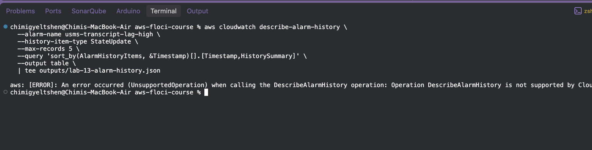

**Part 3: put it back to `OK`.** The verification script fails if any alarm is left in `ALARM`.

```bash
aws cloudwatch set-alarm-state \
  --alarm-name usms-transcript-lag-high \
  --state-value OK \
  --state-reason "Lab 13 Step 20: restoring state after the forced-transition proof"

aws cloudwatch describe-alarms --alarm-names usms-transcript-lag-high \
  --query 'MetricAlarms[0].StateValue' --output text
```


### Step 21: Combine the alarms into one incident

A composite alarm turns "slow **or** silent" into one incident, so on-call staff get one page instead of two for the same problem.

!!! warning "Floci limitation"
    Floci's CloudWatch does not implement `PutCompositeAlarm`; it returns `UnsupportedOperation ... not supported by CloudWatch JSON`. The command below works against real AWS but fails here. On Floci, keep the error as your evidence and skip the composite-specific checks. You can still demonstrate the two child alarms.

```bash
aws cloudwatch put-composite-alarm \
  --alarm-name usms-transcript-pipeline-down \
  --alarm-description "The USMS transcript pipeline is failing or silent. One incident, one page." \
  --alarm-rule 'ALARM("usms-transcript-lag-high") OR ALARM("usms-notify-silence")' \
  --actions-enabled \
  --tags Key=Project,Value=USMS Key=Lab,Value=08
```

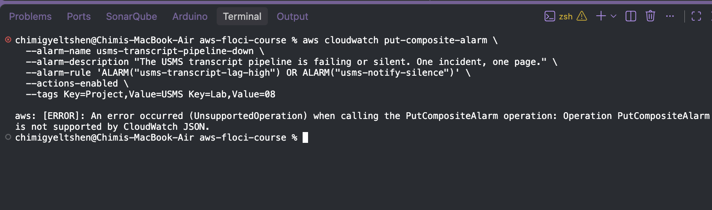

**Verify (real AWS):** drive one child alarm into `ALARM`, check the composite, then restore the child alarm.

```bash
aws cloudwatch describe-alarms --alarm-types CompositeAlarm \
  --query 'CompositeAlarms[].{Name:AlarmName,Rule:AlarmRule,State:StateValue}' --output json

aws cloudwatch set-alarm-state \
  --alarm-name usms-notify-silence \
  --state-value ALARM \
  --state-reason "Lab 13 Step 21: driving a child alarm to observe the composite"

sleep 3

aws cloudwatch describe-alarms --alarm-names usms-transcript-pipeline-down \
  --alarm-types CompositeAlarm \
  --query 'CompositeAlarms[0].{State:StateValue,Reason:StateReason}' --output json

aws cloudwatch set-alarm-state \
  --alarm-name usms-notify-silence \
  --state-value OK \
  --state-reason "Lab 13 Step 21: restoring state"
```

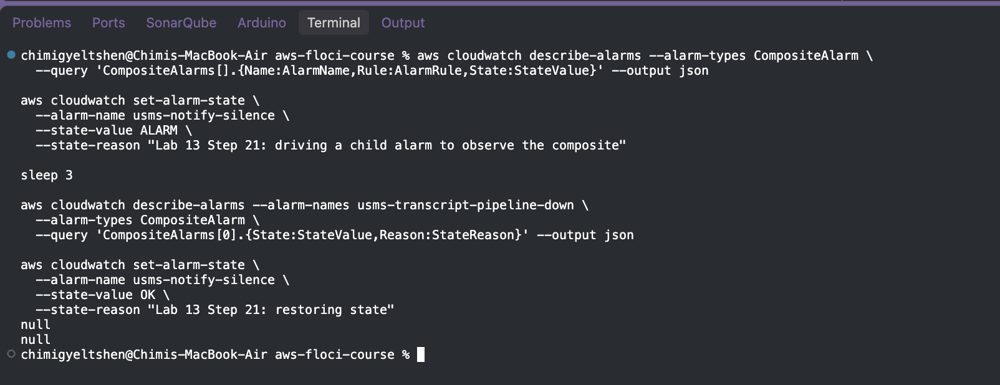

---

## Part F: Dashboard and Log Queries

### Step 22: Build the dashboard

`templates/lab-13-dashboard.json` defines the `usms-overview` dashboard with five widgets on a 24-column grid.

```bash
python3 -m json.tool templates/lab-13-dashboard.json > /dev/null && echo "valid JSON"

aws cloudwatch put-dashboard \
  --dashboard-name usms-overview \
  --dashboard-body file://templates/lab-13-dashboard.json \
  --query 'DashboardValidationMessages' --output json
```

!!! check "Expected result"
    `[]`, meaning there were no validation messages.

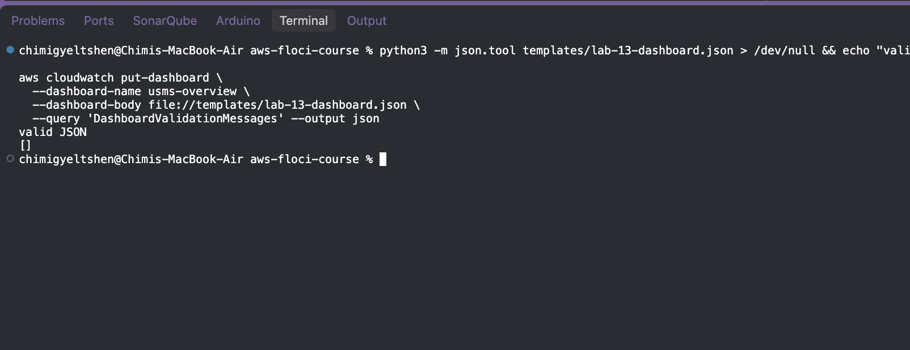

**Verify:** read the dashboard back and check the number of widgets, their types, the grid width, and whether any widgets overlap.

```bash
aws cloudwatch list-dashboards \
  --query 'DashboardEntries[].[DashboardName,Size]' --output table

aws cloudwatch get-dashboard --dashboard-name usms-overview \
  --query 'DashboardBody' --output text \
  | python3 -c "
import json, sys
body = json.load(sys.stdin)
print('widgets     :', len(body['widgets']))
print('types       :', ', '.join(sorted({w['type'] for w in body['widgets']})))
print('grid width  :', max(w['x'] + w['width'] for w in body['widgets']))
rows = sorted((w['y'], w['y'] + w['height'], w['x'], w['x'] + w['width']) for w in body['widgets'])
overlap = any(a[1] > b[0] and a[3] > b[2] and b[3] > a[2] for a, b in zip(rows, rows[1:]))
print('overlapping :', overlap)
"
```

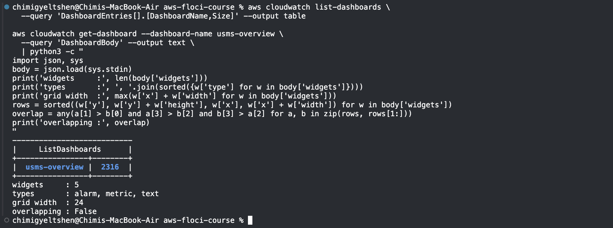

### Step 23: Query the logs

Question: **how many transcript events did each faculty have?** Answer it with whichever tool Step 4 reported as supported.

**Path A: Logs Insights is SUPPORTED**

```bash
QUERY_ID=$(aws logs start-query \
  --log-group-name "$CENTRAL_LOG_GROUP" \
  --start-time "$XSTART" --end-time "$XEND" \
  --query-string 'fields @timestamp, @message
| filter @message like /USMS_EVENT/
| parse @message "*\"faculty\":\"*\"*" as pre, faculty, post
| stats count() as events by faculty
| sort events desc' \
  --query 'queryId' --output text)

echo "query: $QUERY_ID"

for attempt in 1 2 3 4 5 6; do
  STATUS=$(aws logs get-query-results --query-id "$QUERY_ID" --query 'status' --output text)
  [ "$STATUS" = "Complete" ] && break
  printf '  status %s, waiting\n' "$STATUS"
  sleep 3
done

aws logs get-query-results --query-id "$QUERY_ID" \
  --query 'results[].[ [0].value, [1].value ]' --output table
```


**Path B: Logs Insights is UNSUPPORTED.** Get the matching events with `filter-log-events` and count them in Python.

```bash
aws logs filter-log-events \
  --log-group-name "$CENTRAL_LOG_GROUP" \
  --filter-pattern 'USMS_EVENT' \
  --query 'events[].message' --output text \
  | python3 -c "
import collections, json, re, sys

counts = collections.Counter()
for line in sys.stdin.read().split('USMS_EVENT'):
    line = line.strip()
    if not line.startswith('{'):
        continue
    match = re.match(r'\{.*?\}', line, re.S)
    if not match:
        continue
    try:
        payload = json.loads(match.group(0))
    except json.JSONDecodeError:
        continue
    counts[payload.get('faculty', 'unknown')] += 1

for faculty, n in counts.most_common():
    print('%-14s %d' % (faculty, n))
"
```


**Verify**

```bash
aws logs describe-log-groups --log-group-name-prefix /usms/central \
  --query 'logGroups[0].{Group:logGroupName,Retention:retentionInDays,Bytes:storedBytes}' \
  --output json
```


---

## Part G: Persistence, Record and Commit

### Step 24: Restart Floci and read everything back

Record the configuration, restart the emulator, record it again, and compare. If the two records match, everything survived the restart.

**Part 1: record the current state**

```bash
inventory() {
  echo "--- log groups ---"
  aws logs describe-log-groups \
    --query 'sort_by(logGroups, &logGroupName)[].[logGroupName,retentionInDays]' --output text
  echo "--- metric filters ---"
  aws logs describe-metric-filters \
    --query 'sort_by(metricFilters, &filterName)[].[filterName,logGroupName]' --output text
  echo "--- metrics ---"
  aws cloudwatch list-metrics --namespace USMS/Application \
    --query 'sort_by(Metrics, &MetricName)[].MetricName' --output text | tr '\t' '\n' | sort -u
  echo "--- alarms ---"
  aws cloudwatch describe-alarms \
    --query 'sort_by(MetricAlarms, &AlarmName)[].[AlarmName,StateValue]' --output text
  aws cloudwatch describe-alarms --alarm-types CompositeAlarm \
    --query 'sort_by(CompositeAlarms, &AlarmName)[].[AlarmName,AlarmRule]' --output text
  echo "--- dashboards ---"
  aws cloudwatch list-dashboards --query 'DashboardEntries[].DashboardName' --output text
  echo "--- notifier ---"
  aws lambda get-function-configuration --function-name "$NOTIFIER" --qualifier live \
    --query '[Version,TracingConfig.Mode]' --output text
}

inventory | tee outputs/lab-13-pre-restart.txt

DATA_BEFORE=$(aws cloudwatch get-metric-statistics \
  --namespace USMS/Application --metric-name TranscriptsProcessed \
  --start-time "$START" --end-time "$END" --period 300 --statistics Sum \
  --query 'length(Datapoints)' --output text)

echo "metric data points before restart: $DATA_BEFORE"
```

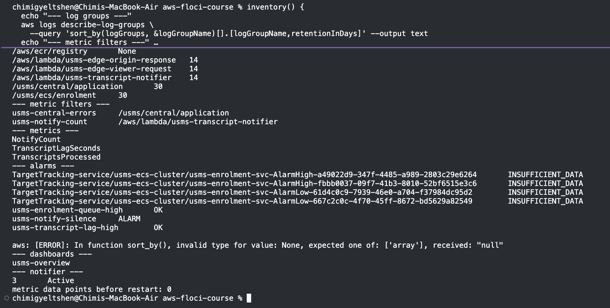

**Part 2: restart Floci**

```bash
./scripts/setup/floci-down.sh
./scripts/setup/floci-up.sh
./scripts/utilities/whoami.sh
```


**Part 3: record the state again and compare.** The restart does not keep your shell variables, so set them again first.

```bash
source configs/course.env
for f in configs/lab-01.env configs/lab-10.env; do [ -f "$f" ] && source "$f"; done
NOTIFIER="${USMS_LAMBDA_NOTIFIER_FN:-usms-transcript-notifier}"
CENTRAL_LOG_GROUP=/usms/central/application

inventory | tee outputs/lab-13-post-restart.txt

diff outputs/lab-13-pre-restart.txt outputs/lab-13-post-restart.txt \
  && echo "CONFIGURATION IDENTICAL - every Lab 13 object survived the restart"

DATA_AFTER=$(aws cloudwatch get-metric-statistics \
  --namespace USMS/Application --metric-name TranscriptsProcessed \
  --start-time "$START" --end-time "$END" --period 300 --statistics Sum \
  --query 'length(Datapoints)' --output text)

printf 'metric data points: before=%s after=%s\n' "$DATA_BEFORE" "$DATA_AFTER"
```

!!! note
    If you open a new terminal for Part 3, the `inventory` function and the `START`/`END` variables from Part 1 are gone. Run Part 3 in the same terminal as Part 1.

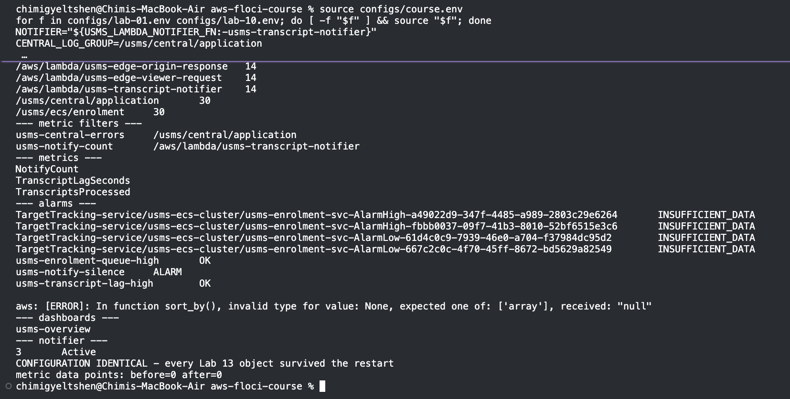

### Step 25: Write `configs/lab-13.env`

The file stores names, ARNs and IDs only, with **no secrets**. The heredoc is **unquoted** (`<< EOF`) so the `$(...)` lookups and the `${NOTIFIER_V2}`/`${NOTIFIER_V3}` values are filled in when the file is written. Run it in the same shell as Steps 13 and 14.

```bash
cat > configs/lab-13.env << EOF
# Lab 13 - Centralized logging and monitoring with CloudWatch and X-Ray
# Generated on $(date -u +%Y-%m-%dT%H:%M:%SZ)
# Contains names, ARNs and IDs only. NO SECRETS. Safe to commit.

# --- log layer ------------------------------------------------------------
export USMS_LOG_GROUP_CENTRAL=/usms/central/application
export USMS_LOG_GROUP_ECS=/usms/ecs/enrolment
export USMS_LOG_STREAM_CENTRAL=$(aws logs describe-log-streams \
  --log-group-name /usms/central/application \
  --order-by LastEventTime --descending --max-items 1 \
  --query 'logStreams[0].logStreamName' --output text | head -1)
export USMS_LOG_RETENTION_APP=30
export USMS_LOG_RETENTION_FN=14

# --- metric layer ---------------------------------------------------------
export USMS_METRIC_NAMESPACE=USMS/Application
export USMS_METRIC_FILTER_NOTIFY=usms-notify-count
export USMS_METRIC_FILTER_ERRORS=usms-central-errors
export USMS_METRIC_NOTIFY_COUNT=NotifyCount
export USMS_METRIC_ERROR_COUNT=CentralErrorCount
export USMS_METRIC_PROCESSED=TranscriptsProcessed
export USMS_METRIC_LAG=TranscriptLagSeconds
export USMS_METRIC_EDGE_DENY=EdgeDenyCount

# --- iam ------------------------------------------------------------------
export USMS_POLICY_OBSERVABILITY=USMSObservabilityWrite
export USMS_POLICY_OBSERVABILITY_ARN=$(aws iam list-policies --scope Local \
  --query "Policies[?PolicyName=='USMSObservabilityWrite'].Arn | [0]" --output text)

# --- the instrumented notifier -------------------------------------------
export USMS_NOTIFIER_VERSION_INSTRUMENTED=${NOTIFIER_V2}
export USMS_NOTIFIER_VERSION_TRACED=${NOTIFIER_V3}
export USMS_NOTIFIER_ALIAS_VERSION=$(aws lambda get-alias \
  --function-name usms-transcript-notifier --name live \
  --query 'FunctionVersion' --output text)
export USMS_NOTIFIER_TRACING_MODE=$(aws lambda get-function-configuration \
  --function-name usms-transcript-notifier --qualifier live \
  --query 'TracingConfig.Mode' --output text)

# --- alarms - a future alerting lab attaches SNS actions to these three ------------------
export USMS_ALARM_LAG_HIGH=usms-transcript-lag-high
export USMS_ALARM_NOTIFY_SILENCE=usms-notify-silence
export USMS_ALARM_COMPOSITE=usms-transcript-pipeline-down

# --- dashboard ------------------------------------------------------------
export USMS_DASHBOARD=usms-overview

# --- x-ray ----------------------------------------------------------------
export USMS_XRAY_SAMPLING_RULE=usms-transcripts-sampling
export USMS_XRAY_SUPPORTED=$(aws xray get-sampling-rules >/dev/null 2>&1 && echo yes || echo no)
export USMS_XRAY_LAST_TRACE_ID=$(awk 'END {print $1}' outputs/lab-13-trace-ids.txt 2>/dev/null | grep -E '^1-' || echo none)

# --- capability flags recorded at lab time --------------------------------
export USMS_INSIGHTS_SUPPORTED=$(aws logs describe-queries --max-results 1 >/dev/null 2>&1 && echo yes || echo no)
export USMS_TELEMETRY_EMITTER=scripts/utilities/usms-emit-telemetry.sh
EOF

cat configs/lab-13.env
```

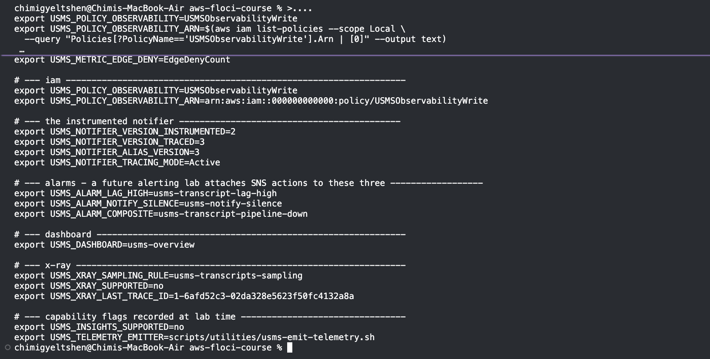

**Verify:** expect 28 exports, no empty values, and a file that sources without errors.

```bash
grep -c '^export' configs/lab-13.env

grep -nE '^export [A-Z_]+=$|None' configs/lab-13.env || echo "all values populated"

( source configs/lab-13.env && echo "sources cleanly" )
```


### Step 26: Check what Git sees, then commit

Commit the source, policies, templates, scripts and `lab-13.env`. Do **not** commit `outputs/`, which holds evidence files and the deployment zip.

```bash
git status --short
git add labs/lab-13-cloudwatch-xray project/checkpoint-01 \
        policies templates scripts/utilities configs/lab-13.env
git status --short
git commit -m "Lab 13: centralized logging and monitoring with CloudWatch and X-Ray"
```

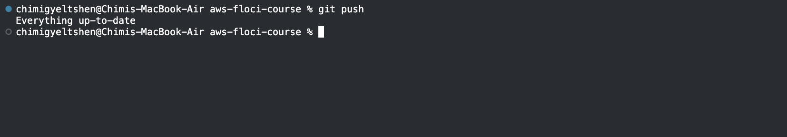

---

## Verification

### Build `scripts/utilities/verify-lab-13.sh`

The script only reads; it changes nothing. It checks that every Lab 13 resource exists **and** is configured the way the lab requires.

| Block | Checks | What it confirms |
|---|---|---|
| Environment | 3 | Floci is running, persistent, and reachable |
| Log layer | 6 | Central group, retention everywhere, at least one stream |
| Metric filters | 3 | Both filters are attached to the right log groups |
| Metrics | 4 | Dimensioned and total series both exist |
| IAM | 5 | Policy is attached to both roles and scoped correctly |
| Instrumented notifier | 5 | Alias has moved past v1, tracing is Active |
| Alarms | 8 | Statistics, missing-data handling, composite rule, none left in ALARM |
| Dashboard | 4 | 5 widgets, valid JSON, no overlap |
| X-Ray documents | 3 | Sampling rule is complete, segments are consistent |
| Files and Git hygiene | 8 | 28 exports, no outputs or zips tracked |

```bash
cat > scripts/utilities/verify-lab-13.sh << 'EOF'
#!/usr/bin/env bash
# Verify every Lab 13 artefact exists AND is configured as the lab requires.
# Exit 1 if anything is missing. Read-only: this script changes nothing.
set -uo pipefail

REPO_ROOT="$(cd "$(dirname "${BASH_SOURCE[0]}")/../.." && pwd)"
cd "$REPO_ROOT"
# shellcheck disable=SC1091
source "$REPO_ROOT/configs/course.env"
# shellcheck disable=SC1091
source "$REPO_ROOT/configs/lab-01.env" 2>/dev/null || true
# shellcheck disable=SC1091
source "$REPO_ROOT/configs/lab-10.env" 2>/dev/null || true
# shellcheck disable=SC1091
source "$REPO_ROOT/configs/lab-13.env" 2>/dev/null || true

CENTRAL="${USMS_LOG_GROUP_CENTRAL:-/usms/central/application}"
FN_LOG="${USMS_LOG_GROUP_NOTIFIER:-/aws/lambda/usms-transcript-notifier}"
ECS_LOG="${USMS_LOG_GROUP_ECS:-/usms/ecs/enrolment}"
NS="${USMS_METRIC_NAMESPACE:-USMS/Application}"
NOTIFIER="${USMS_LAMBDA_NOTIFIER_FN:-usms-transcript-notifier}"
ROLE_LAMBDA="${USMS_ROLE_LAMBDA:-usms-lambda-exec-role}"
ROLE_EC2="${USMS_ROLE_EC2:-usms-ec2-app-role}"
A_LAG="${USMS_ALARM_LAG_HIGH:-usms-transcript-lag-high}"
A_SILENCE="${USMS_ALARM_NOTIFY_SILENCE:-usms-notify-silence}"
A_COMP="${USMS_ALARM_COMPOSITE:-usms-transcript-pipeline-down}"
DASH="${USMS_DASHBOARD:-usms-overview}"

PASS=0; FAIL=0
check() {
  if eval "$2" >/dev/null 2>&1; then printf "  ✔ %s\n" "$1"; PASS=$((PASS+1))
  else printf "  ✗ %s\n" "$1"; FAIL=$((FAIL+1)); fi
}

# --- helpers -------------------------------------------------------------
# Defined as functions so the check strings below stay free of nested quoting.

lg_retention() {   # $1 = log group name
  aws logs describe-log-groups --log-group-name-prefix "$1" \
    --query "logGroups[?logGroupName=='$1'].retentionInDays | [0]" --output text
}

lg_any_unset() {   # prints the names of USMS log groups with no retention policy
  aws logs describe-log-groups \
    --query 'logGroups[?retentionInDays==null].logGroupName' --output text \
    | tr '\t' '\n' | grep -E '^/usms/|^/aws/lambda/usms-'
}

mf_group() {   # $1 = filter name
  aws logs describe-metric-filters \
    --query "metricFilters[?filterName=='$1'].logGroupName | [0]" --output text
}

metric_dims() {   # $1 = metric name; prints one line per published dimension set
  aws cloudwatch list-metrics --namespace "$NS" --metric-name "$1" \
    --query 'Metrics[].join(`,`, Dimensions[].Name) || `NONE`' --output text
}

obs_policy_arn() {
  aws iam list-policies --scope Local \
    --query "Policies[?PolicyName=='USMSObservabilityWrite'].Arn | [0]" --output text
}

obs_policy_doc() {
  local arn ver
  arn=$(obs_policy_arn)
  ver=$(aws iam get-policy --policy-arn "$arn" --query 'Policy.DefaultVersionId' --output text)
  aws iam get-policy-version --policy-arn "$arn" --version-id "$ver" \
    --query 'PolicyVersion.Document' --output json
}

role_has_obs() {   # $1 = role name
  aws iam list-attached-role-policies --role-name "$1" --output text \
    | grep -q USMSObservabilityWrite
}

alias_version() {
  aws lambda get-alias --function-name "$NOTIFIER" --name live \
    --query 'FunctionVersion' --output text
}

alarm_field() {   # $1 = alarm name, $2 = JMESPath field
  aws cloudwatch describe-alarms --alarm-names "$1" \
    --query "MetricAlarms[0].$2" --output text
}

composite_rule() {
  aws cloudwatch describe-alarms --alarm-names "$A_COMP" --alarm-types CompositeAlarm \
    --query 'CompositeAlarms[0].AlarmRule' --output text
}

dashboard_body() {
  aws cloudwatch get-dashboard --dashboard-name "$DASH" --query 'DashboardBody' --output text
}

dashboard_widgets() {
  dashboard_body | python3 -c 'import json,sys; print(len(json.load(sys.stdin)["widgets"]))'
}

dashboard_no_overlap() {
  dashboard_body | python3 -c '
import json, sys
w = json.load(sys.stdin)["widgets"]
boxes = [(x["x"], x["y"], x["x"]+x["width"], x["y"]+x["height"]) for x in w]
for i, a in enumerate(boxes):
    for b in boxes[i+1:]:
        if a[0] < b[2] and b[0] < a[2] and a[1] < b[3] and b[1] < a[3]:
            sys.exit(1)
sys.exit(0)'
}

sampling_rule_complete() {
  python3 -c '
import json, sys
r = json.load(open("templates/lab-13-sampling-rule.json"))
need = {"RuleName","ResourceARN","Priority","FixedRate","ReservoirSize",
        "ServiceName","ServiceType","Host","HTTPMethod","URLPath","Version"}
sys.exit(0 if need.issubset(r) else 1)'
}

segments_consistent() {
  python3 -c '
import json, re, sys
d = {n: json.load(open("templates/lab-13-segment-%s.json" % n))
     for n in ("parent", "subsegments", "downstream")}
tid = d["parent"]["trace_id"]
ok = (re.fullmatch(r"1-[0-9a-f]{8}-[0-9a-f]{24}", tid)
      and all(x["trace_id"] == tid for x in d.values())
      and all(re.fullmatch(r"[0-9a-f]{16}", x["id"]) for x in d.values())
      and d["downstream"].get("parent_id") == d["parent"]["id"]
      and all(x["end_time"] > x["start_time"] for x in d.values()))
sys.exit(0 if ok else 1)'
}

echo "== Environment =="
check "Floci container running" \
  'test "$(docker container inspect $FLOCI_CONTAINER_NAME --format "{{.State.Running}}")" = true'
check "Storage mode is NOT memory" \
  'docker container inspect $FLOCI_CONTAINER_NAME --format "{{range .Config.Env}}{{println .}}{{end}}" | grep -qE "^FLOCI_STORAGE_MODE=(hybrid|persistent|wal)$"'
check "AWS CLI reaches Floci" \
  'aws sts get-caller-identity'

echo "== Log layer =="
check "central log group $CENTRAL exists" \
  'aws logs describe-log-groups --log-group-name-prefix "$CENTRAL" --query "length(logGroups)" --output text | grep -qv "^0$"'
check "central log group retention is 30 days" \
  'test "$(lg_retention "$CENTRAL")" = "30"'
check "notifier log group has a retention policy" \
  'lg_retention "$FN_LOG" | grep -qE "^[0-9]+$"'
check "ECS log group has a retention policy" \
  'lg_retention "$ECS_LOG" | grep -qE "^[0-9]+$"'
check "NO USMS log group is left on never-expire" \
  '! lg_any_unset | grep -q .'
check "central log group has at least one stream" \
  'test "$(aws logs describe-log-streams --log-group-name "$CENTRAL" --query "length(logStreams)" --output text)" != "0"'

echo "== Metric filters =="
check "usms-notify-count exists" \
  'aws logs describe-metric-filters --filter-name-prefix usms-notify-count --query "length(metricFilters)" --output text | grep -qv "^0$"'
check "usms-notify-count is attached to the NOTIFIER log group" \
  'test "$(mf_group usms-notify-count)" = "$FN_LOG"'
check "usms-central-errors is attached to the CENTRAL log group" \
  'test "$(mf_group usms-central-errors)" = "$CENTRAL"'

echo "== Metrics =="
check "namespace $NS has metrics" \
  'test "$(aws cloudwatch list-metrics --namespace "$NS" --query "length(Metrics)" --output text)" != "0"'
check "TranscriptsProcessed published WITH dimensions" \
  'metric_dims TranscriptsProcessed | grep -q Faculty'
check "TranscriptsProcessed ALSO published with none  (the total)" \
  'metric_dims TranscriptsProcessed | grep -q NONE'
check "TranscriptLagSeconds exists" \
  'test "$(aws cloudwatch list-metrics --namespace "$NS" --metric-name TranscriptLagSeconds --query "length(Metrics)" --output text)" != "0"'

echo "== IAM =="
check "USMSObservabilityWrite exists" \
  'obs_policy_arn | grep -q "policy/USMSObservabilityWrite"'
check "attached to $ROLE_LAMBDA" \
  'role_has_obs "$ROLE_LAMBDA"'
check "attached to $ROLE_EC2" \
  'role_has_obs "$ROLE_EC2"'
check "PutMetricData is scoped by a cloudwatch:namespace condition" \
  'obs_policy_doc | grep -q "cloudwatch:namespace"'
check "log group ARNs end in :*  (streams, not just the group)" \
  'obs_policy_doc | grep -qE "log-group:/usms/\*:\*"'

echo "== The instrumented notifier =="
check "$NOTIFIER exists" \
  'aws lambda get-function-configuration --function-name "$NOTIFIER"'
check "alias live points at a numbered version" \
  'alias_version | grep -qE "^[0-9]+$"'
check "alias live has MOVED PAST Lab 10 version 1" \
  'test "$(alias_version)" -ge 2'
check "tracing mode on the alias is Active" \
  'test "$(aws lambda get-function-configuration --function-name "$NOTIFIER" --qualifier live --query "TracingConfig.Mode" --output text)" = "Active"'
check "instrumented handler source emits USMS_SUMMARY" \
  'grep -q "USMS_SUMMARY" labs/lab-13-cloudwatch-xray/transcript-notifier-v2/notifier.py'

echo "== Alarms =="
check "$A_LAG exists" \
  'aws cloudwatch describe-alarms --alarm-names "$A_LAG" --query "length(MetricAlarms)" --output text | grep -qv "^0$"'
check "$A_LAG uses the Maximum statistic, not Average" \
  'test "$(alarm_field "$A_LAG" Statistic)" = "Maximum"'
check "$A_LAG treats missing data as notBreaching" \
  'test "$(alarm_field "$A_LAG" TreatMissingData)" = "notBreaching"'
check "$A_SILENCE exists" \
  'aws cloudwatch describe-alarms --alarm-names "$A_SILENCE" --query "length(MetricAlarms)" --output text | grep -qv "^0$"'
check "$A_SILENCE treats missing data as BREACHING  (it watches an absence)" \
  'test "$(alarm_field "$A_SILENCE" TreatMissingData)" = "breaching"'
check "composite alarm $A_COMP exists" \
  'composite_rule | grep -q ALARM'
check "composite rule names BOTH child alarms" \
  'composite_rule | grep -q "$A_LAG" && composite_rule | grep -q "$A_SILENCE"'
check "no alarm is left stuck in ALARM from Step 20 or 21" \
  'test "$(alarm_field "$A_LAG" StateValue)" != "ALARM" && test "$(alarm_field "$A_SILENCE" StateValue)" != "ALARM"'

echo "== Dashboard =="
check "dashboard $DASH exists" \
  'aws cloudwatch list-dashboards --query "DashboardEntries[].DashboardName" --output text | grep -q "$DASH"'
check "dashboard body is valid JSON" \
  'dashboard_body | python3 -m json.tool'
check "dashboard has 5 widgets" \
  'test "$(dashboard_widgets)" -eq 5'
check "no two widgets overlap" \
  'dashboard_no_overlap'

echo "== X-Ray documents =="
check "sampling rule document is valid JSON" \
  'python3 -m json.tool templates/lab-13-sampling-rule.json'
check "sampling rule declares every required field" \
  'sampling_rule_complete'
check "segment documents share one trace id and are well formed" \
  'segments_consistent'

echo "== Files and Git hygiene =="
check "configs/lab-13.env exists" \
  'test -f configs/lab-13.env'
check "configs/lab-13.env has 28 exports" \
  'test "$(grep -c "^export" configs/lab-13.env)" -eq 28'
check "configs/lab-13.env has no empty values" \
  '! grep -qE "^export [A-Z_]+=$" configs/lab-13.env'
check "usms-emit-telemetry.sh is executable and valid bash" \
  'test -x scripts/utilities/usms-emit-telemetry.sh && bash -n scripts/utilities/usms-emit-telemetry.sh'
check "observability policy document is valid JSON" \
  'python3 -m json.tool policies/usms-observability-write-policy.json'
check "dashboard template is committed, not only deployed" \
  'test -f templates/lab-13-dashboard.json'
check "no secret is tracked" \
  '! git ls-files | grep -q "^outputs/"'
check "no deployment archive is tracked" \
  '! git ls-files | grep -q "\.zip$"'

echo; echo "PASS=$PASS  FAIL=$FAIL"
[ "$FAIL" -eq 0 ]
EOF

chmod +x scripts/utilities/verify-lab-13.sh
bash -n scripts/utilities/verify-lab-13.sh && echo "syntax OK"
./scripts/utilities/verify-lab-13.sh
```

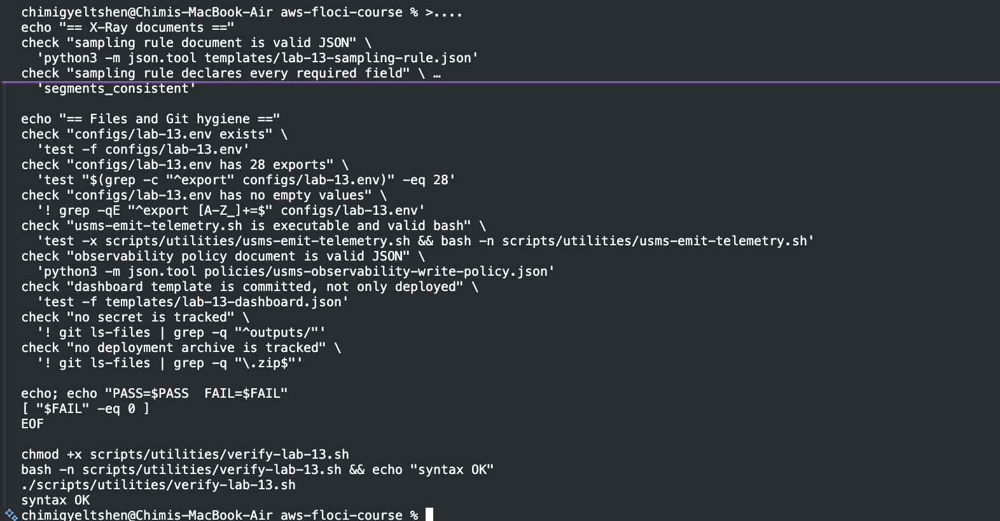

!!! note "Expected failures on Floci"
    The script has 49 checks. On Floci, the two composite-alarm checks (`composite alarm ... exists` and `composite rule names BOTH child alarms`) are expected to fail, because Floci does not support `PutCompositeAlarm` (Step 21). Any other failure needs fixing.

### Reading the results

| Failing block | Where to look |
|---|---|
| Environment | Floci is not running, or is in memory mode. Fix this first. |
| Log layer | Steps 6 and 7. "Never-expire" means a USMS log group has no retention policy. |
| Metric filters | Step 9. Check that each filter is attached to the right log group. |
| Metrics | Step 11. Both the dimensioned series and the total must be published. |
| IAM | Step 12, and the policy document's condition and ARNs. |
| Instrumented notifier | Steps 13 and 14. The alias must point at the newest version. |
| Alarms | Steps 19–21. A stuck `ALARM` state means Step 20 Part 3 was skipped. |
| Dashboard | Step 22 and `templates/lab-13-dashboard.json`. |
| X-Ray documents | Steps 15, 16 and 18. Regenerate the segments in one shell session. |
| Files and Git hygiene | Steps 25 and 26. |

---

## Cleanup

The end-of-course cleanup script deletes resources from the inside out: the composite alarm before its child alarms, and the metric filters before the log group. It asks you to type a confirmation phrase before doing anything. Build it and check its syntax now, but **do not run it** while later labs still need these alarms.

```bash
cat > scripts/cleanup/lab-13-cleanup.sh << 'EOF'
#!/usr/bin/env bash
# END-OF-COURSE CLEANUP for Lab 13. Deletes dependencies inside-out.
# DO NOT RUN while Lab 09 or anything after it still needs these alarms.
set -uo pipefail

REPO_ROOT="$(cd "$(dirname "${BASH_SOURCE[0]}")/../.." && pwd)"
cd "$REPO_ROOT"
# shellcheck disable=SC1091
source "$REPO_ROOT/configs/course.env"
# shellcheck disable=SC1091
source "$REPO_ROOT/configs/lab-13.env" 2>/dev/null || true

CENTRAL="${USMS_LOG_GROUP_CENTRAL:-/usms/central/application}"
FN_LOG="${USMS_LOG_GROUP_NOTIFIER:-/aws/lambda/usms-transcript-notifier}"

cat << 'WARN'
This will permanently delete:
  - usms-transcript-pipeline-down (composite), and its two child alarms
  - ALL alarm history for them, which is not recoverable
  - the usms-overview dashboard
  - the usms-notify-count and usms-central-errors metric filters
  - /usms/central/application AND EVERY LOG EVENT IN IT
  - the usms-transcripts-sampling X-Ray rule
  - USMSObservabilityWrite, after detaching it from two roles

A future alerting lab (not yet written) attaches SNS actions to those alarms by name.
Metric DATA already published into USMS/Application is not deleted by this
script and cannot be deleted at all - CloudWatch metrics expire, they are
never removed. That is worth knowing and is not a bug.
WARN

printf 'Type exactly: DELETE USMS OBSERVABILITY\n> '
read -r CONFIRM
[ "$CONFIRM" = "DELETE USMS OBSERVABILITY" ] || { echo "aborted"; exit 1; }

echo "1/7 deleting the composite alarm first (it references the others)"
aws cloudwatch delete-alarms --alarm-names usms-transcript-pipeline-down 2>/dev/null \
  && echo "    deleted usms-transcript-pipeline-down" \
  || echo "    already absent"

echo "2/7 deleting the child alarms"
aws cloudwatch delete-alarms \
  --alarm-names usms-transcript-lag-high usms-notify-silence 2>/dev/null \
  && echo "    deleted both metric alarms" \
  || echo "    already absent"

echo "3/7 deleting the dashboard"
aws cloudwatch delete-dashboards --dashboard-names usms-overview 2>/dev/null \
  && echo "    deleted usms-overview" \
  || echo "    already absent"

echo "4/7 deleting the metric filters (stops new data first)"
aws logs delete-metric-filter --log-group-name "$FN_LOG" \
  --filter-name usms-notify-count 2>/dev/null || true
aws logs delete-metric-filter --log-group-name "$CENTRAL" \
  --filter-name usms-central-errors 2>/dev/null || true

echo "5/7 deleting the central log group and its events"
aws logs delete-log-group --log-group-name "$CENTRAL" 2>/dev/null \
  && echo "    deleted $CENTRAL" \
  || echo "    already absent"

echo "6/7 deleting the X-Ray sampling rule"
aws xray delete-sampling-rule --rule-name usms-transcripts-sampling 2>/dev/null \
  && echo "    deleted usms-transcripts-sampling" \
  || echo "    already absent or unsupported"

echo "7/7 detaching and deleting USMSObservabilityWrite"
OBS_ARN=$(aws iam list-policies --scope Local \
  --query "Policies[?PolicyName=='USMSObservabilityWrite'].Arn | [0]" --output text 2>/dev/null)
if [ -n "$OBS_ARN" ] && [ "$OBS_ARN" != "None" ]; then
  for role in usms-lambda-exec-role usms-ec2-app-role; do
    aws iam detach-role-policy --role-name "$role" --policy-arn "$OBS_ARN" 2>/dev/null \
      && echo "    detached from $role" || true
  done
  aws iam delete-policy --policy-arn "$OBS_ARN" 2>/dev/null \
    && echo "    deleted USMSObservabilityWrite" \
    || echo "    could not delete - check for remaining attachments"
fi

echo
echo "NOT deleted, deliberately:"
echo "  - the notifier's versions and alias (Lab 10 owns them)"
echo "  - /aws/lambda/usms-transcript-notifier (Lambda recreates it anyway)"
echo "  - retention policies on groups this lab did not create"
echo "  - metric data in USMS/Application (CloudWatch metrics cannot be deleted)"
EOF

chmod +x scripts/cleanup/lab-13-cleanup.sh
bash -n scripts/cleanup/lab-13-cleanup.sh && echo "syntax OK - and do not run it"
```

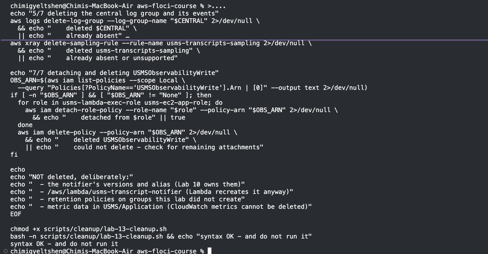

---

## Troubleshooting

| Symptom | Likely cause and fix |
|---|---|
| `put-log-events` rejects events as too old | Timestamps were in seconds. Multiply by 1000 (Step 7). |
| Metric filter exists but `NotifyCount` has no data | The notifier did not log `USMS_NOTIFY`, or the filter is on the wrong log group. Check Steps 9 and 10. |
| Only the dimensioned metric appears | Publish the no-dimension total as well (Step 11, Part 1). |
| `AccessDenied` on `PutMetricData` from the Lambda | The namespace condition doesn't match `USMS/Application`, or the policy isn't attached (Step 12). |
| `get-function-configuration --qualifier live` shows old code | The alias wasn't moved. Run `update-alias` again with the new version (Steps 13 and 14). |
| `put-trace-segments` returns unprocessed segments | The trace ID or segment ID format is wrong, or `end_time` is not after `start_time`. Regenerate in one shell. |
| Annotation search returns 0 for `science` | Annotations must be flat key/value pairs, not nested. Also check that the time window covers when the segment was sent. |
| Alarms stay `INSUFFICIENT_DATA` | Expected on Floci, which does not evaluate alarms. Use `set-alarm-state` (Step 20). |
| `put-composite-alarm` fails with `UnsupportedOperation` | Expected on Floci. Keep the error as evidence (Step 21). |
| `start-query` fails | Logs Insights is not supported. Use Path B in Step 23. |
| `diff` in Step 24 shows differences | Something did not persist. Check that Floci is not in memory mode. |
| `lab-13.env` has empty notifier versions | Step 25 ran in a different shell from Steps 13–14. Set `NOTIFIER_V2` and `NOTIFIER_V3` again, then rerun. |